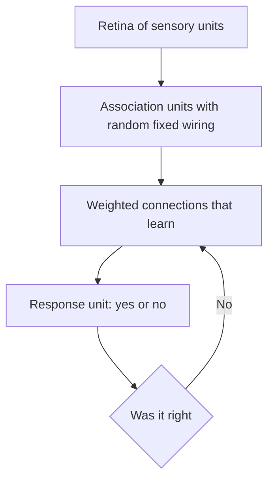

## The hook

In July 1958, the New York Times ran a story about a machine funded by the US Navy. The Navy, it reported, expected the device to eventually "walk, talk, see, write, reproduce itself and be conscious of its existence."

The machine in question could, at that point, learn to tell whether a square was printed on the left or the right of a card.

The gap between those two sentences is the story of the perceptron: a genuinely brilliant idea, wrapped in hype so loud that when its limits were exposed, the whole field of neural networks went quiet for over a decade. And yet every neural network you use today is its direct descendant.

## Before you start

You should know how a weighted sum and a threshold make a decision, from [Yes or No? How Machines Make Decisions](article:primer-classification), and what a single artificial neuron is, from [Neural Networks from One Neuron Up](article:primer-neural-networks). The perceptron is that neuron, with the very first learning rule attached.

## The world before this paper

:::history
In 1943, Warren McCulloch and Walter Pitts described an idealised neuron as a logic unit: it fires if enough of its inputs fire. Their neurons could compute logic, but their connections were fixed by the designer. Nothing learned. In 1949, the psychologist Donald Hebb suggested that connections between real neurons strengthen when they are active together. The question hanging in the air was whether a machine could adjust its own connections from experience.
:::

Frank Rosenblatt was a psychologist at the Cornell Aeronautical Laboratory in Buffalo, New York. He was interested in a deep question: how does a brain store information and recognise patterns it has never seen in exactly that form before? He wanted a model that was concrete enough to build.

## The big idea

Rosenblatt's answer was the [[perceptron]]: a network of simple units whose connection strengths change in response to its own mistakes.

:::analogy
Think of the perceptron as a new referee learning to make offside calls. At first the referee guesses. Every time a replay shows a wrong call, the referee adjusts what they pay attention to: a little more weight on the defender's position, a little less on the crowd's noise. Correct calls change nothing. After enough corrected mistakes, the calls are reliably right, without anyone ever writing down a rulebook.
:::

The key insight was that learning could be **driven by errors**. You do not need to tell the machine the rule. You only need to tell it when it is wrong.

:::insight
The perceptron was the first machine that learned a classification rule from labeled examples by correcting its own mistakes. That idea, learning by error correction, is still the heart of training every neural network.
:::

## How it works

### The architecture in the paper

Rosenblatt described his model in biological terms. Light falls on a "retina" of sensory units. These connect, through fixed and partly random wiring, to a layer of association units. The association units connect to response units, and **those** connections are the ones that learn.

In the physical machine later built from this design, the Mark I Perceptron, the retina was a grid of 400 light sensors, and the adjustable weights were potentiometers turned by small electric motors. Learning was literally a machine turning its own dials.

### The decision

Strip away the biology and the decision rule is simple. Each input $x_i$ has a [[weight]] $w_i$. The perceptron adds up the weighted inputs plus a bias $b$ and passes the total through a [[step function]]:

$$\text{output} = \begin{cases} 1 & \text{if } w_1x_1 + w_2x_2 + \dots + b > 0 \\ 0 & \text{otherwise} \end{cases}$$

That is logistic regression with a hard yes-or-no step instead of a smooth S-curve.

### The learning rule

The [[perceptron learning rule]], in its modern textbook form, is short enough to fit on a sticky note:

$$w_i \leftarrow w_i + \eta\,(y - \hat{y})\,x_i$$

- $y$ is the correct label (0 or 1) and $\hat{y}$ is the perceptron's guess.
- If the guess is right, $y - \hat{y} = 0$, and nothing changes.
- If it said 0 but should have said 1, each weight grows by $\eta x_i$: inputs that were active get more say next time.
- If it said 1 but should have said 0, active inputs lose some say.
- $\eta$ is a small step size, the learning rate.

### A worked mistake

Suppose a perceptron is learning to detect "both switches on" (the AND pattern). Its weights are $w_1 = 1, w_2 = 1$ and bias $b = -0.5$, with $\eta = 1$.

It sees the input $(1, 0)$, whose correct answer is 0. The sum is $1 \times 1 + 1 \times 0 - 0.5 = 0.5$, which is above zero, so it wrongly says 1.

The update: $y - \hat{y} = 0 - 1 = -1$. So $w_1$ becomes $1 - 1 \times 1 = 0$, $w_2$ stays $1 - 1 \times 0 = 1$ (that input was off, so it gets no blame), and the bias becomes $-0.5 - 1 = -1.5$.

Only the parts that contributed to the mistake were changed. A few more passes through the four examples and it settles on weights that get every case right.

:::try-this
Take the corrected perceptron ($w_1 = 0$, $w_2 = 1$, $b = -1.5$) and test it on the input $(1, 1)$, which should be 1. What does it output, and what would the update be? (The sum is $0 + 1 - 1.5 = -0.5$, so it says 0: another mistake. Both weights grow by 1 and the bias rises by 1, giving $w_1 = 1$, $w_2 = 2$, $b = -0.5$.)
:::

## What they found

The 1958 paper was mainly theoretical. Rosenblatt analysed, with probability theory, how well such a system could learn to respond correctly to classes of stimuli, and argued that it could generalise to patterns it had not been trained on exactly. Experiments on an IBM 704 computer, and later the Mark I hardware, showed perceptrons learning to tell simple shapes and positions apart.

A powerful theoretical result followed in the early 1960s: the **perceptron convergence theorem**. If the two classes are [[linearly separable]], meaning a straight line can separate them perfectly, the learning rule is guaranteed to find such a line in a finite number of mistakes. A simple rule, with a proof that it works. That was thrilling.

The intuition behind the proof is pleasingly geometric. If a perfect separating line exists, think of its weights as a target direction. Every correction nudges the perceptron's weights a little closer to pointing that way, and the proof shows the weights cannot keep growing without lining up with the target. So the number of mistakes is capped, and after that, the perceptron is right on every training example.

:::warning
Common misconception: "Rosenblatt claimed his machine was conscious." The extravagant claims in the 1958 press coverage were not in his scientific paper. But the hype attached itself to the perceptron anyway, and the field paid for it later.
:::

## What it got wrong (or left open)

The fatal limit was the straight line. A single-layer perceptron can only separate classes with one straight boundary. Some very simple patterns, like XOR (exactly one of two switches on), cannot be split by any single line.

In 1969, Marvin Minsky and Seymour Papert published a book called *Perceptrons* that analysed these limits with mathematical rigour. They showed that single-layer perceptrons could not compute several basic properties. Multi-layer networks could, in principle, but nobody knew how to train their hidden layers.

The book was widely read as a verdict on neural networks in general. Combined with broader disappointment in AI's grand promises, funding dried up. This stretch is often called the first [[AI winter]]. Rosenblatt died in a boating accident in 1971, before his ideas were vindicated.

## What happened next

- The missing piece, a way to train hidden layers, arrived in 1986 with [backpropagation](article:paper-backpropagation), which showed that multi-layer networks could learn features the single perceptron never could.
- The idea of finding a separating boundary lived on in [Support-Vector Networks](article:paper-support-vector-networks), which chose the boundary with the widest safety margin.
- Convolutional networks like [LeNet](article:paper-lenet) arranged many perceptron-like units to read handwriting.
- Every neuron in today's networks, including the giant ones in [GPT-3](article:paper-gpt-3), is still a weighted sum followed by an activation: Rosenblatt's unit with a smoother bend.

## Key takeaways

- The perceptron adds up weighted inputs and fires if the total passes a threshold, the same structure as a modern artificial neuron.
- It learns by correcting mistakes: after a wrong answer, it shifts the weights of the inputs that were active toward the right answer.
- If a straight line can separate the two classes, the perceptron learning rule is guaranteed to find one in a finite number of steps.
- A single perceptron cannot learn patterns like XOR, and the overreaction to that limit helped cause the first AI winter.
- Training multiple layers, which Rosenblatt could not do, became possible with backpropagation in 1986.
