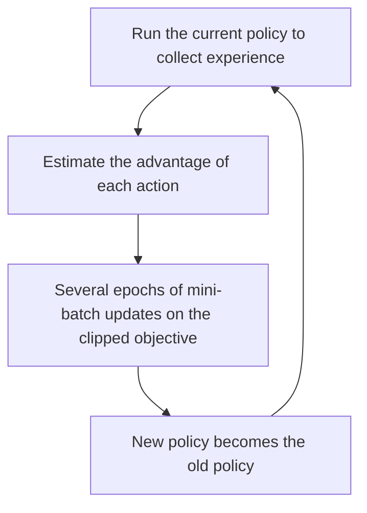

## The hook

Picture a cricket coach working with a promising young bowler. The bowler takes a wicket with a slower ball, and the coach, thrilled, says: "From now on, bowl only slower balls!" Next match, the batters read it immediately and the bowler is hammered. A good coach would have said, "That worked. Use it a little more often." Small, steady adjustments.

Reinforcement learning algorithms had exactly this problem: one overly enthusiastic update could wreck a strategy that took days to learn. In 2017, John Schulman and colleagues at OpenAI published an algorithm whose whole philosophy is "improve, but not too much at once." Proximal Policy Optimization went on to train bots that beat world champions at Dota 2, a robot hand that solved a Rubik's Cube, and, a few years later, the fine-tuning stage that turned GPT into ChatGPT.

## Before you start

You need the basic reinforcement learning ideas of agents, actions and rewards from [One Program, Forty-Nine Atari Games](article:paper-dqn). This article is a little more mathematical, but each formula is explained in words and with numbers.

## The world before this paper

DQN learns the value of each action and picks the best. Another family, [[policy gradient]] methods, learns the [[policy]] directly: a network that outputs the probability of each action. Policy gradients handle continuous actions, like how hard to push a robot joint, and naturally produce random, exploring behaviour.

The core rule is intuitive. After trying actions and seeing results, compute each action's [[advantage]]: how much better it turned out than expected. Then increase the probability of actions with positive advantage and decrease the probability of actions with negative advantage.

The trouble was **step size**. The data was collected by the current policy. Take one big gradient step, and the new policy might behave so differently that the data no longer describes it, and performance can collapse. Take tiny steps, and learning is painfully slow, wasting the expensive experience you collected.

:::history
In 2015, Schulman and colleagues at Berkeley introduced TRPO, Trust Region Policy Optimization. It solved the step-size problem rigorously by constraining each update to stay within a [[trust region]], measured by how much the action probabilities change. TRPO worked well, but it relied on complicated second-order maths that was hard to implement, slow, and awkward to combine with common network designs. Schulman, by then at OpenAI, wanted TRPO's reliability with the simplicity of ordinary gradient descent.
:::

## The big idea

Keep updates "proximal," close to the old policy, not with a hard mathematical constraint, but by changing the objective so that it simply stops rewarding large changes.

:::analogy
Think of the coach again, with a rule written on the dressing-room wall: "Never change any bowler's plan by more than 20% after one match." If a delivery worked, use it up to 20% more. If it failed, use it up to 20% less. Beyond that, extra enthusiasm earns nothing. The team still improves every match, but no single game can trigger a disastrous overreaction.
:::

:::insight
Stable learning comes from limiting how far each update can move, not from being timid. PPO lets the agent learn as much as it can from each batch of experience, right up to a safe boundary, and no further.
:::

## How it works

### The probability ratio

For an action $a$ taken in situation $s$, compare how likely the new policy is to take it versus the old policy that collected the data:

$$r(\theta) = \frac{\pi_\theta(a \mid s)}{\pi_{\text{old}}(a \mid s)}$$

A [[probability ratio]] of 1 means no change. A ratio of 1.3 means the action became 30% more likely.

### The clipped objective

The unclipped objective is $r(\theta) \times A$, the ratio times the advantage. Maximizing it pushes good actions up and bad ones down, with no limit. PPO's key line is:

$$L^{\text{CLIP}} = \mathbb{E}\Big[\min\big(r(\theta)\, A,\; \text{clip}(r(\theta), 1 - \epsilon, 1 + \epsilon)\, A\big)\Big]$$

In plain words:

- [[Clipping]] forces the ratio into the range from $1 - \epsilon$ to $1 + \epsilon$. With the paper's typical $\epsilon = 0.2$, that is 0.8 to 1.2.
- The objective takes the **smaller** of the clipped and unclipped versions. That makes it pessimistic: it never gives credit for moving the ratio beyond the safe range.
- Once an action's probability has moved more than 20% in the helpful direction, the gradient for it becomes zero. There is nothing more to gain by pushing further.

### A worked example

Suppose an action had advantage $A = +2$ (better than expected), and after a few updates its ratio is $1.5$.

- Unclipped: $1.5 \times 2 = 3.0$.
- Clipped: the ratio becomes $1.2$, so $1.2 \times 2 = 2.4$.
- PPO takes the minimum: $2.4$. Since the clipped value no longer depends on the ratio, there is no gradient pushing it higher. The update for this action stops.

Now an action with advantage $A = -1$ (worse than expected) whose ratio has dropped to $0.5$:

- Unclipped: $0.5 \times -1 = -0.5$.
- Clipped: the ratio becomes $0.8$, so $0.8 \times -1 = -0.8$.
- The minimum is $-0.8$, again a flat, clipped value. Having already made the bad action 20% less likely, PPO stops pushing it down further in this round.

:::try-this
An action has advantage $A = +2$ and its ratio is $1.1$. Compute both the unclipped and clipped terms, and say whether PPO will keep increasing this action's probability. (Unclipped: 2.2. Clipped: 1.1 is inside 0.8 to 1.2, so also 2.2. They match, the minimum depends on the ratio, and the gradient is active: PPO keeps nudging this action up until the ratio reaches 1.2.)
:::

### The training loop

Because clipping makes it safe, PPO reuses each batch of experience for several epochs of mini-batch gradient steps, extracting much more learning from each interaction than simple policy gradients. In practice, the policy usually shares a network with a value function that estimates expected reward, used to compute advantages.

The paper also tested an alternative that penalises the change in policy directly, with an adaptive penalty strength. The clipped version performed better and became the standard.

## What they found

- On simulated robot control tasks in the MuJoCo physics simulator, such as making simulated creatures walk and hop, PPO with clipping outperformed the other policy gradient methods tested, including TRPO, on most tasks.
- On 49 Atari games, PPO learned faster than A2C, a popular simpler method, and performed similarly to ACER, a much more complex algorithm.
- It was simple: a few lines changed from a standard policy gradient implementation, with ordinary first-order optimization.

:::warning
Common misconception: "PPO guarantees the policy always improves." The clipping is a heuristic that keeps updates cautious, not a mathematical guarantee. PPO can still fail or be unstable, and later research showed that its performance depends surprisingly heavily on implementation details beyond the core clipping idea.
:::

## What it got wrong (or left open)

PPO is **on-policy**: it learns from data collected by the current policy and then throws that data away. That makes it less sample-efficient than methods that reuse old experience for longer, like DQN's replay memory, which matters when experience is expensive, as with real robots.

Its performance also turned out to be sensitive to many small choices: how advantages are normalised, learning rate schedules, network initialisation and more. A 2020 study found that some of these "code-level" details mattered as much as the clipping itself.

## What happened next

- OpenAI Five used a large-scale version of PPO to train agents that defeated the reigning world champion team at Dota 2 in 2019.
- OpenAI's robot hand, Dactyl, learned dexterous manipulation in simulation with PPO and later solved a Rubik's Cube with a physical hand.
- PPO became the default algorithm for reinforcement learning from human feedback. In [InstructGPT](article:paper-instructgpt), a reward model trained on human preferences provided the reward, and PPO fine-tuned the language model, the recipe behind ChatGPT.
- Later work on aligning language models, such as [Direct Preference Optimization](article:paper-dpo), found ways to skip the reinforcement learning loop entirely, partly because PPO is complex to run at scale.

## Key takeaways

- Policy gradient methods learn a strategy directly by making actions with positive advantage more likely and those with negative advantage less likely.
- Large policy updates can collapse performance, because the collected data stops describing the changed policy.
- PPO clips the probability ratio between new and old policies, so the objective stops rewarding changes beyond a small range, typically 20%.
- This simple first-order trick matched or beat the more complex TRPO and let each batch of experience be reused for several updates.
- PPO trained championship-level game bots and robot hands, and became the reinforcement learning step behind ChatGPT's fine-tuning.
