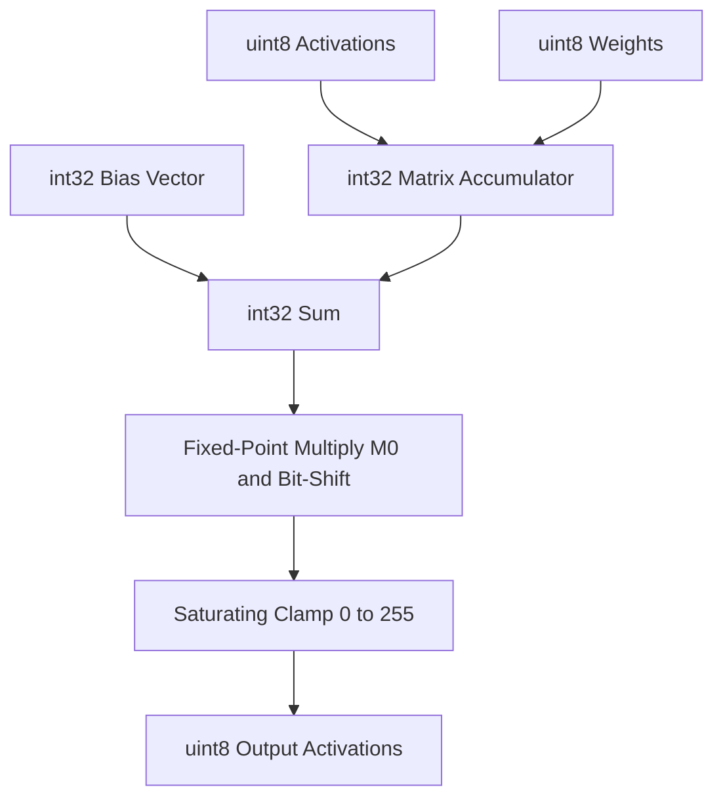
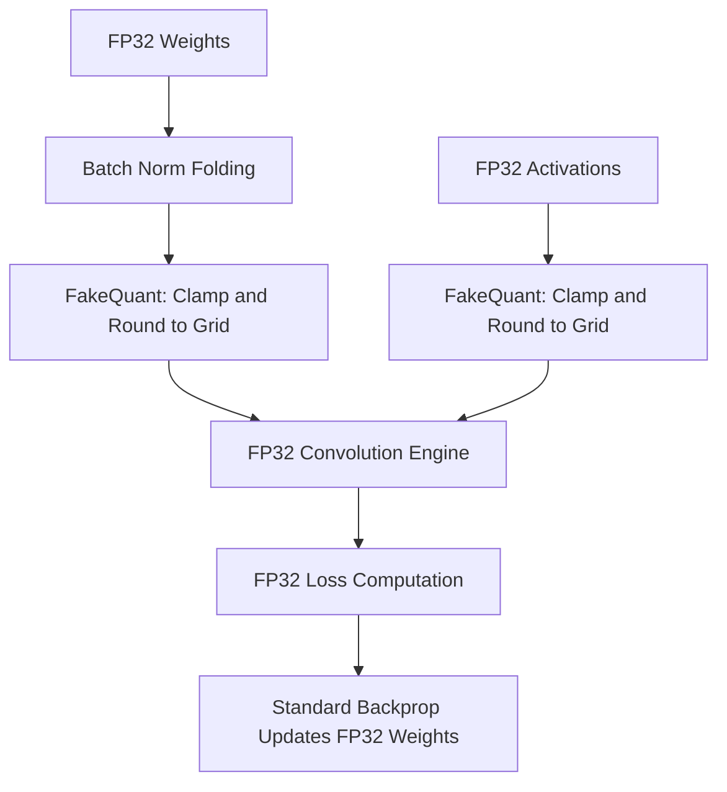

## The hook

Your smartphone camera needs to detect faces at thirty frames per second without melting through the battery or scorching your palm. In 2017, that was an impossible task. State-of-the-art vision models performed billions of 32-bit floating-point multiplications for every single video frame, draining batteries and choking mobile processors. What if you could banish floating-point numbers completely and run modern vision networks using nothing but humble 8-bit integers?

```
32-bit Float:  [ s | e e e e e e e e | m m m m m m m m m m m m m m m m m m m m m m m ] (4 bytes)
8-bit Integer: [ b b b b b b b b ]                                                    (1 byte)
```

## Before you start

To get the most out of this paper, you should be familiar with the fundamentals of [neural networks](article:primer-neural-networks) and how weights update via [backpropagation](article:paper-backpropagation). It will also help to know how [batch normalization](article:paper-batch-normalization) normalizes layer inputs during training.

## The world before this paper

Following the breakthrough of [AlexNet](article:paper-alexnet), deep learning entered an era of brute-force expansion. Models like VGG and early Inceptions packed tens of millions of parameters into deep stacks of convolutions. Because researchers evaluated these networks solely on benchmark accuracy, efficiency took a back seat.

When engineers tried running these models on phones, they ran straight into a wall of thermal throttling and lag. Early attempts to compress networks took extreme paths:

1. **Storage-only compression:** Quantizing weights to 8 bits for storage on disk, but decompressing them back to 32-bit floats during runtime. This shrunk download sizes but provided zero compute speedup.
2. **Binary and ternary networks:** Crushing weights down to 1 or 2 bits (values like $\{-1, 0, 1\}$). While mathematically elegant, real-world mobile chips have pipelined multiply-accumulate hardware. Reversing into custom bit-shift operations yielded almost no practical speedup on mobile CPUs, and it devastated accuracy on compact networks.
3. **Over-parameterized benchmarks:** Researchers tested their compression techniques on massive models like [AlexNet](article:paper-alexnet). AlexNet was so bloated with redundant parameters that you could prune or round half of it away without noticing. But when researchers tried those same tricks on sleek, efficient architectures like MobileNet, the models broke down.

The field needed a practical approach: genuine hardware-level speedups on compact models without sacrificing accuracy.

:::history
In 2017, Google was preparing to launch the Pixel 2 smartphone. Mobile features like portrait mode and on-device vision required real-time execution on low-power ARM cores and digital signal processors (DSPs). A team led by Benoit Jacob set out to build an end-to-end framework that would power the brand-new TensorFlow Lite engine.
:::

## The big idea

Instead of treating quantization as an afterthought applied after training, why not train the model to anticipate 8-bit math from the beginning?

The authors devised an affine quantization scheme that maps continuous real numbers to 8-bit unsigned integers. Every single operation during inference—matrix multiplication, bias addition, scaling, and activation clamping—executes using pure integer math. Floating-point units never wake up.

To keep accuracy intact, they introduced **Quantization-Aware Training (QAT)**. During training, the network computes in standard 32-bit floats, but simulated rounding and clamping nodes mimic the exact errors of 8-bit hardware in the forward pass.

:::analogy
Imagine painting a portrait with a continuous spectrum of millions of colors, only to discover at the gallery that you must reproduce it using a cheap paint-by-numbers kit with only 256 paint pots. If you paint freely and round each brushstroke at the end, subtle skin tones turn into garish stripes. 

Now imagine painting the original while looking through a special stencil that shows you exactly how each stroke maps onto those 256 pots. As an artist, you adjust your shading in real time so the final 256-color painting looks almost indistinguishable from the master original.
:::

## How it works

### 1. The Affine Quantization Mapping

To map an arbitrary real-valued continuous number $r$ (like a weight or activation) to an integer $q$, we use an affine transform defined by two constants:

$$r = S(q - Z)$$

- $r$ is the real-world floating-point value.
- $q$ is the quantized integer (an 8-bit unsigned integer, `uint8`, ranging from 0 to 255).
- $S$ is the **[[Scale (S)]]**, an arbitrary positive real number denoting the step size between adjacent integers.
- $Z$ is the **[[Zero-point (Z)]]**, an integer of the same type as $q$.

Why do we need $Z$? In real networks, operations like zero-padding surround images with zeroes. If real $0.0$ does not map to an exact integer, every zero-padded boundary pixel introduces systematic noise. The [[Zero-point (Z)]] guarantees that $r = 0.0$ maps exactly to $q = Z$.

```
Real space (r):       -1.5      0.0       1.5       3.0
                       |---------|---------|---------|
Quantized space (q):   0        32        64        96  ... (Z = 32, S = 0.046875)
```

### 2. Matrix Multiplication in Pure Integer Math

In modern vision networks, the bulk of computation lives inside general matrix multiplications ([[GEMM]]) or convolutions. Suppose we multiply matrix $r_1$ (weights) by matrix $r_2$ (activations) to produce matrix $r_3$.

Substituting the affine equation for each matrix:

$$S_3(q_3^{(i,k)} - Z_3) = \sum_{j=1}^N S_1(q_1^{(i,j)} - Z_1) S_2(q_2^{(j,k)} - Z_2)$$

Rearranging for the output integer $q_3$:

$$q_3^{(i,k)} = Z_3 + M \sum_{j=1}^N (q_1^{(i,j)} - Z_1)(q_2^{(j,k)} - Z_2)$$

Notice the multiplier $M$:

$$M = \frac{S_1 S_2}{S_3}$$

$M$ is a real number. If computing $M$ required floating-point hardware at runtime, the entire point of integer inference would be lost. But look closely: $S_1$, $S_2$, and $S_3$ are constants determined before inference runs! 

The authors made an empirical discovery: in trained networks, $M$ always falls in the interval $(0, 1)$. This lets us factor $M$ into a normalized fixed-point format:

$$M = 2^{-n} M_0$$

Here, $M_0$ is an integer scaled into the range $[0.5, 1.0)$, and $n$ is a non-negative integer. On an ARM processor, multiplying by $M_0$ is a standard 32-bit fixed-point integer multiplication, and multiplying by $2^{-n}$ is a high-speed hardware bit-shift!

:::insight
A floating-point scale factor can be replaced entirely by an integer multiplication followed by a bit-shift. No floating-point hardware required.
:::

### 3. Taming the Zero-Point Overhead

Expanding the product $(q_1 - Z_1)(q_2 - Z_2)$ directly requires $2N^3$ subtractions:

$$(q_1 - Z_1)(q_2 - Z_2) = q_1 q_2 - Z_1 q_2 - Z_2 q_1 + Z_1 Z_2$$

If done naively, this would force 8-bit values into signed 16-bit integers, doubling register pressure. Instead, the authors factored the algebra:

$$q_3^{(i,k)} = Z_3 + M \left( N Z_1 Z_2 - Z_1 \sum_{j=1}^N q_2^{(j,k)} - Z_2 \sum_{j=1}^N q_1^{(i,j)} + \sum_{j=1}^N q_1^{(i,j)} q_2^{(j,k)} \right)$$

Notice what happened:
- The core loop is $\sum q_1^{(i,j)} q_2^{(j,k)}$: an unsigned 8-bit multiply accumulating into a signed 32-bit register (`int32 += uint8 * uint8`). This takes $O(N^3)$ operations, running at peak SIMD efficiency.
- The row sums $\sum q_1$ and column sums $\sum q_2$ depend on only one dimension! They take only $O(N^2)$ additions.

All zero-point bookkeeping drops into negligible overhead, leaving raw, unencumbered integer dot products.

### 4. Fused Bias and Clamping Pipeline

How do biases and activation functions fit in?



- **Biases:** Stored as 32-bit integers (`int32`). Why not 8-bit? A single bias value is added to every pixel across an entire output channel. Any quantization error in the bias shifts all outputs in that channel systematically, wrecking accuracy. Quantizing bias to `int32` with scale $S_{\text{bias}} = S_1 S_2$ and zero-point $Z_{\text{bias}} = 0$ allows zero-cost addition directly into the accumulator.
- **Activation Functions:** Common functions like ReLU and ReLU6 are simple clamping operations. The pipeline folds the activation directly into the final step: when downcasting from the accumulator to `uint8`, it clamps values between $0$ and $255$.

:::warning
You cannot cleanly fuse transcendental activation functions like Sigmoid or Tanh into this integer pipeline. They require separate polynomial approximations or lookup tables, which can slow down SIMD pipelines.
:::

### 5. Training with Simulated Quantization

Rounding numbers during inference introduces quantization noise. If you train a model in 32-bit floats and round weights to 8-bit integers after the fact, small errors compound across dozens of layers.

To prevent this drop, the authors introduced **[[Fake Quantization]]** nodes during training:



During the forward pass, floating-point weights and activations are clamped and rounded to simulate integer bins:

$$q(r; a, b, n) = \left\lfloor \frac{\text{clamp}(r; a, b) - a}{s(a, b, n)} \right\rceil \cdot s(a, b, n) + a$$

Where $[a, b]$ is the clamping range, $n=256$ is the number of levels, and $\lfloor \cdot \rceil$ rounds to the nearest integer.

During backpropagation, derivatives pass straight through the rounding operator using the straight-through estimator ($d q / d r = 1$ within $[a, b]$). The continuous weights absorb tiny gradient updates, letting parameters adjust around grid boundaries until the model settles into integer-friendly configurations.

### 6. Batch Normalization Folding

Modern vision models rely on [batch normalization](article:paper-batch-normalization) during training. At inference time, batch normalization is folded into the preceding convolution's weights:

$$w_{\text{fold}} = \frac{\gamma w}{\sqrt{\text{EMA}(\sigma_B^2) + \epsilon}}$$

If you quantize the weights first and fold batch norm parameters afterward, the folded weights will fall off the integer grid. The authors solved this by performing **[[Batch Normalization Folding]]** *before* the fake quantization node in the training graph.

:::try-this
Suppose an activation layer's output falls in the real range $[0.0, 6.0]$, and you quantize it into 8-bit integers (256 levels, from 0 to 255).
1. What is the scale $S$? ($S = (6.0 - 0.0) / 255 \approx 0.02353$).
2. What is the zero-point $Z$? (Because $0.0$ maps to $0$, $Z = 0$).
3. If an activation produces $r = 1.50$, what is the integer $q$? ($q = \text{round}(1.50 / 0.02353) = 64$).
:::

## What they found

The authors evaluated their integer-only scheme across multiple computer vision architectures and mobile hardware targets, focusing heavily on ARM big and LITTLE cores (found in Qualcomm Snapdragon processors).

### Preserving Accuracy on Hard Benchmarks

On ImageNet classification with ResNet architectures, 8-bit integer models matched their 32-bit floating-point twins within 1.5 to 2.0 percentage points of top-1 accuracy:

| Architecture | FP32 Accuracy | 8-bit Integer Accuracy | Accuracy Gap |
| :--- | :--- | :--- | :--- |
| **ResNet-50** | 76.4% | 74.9% | -1.5% |
| **ResNet-100** | 78.0% | 76.6% | -1.4% |

Crucially, this integer quantization outperformed prior 2-bit weight schemes like Fine-Grained Quantization (FGQ, 70.8%) while delivering faster real-world speedups than 5-bit methods like Incremental Network Quantization (INQ).

### Unlocking Real-Time Edge Vision

The real victory was on compact architectures like MobileNet, where previous quantization methods collapsed:

- **Snapdragon 835 LITTLE Cores:** Under a strict real-time 33 ms latency budget (30 fps), integer-quantized MobileNets achieved an accuracy roughly **10% higher** than floating-point baselines. Because 8-bit math ran twice as fast, engineers could deploy a larger, more accurate model within the same millisecond budget.
- **COCO Object Detection:** For MobileNet SSD running on Snapdragon 835 LITTLE cores, 8-bit quantization cut latency nearly in half—dropping from **270 ms down to 146 ms** (and from **121 ms down to 61 ms** on big cores)—with only a negligible 1.8% relative drop in mean Average Precision (mAP).
- **Face Detection:** On a Snapdragon 835 big core, an 8-bit MobileNet face detector ran at **36 frames per second** (28 ms per frame), crossing the threshold into smooth real-time video processing. The 32-bit float model was stuck at **23 frames per second** (44 ms per frame).

```
MobileNet SSD COCO Latency (Snapdragon 835 LITTLE Cores):
Float (FP32):   [=============================] 270 ms
Quantized (8b): [===============] 146 ms  (~46% faster!)
```

## What it got wrong (or left open)

While the paper laid the foundation for modern edge inference, it left several key challenges unsolved:

1. **Post-Training Fragility:** The authors found that purely quantizing weights post-training without QAT fine-tuning severely degraded compact networks. Wide channel-to-channel variations and outlier weights distorted the single per-layer scale factor $S$. Later work resolved this by adopting *per-channel quantization* (giving each convolutional filter its own scale factor).
2. **Hardware Dependency:** Latency gains depended heavily on the CPU microarchitecture. On chips with specialized, highly optimized floating-point units (like the Qualcomm Snapdragon 821), integer quantization showed smaller speedups compared to chips where integer arithmetic was significantly cheaper.
3. **Complex Activation Functions:** The affine scheme required activations to be simple clamps. Non-linear functions like Sigmoid, Tanh, or modern GELU activations require auxiliary lookup tables or fixed-point polynomial approximations, breaking the simplicity of the fused GEMM pipeline.

## What happened next

This paper changed how the software industry serves machine learning on edge devices.

The quantization scheme described here became the underlying engine of **TensorFlow Lite** and Google's open-source `gemmlowp` (low-precision GEMM) library. It proved that 8-bit integers were not just an approximation tool for memory savings, but a viable format for end-to-end execution.

Following this work, Quantization-Aware Training (QAT) became a standard feature across PyTorch, ONNX Runtime, and TensorRT. Chipmakers responded in kind: modern mobile System-on-Chips (SoCs), Apple Silicon Neural Engines, and server-grade AI accelerators (including Google TPUs and NVIDIA Tensor Cores) now ship with dedicated hardware units optimized around the 8-bit integer formats popularized by this paper.

## Key takeaways

- Real-world mobile inference requires eliminating floating-point math entirely, not just compressing weights for storage.
- An affine mapping ($r = S(q - Z)$) maps continuous real values to 8-bit unsigned integers while ensuring zero maps to an exact integer for zero-overhead padding.
- Floating-point scale factors can be factored into a fixed-point integer multiplier and a power-of-two bit-shift, keeping all runtime operations strictly inside integer registers.
- Biases must be kept at 32-bit integer precision because any quantization error in a bias creates a systematic nonzero-mean offset across all spatial outputs.
- Quantization-Aware Training (QAT) simulates rounding errors in the forward pass, allowing standard backpropagation to steer network weights into robust, integer-friendly minimums.
