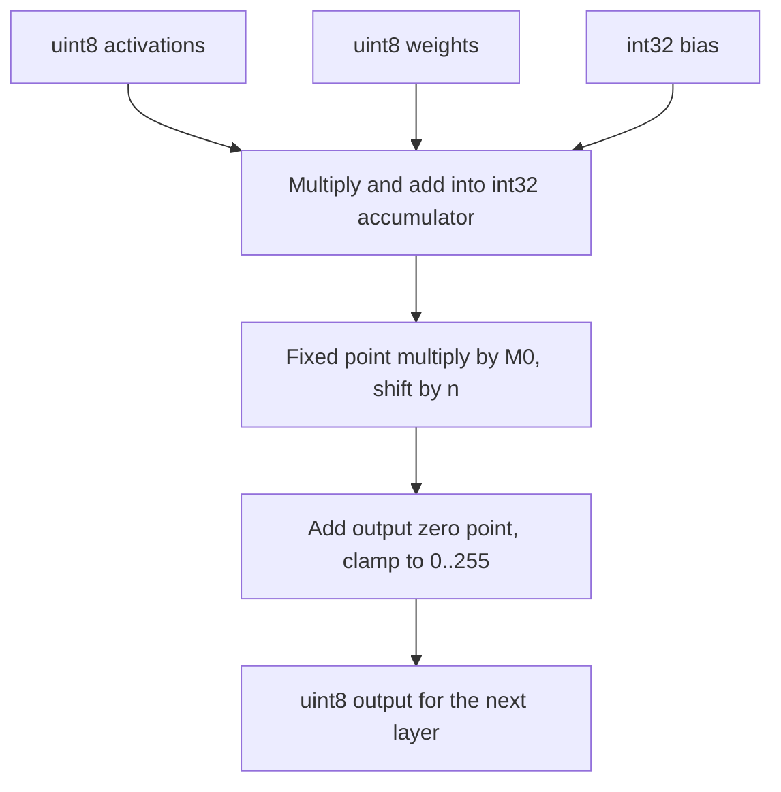

## The hook

Your phone can find faces in the camera preview while you frame a photo, many times a second, without getting hot. Underneath, a neural network is doing millions of multiplications per frame. On many phone chips, doing those with 32-bit floating-point numbers is too slow and too power-hungry.

A team at Google asked a blunt question: what if the network never used a floating-point number at all while running, only small whole numbers between 0 and 255?

## Before you start

You should know what weights and activations are from [the neural networks primer](article:primer-neural-networks), and how training adjusts weights with gradients from [backpropagation](article:paper-backpropagation). We also mention [batch normalization](article:paper-batch-normalization), a layer that rescales activations during training.

## The world before this paper

By 2017, people knew that networks tolerate small errors in their numbers, so there was plenty of work on shrinking them. But two problems kept appearing.

- **Smaller files, not faster maths.** Many methods compressed weights for storage but converted them back to floats before computing. Downloads got smaller; inference did not get faster.
- **Exotic formats, fragile baselines.** Binary and ternary networks used 1 or 2 bits per weight, but common phone hardware could not run them efficiently, and accuracy often dropped. Many results were shown on large, redundant networks like [AlexNet](article:paper-alexnet), which tolerate almost anything, rather than on models already designed to be lean.

The real test was MobileNets: networks built for phones, with little redundancy left to squeeze.

:::history
Benoit Jacob, Skirmantas Kligys, Bo Chen, Menglong Zhu, Matthew Tang, Andrew Howard, Hartwig Adam and Dmitry Kalenichenko at Google posted the paper in December 2017, and it appeared at CVPR 2018. It describes the scheme implemented in Google's gemmlowp library for low-precision matrix multiplication, which TensorFlow's mobile tools then built on.
:::

## The big idea

:::analogy
Imagine a carpenter whose tape measure has only 256 marks. The gap between marks is fixed, and one particular mark lines up with the true zero. She writes every length as a mark number, adds and multiplies mark numbers in her head, and converts back to centimetres only when she needs to. And as an apprentice, she practised with that same coarse tape, so her cuts already allow for its roughness.
:::

The paper has two parts that match the carpenter's two habits.

1. **An integer-only arithmetic scheme.** Every weight and activation is stored as an 8-bit integer. Every multiplication, addition, bias and activation at inference time uses integer operations only.
2. **Training that practises with the coarse tape.** During training, the forward pass rounds values onto the same 8-bit grid, so the network learns weights that survive rounding.

## How it works

### The mapping: real number to mark number

Each tensor gets two constants:

$$r = S(q - Z)$$

Here $r$ is the real value, $q$ is the 8-bit integer (0 to 255), $S$ is the [[scale]], the size of one step, and $Z$ is the [[zero-point]], the integer that stands for 0.0. In the analogy, $S$ is the gap between marks and $Z$ is the mark that lines up with true zero.

Why insist that zero is exact? Convolutions pad images with zeros, and ReLU outputs many zeros. If 0.0 fell between two marks, every padded value would carry the same small error, and those errors would add up rather than cancel.

### A worked example: one quantized dot product

Suppose activations range from -1.0 to 2.0. Then $S = 3.0 / 255 \approx 0.01176$ and $Z = 85$. The real value 0.75 becomes $q = 0.75 / 0.01176 + 85 = 63.75 + 85$, rounded to 149. Converting back gives $0.01176 × (149 − 85) \approx 0.7529$, an error of about 0.003.

Now a three-number dot product. Activations $x = [0.75, -0.40, 1.45]$ use the scale above. Weights $w = [0.32, -0.20, 0.12]$ range from -0.4 to 0.6, so their scale is $1.0 / 255 \approx 0.00392$ and their zero-point is 102.

| | item 1 | item 2 | item 3 |
|---|---|---|---|
| $q_x - Z_x$ | 64 | -34 | 123 |
| $q_w - Z_w$ | 82 | -51 | 31 |
| product | 5,248 | 1,734 | 3,813 |

The integer sum is 10,795. That sum lives in a 32-bit [[accumulator]], because thousands of such products would overflow 8 bits.

The true float answer is 0.494. The integer sum times both scales gives $0.01176 × 0.00392 × 10{,}795 \approx 0.498$. The carpenter worked only in mark numbers and still landed within about 1 percent.

### Getting back to 8 bits with no floats

The output also needs to be an 8-bit integer, with its own scale $S_3$ and zero-point $Z_3$. The rule is:

$$q_3 = Z_3 + M × \text{(integer sum)}, \quad M = \frac{S_1 S_2}{S_3}$$

$S_1$ and $S_2$ are the input scales. $M$ is a real number, which seems to bring floats back. The trick: all scales are known before inference, and the authors found $M$ is always between 0 and 1 in practice. So it can be written as $M = M_0 × 2^{-n}$, with $M_0$ between 0.5 and 1 stored as a 32-bit fixed-point integer. Multiplying by $M_0$ is an integer multiply; multiplying by $2^{-n}$ is a right shift.

In our example, an output range of -1.0 to 1.5 gives $S_3 \approx 0.00980$ and $Z_3 = 102$. Then $M \approx 0.004706 = 0.6024 × 2^{-7}$. The sum times $M$ is 50.8, which rounds to 51, so $q_3 = 102 + 51 = 153$, meaning 0.500 in real terms.

Three more details make this fast and accurate:

- **Zero-points cost almost nothing.** Expanding $(q_1 - Z_1)(q_2 - Z_2)$ splits the work into the core sum of products, plus row and column sums that are far cheaper. The heavy loop stays a plain 8-bit multiply-accumulate.
- **Biases stay 32-bit.** A bias is added to every output of a channel, so its rounding error would shift all of them the same way. Biases use scale $S_1 S_2$ and zero-point 0, so they add straight into the accumulator.
- **ReLU is free.** ReLU and ReLU6 are just clamps, so they merge into the final clamp to 0..255.

:::try-this
A ReLU6 layer outputs values from 0 to 6. What are its scale and zero-point, and which integer stores 1.5? (Scale is 6 / 255, about 0.0235; zero-point is 0; and 1.5 / 0.0235 is 63.75, which rounds to 64.)
:::

### Training: the apprentice practises with the coarse tape

If you train in floats and round afterwards, every layer meets errors it never saw. For lean models, the damage can be large. So the authors insert [[fake quantization]] into the training graph: in the forward pass, weights and activations are rounded to their 8-bit grids; in the backward pass, gradients flow through as if the rounding were not there. Ranges for activations are tracked during training, so the scales are known in advance.

One subtle point: at inference, batch normalization is merged into the convolution, a step called [[batch normalization folding]]. The paper simulates that folding during training too, so the weights being rounded in training are the same weights that run on the phone.

:::warning
Common misconception: "8-bit quantization just means rounding the trained weights." Rounding only the weights leaves the arithmetic in floats and gives no speedup. This paper quantizes weights and activations, keeps all inference arithmetic in integers, and trains the network to expect it.
:::

:::insight
Speed comes from the arithmetic, not the file size. Once every operation is an integer operation, cheap integer hardware can do the work, and a network trained with the rounding in place hardly notices the change.
:::

## What they found

The abstract's claims are about the trade-off between accuracy and speed:

- **A better accuracy and latency trade-off.** For a given time budget on a phone, the quantized models were more accurate, or for a given accuracy they were faster, than their floating-point versions.
- **Gains even on MobileNets.** The improvements held on MobileNets, a family already designed for efficiency, which was the hard case earlier methods tended to avoid.
- **Tested on real tasks and real chips.** Results covered ImageNet classification and COCO object detection, measured on popular phone CPUs.

The carpenter's two habits, measuring in marks and practising with the coarse tape, together were what made this work.

## What it got wrong (or left open)

- **One scale per tensor.** Each layer's weights shared a single scale. Layers whose channels have very different ranges waste precision; later work gave each output channel its own scale.
- **Retraining needed.** The best results relied on quantization-aware training, which needs the training pipeline and data. Making post-training quantization accurate without retraining became its own research area.
- **Not every operation fits.** Smooth activations such as sigmoid or tanh are not simple clamps and need extra handling.
- **Speed depends on the chip.** How much faster integers are than floats varies with the hardware, so gains are not uniform.

## What happened next

This scheme became a standard way to run networks on phones. TensorFlow Lite's 8-bit models follow the same scale and zero-point idea, and quantization-aware training became a built-in feature of major frameworks.

The same thinking now shapes large language model serving, where 8-bit and even 4-bit weights cut memory and cost. Methods that cope with unusual activation patterns, such as the outlier tokens discussed in [the attention sinks article](article:paper-efficient-streaming-language-models-with-attention-sinks), and systems like [vLLM](article:paper-vllm) all sit in the same engineering tradition: make the arithmetic fit the hardware.

## Key takeaways

- The paper maps each real number to an 8-bit integer with a scale and an integer zero-point, so that 0.0 is represented exactly.
- All inference arithmetic is integer-only: 8-bit products sum into 32-bit accumulators, and the real rescale factor becomes a fixed-point multiply and a bit shift.
- Biases are kept at 32 bits and ReLU merges into the final clamp, so a whole layer runs without floating point.
- Training with fake quantization, including simulated batch normalization folding, lets the network learn weights that survive rounding.
- The approach improved the accuracy and latency trade-off on phone CPUs, even for compact MobileNets.
