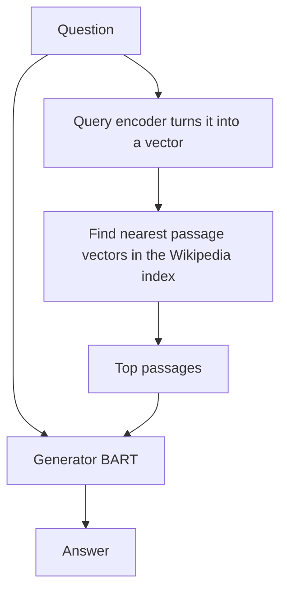

## The hook

Ask a friend who reads a lot, "Who won the 2018 Booker Prize?" They might be sure, they might half remember, or they might confidently get it wrong. Now give that same friend a phone with Wikipedia open. Their answer becomes reliable, up to date, and you can check where it came from.

Large language models are the well-read friend without a phone. Everything they know is baked into their weights during training: hard to update, impossible to inspect, and prone to confident invention. In 2020, a team at Facebook AI Research proposed handing the model a searchable library. They called the idea retrieval-augmented generation, RAG, and today it is one of the most common ways companies connect AI assistants to their own documents.

## Before you start

You need [BERT](article:paper-bert), whose encoder turns text into vectors, and the encoder-decoder pattern from [Read the Whole Sentence, Then Write the Translation](article:paper-seq2seq). The search part relies on [embeddings](article:primer-embeddings) and nearest-neighbour lookup.

## The world before this paper

By 2020, researchers knew that large pre-trained models stored a surprising amount of factual knowledge in their weights, their [[parametric memory]]. You could ask a model to fill in "Dante was born in ___" and it would often say "Florence." But this memory had serious problems:

- **Hard to update.** When facts change, you must retrain or fine-tune the model.
- **Hard to inspect.** You cannot see where an answer came from.
- **Prone to hallucination.** When unsure, models generate fluent, plausible fabrications.

:::history
Meanwhile, open-domain question answering systems had long used a two-stage pipeline: retrieve relevant documents, then read them to extract an answer. In 2020, Facebook researchers released Dense Passage Retrieval (DPR), which found relevant Wikipedia passages using learned embeddings rather than keyword matching, and Google researchers published REALM, which built retrieval into language model pre-training. Patrick Lewis, at Facebook AI Research and University College London, and colleagues set out to make retrieval a general-purpose companion for **generation**, not just for extracting answer spans.
:::

## The big idea

Combine two memories in one model, trained end to end:

1. A [[non-parametric memory]]: a dense vector [[index]] of 21 million Wikipedia passages, searched by a neural [[retriever]].
2. A parametric memory: a pre-trained sequence-to-sequence [[generator]] (BART) that writes the answer.

For each input, retrieve the most relevant passages and let the generator condition on them while writing.

:::analogy
Think of an open-book exam. A student who memorised the textbook (parametric memory) can answer many questions, but forgets details and cannot cite sources. A student allowed to bring the textbook (non-parametric memory) first flips to the relevant pages, then writes the answer in their own words, drawing on both what they remember and what is on the page. RAG takes the open-book exam.
:::

:::insight
Separating "what the model knows how to say" from "what facts it can look up" makes AI more accurate, easier to update and easier to check.
:::

## How it works

### Step 1: dense retrieval

The retriever is DPR, which has two BERT-based encoders: one turns the question into a vector, the other turns each Wikipedia passage into a vector. Relevance is the dot product between them. All 21 million passage vectors are computed in advance and stored in an index built with FAISS, a library for fast similarity search, so finding the top matches takes milliseconds.

This is [[dense retrieval]]: matching by meaning, not exact words. A question about "the author of Pride and Prejudice" can find a passage about "Jane Austen's novels" even if the exact phrase never appears.

### Step 2: generate with the passages

The question and each retrieved passage are fed together into BART, a pre-trained encoder-decoder model. The paper describes two ways to combine multiple passages:

- **RAG-Sequence:** use the same passage for the whole answer, generate an answer conditioned on each of the top passages, and combine them weighted by how relevant each passage is.
- **RAG-Token:** allow a different passage to inform each generated token, so one answer can draw facts from several documents.

### Step 3: train it together

The training data is just inputs and target outputs, like questions and answers. Nobody labels which passage is relevant. The retrieval scores and the generator are trained jointly: the model treats the retrieved passage as a hidden choice and marginalises over the top few. If a passage helps produce the right answer, its retrieval score gets pushed up. The passage encoder and index were kept fixed to avoid rebuilding the index constantly; only the query encoder and the generator were fine-tuned.

### A worked example

Question: *"Which river flows through Varanasi?"*

The retriever returns three passages with relevance probabilities: a passage about Varanasi's ghats on the Ganges (0.70), a passage about rivers of Uttar Pradesh (0.20), and a passage about Hindu pilgrimage sites (0.10).

With RAG-Sequence, the generator writes an answer for each passage. Suppose all three produce "the Ganges," with the generator giving it probabilities of 0.95, 0.80 and 0.60 respectively. The combined probability is

$$0.70 \times 0.95 + 0.20 \times 0.80 + 0.10 \times 0.60 = 0.665 + 0.16 + 0.06 = 0.885$$

The answer "the Ganges" wins with high confidence, and you can point to the passage that supported it.

:::try-this
Suppose the most relevant passage were missing from the index, so the retriever returned only the weaker two, renormalised to 0.67 and 0.33, with generator probabilities 0.80 and 0.60. What is the combined probability now? ($0.67 \times 0.80 + 0.33 \times 0.60 \approx 0.54 + 0.20 = 0.74$. Lower confidence. The quality of retrieval directly limits the quality of the answer.)
:::

### Why not just use a bigger model?

A fair question: if larger models memorise more facts, why bother with retrieval? The paper's answer is that the two kinds of memory are good at different things. Weights are great at language, style and reasoning patterns, and at well-known facts. An index is better for the long tail of specific facts, for knowledge that changes, and for anything you need to verify. A 400-million-parameter generator with a good library can beat much larger models on fact-heavy questions, at a fraction of the cost.

## What they found

- **Open-domain question answering.** RAG set new state-of-the-art results on several benchmarks, including Natural Questions, WebQuestions and CuratedTrec, outperforming both pure parametric models and specialised retrieve-and-extract pipelines. It could also generate correct answers even when no retrieved passage contained the answer word for word.
- **Better generation.** On tasks like writing Jeopardy-style questions, human judges found RAG's outputs more factual and more specific than those of BART alone.
- **Fact verification.** On the FEVER fact-checking task, RAG came close to state-of-the-art pipelines that used much more task-specific engineering.
- **Updatable knowledge.** By swapping an index built from a 2016 Wikipedia snapshot for one from 2018, the model's answers about world leaders changed to reflect the newer facts, without any retraining.

:::warning
Common misconception: "retrieval-augmented models cannot hallucinate." They hallucinate less, and their answers are easier to check, but they can still ignore the retrieved text, mix it up, or retrieve the wrong passage and confidently build on it. Good retrieval is necessary, not sufficient.
:::

## What it got wrong (or left open)

The quality of answers depends heavily on retrieval. If the right passage is not found, the generator is on its own. The fixed document encoder also meant the index could not adapt during training.

RAG worked over short passages and a single source, Wikipedia. Real-world use brought harder problems: messy documents, long contexts, conflicting sources and questions that need information combined across many documents.

And the original model was modest in size. It was not yet clear how retrieval would combine with much larger generators that already knew more.

## What happened next

- "RAG" became the standard name for connecting language models to external knowledge. Companies use it to let assistants answer questions over their own documents, help pages and databases.
- Vector databases and embedding models became a whole industry, built to serve the retrieval step.
- Large chat assistants gained web search and document upload, a form of retrieval augmentation that lets them cite sources.
- Fine-tuning approaches like [LoRA](article:paper-lora) and retrieval are often combined: fine-tuning teaches style and skills, retrieval supplies facts.

## Key takeaways

- RAG combines a language model's parametric memory with a non-parametric memory: a searchable index of 21 million Wikipedia passages.
- A dense retriever finds passages by comparing embedding vectors, and a BART generator writes the answer conditioned on them.
- The retriever and generator are trained together end to end, without any labels saying which passages are relevant.
- RAG set new records on open-domain question answering, produced more factual text, and could be updated by swapping its index.
- Retrieval augmentation became the standard way to ground AI assistants in specific, checkable, up-to-date knowledge.
