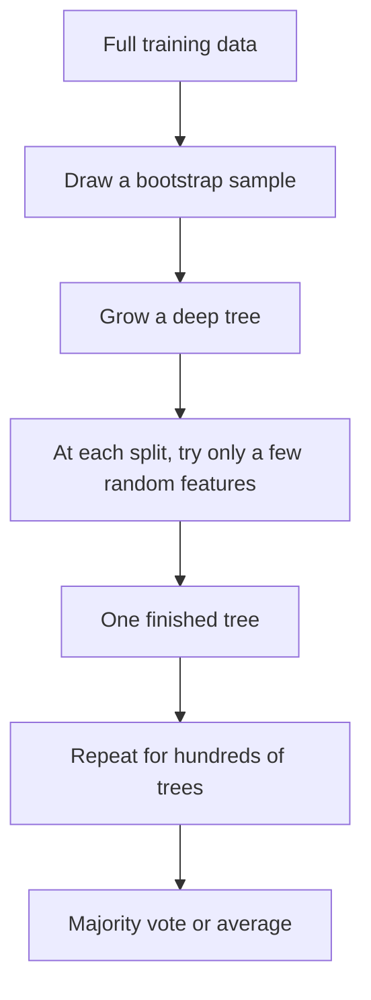

## The hook

In 1906, at a country fair in England, around 800 people paid to guess the weight of an ox. Most guesses were off, some wildly. But when the scientist Francis Galton looked at all the guesses together, the middle value was within about one percent of the true weight. The crowd, as a whole, beat the individuals in it, including the experts.

Nearly a century later, a statistician named Leo Breiman built that idea into a machine learning method so reliable that, two decades on, it is still one of the first things data scientists try. He did it with a twist that sounds backwards: he made each individual model **worse**, on purpose.

## Before you start

You should know what overfitting is and why we judge models on unseen data, from [Memorizing vs Learning](article:primer-overfitting). No maths beyond averages and voting is needed.

## The world before this paper

A [[decision tree]] is about the most human-friendly model there is. It predicts by asking questions in sequence: "Is income above 50,000? If yes, has the person missed a payment? If no..." Each question splits the data, and you keep splitting until the groups are pure.

Trees are fast and easy to read, but they have a famous weakness: they overfit. A deep tree can keep splitting until every training example sits in its own leaf, memorizing the data. And trees are unstable: change a few training examples and you can get a completely different tree.

:::history
Leo Breiman had an unusual career. He was a probability theorist, left academia to work as a consultant for over a decade, and came back to the statistics department at the University of California, Berkeley. His consulting years made him impatient with elegant models that did not predict well. In 1996 he introduced [[bagging]]: train many trees, each on a different random resample of the data, and let them vote. It helped a lot, but the trees still tended to look alike.
:::

## The big idea

Breiman's insight was that voting works best when the voters are **independent**, and that you can buy independence with randomness.

A random forest grows many decision trees, and injects two kinds of randomness into each one:

1. Each tree trains on its own [[bootstrap sample]] of the data.
2. At every split, the tree may only choose among a small random subset of the features.

:::analogy
Think of a pub quiz with a panel of guessers. If all the guessers went to the same school and read the same books, they make the same mistakes, and a majority vote just repeats those mistakes louder. Now imagine each guesser was only allowed to study a random handful of chapters. Individually they are weaker. But their blind spots are in different places, so when they vote, the right answer usually wins.
:::

:::insight
An [[ensemble]] of models is only as good as the disagreement between them. Making each tree slightly worse but much more different from the others makes the forest as a whole much better.
:::

## How it works

### Growing one tree

For each tree:

- **Bootstrap:** from $N$ training examples, draw $N$ at random **with replacement**. Some examples appear two or three times; others are left out.
- **Random features at every split:** instead of searching all features for the best question, pick a small random subset (Breiman suggested numbers like one feature, or about the logarithm of the number of features) and choose the best question among only those.
- **How many features per split?** Breiman found results were surprisingly insensitive to this number. Popular software later settled on a default of about the square root of the number of features for classification, so a dataset with 100 features would consider 10 at each split.
- **No pruning:** each tree grows deep. Individual trees overfit, and that is fine, because the vote cancels out their individual quirks.

To predict, every tree votes. For classification, the majority wins; for regression, the forest averages the trees' numbers.

### A free test set

Drawing with replacement leaves out about 37% of the examples from each bootstrap sample (for large $N$, the chance an example is never drawn approaches $1/e \approx 0.368$). Those left-out examples are "out of the bag" for that tree.

So for every training example, roughly a third of the trees never saw it. Let only those trees vote on it, and you get an honest prediction for that example without setting aside any data. Averaged over all examples, this is the [[out-of-bag error]]: a built-in test score that comes for free.

### Which features matter?

Breiman also proposed a clever way to measure [[feature importance]]. Take the out-of-bag examples, randomly shuffle the values of one feature, and see how much the error rises. If scrambling "income" wrecks the predictions, income matters a lot. If scrambling "favourite colour" changes nothing, the forest was not using it.

### The maths of a good crowd

Breiman proved a bound showing that a forest's error depends on two things:

- the **strength** of the individual trees (how accurate each is on its own), and
- the **correlation** between trees (how often they make the same mistakes).

Strong trees help. Correlated trees hurt. The random feature choice lowers correlation, at the cost of a little strength, and the trade is worth it.

:::try-this
Suppose you have 25 trees, each correct 65% of the time, and pretend their mistakes are completely independent. A majority vote needs at least 13 correct trees. Guess the forest's accuracy before reading on. (It works out to about 94%. Now imagine the trees were perfect copies of each other: the vote would be exactly as good as one tree, 65%. Independence is everything.)
:::

## What they found

- On a wide range of standard datasets, random forests matched or beat AdaBoost, then considered one of the best off-the-shelf classifiers.
- Random forests were notably more robust than boosting when some training labels were wrong, because they do not keep concentrating on the hardest (possibly mislabeled) examples.
- As more trees are added, the forest's generalization error converges to a limit. Adding trees costs computation, but it does not cause overfitting.
- Out-of-bag estimates tracked test error well, so users could tune and evaluate without a separate test set.

:::warning
Common misconception: "random forests can never overfit." Adding more **trees** does not cause overfitting. But a forest can still overfit if the data is noisy and the trees are allowed to fit every quirk, or if information about the answer leaks into the features. The guarantee is about the number of trees, not about everything.
:::

## What it got wrong (or left open)

A forest of 500 deep trees is no longer readable the way one tree is. You trade the flowchart a person can follow for accuracy, and lean on importance scores to peek inside.

Random forests also work best on tabular data: rows and columns of meaningful features. On raw images, audio or text, where useful features must be learned from scratch, they cannot compete with deep neural networks.

And the permutation importance measure has subtleties. When two features are strongly correlated, shuffling one may barely hurt, because the forest leans on the other, so both can look less important than they really are.

## What happened next

- Random forests became a standard tool in science, finance and medicine, and they remain a strong baseline on tabular data today.
- A rival family, gradient-boosted trees, built trees one after another to fix the previous trees' errors. Libraries such as XGBoost (2016) made boosting the favourite in data science competitions, often trading off with random forests.
- Breiman's 2001 essay "Statistical Modeling: The Two Cultures" argued that statisticians should care more about prediction accuracy, an argument that the deep learning era, starting with [AlexNet](article:paper-alexnet), took to its extreme.
- The general lesson, that combining many diverse models beats searching for one perfect model, reappears in [A Few Useful Things to Know About Machine Learning](article:paper-few-useful-things) and in the regularization trick of [Dropout](article:paper-dropout), which Hinton's group described as training a huge ensemble of networks at once.

## Key takeaways

- A random forest is an ensemble of deep decision trees whose predictions are combined by voting or averaging.
- Each tree is trained on a bootstrap sample and chooses each split from a random subset of features, which makes the trees different from each other.
- The forest's error depends on the strength of individual trees and the correlation between them, and randomness lowers correlation enough to win overall.
- Out-of-bag error gives a free, honest estimate of performance, and permutation importance shows which features the forest relies on.
- Adding more trees does not cause overfitting; the error converges to a limit as the forest grows.
