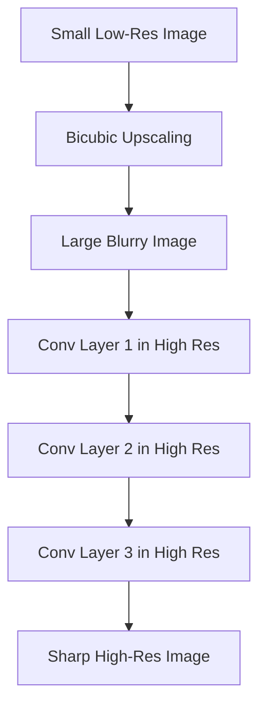
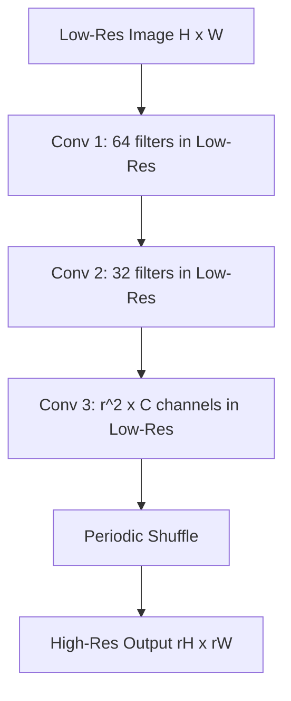

## The hook

In old spy movies, an investigator points at a blurry security photo and tells the technician to "zoom in and enhance." For decades, computer scientists laughed at that trope because throwing away pixel data is irreversible. Once an image is shrunk, the sharp edges are gone forever. 

When deep learning arrived, researchers found that neural networks could actually pull off plausible enhancement. But there was a catch: upscaling a single frame of high-definition video took almost half a second. At barely two frames per second, real-time video was out of the question.

In 2016, a small London startup called Magic Pony Technology asked a deceptively simple question: why are we spending all our computing power processing blurry pixels that we invented ourselves?

## Before you start

To get the most out of this article, you should understand:
- The basics of feedforward neural networks from [Neural Networks from One Neuron Up](article:primer-neural-networks).
- How 2D convolutions slide filters over image grids from [The Night Deep Learning Won](article:paper-alexnet).

## The world before this paper

The problem of taking a single low-resolution snapshot and estimating a crisp, detailed high-resolution image is called [[Single Image Super-Resolution (SISR)]]. 

It is an "ill-posed" inverse problem. If an original high-resolution patch is smoothed and downsampled into four blurry pixels, hundreds of distinct, sharp real-world textures could have produced those exact four blurry numbers. A model has to guess which fine details are the most plausible based on its knowledge of natural images.

In 2014, a landmark paper introduced SRCNN (Super-Resolution Convolutional Neural Network). SRCNN proved that deep learning could easily beat older mathematical tricks and dictionary methods. But SRCNN had an architectural blind spot.

Before feeding a low-resolution image into its neural network, SRCNN blew the image up using [[Bicubic Interpolation]].



Bicubic interpolation is a classic algorithm that estimates missing pixels by taking a weighted average of sixteen nearby known pixels. It does not hallucinate new details. It just creates a larger, blurry image where the pixel grid matches the target size.

Think about what happens to the math when you upscale by an integer factor $r = 4$. If your original image is $100 \times 100$ pixels, bicubic interpolation inflates it to $400 \times 400$ pixels. That is an area increase of $r^2 = 16\times$. 

Every subsequent convolutional layer now has to slide its filters across 16 times as many positions. The network burns more than 90% of its calculations processing smeared, interpolated pixels that carry zero new information.

:::history
The team behind this paper worked at Magic Pony Technology, a London startup founded by Imperial College graduates Zehan Wang and Rob Bishop. While academic labs focused on stacking deeper layers regardless of cost, Magic Pony focused squarely on speed. They wanted video streaming to run smoothly on standard consumer hardware. Their work caught Twitter's attention; Twitter acquired Magic Pony in June 2016 for approximately $150 million, right around the time this work was published.
:::

## The big idea

Instead of magnifying the image at the front door, keep the entire network working inside the tiny, compact low-resolution space. Do all the heavy feature extraction at the native resolution, and only expand the image in the very final step.

:::analogy
Imagine you are building an intricate mosaic on a dining table. 

The old way was like printing out a giant, pixelated 4-meter poster, taping it across the entire living room floor, and then crawling across the carpet with a paintbrush to touch up every blurry square millimeter. 

The sub-pixel way keeps you seated comfortably at your desk. You assemble neat stacks of small, dense tiles right in front of you. When every stack is finished, you deal them out side by side across the table in one quick movement.
:::

To make this work without relying on slow upscaling filters, the authors introduced the [[Sub-Pixel Convolution]] layer, powered by an operation called [[Periodic Shuffling (PS)]].

Rather than outputting one large high-resolution feature map directly, the final low-resolution convolution outputs multiple channels—exactly $r^2$ channels for every target color channel. Then, a simple deterministic reshuffle weaves those channel values into neighboring spatial positions.

## How it works

Let's look at the ESPCN (Efficient Sub-Pixel Convolutional Neural Network) pipeline. The architecture is lean: just three convolutional layers, with no pooling and no initial interpolation.



### 1. Low-Resolution Feature Extraction
Given an input low-resolution image $I_{LR}$ of height $H$, width $W$, and $C$ color channels, the model processes the image directly at size $H \times W \times C$.

The first layer applies 64 filters of size $5 \times 5$, followed by an activation function:
$$f_1(I_{LR}) = \tanh(W_1 * I_{LR} + b_1)$$

The second layer extracts deeper combinations using 32 filters of size $3 \times 3$:
$$f_2(I_{LR}) = \tanh(W_2 * f_1(I_{LR}) + b_2)$$

Because these convolutions operate entirely on the tiny $H \times W$ grid, they run blazingly fast. A $5 \times 5$ filter in low-resolution space covers the exact same physical visual context that would have required a massive $20 \times 20$ filter in $4\times$ upscaled space.

### 2. Generating the Sub-Pixel Channels
In the third layer, the network needs to prepare the pixels for the high-resolution image $I_{SR}$. If the scaling ratio is $r$, each single low-resolution pixel must spawn an $r \times r$ block of high-resolution pixels. That means one low-resolution pixel corresponds to $r^2$ values.

The third convolution uses filters of size $3 \times 3$ to project the 32 feature maps into $r^2 \cdot C$ output channels. If you upscale a grayscale or luminance image ($C = 1$) by $r = 3$, the final convolution produces $3^2 \cdot 1 = 9$ channels. 

No activation function is applied after this final convolution; the network outputs raw values ready to become intensities.

### 3. The Periodic Shuffling Operator
Now comes the magic trick: [[Periodic Shuffling (PS)]]. We have a tensor of dimensions:
$$H \times W \times (C \cdot r^2)$$

The periodic shuffling operator reorganizes these numbers into a high-resolution grid of dimensions:
$$(r \cdot H) \times (r \cdot W) \times C$$

The mathematical mapping looks like this:
$$PS(T)_{x, y, c} = T_{\lfloor x/r \rfloor, \lfloor y/r \rfloor, \; C \cdot r \cdot \text{mod}(y, r) + C \cdot \text{mod}(x, r) + c}$$

Here is what the symbols mean:
- $x$ and $y$ are the horizontal and vertical pixel coordinates in the final high-resolution image.
- $\lfloor x/r \rfloor$ and $\lfloor y/r \rfloor$ divide the coordinate by $r$ and round down. This tells you which low-resolution cell holds the data.
- $\text{mod}(x, r)$ and $\text{mod}(y, r)$ calculate the remainder after division. This tells you where you are inside the $r \times r$ patch.
- $c$ selects the color channel.

### A tiny worked example

Let's trace this with real numbers. Suppose we want an upscaling factor of $r = 2$ on a tiny $1 \times 1$ grayscale image ($H=1, W=1, C=1$). 

The target high-resolution image will be $2 \times 2$ pixels:
$$\begin{bmatrix} P_{0,0} & P_{1,0} \\ P_{0,1} & P_{1,1} \end{bmatrix}$$

The final low-resolution layer produces $r^2 \cdot C = 2^2 \cdot 1 = 4$ channels for that single cell. Suppose the channel values are:
- Channel 0: `10`
- Channel 1: `20`
- Channel 2: `30`
- Channel 3: `40`

The periodic shuffle maps channel depth into 2D space:
- Top-left ($x=0, y=0$): remainder $x$ is 0, remainder $y$ is 0 $\rightarrow$ Channel 0 $\rightarrow$ **10**
- Top-right ($x=1, y=0$): remainder $x$ is 1, remainder $y$ is 0 $\rightarrow$ Channel 1 $\rightarrow$ **20**
- Bottom-left ($x=0, y=1$): remainder $x$ is 0, remainder $y$ is 1 $\rightarrow$ Channel 2 $\rightarrow$ **30**
- Bottom-right ($x=1, y=1$): remainder $x$ is 1, remainder $y$ is 1 $\rightarrow$ Channel 3 $\rightarrow$ **40**

In one memory reorganization step, the depth vector `[10, 20, 30, 40]` unfolds into:
$$\begin{bmatrix} 10 & 20 \\ 30 & 40 \end{bmatrix}$$

No floating-point multiplications, no division, and no interpolation filters. It is a pure tensor reshape.

:::try-this
Suppose you have an upscaling factor of $r = 3$. How many output channels must the final low-resolution convolution produce if the image has $C = 3$ color channels (RGB)? 

*Answer:* You need $r^2 \cdot C = 3^2 \cdot 3 = 9 \cdot 3 = 27$ feature channels. Every single low-resolution pixel will generate 27 numbers, which shuffle into a $3 \times 3$ patch across 3 color channels.
:::

:::insight
Channels are just spatial resolution waiting to be unpacked. By computing features across channels in low resolution, standard 2D convolutions implicitly learn specialized upscaling filters for every sub-pixel position.
:::

:::warning
Do not confuse sub-pixel convolution with transposed convolution (sometimes called "deconvolution"). Transposed convolutions insert zeros between pixels and slide a filter over the zero-padded grid. This often causes unpleasant checkerboard patterns because overlapping filter windows receive uneven amounts of real pixel data. Sub-pixel convolution avoids this by running standard, uniform convolutions and doing a clean structural rearrange at the end.
:::

## What they found

The authors tested ESPCN against competitive SISR baselines, including SRCNN and TNRD (Trainable Nonlinear Reaction Diffusion), across benchmark datasets like Set5, Set14, BSD300, and BSD500.

Quality was measured using [[PSNR (Peak Signal-to-Noise Ratio)]], expressed in decibels (dB). Higher PSNR values mean the reconstructed image is mathematically closer to the ground truth.

On standard benchmark images with a scaling factor of $r = 4$, ESPCN delivered:
- An improvement of **+0.15 dB** over SRCNN on images.
- An improvement of **+0.39 dB** over SRCNN on high-definition video datasets.

The visual quality was noticeably crisper: edges along text and natural boundaries had sharper contrast than the blurred lines produced by bicubic-first models.

```
Model                  Set14 PSNR (r=3)    Inference Time (Set14)
------------------------------------------------------------------
Bicubic baseline       27.54 dB            N/A
SRCNN (9-5-5)          29.30 dB            ~50 ms (GPU)
ESPCN (Ours)           29.49 dB            4.7 ms (GPU)
```

The headline result was execution speed:
1. **Single images:** ESPCN processed a Set14 image in just **4.7 milliseconds** on an NVIDIA K2 GPU.
2. **Video at scale 3:** For 1080p video, SRCNN took **0.435 seconds** per frame. ESPCN finished in **0.038 seconds** per frame—an 11-fold speedup.
3. **Video at scale 4:** SRCNN took **0.434 seconds** per frame. ESPCN clocked in at **0.029 seconds** per frame (~34 frames per second).

For the first time, a deep learning model could super-resolve full 1080p high-definition video in real time on a single GPU. Across the whole system, ESPCN reduced overall computational complexity by a factor of $2.5 \cdot r^2$ compared to SRCNN 9-5-5. At $r = 4$, that is a 40-fold reduction in theoretical operations.

## What it got wrong (or left open)

While ESPCN solved the speed bottleneck of super-resolution, it left important problems open:

1. **The blurry average of MSE loss:** The network was trained using Mean Squared Error (MSE / L2 loss) between predicted pixels and ground truth pixels. When a network is uncertain whether an edge should go slightly to the left or to the right, minimizing squared error forces it to guess the average of all possibilities. The result is a clean but overly smooth, plastic look that misses fine, high-frequency textures like pores, fur, and fabric weave.
2. **Luminance-only processing:** The model was evaluated primarily on the Y channel (luminance) in the YCbCr color space, relying on cheap bicubic interpolation for the color channels (Cb and Cr). While human vision is far more sensitive to brightness differences than color differences, true end-to-end multi-channel color reconstruction was largely sidestepped.
3. **Ignoring temporal video information:** Even though the paper showcased 1080p video upscaling, it treated video as a sequence of completely isolated snapshots. Real video has immense redundancy: an object moving across the screen reveals parts of its texture across successive frames. ESPCN discarded all neighboring frame data.

## What happened next

The core mechanism introduced in this paper—the periodic shuffle—spread across deep learning under the name **PixelShuffle**. 

Frameworks like PyTorch built it directly into their core libraries as `torch.nn.PixelShuffle`. It quickly replaced transposed convolutions in super-resolution architectures, autoencoders, and image generators.

In 2017, Christian Ledig and his team introduced SRGAN, which paired ESPCN's sub-pixel convolution upsampling with a generative adversarial network (similar to the ideas in [The Counterfeiter and the Detective](article:paper-gan)). By replacing plain MSE loss with perceptual and adversarial losses, they fixed the over-smoothing problem and finally produced photorealistic textures.

Later, modern image generators like [Diffusion in a Smaller World](article:paper-latent-diffusion) adopted the broader lesson of ESPCN: doing heavy neural computation in low-dimensional latent spaces and only decoding into high-resolution pixels at the output boundary is the most computationally sane way to process visual media.

## Key takeaways

- Running convolutional layers on an image that was upscaled before the network multiplies computational cost by $r^2$ without introducing any new visual information.
- Feature extraction should happen entirely inside the compact, low-resolution space where filters cover wider spatial contexts at a fraction of the memory and compute.
- Sub-pixel convolution generates $r^2$ feature channels per output color channel and uses a deterministic periodic shuffle to rearrange depth channels into high-resolution spatial pixels.
- The periodic shuffling operator requires zero multiplication or mathematical filtering; it is an efficient memory layout transformation.
- ESPCN achieved real-time 1080p video super-resolution at over 30 frames per second on a single GPU, turning AI-powered video enhancement into an engineering reality.
