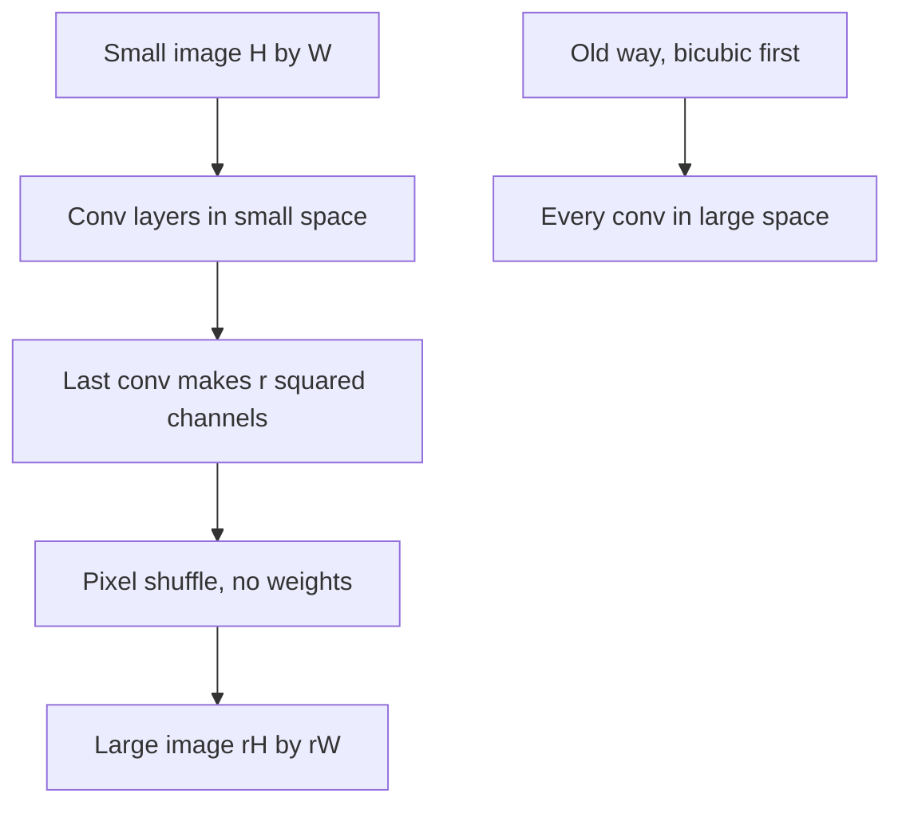

## The hook

You are streaming a football match on a slow connection. The video arrives small and soft, and your screen is large and sharp. Somewhere between the two, something has to invent the missing pixels, 25 or more times a second, without making the player's face look like wax.

By 2016, neural networks could invent convincing pixels, but they were too slow for live video. A team from a London start-up found the slowdown came from one habit: everyone enlarged the image before doing any thinking. They flipped the order.

## Before you start

You should know what a neural network layer does, from [the neural networks primer](article:primer-neural-networks), and how convolution filters slide over an image, as in [AlexNet](article:paper-alexnet). Knowing that a convolution's cost grows with the number of positions it visits is all the maths you need.

## The world before this paper

[[Super-resolution]] means producing a large, sharp image from a small one. It is a guessing game: many different sharp images shrink to the same small one, so a model has to learn which details are plausible.

In 2014, SRCNN showed that a small convolutional network beats older hand-built methods. Its pipeline, like most that followed, had two steps:

1. Enlarge the small image to the target size with [[bicubic interpolation]], a fixed formula that blends neighbouring pixels.
2. Run the network on the big, blurry image to sharpen it.

That first step is costly. Enlarging by a factor $r$ in each direction multiplies the number of pixels by $r^2$, and every convolution must visit every one of them. For a 3 times upscale, that is 9 times the work per layer, mostly spent on pixels that were filled in by a blur formula and carry no new information.

:::history
Wenzhe Shi, Jose Caballero, Ferenc Huszár and colleagues, from the London start-up Magic Pony Technology and Imperial College London, published the paper at CVPR 2016. Twitter acquired Magic Pony that year. The team cared about speed because they wanted super-resolution on real video, not just on benchmark photos.
:::

## The big idea

:::analogy
Picture a mosaic workshop asked to lay a large floor. The old method blows the design up to full floor size first, then the craftspeople crawl over every square of the floor touching it up. The new method keeps the craftspeople at a small table, working on a small plan. Each square of the small plan gets a little packet of tiles, already chosen and coloured. At the very end, someone walks to the floor, opens each packet and lays its tiles in a fixed pattern in that square's patch. All the thinking happens at the table; the unpacking needs no thought at all.
:::

The paper's network, called ESPCN, does exactly that. Every layer runs on the small image. The last layer produces, for each small-image position, a packet of $r^2$ values: one for every output pixel in that position's $r$ by $r$ patch. A [[pixel shuffle]] then unpacks the packets into the large image.

Together, the last convolution and the shuffle form the [[sub-pixel convolution]] layer. The upscaling is no longer a fixed blur; the network learns how each sub-pixel should look.

## How it works

### Step 1: think at the table

The paper's network is small: three convolutional layers, all on the low-resolution input. The first two produce [[feature map]]s, 64 and then 32 of them, describing edges, textures and shapes. Because each layer only visits the small grid, it costs $r^2$ times less than the same layer on the enlarged image. A filter on the small image also covers $r$ times more of the scene in each direction than a filter of the same size on the big image.

### Step 2: fill the packets

The last convolution outputs $r^2$ channels per colour channel. For a 3 times upscale of a single brightness channel, that is 9 channels. At each small-image position, those 9 numbers are the 9 pixels of its 3 by 3 output patch. In our analogy, each square of the small plan now holds a packet of 9 tiles.

### Step 3: unpack

The pixel shuffle turns an $H \times W \times r^2$ block of numbers into an $rH \times rW$ image. One common ordering, the one PyTorch's `PixelShuffle` uses, is: the output pixel at row $y$ and column $x$ comes from small-image position $(\lfloor y/r \rfloor, \lfloor x/r \rfloor)$, channel $(y \bmod r) \times r + (x \bmod r)$.

In words, divide the output coordinates by $r$ to find which packet; use the remainders to find which tile in the packet.

### A worked example: unpacking a 2 by 2 image

Take a 2 by 2 small image with pixels A, B, C and D, and $r = 2$, so each position has 4 channels. To keep track, the tens digit says which pixel and the units digit says which channel: A holds 11, 12, 13, 14; B holds 21 to 24; C holds 31 to 34; D holds 41 to 44.

After the shuffle, the 4 by 4 output is:

| | col 0 | col 1 | col 2 | col 3 |
|---|---|---|---|---|
| row 0 | 11 | 12 | 21 | 22 |
| row 1 | 13 | 14 | 23 | 24 |
| row 2 | 31 | 32 | 41 | 42 |
| row 3 | 33 | 34 | 43 | 44 |

Each packet lands in its own 2 by 2 patch: A's four values fill the top-left, B's the top-right, and so on. Check one: output row 1, column 2 comes from position $(\lfloor 1/2 \rfloor, \lfloor 2/2 \rfloor) = (0, 1)$, which is B, channel $1 \times 2 + 0 = 2$, the third of B's values: 23.

:::try-this
You want a 4 times upscale of a colour image with 3 channels (red, green, blue). How many channels must the last convolution output? (Each colour channel needs $4^2 = 16$ values per position, so $16 \times 3 = 48$ channels.)
:::

### A worked example: how much work is saved

Suppose the target is a 1080p frame, 1920 by 1080, upscaled 3 times from a 640 by 360 input. The small image has 230,400 pixels; the large one has 2,073,600, exactly 9 times more.

Use the paper's layer sizes for ESPCN: 64 filters of 5 by 5, then 32 filters of 3 by 3, then 9 output channels with 3 by 3 filters, on one brightness channel. That is $1{,}600 + 18{,}432 + 2{,}592 = 22{,}624$ multiply-adds per small pixel, or about 5.2 billion per frame.

Now run layers of the same sizes on the enlarged image instead, ending in a single output channel: $1{,}600 + 18{,}432 + 288 = 20{,}320$ per large pixel, or about 42.1 billion per frame. That is about 8 times more work for the same network shape, and it is the gap between the table and the floor.

:::insight
Do the expensive thinking where the data is small, and leave the enlargement to a free rearrangement at the very end. The network's learned weights end up doing the upscaling, so it is both faster and smarter than a fixed blur.
:::

:::warning
Common misconception: "the pixel shuffle is a clever learned upsampler." The shuffle has no weights at all; it only moves numbers. All the learning happens in the convolution before it, which decides what goes into each packet. That is also why the layer is so cheap: unpacking costs nothing but memory moves.
:::

## What they found

The abstract makes these claims:

- **Real-time 1080p video.** ESPCN was the first CNN able to super-resolve 1080p video in real time on a single K2 GPU.
- **Better quality.** It scored better than previous CNN-based methods, by +0.15 dB [[PSNR]] on images and +0.39 dB on videos, on publicly available datasets.
- **Much faster.** It was an order of magnitude faster than earlier CNN-based methods.
- **Learned upscaling filters.** The sub-pixel layer replaces the single hand-designed bicubic filter with upscaling filters trained for each feature map, while lowering the total cost.

Those gains come from the same move: keep the workshop at the table, unpack once at the end.

## What it got wrong (or left open)

- **PSNR rewards blur.** Training to match pixels on average gives safe, slightly smooth results. Fine textures such as hair or grass can still look soft, because the network averages over the many plausible answers.
- **A small network has limited reach.** Three layers see only a small neighbourhood, so large structures cannot inform the details. Later, much deeper networks gained quality by spending more compute.
- **Unpacking can show a grid.** If neighbouring channels in a packet are not well coordinated, faint checkerboard patterns can appear in the output. Later work by members of the same group proposed initialising the layer to avoid this.
- **Video is handled frame by frame.** The core model does not track motion over time, which leaves temporal information unused.

## What happened next

The sub-pixel convolution became a standard building block. PyTorch ships it as `PixelShuffle`, and later super-resolution networks such as SRGAN, from the same Twitter group, and EDSR use sub-pixel layers to upscale at the end. SRGAN also attacked the blur problem by adding an adversarial loss, building on [GANs](article:paper-gan).

The broader idea, keep heavy computation at low resolution and move information between space and channels cheaply, shows up across vision. The reverse operation, folding space into channels, is used to shrink images cheaply inside many networks. Encoder-decoder segmentation models such as [U-Net](article:paper-unet) face the same question of how to upsample well.

## Key takeaways

- Earlier CNN super-resolution enlarged the image first, so every layer ran on r squared times as many pixels, mostly interpolated ones.
- ESPCN runs every convolution on the small image and upscales only at the end, cutting the work by roughly a factor of r squared.
- The sub-pixel convolution outputs r squared channels per colour channel, and a weight-free pixel shuffle rearranges them into an image r times larger.
- Because the network produces every sub-pixel itself, the upscaling filters are learned rather than a fixed bicubic blur.
- The abstract reports real-time 1080p video on one K2 GPU, gains of 0.15 dB on images and 0.39 dB on video, and an order-of-magnitude speedup.
