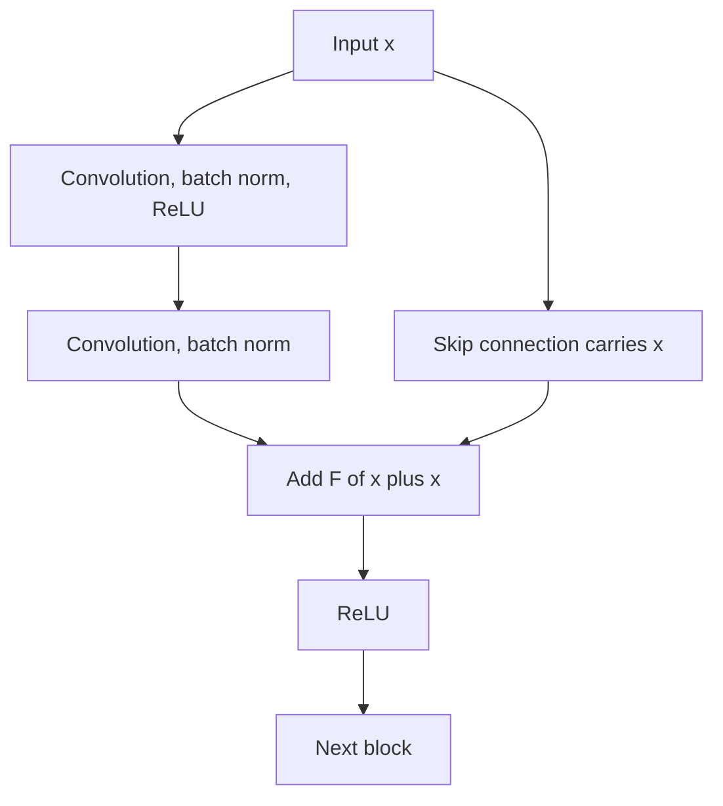

## The hook

Here is a puzzle. Take a neural network with 20 layers that works well. Add 36 more layers on top. In the worst case, the extra layers could simply pass their input through unchanged, so the bigger network should be at least as good as the small one.

When researchers at Microsoft Research Asia actually tried this, the 56-layer network was **worse**. Not just on new data, where you might blame overfitting, but on the very data it was trained on.

Their fix was almost embarrassingly small: add each block's input back to its output. That change let them train networks with 152 layers, swept every major vision competition of 2015, and produced what an analysis by Nature in 2025 found to be the most cited scientific paper of the 21st century.

## Before you start

You should know about convolutional networks from [AlexNet](article:paper-alexnet) and about normalization from [Batch Normalization](article:paper-batch-normalization). The vanishing gradient story from [Backpropagation Without the Scary Math](article:primer-backprop-intuition) is useful background too.

## The world before this paper

After AlexNet's 8 layers, depth kept paying off. In 2014, networks like VGG (19 layers) and GoogLeNet (22 layers) pushed accuracy higher. The pattern seemed clear: deeper is better.

With batch normalization and careful initialization, the old problem of vanishing gradients was largely under control. Networks with dozens of layers would start training. But Kaiming He, Xiangyu Zhang, Shaoqing Ren and Jian Sun noticed something odd when they went deeper still.

:::history
On the CIFAR-10 image dataset, they trained "plain" networks of 20 and 56 layers. The 56-layer network had higher training error throughout training, as well as higher test error. Because the deeper network was worse at fitting even the training data, overfitting could not be the explanation. They named this the [[degradation problem]]: deeper [[plain network|plain networks]] were simply harder for gradient descent to optimize.
:::

The thought experiment in the hook shows why this is strange. A deeper network can always copy a shallower one: use the shallow network's layers, then make the extra layers do nothing. A solution at least as good exists. The optimizer just could not find it.

## The big idea

The trouble is that "do nothing" is surprisingly hard for a stack of layers to learn. To pass its input through unchanged, a block of convolutions, normalizations and ReLUs would need its weights arranged just so. Gradient descent, starting from random weights, does not easily land on that.

So make "do nothing" the default. Instead of asking a block to learn the full output $H(x)$, ask it to learn only the change, the [[residual]] $F(x) = H(x) - x$, and add the input back:

$$\text{output} = F(x) + x$$

:::analogy
Think of editing an essay. A plain network is like asking each editor in a chain to retype the whole essay from scratch, improving it as they go. One careless editor and the essay is ruined. A residual network is like giving each editor the essay with track changes on: they only mark corrections. An editor with nothing to add simply makes no changes, and the essay passes through intact. Twenty editors, or a hundred and fifty, cannot make it worse by accident.
:::

:::insight
If the best thing a block can do is nothing, a residual block only has to learn to output zero, which is easy. Extra layers stop being a risk and become an opportunity.
:::

## How it works

### The residual block

Two or three layers form a block. The [[skip connection]] carries the block's input around the layers and adds it to their output. When the shapes match, the shortcut is just the input itself, an [[identity mapping]] with no extra parameters. When the block changes the number of channels or the image size, a simple projection adjusts the shortcut to fit.

### Why the gradients flow

Skip connections also help backpropagation directly. When blame flows backward through an addition, it is copied unchanged to both branches. So every block's shortcut gives the error signal a clear express lane back to earlier layers. Even if the gradient through a block's convolutions is small, the gradient through the shortcut is not, which keeps early layers learning.

### A worked example

Imagine the ideal output of a block is exactly its input: $H(x) = x$. Suppose $x = 5$.

- A **plain** block must produce 5 from 5. With weights near random, it might output 0.3, an error of 4.7. To fix that, many weights must move in coordinated ways.
- A **residual** block outputs $F(x) + 5$. If its layers output something near zero, say 0.3, the total is 5.3, an error of only 0.3. And pushing $F$ the rest of the way to zero just means making some weights small.

Starting near "do nothing" puts the residual network close to a good solution from the very first step.

:::try-this
Suppose the ideal output of a block is $1.1 \times x$, a gentle amplification, and $x = 10$. What residual $F(x)$ does the block need to learn? Is that easier or harder than learning the whole output of 11? (It needs $F(x) = 1$, a small correction, instead of producing 11 from scratch. Small corrections are exactly what gradient descent finds easily.)
:::

### A network of many paths

There is another way to picture a ResNet. Because every block's output is its input plus a correction, information can reach the end of the network along many different routes: through every block, or skipping some of them via shortcuts. A network with $n$ blocks has $2^n$ possible routes. Later research suggested that ResNets behave a little like a large team of shallower networks working together, with most of the useful signal travelling along the relatively short routes.

### Going very deep: bottlenecks

For their deepest ImageNet networks (50, 101 and 152 layers), the authors used a [[bottleneck block]]: a 1 by 1 convolution shrinks the number of channels, a 3 by 3 convolution does the main work on the slimmer representation, and another 1 by 1 convolution expands back. This kept computation manageable. The 152-layer ResNet was eight times deeper than VGG, yet required less computation.

## What they found

- **Degradation solved.** On ImageNet, a 34-layer residual network beat its 18-layer version, while the plain 34-layer network was worse than the plain 18-layer one. With shortcuts, deeper finally meant better.
- **Winning everything.** An ensemble of residual networks achieved a 3.57% top-5 error on the ImageNet test set and won first place in the 2015 ImageNet classification challenge. ResNets also took first place in the 2015 ImageNet detection and localization tasks, and in the COCO detection and segmentation competitions.
- **Extreme depth.** On CIFAR-10, they trained networks with over 100 layers successfully, and even explored a network with over 1,000 layers. It trained, though it did slightly worse than the 110-layer version, which the authors attributed to overfitting on the small dataset.

:::warning
Common misconception: "ResNet solved vanishing gradients." Batch normalization had already made deep plain networks start training. ResNet addressed a different problem, the degradation of deeper networks that could train but optimized poorly. The shortcuts do help gradients flow, but the paper's framing is about making the right solution easy to find.
:::

## What it got wrong (or left open)

The paper did not fully explain **why** residual networks work so well, and several competing explanations followed: that they behave like ensembles of many shallower paths, that they smooth the loss landscape, and that they let information pass forward unchanged. Each captures part of the story.

The 1,000-layer experiment also showed that depth alone has limits; without enough data, extra depth stops helping. And the exact block design was tweaked in a follow-up paper by the same authors, which moved batch norm and ReLU before the convolutions to keep the shortcut path completely clean.

## What happened next

- Residual connections became nearly universal. Almost every deep architecture since uses them.
- The [Transformer](article:paper-attention-is-all-you-need) wraps every attention layer and every feed-forward layer in a residual connection, which is a big reason it can be stacked dozens of layers deep in models like [GPT-3](article:paper-gpt-3).
- [U-Net](article:paper-unet)-style networks and diffusion models such as [latent diffusion](article:paper-latent-diffusion) are built from residual blocks.
- The [Vision Transformer](article:paper-vit) used ResNets as its main point of comparison, and ResNet-50 became the standard reference model for computer vision for years.

## Key takeaways

- Deeper plain networks can have higher training error than shallower ones, a degradation problem caused by optimization difficulty, not overfitting.
- Residual blocks learn a correction F(x) and add the input back, so doing nothing only requires learning to output zero.
- Skip connections also give gradients a direct path backward, keeping early layers learning in very deep networks.
- ResNets with up to 152 layers won the major 2015 vision competitions, including ImageNet classification with 3.57% top-5 error.
- Residual connections became a standard ingredient of deep learning, including every Transformer and large language model.
