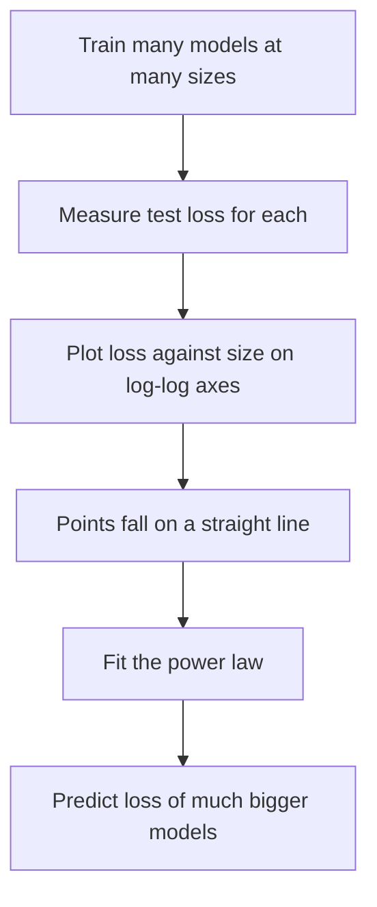

## The hook

Most of machine learning is unpredictable. You change something, run an experiment for days, and find out whether it helped. Nobody can tell you in advance how good your model will be.

In January 2020, a team at OpenAI published a set of charts that looked almost too clean to be real. Plot a language model's error against its size on the right kind of graph, and you get a straight line. Against the amount of data: a straight line. Against compute: a straight line. Across seven orders of magnitude.

Straight lines can be extended. If you know where the line goes, you can predict how good a model ten times bigger will be before you build it. Those lines helped persuade companies to invest previously unthinkable sums in training ever-larger models, and the era of giant language models followed.

## Before you start

You should know what a language model is and how loss measures its mistakes, from [GPT-1](article:paper-gpt-1) and [How Wrong Is the Model?](article:primer-loss-functions). It also helps to have seen the payoff of scale in [GPT-3](article:paper-gpt-3), which was trained partly on the strength of this paper.

## The world before this paper

In 2019, people knew that bigger language models tended to be better. GPT-2 was better than GPT-1; larger BERT beat smaller BERT. But "bigger is better" is vague. How much better? Does it level off? Should you spend your budget on a bigger model, more data or longer training? Is depth or width more important?

:::history
Hints of regular scaling had appeared before. In 2017, researchers at Baidu found that error in tasks like translation and speech recognition fell as a power law with dataset size. Jared Kaplan, a theoretical physicist at Johns Hopkins who was also working with OpenAI, brought a physicist's instinct: look for simple laws in messy systems. The paper's authors included Dario Amodei, Tom Brown and Sam McCandlish, several of whom would go on to co-found Anthropic the following year.
:::

## The big idea

Train many Transformer language models across a huge range of sizes, dataset sizes and training lengths, measure the [[test loss]] of each, and look for simple equations that describe the results. They found them: [[scaling law|scaling laws]] in the form of [[power law|power laws]].

:::analogy
Think of filling a bucket with water from three taps: one for model size, one for data and one for compute. Opening any tap helps, and each tap follows a steady, predictable rule: double the flow and the water rises by a fixed proportion. But if you open one tap wide while another is barely dripping, the bucket stops rising; the weakest tap becomes the bottleneck. Good scaling means opening all three together, in the right proportion.
:::

:::insight
Language model quality is not a mysterious art at large scale. It improves predictably with model size, data and compute, so you can forecast the benefit of a bigger model before you spend the money to train it.
:::

## How it works

### The power laws

When a model is not held back by the other two factors, its test loss $L$ depends on each factor as a power law. For model size $N$ (the number of non-embedding parameters):

$$L(N) = \left(\frac{N_c}{N}\right)^{\alpha_N}, \qquad \alpha_N \approx 0.076$$

- $N$ is the number of parameters, and $N_c$ is a fitted constant.
- $\alpha_N$ is the exponent: how steeply loss falls as the model grows.

Similar laws hold for dataset size $D$ (exponent about 0.095) and for [[compute]] $C$ when it is allocated optimally (exponent about 0.050).

### Why straight lines?

On a [[log-log plot]], each step along an axis multiplies by ten. A power law turns into a straight line there, with slope $-\alpha$. That is what made the charts so striking: a ruler could predict the future.

### A worked example

With $\alpha_N \approx 0.076$, what happens to loss when you make the model 10 times bigger, with enough data and compute?

- Loss is multiplied by $10^{-0.076} \approx 0.84$, about **16% lower**.
- Make it another 10 times bigger (100 times the original): $0.84 \times 0.84 \approx 0.70$, about 30% lower than where you started.

Each tenfold increase buys the same proportional improvement. Progress is steady, but expensive: every equal step in quality costs ten times more.

:::try-this
Using the same exponent, by roughly how much does loss fall if you only **double** the model size? ($2^{-0.076} \approx 0.95$, so about 5% lower. That is why labs think in factors of ten, not factors of two.)
:::

### Other findings

- **Shape barely matters.** Within a wide range, the number of layers, the width and the number of attention heads had small effects compared with total parameter count.
- **Bigger models learn faster per example.** Larger models reach a given loss with fewer training tokens. They have better [[sample efficiency]].
- **Overfitting is predictable.** If you grow the model without growing the data, performance suffers in a predictable way. The paper estimated that an 8 times larger model needs only about 5 times more data to avoid this penalty.
- **Transfer follows the same lines.** Performance on text from different sources improved in step with performance on the training distribution.

### What to do with a fixed budget

The paper's most influential conclusion was about allocating compute. Because bigger models are more sample-efficient, they argued, the best strategy for a fixed compute budget is to train a **very large model** and **stop well before it converges**. As the budget grows, most of the extra compute should go into a bigger model, with data growing much more slowly.

### Why would nature be this tidy?

Nobody fully knows why language models obey such clean laws. One intuition: natural language contains patterns at every level of difficulty, from common spellings to rare facts to subtle reasoning. A bigger model, or more data, lets the model capture a little more of this long tail of patterns, and because the tail thins out smoothly, the improvements arrive smoothly too. Physicists see similar power laws in earthquakes, city sizes and word frequencies, which is partly why a physicist went looking for them here.

## What they found

- Test loss followed smooth power laws in model size, dataset size and compute, over more than seven orders of magnitude, with no sign of levelling off within the range tested.
- Architectural details mattered far less than overall scale.
- Larger models were more sample-efficient, and the compute-optimal strategy appeared to be training enormous models on relatively modest amounts of data.
- These relationships allowed reasonably accurate predictions of the loss of models much larger than those used to fit the laws.

:::warning
Common misconception: "a lower loss means the model is smarter in every way." Scaling laws predict next-token loss, a smooth average. Specific abilities, like doing arithmetic or following a complex instruction, can improve in more uneven ways, and a lower loss does not guarantee the model is more truthful or safer.
:::

## What it got wrong (or left open)

The allocation advice turned out to be off. In 2022, DeepMind's [Chinchilla](article:paper-chinchilla) study found that model size and data should grow in roughly **equal** proportion, and that models like GPT-3 had been trained on far too little data for their size. One reason for the difference was a training detail: Kaplan's experiments used a fixed learning-rate schedule length, which made smaller models trained for longer look worse than they should.

Power laws also cannot continue forever. Real text has some irreducible unpredictability, so loss must flatten eventually. And the laws say nothing about the cost of running a model after training, which favours smaller models trained for longer.

## What happened next

- The same OpenAI group trained [GPT-3](article:paper-gpt-3) at 175 billion parameters later that year, and its results followed the predicted trends; similar reasoning drove a race toward ever-larger models across the industry.
- [Chinchilla](article:paper-chinchilla) corrected the data-versus-size balance, and [LLaMA](article:paper-llama) then trained smaller models on far more data to make them cheap to run.
- Scaling-law studies became a standard planning tool: labs now train small models first to forecast the behaviour of large ones before committing huge budgets.
- Similar laws were later found for images, video, code and multimodal models, and for the compute spent at inference time, such as reasoning steps.

## Key takeaways

- Language model test loss improves as a smooth power law in model size, dataset size and training compute, appearing as straight lines on log-log plots.
- These trends held over more than seven orders of magnitude, so the performance of much bigger models could be predicted in advance.
- Within a wide range, the shape of the network mattered far less than its total size.
- The paper advised putting most extra compute into bigger models trained on relatively little data, advice that Chinchilla later corrected.
- Scaling laws changed AI strategy, encouraging massive investment in large models and turning scale into a planned engineering decision.
