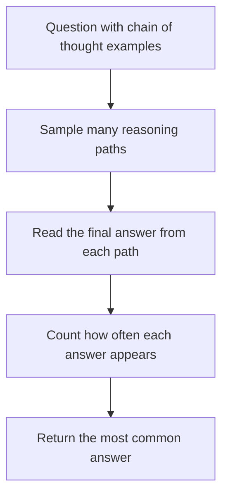

## The hook

Ask a language model a tricky word problem once and it may slip on step three and confidently give the wrong number. Ask it again, letting it phrase things a little differently, and it may get it right. Ask ten times and you will often see one answer turning up again and again.

A Google team turned that observation into a method so simple it fits in a sentence: sample several solutions and go with the majority.

## Before you start

You should know [chain-of-thought prompting](article:paper-chain-of-thought), where a model writes out its working before answering, and how models like [GPT-3](article:paper-gpt-3) generate text one token at a time from a prompt.

## The world before this paper

In early 2022, [[chain-of-thought prompting]] showed that large language models solve far more maths and logic problems when shown worked examples and asked to reason step by step.

But there was a weak spot in how the reasoning was produced. Most work used [[greedy decoding]]: at every step, take the single most likely next token. That gives one path of reasoning. If the path takes a wrong turn early, nothing catches it.

The usual fixes needed extra training: a separate verifier model to score solutions, or fine-tuning on human-written reasoning. Both cost labelled data and new training runs.

:::history
Xuezhi Wang, Jason Wei, Dale Schuurmans, Quoc Le, Ed Chi, Sharan Narang, Aakanksha Chowdhery and Denny Zhou at Google posted the paper in March 2022, shortly after chain-of-thought prompting appeared. It was published at ICLR 2023. Their starting intuition: a hard problem usually has many valid ways to reach its single correct answer.
:::

## The big idea

:::analogy
Imagine you are lost in a new city and ask five strangers the way to the railway station. Each gives a different route: one says turn left at the temple, another says follow the main road past the market. One stranger is confused and sends you toward the bus depot. You do not need to check every route. If three of the five routes end at the same station, that is where you head.
:::

That is self-consistency. The routes are reasoning paths; the station is the final answer. Valid routes differ in their turns but agree on the destination. Bad directions tend to point to different wrong places.

So instead of one greedy path, the model generates many paths by [[sampling]], then you throw away the routes and count only the destinations. The paper calls this [[marginalizing]] out the reasoning paths: you sum over all the different ways of getting somewhere and score only where they ended up.

## How it works

### Step 1: prompt as usual

Use the same chain-of-thought prompt you would use anyway: a few worked examples, then the new question. No new model, no training.

### Step 2: sample several paths

Generate the answer many times with sampling rather than greedy decoding. A [[temperature]] above zero makes each run take slightly different turns, so you get genuinely different routes.

### Step 3: extract and vote

From each path, read off the final answer, such as the number after "The answer is". Then pick the answer that appears most often:

$$\hat{a} = \arg\max_{a} \sum_{i=1}^{m} \mathbf{1}(a_i = a)$$

Here $m$ is how many paths you sampled, $a_i$ is the answer at the end of path $i$, and $\mathbf{1}(a_i = a)$ is 1 if that path ended at answer $a$ and 0 otherwise. The sum counts votes for $a$, and $\hat{a}$ is the answer with the most votes. The routes themselves never enter the count.

### A worked example

Question: pens come in packs of 4 for ₹30. Riya needs 18 pens and can only buy whole packs. How much does she pay? Five sampled paths:

| Path | Reasoning, in short | Answer |
|---|---|---|
| 1 | 18 / 4 = 4.5, round up to 5 packs, 5 × 30 | ₹150 |
| 2 | 4 packs give 16 pens, she needs 2 more, so 5 packs | ₹150 |
| 3 | 18 / 4 × 30 = 135, forgets whole packs | ₹135 |
| 4 | 20 pens is the next multiple of 4, that is 5 packs | ₹150 |
| 5 | 4 packs, 4 × 30 | ₹120 |

The tally is ₹150 with 3 votes, ₹135 with 1 and ₹120 with 1. The three correct paths took different routes and met at one station. The two mistakes went to different places.

### Why the vote gets stronger with more samples

Here is a toy model, simulated in Python. Suppose each path is right 40% of the time, and the wrong paths spread evenly over 10 different wrong answers, 6% each. One path alone is right 40% of the time. Voting does much better:

| Paths sampled | Vote picks the right answer |
|---|---|
| 1 | about 40% |
| 5 | about 64% |
| 10 | about 83% |
| 20 | about 97% |
| 40 | about 99.9% |

The right answer never needed to be a majority of paths. It only needed to beat each wrong answer individually, and scattered mistakes split their votes.

### How different should the paths be?

Variety is the whole point. With the temperature at zero, every run is the greedy path, so five samples are one stranger asked five times. Turn it up too far and the strangers start rambling, and the reasoning stops making sense. Moderate settings give routes that differ in their turns but still head somewhere sensible. The paper reports that the gains held up across a range of sampling settings, so the method does not depend on finding one magic value.

:::try-this
Change the toy model: the right answer still comes up 40% of the time, but one particular wrong answer comes up 45% of the time. What happens as you sample more paths? (Voting now favours the wrong answer. In the same simulation, with 40 paths the vote is right only about 37% of the time, worse than a single path.)
:::

:::warning
Common misconception: "More samples always make the answer more reliable." Voting amplifies whatever answer is most common. It helps when mistakes scatter. If the model has a systematic misconception, so that one wrong answer is its favourite, sampling more just confirms the mistake. In the city, if most strangers share the same wrong belief about the station, asking more of them will not help.
:::

:::insight
There are many ways to be wrong and usually only one way to be right. Sampling turns that asymmetry into accuracy, without training anything.
:::

## What they found

The abstract reports gains over standard chain-of-thought prompting with greedy decoding, across arithmetic and commonsense benchmarks:

- **GSM8K** (grade-school maths word problems): +17.9 percentage points.
- **SVAMP** (varied arithmetic problems): +11.0 points.
- **AQuA** (algebra word problems): +12.2 points.
- **StrategyQA** (multi-step yes or no questions): +6.4 points.
- **ARC-challenge** (science exam questions): +3.9 points.

The method is unsupervised and works off the shelf: no extra training, no verifier, no human labels, just more samples from the same model.

The paper also made two practical observations. Weighting each answer by how probable the model thought its path was did no better than a plain count. And the share of paths agreeing on the winner works as a confidence signal: when most strangers point the same way, the answer is more likely right.

## What it got wrong (or left open)

- **Cost grows with the number of samples.** Forty paths cost about forty times as much to generate as one. For many products that is too slow or too expensive.
- **It needs answers you can match.** Voting works when the final answer is a number or a choice. For an essay or a summary, there is no simple way to say two outputs "agree".
- **Right answer, wrong route.** A path can reason badly and still land on the right number. Self-consistency checks destinations, not routes, so it cannot tell sound reasoning from lucky reasoning.
- **Shared mistakes survive.** As the try-this showed, voting cannot fix an error the model makes consistently.

## What happened next

Self-consistency became a standard baseline for reasoning with language models, and a clear early example of trading extra computation at answer time for accuracy, rather than training a bigger model.

Researchers then asked how to spend that extra computation more cleverly. [Tree of Thoughts](article:paper-tree-of-thoughts-deliberate-problem-solving-with-large-langu) branches and evaluates partial reasoning instead of only whole paths. Other work combined many samples with trained verifiers that pick the best one, and "universal self-consistency" asked the model itself to choose the most consistent answer among free-form outputs. Sampling and voting also pairs naturally with prompts like "Let's think step by step" from [the zero-shot reasoning paper](article:paper-large-language-models-are-zero-shot-reasoners).

## Key takeaways

- Self-consistency replaces greedy decoding in chain-of-thought prompting: sample many reasoning paths, then return the most common final answer.
- It works because a problem with one correct answer can be reached by many valid routes, while mistakes tend to scatter across different wrong answers.
- The method needs no extra training, verifier or labels, and it improved results on arithmetic and commonsense benchmarks, including +17.9 points on GSM8K.
- How strongly the paths agree is a useful signal of how confident to be in the answer.
- Voting costs many times more computation, needs answers that can be compared, and cannot fix a mistake the model makes consistently.
