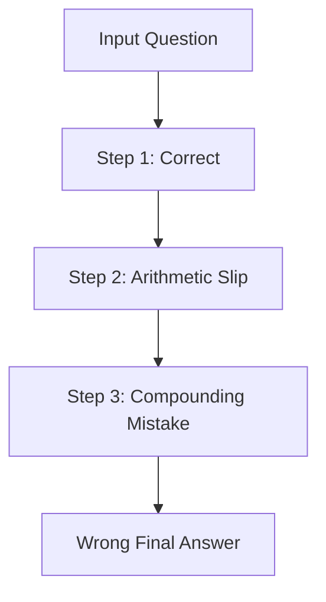
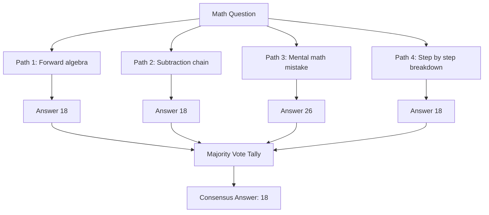
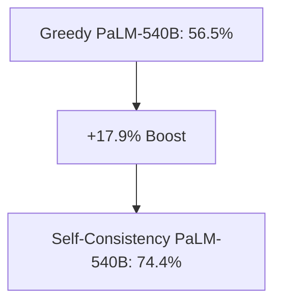

## The hook

If you hand a tricky math puzzle to five students working on scratch paper, they will not solve it the same way. One might work forward with algebra, another might work backward from the choices, and a third might sketch out arithmetic tallies. But if four of them arrive at 18 and one slips on mental arithmetic to announce 26, you can bet on 18 without checking their line-by-line calculations.

By default, large language models do the exact opposite. They construct a single solution one token at a time, picking the top candidate at every juncture, and if they miscalculate a minus sign on step three, the whole answer crashes down. 

What if you allowed the model to act like that entire room of students?

:::analogy
Think of [[Self-Consistency]] like five classmates tackling the same homework problem on separate scratch sheets. Each takes their own route through the steps. Mistakes scatter in every direction, but valid logic arrives at the same final number. The teacher simply collects the sheets, tallies the bottom-line answers, and trusts the majority.
:::

## Before you start

To get the most out of this paper, you should feel comfortable with:
- How models generate text step by step, which we explored in [few-shot learning with GPT-3](article:paper-gpt-3).
- The idea of having a model write out its steps before answering, covered in [Show Your Working: The Prompt That Unlocked Reasoning](article:paper-chain-of-thought).

## The world before this paper

In early 2022, [[Chain-of-Thought Prompting]] changed how the field evaluated large language models. Showing a model a few step-by-step examples unlocked dramatic leaps in multi-step word problems. 

Yet people noticed an annoying bottleneck. Even when primed to show its work, the model relied on [[Greedy Decoding]]. At every token, the system selected the single most probable continuation. 

This winner-take-all approach suffers from three big problems:
1. **Local fragility:** If the model makes one tiny arithmetic slip early on, every subsequent step is poisoned.
2. **Repetition and lack of exploration:** Greedy decoding pursues only one path, never exploring alternative ways to frame the problem.
3. **Expensive workarounds:** To fix these mistakes, teams trained dedicated verifiers or human-guided ranking models. Those fixes worked, but they demanded thousands of extra labeled examples and new training runs.

Researchers needed a way to make multi-step reasoning resilient without training extra models.

:::history
Denny Zhou, Jason Wei, and their colleagues at Google Research had just watched chain-of-thought prompting take off. But they noticed that when large models failed at reasoning, it was rarely because they lacked the underlying knowledge. They failed because greedy decoding forced them onto a single tightrope. If the model wobbled once, there was no safety net.
:::

## The big idea

Instead of settling for the single greedy path, ask the model to generate multiple alternative reasoning journeys using stochastic sampling. 

Then, throw away the intermediate working steps and run a simple majority vote on the conclusions. 

The paper calls this process sample-and-marginalize. In statistics, [[Marginalization]] means integrating out nuisance variables to focus on the outcome you care about. Here, the diverse scratchpad explanations are the nuisance variables. The final answer is the prize.

:::insight
There are countless ways to make an arithmetic mistake, but only a few ways to get the answer right. As diverse reasoning paths proliferate, errors scatter into random answers, while valid derivations converge on the same consensus.
:::

## How it works

Let's break down the self-consistency workflow into four clear steps.

### Step 1: Prompt with chain-of-thought exemplars
You feed the language model a prompt containing several question-and-answer pairs where the answers display clear, step-by-step rationales.

### Step 2: Sample diverse reasoning paths
Instead of taking the highest-scoring token at every step, use [[Temperature Sampling]] (often paired with top-$k$ or nucleus sampling). Setting the temperature parameter $T > 0$ softens the probability distribution over upcoming tokens, allowing the model to wander down alternative syntactic and logical avenues. 

You generate $m$ independent completions (typically between 10 and 40 runs) for the exact same prompt.

### Step 3: Extract the bottom-line answers
From each generated sequence $i$, isolate the rationale $r_i$ from the final answer $a_i$. In practice, this uses a lightweight parser:
- For math questions, pick the number following "The answer is...".
- For multiple-choice or true/false tasks, grab the target label.

### Step 4: Marginalize and vote
Now tally up how often each candidate answer appears across all $m$ generations. Formally, pick the answer $\hat{a}$ that maximizes the votes:

$$\hat{a} = \arg\max_{a} \sum_{i=1}^{m} \mathbb{I}(a_i = a)$$

Here:
- $m$ is the total number of sampled paths.
- $a_i$ is the parsed answer from path $i$.
- $a$ is any candidate answer from the set of possible answers.
- $\mathbb{I}(\cdot)$ is an indicator function that equals 1 if the condition inside is true and 0 otherwise.

### A concrete example

Imagine a word problem: 
*Janet has 16 eggs. She eats 3 for breakfast and uses 4 for baking. She sells the rest for $2 each. How much money does she make?*

Using temperature sampling, you generate 5 independent runs:

| Run | Sampled Reasoning Path | Parsed Answer ($a_i$) |
|---|---|---|
| 1 | "16 minus 3 is 13. 13 minus 4 is 9 eggs left. 9 times $2 is $18." | $18 |
| 2 | "She uses 3 plus 4, which is 7 eggs. 16 minus 7 is 9. 9 times 2 is $18." | $18 |
| 3 | "Total used: 3 plus 4 = 7. 16 minus 7 = 9. But 9 times 3 is $27." | $27 |
| 4 | "Janet eats 3, leaves 13. Bakes 4, leaves 9. 9 eggs at $2 each gives $18." | $18 |
| 5 | "She bakes 4 and sells remainder. 16 minus 4 is 12. 12 times 2 is $24." | $24 |

The votes come in:
- **$18:** 3 votes
- **$24:** 1 vote
- **$27:** 1 vote

The consensus winner is **$18**. Notice that the mistakes diverged into different wrong answers ($24 and $27), while the correct logic paths agreed on the true value.

:::try-this
Suppose you sample 7 reasoning paths for a binary True/False logic question. Four paths output "True", each using completely different reasoning paragraphs. Three paths output "False". 

Under standard self-consistency, what does the system predict? Does it matter if the three "False" answers had higher average token probabilities than the four "True" answers? 

*(Answer: It predicts "True". Standard self-consistency uses an unweighted majority tally, discarding token confidence scores because large models are often poorly calibrated.)*
:::

:::warning
Self-consistency does not verify logical purity. A model can hallucinate a bizarre intermediate step and still luck into the right final number. You are ensembling outputs, not guaranteeing that every sentence along the way is mathematically sound.
:::

## What they found

The Google team evaluated self-consistency across dozens of benchmarks, spanning arithmetic, symbolic manipulation, and commonsense reasoning on models like PaLM-540B, LaMDA-137B, and GPT-3.

The accuracy gains over greedy chain-of-thought were massive:
- **GSM8K (Grade School Math):** PaLM-540B jumped from 56.5% to **74.4%** (+17.9%). GPT-3 code-davinci-002 leapt from 60.1% to **78.0%** (+17.9%).
- **SVAMP (Challenging Math Variations):** GPT-3 rose from 75.8% to **86.8%** (+11.0%).
- **AQuA (Algebra Word Problems):** GPT-3 climbed from 39.8% to **52.0%** (+12.2%).
- **Commonsense reasoning:** StrategyQA improved from 73.4% to **79.8%**, while ARC-challenge rose from 83.6% to **87.5%**.

Even in zero-shot chain-of-thought (where the prompt simply instructs the model to think step by step without examples), self-consistency lifted PaLM-540B on GSM8K from 43.0% to **69.2%**, an improvement of more than 26 percentage points.

The authors also highlighted two fascinating behaviors:

1. **Unweighted voting beats complex math:** You might expect that weighting answers by the model's generated token probabilities would help. Surprisingly, a simple unweighted count performed just as well as length-normalized probability sums. The model assigns roughly similar probabilities to its sampled chains, making basic democracy the cleanest aggregation rule.
2. **Confidence estimation:** The percentage of sampled paths that agree on the winning answer correlates directly with actual accuracy. When 90% of paths pick the same option, the model is almost certainly right. When the vote splits evenly among three choices, the model has low confidence. It gives the model a built-in way to signal doubt.

## What it got wrong (or left open)

While self-consistency proved that diversity beats greed, it left several practical headaches open:

- **Compute cost explodes:** Sampling 40 chains means you run the decoder 40 times longer. For interactive chatbots or budget-constrained teams, paying 40x the inference cost for a single query is a non-starter.
- **Fixed answer sets:** Voting requires answers that can be neatly matched. If the question is "What is the capital of France?", tallying "Paris" is trivial. But if the task is "Write an essay explaining the French Revolution", you cannot run an unweighted majority vote over paragraphs.
- **Broken steps that get lucky:** The authors noted instances where the model hallucinated bogus facts in its reasoning chain but landed on the correct multiple-choice letter by accident. Self-consistency cannot spot when a model is "right for the wrong reasons."

## What happened next

Self-consistency fundamentally shifted how people think about test-time compute. Instead of spending millions of dollars training a slightly bigger transformer, engineers realized they could spend compute at test time by sampling more candidate paths.

This insight kicked off a wave of tree-based and search-based reasoning methods. Researchers soon asked: why sample full chains from start to finish? Why not branch out at each intermediate thought, prune dead ends, and backtrack? That train of thought led directly to [Tree of Thoughts](article:paper-tree-of-thoughts-deliberate-problem-solving-with-large-langu). 

Today, self-consistency remains a foundational baseline in AI research. It powers synthetic data generation pipelines, where models generate multiple solutions to unlabeled problems, vote on consensus answers, and use the winners to fine-tune future generations.

## Key takeaways

- Greedy decoding forces language models onto a brittle, single-track reasoning path where an early calculation slip destroys the final output.
- Self-consistency samples multiple distinct reasoning chains using temperature decoding, then picks the final answer via majority vote.
- The technique is completely unsupervised, requires no fine-tuning or secondary verifier models, and works on top of any off-the-shelf LLM.
- Correct reasoning chains tend to reach the same conclusion, whereas flawed chains scatter across different errors.
- The level of agreement among sampled paths provides a reliable, built-in estimate of the model's confidence in its prediction.
