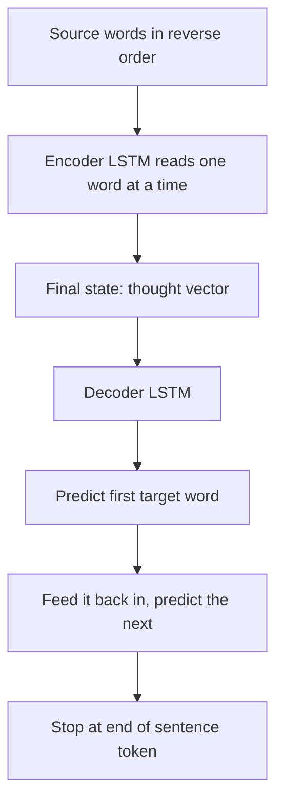

## The hook

For decades, machine translation systems were giant contraptions. Phrase tables with millions of entries, separate models for word alignment, reordering and fluency, each built by specialists and glued together with careful tuning. Google Translate ran on this kind of machine.

In 2014, three researchers at Google proposed replacing all of it with something almost absurdly simple. One neural network reads the English sentence. A second neural network writes the French sentence. Nothing else. No phrase tables, no grammar rules, no alignment models. And on a major benchmark, this pair of networks beat a strong traditional system.

## Before you start

You need [LSTMs](article:paper-lstm), which carry memory through a sequence, and [word vectors](article:paper-word2vec), which turn words into meaningful numbers. This paper connects the two into a general machine for turning one sequence into another.

## The world before this paper

Neural networks were good at mapping a fixed-size input to a fixed-size output, like an image to a label. But many important problems map a **sequence** to a **sequence** of a different length: a sentence to its translation, a question to an answer, audio to text. An English sentence of 8 words might become a French sentence of 11.

:::history
[[Statistical machine translation]] had dominated since the 1990s. Its best versions, phrase-based systems like the open-source Moses, translated chunks of words using probability tables learned from parallel texts, then rearranged and smoothed the result. Neural networks had started to help as components, for example to rescore a system's candidate translations. In the same year as this paper, Kyunghyun Cho, Yoshua Bengio and colleagues independently proposed a similar encoder-decoder design with a new, simpler kind of recurrent unit.
:::

Ilya Sutskever (fresh from [AlexNet](article:paper-alexnet)), Oriol Vinyals and Quoc Le asked whether a large, deep network, trained end to end on raw sentence pairs, could do the whole job alone.

## The big idea

Use one LSTM, the [[encoder]], to read the input sequence word by word and compress it into a single fixed-size vector. Use a second LSTM, the [[decoder]], to generate the output sequence word by word, starting from that vector.

:::analogy
Think of a professional interpreter at a conference who waits until the speaker finishes a whole sentence, holds its meaning in their head, and only then speaks the translation. They do not translate word by word. They first understand, then express. The encoder is the listening, the vector is the meaning held in mind, and the decoder is the speaking.
:::

That middle vector is sometimes called a [[thought vector]]: the network's compressed understanding of the sentence.

:::insight
Any problem that turns one sequence into another can, in principle, be learned by a single network trained end to end: read everything into a vector, then generate the output from it.
:::

## How it works

### Encoder and decoder

The encoder reads the source sentence and ends with a final hidden state. The decoder starts from that state and predicts the first target word. That word is fed back in as the next input, and the decoder predicts the second word, and so on, until it produces a special end-of-sentence token. This is how the model handles outputs of any length.

Training uses pairs of sentences. At each decoder step, the model is told the true previous word and asked to predict the next one, and the loss is the cross-entropy you met in [How Wrong Is the Model?](article:primer-loss-functions).

### Making it big

The model was large for its time: four layers of LSTMs in both encoder and decoder, each layer with 1,000 memory cells, 1,000-dimensional word embeddings, and a vocabulary of 160,000 English words and 80,000 French words. That came to about 384 million parameters. Training took about ten days on a machine with eight GPUs.

### The reversal trick

The most surprising finding was a tiny change: feed the source sentence in **reverse order**. Instead of "a b c" → "x y z," the network reads "c b a" and then writes "x y z."

Why should that help? In normal order, the first source word is far from the first target word: the whole sentence sits between them. In reverse order, the first source word is the last thing the encoder read, right before the decoder starts writing its first word. That creates many short-range connections early in the output, which gives the gradients an easy path to begin learning. The paper reported a large improvement in translation quality from this change alone.

:::try-this
Take the sentence "I love green tea," with French "J'aime le thé vert." How many words does the encoder read between "I" and the moment the decoder writes "J'"? Count it for the normal order, then for the reversed order ("tea green love I"). (Normal: "I" is read first, so three more words pass before the decoder starts. Reversed: "I" is the very last word read, immediately before "J'". Shorter gaps mean easier learning.)
:::

### Why one network can do it all

It is worth pausing on how little the model is told. Nobody explains that French adjectives usually follow nouns, that "le" and "la" depend on gender, or that idioms rarely translate word for word. The network sees only pairs of sentences, millions of them, and the loss rewards it for predicting each next French word. Everything else, grammar, word order, vocabulary, is absorbed as patterns in its weights. This "end to end" philosophy, give the network the raw input and the final output and let it learn everything in between, was the same bet that [LeNet](article:paper-lenet) had made for images, now applied to language.

### Beam search

At generation time, picking only the single most likely word at each step can lead to a dead end. So the decoder uses [[beam search]]: it keeps the few best partial translations, extends each with possible next words, and keeps the best few again. The paper found that even a small beam gave most of the benefit.

## What they found

The test was English-to-French translation on the WMT 2014 benchmark, scored with [[BLEU]].

- An ensemble of five deep LSTMs, translating directly, scored **34.8 BLEU**, beating a strong phrase-based statistical system that scored 33.3. This was the first time a pure neural approach had beaten a phrase-based system on a large translation task.
- Using the LSTMs to rescore the phrase-based system's top 1,000 candidate translations pushed the score to **36.5**, close to the best published result on that task.
- Surprisingly, the model did well on long sentences, which many had expected to break a fixed-size vector.
- When the authors projected the thought vectors to two dimensions, sentences with similar meanings clustered together. Sentences with the same words in a different order, such as "John admires Mary" and "Mary admires John," were kept apart, while active and passive versions of the same statement landed close together.

:::warning
Common misconception: "seq2seq understood language." The model learned to map between languages extremely well, but it also made confident mistakes, especially with rare words, which it replaced with an "unknown" token. Its strength was pattern-matching at scale, not reasoning about meaning.
:::

## What it got wrong (or left open)

The fixed-size vector is a bottleneck. Every sentence, short or long, has to fit into the same 8,000 or so numbers of the final LSTM state. The reversal trick helped, but it was a patch, not a fix.

The model also had a limited vocabulary. Any word outside its 80,000 French words had to be written as an "unknown" token, which hurt names, numbers and rare terms.

And the decoder had no way to look back at specific source words while translating. Human translators glance back at the source constantly. The network could only consult its single memorized summary.

## What happened next

- At almost the same moment, [Bahdanau, Cho and Bengio](article:paper-bahdanau-attention) posted a paper letting the decoder look back at every input word through attention, removing the bottleneck.
- In 2016, Google switched Google Translate to a neural system built on LSTMs with attention, and reported large reductions in translation errors.
- The encoder-decoder pattern spread to speech recognition, image captioning, summarisation and chatbots.
- The [Transformer](article:paper-attention-is-all-you-need) kept the encoder-decoder shape but replaced the LSTMs with attention, and its decoder half became the basis of [GPT](article:paper-gpt-1).

## Key takeaways

- Sequence to sequence learning uses an encoder LSTM to compress an input sequence into a vector and a decoder LSTM to generate an output sequence from it.
- Trained end to end on sentence pairs, a deep LSTM ensemble beat a strong phrase-based translation system on WMT 2014 English to French.
- Reversing the source sentence created short-range dependencies that made training much easier and improved results.
- The learned sentence vectors grouped sentences by meaning and were sensitive to word order.
- Squeezing every sentence into one fixed-size vector became a bottleneck, which attention mechanisms soon removed.
