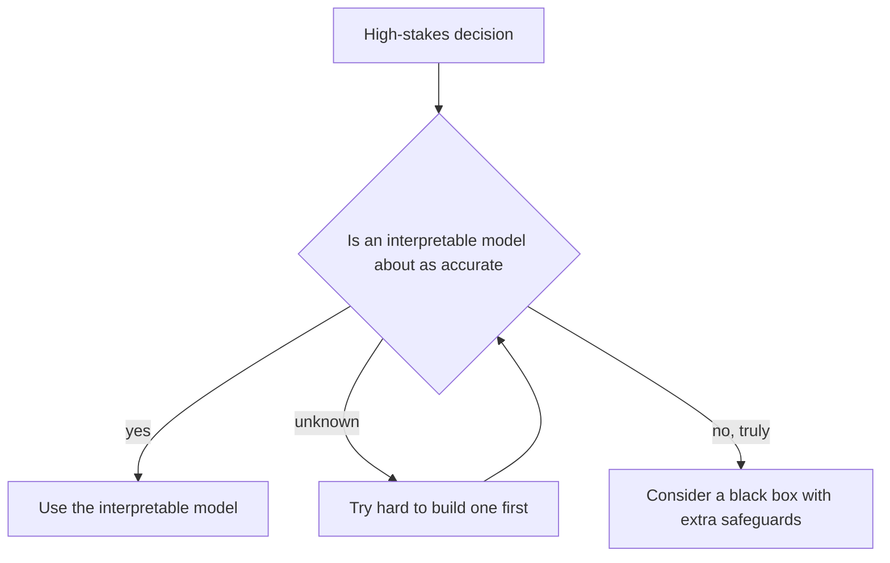

## The hook

A judge is deciding whether to release someone before trial. On her desk is a risk score from a commercial algorithm whose formula is a trade secret. Next to it is a colourful explanation produced by another algorithm, describing which factors "probably" mattered. Neither she nor the defendant can check whether either is right.

In 2019, Duke computer scientist Cynthia Rudin published a sharp argument: for decisions like this, stop building explanations for black boxes. Build models that are understandable in the first place.

## Before you start

You should know what a classifier is from [Yes or No? How Machines Make Decisions](article:primer-classification), and that complex models like ensembles can be powerful but hard to read, from [Random Forests](article:paper-random-forests). No maths beyond counting points is needed.

## The world before this paper

By the late 2010s, complex models were being used for high-stakes decisions: bail and parole, credit, medical triage. Many were [[black box model]]s, either because they were too complex to follow, like large neural networks and ensembles, or because they were proprietary.

The popular response was explainable AI: keep the black box, and add a [[post-hoc explanation]] method on top. Tools appeared that highlighted important features for one prediction, fitted simple local approximations, or drew [[saliency map]]s over images.

:::history
Cynthia Rudin had spent years building [[interpretable model]]s for real decisions, including power-grid maintenance in New York City and medical scoring systems. Her paper appeared on arXiv in late 2018 and in Nature Machine Intelligence in 2019. It was deliberately provocative, written as a perspective to change practice and policy, not to report a single experiment.
:::

## The big idea

:::analogy
Imagine buying a sealed machine that decides whether loans are approved, plus a separate translator who watches it and tells you, after each decision, why the machine probably said yes or no. The translator is fluent and confident, but has never seen inside the machine. Now compare that with a one-page checklist a loan officer follows, where every reason is written down. If something goes wrong, which one can you check, argue with or fix?
:::

The paper's big idea is that in high-stakes settings, the translator approach is fundamentally fragile. An explanation that perfectly matched the black box would itself be a complete model, so any simpler explanation must sometimes be wrong about what the box did. It is not [[faithful]]. Rather than trusting translators, use the checklist: models whose reasoning is visible by design.

## How it works

The paper is an argument, built from several claims.

**1. Explanations cannot be fully trusted.** A post-hoc explanation is a second model approximating the first. Where they disagree, the explanation misleads, and you cannot easily tell where that is. Saliency maps illustrate this: the paper shows maps for the same image under different predicted classes that highlight similar regions, so the "explanation" says little about why one class was chosen.

**2. The accuracy trade-off is often a myth.** People assume interpretable models must be less accurate. For problems with structured data and meaningful features, such as criminal history, age or income, Rudin argues that well-built simple models often perform about as well as complex ones, and that this should be tested rather than assumed.

**3. Interpretable models are hard to find, not hard to use.** Choosing the best few rules or point values from an enormous number of possibilities is a difficult optimisation problem. It needs real computational work and domain knowledge, which is where research effort should go.

**4. Policy should require the comparison.** When a black box is used for a high-stakes decision, those deploying it should show that no interpretable model of similar accuracy exists.

### What an interpretable model looks like

A points-based scoring system, like those used in hospitals, is a classic example. Here is a made-up one to show the shape:

| Factor | Points |
|---|---|
| Age under 25 | 2 |
| Each prior offence, up to 3 | 1 each |
| Currently employed | −1 |
| Predict high risk if the total is 3 or more | |

Anyone can compute it, see exactly why a person scored what they did, and spot an error in the inputs. A [[rule list]] is similar: a short, ordered list of if-then rules where the first match decides.

:::try-this
Score two people with the made-up table: a 22-year-old with one prior offence who is employed, and a 40-year-old with three prior offences who is unemployed. Which is "high risk"? (The first scores 2 + 1 − 1 = 2, below the threshold. The second scores 0 + 3 + 0 = 3, high risk. And you can see exactly which factors drove each answer.)
:::

:::insight
An explanation of a black box is a story about the model. An interpretable model is the model. When people's freedom or health depends on the decision, you want to inspect the model itself, not a story about it.
:::

### Why black boxes stay popular anyway

The paper is frank about incentives. Black boxes are convenient: throw in every feature and let the algorithm sort it out, with no domain expert needed. Proprietary models can be sold and protected as trade secrets, which an open checklist cannot. And a post-hoc explanation lets a team keep its existing model while appearing to address transparency. None of these reasons is about accuracy for the people affected. That is why Rudin argues the burden of proof should shift: before deploying a black box for a high-stakes decision, show that an interpretable model really cannot do as well.

## What they found

The paper gathers evidence from Rudin's work and the wider literature rather than reporting one new benchmark.

- **Recidivism prediction.** The paper discusses the proprietary COMPAS risk tool alongside a short rule list learned by CORELS, an algorithm from Rudin's group, that uses only age and criminal history and achieves similar accuracy.
- **Credit scoring.** Her team's entry to the FICO Explainable Machine Learning Challenge showed that a fully interpretable model could be competitive with black boxes on that dataset.
- **Images too.** For computer vision, where simple rules do not work, the paper points to interpretable deep learning, such as networks that classify by comparing image parts with learned prototype parts ("this looks like that").

:::warning
Common misconception: "interpretable means simple-minded or toy models." Finding the best sparse model is computationally hard, and interpretable deep networks exist for images. Interpretability is a constraint on the final model, not a lack of sophistication in building it.
:::

A practical rule follows for anyone building models: before training a deep network on tabular data, fit a small, readable model first. If it matches the black box, you have lost nothing and gained a model you can explain to the people it affects.

## What it got wrong (or left open)

- **Not every problem has a simple, accurate model.** For raw images, audio and language, interpretable models still trail large neural networks in many tasks, so the trade-off is real there.
- **"Interpretable" is not one thing.** A 50-rule list may be technically readable but practically hard to understand; the paper leaves open how to measure interpretability.
- **Optimisation can be expensive.** Exact methods for the best sparse models do not scale to every dataset, though research has steadily improved them.

## What happened next

The paper became one of the most cited arguments in the interpretability debate and is widely taught alongside explainable AI methods. It pushed researchers to benchmark interpretable baselines before reaching for black boxes, and it influenced discussions about regulating automated decisions in areas like lending and criminal justice.

Research on interpretable models grew: faster algorithms for optimal decision trees, rule lists and risk scores, and interpretable neural networks for images. Meanwhile, as large language models spread, the question the paper asks, can we trust an explanation that is not the model, became even more pressing. It connects back to the honest model-building advice in [A Few Useful Things to Know About Machine Learning](article:paper-few-useful-things).

## Key takeaways

- For high-stakes decisions, Rudin argues for models that are interpretable by design instead of black boxes with explanations added afterwards.
- A post-hoc explanation cannot be fully faithful, because a perfectly faithful explanation would itself be the model.
- On structured data with meaningful features, interpretable models are often about as accurate as black boxes, so the trade-off should be tested, not assumed.
- Building good interpretable models is a hard optimisation problem that deserves research effort and domain knowledge.
- Interpretable models let people check inputs, challenge reasons and fix errors, which matters most when decisions affect freedom, money or health.
