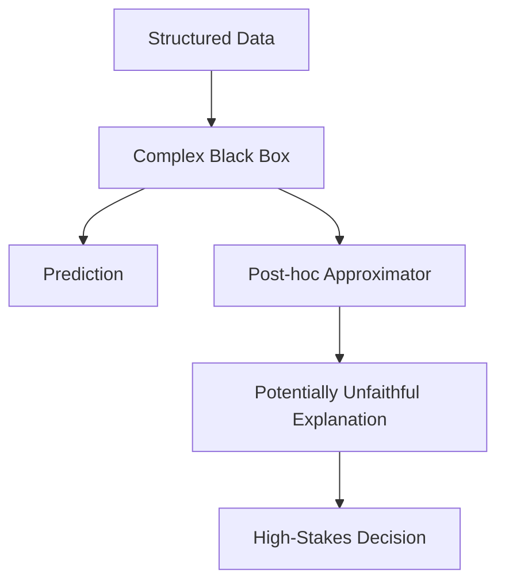
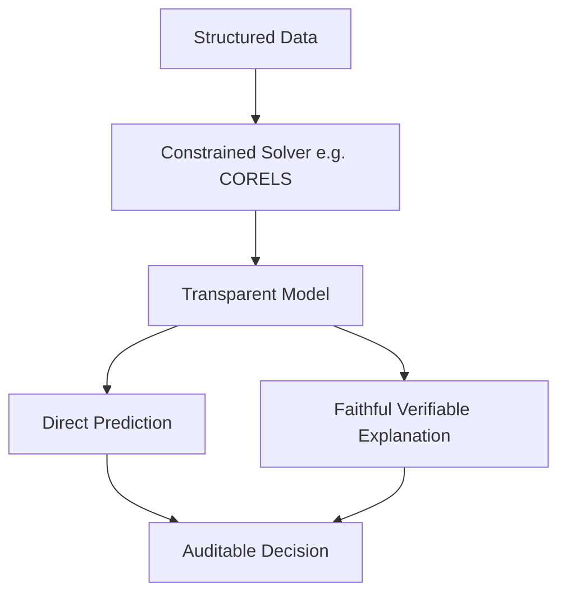
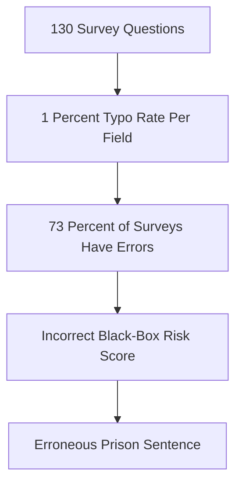

## The hook

A judge decides whether a prisoner receives bail based on a proprietary risk score. A doctor chooses whether to send an intensive care patient home based on a neural network output. A city sends emergency crews into an unfolding crisis guided by a machine learning forecast.

When these decisions alter human lives, everyone asks the same question: *why did the algorithm say that?*

The artificial intelligence research community had an answer ready: **Explainable AI (XAI)**. Keep your gigantic, opaque [[Black Box Model|black box]], and build a second, friendly model to explain it afterwards. In 2018, computer scientist Cynthia Rudin published a searing paper in *Nature Machine Intelligence* that called out this entire movement. Her thesis was unapologetic: trying to explain a black box is a dangerous trap. We should stop doing it, and build [[Inherently Interpretable Model|inherently interpretable models]] instead.

## Before you start

Before jumping in, it helps to be comfortable with the basics of how algorithms learn from structured tables of data:
- [Yes or No? How Machines Make Decisions](article:primer-classification) covers supervised classification.
- [What Machines Actually Learn From](article:primer-data-features-labels) breaks down rows, columns, and target labels.
- [Why a Crowd of Bad Guessers Beats an Expert](article:paper-random-forests) introduces tree-based models and ensembles.

## The world before this paper

By 2018, deep neural networks and complex ensembles like boosted decision trees were taking over industry. Alongside them came high-profile disasters:
- The commercial recidivism prediction tool COMPAS used over 130 questionnaire factors to predict criminal re-arrest, yet remained completely proprietary.
- An algorithm used by Google during the California wildfires reported air quality as ideal for outdoor exercise while people outside were brushing ash off their cars.
- A medical imaging model classified pneumonia by reading the word "portable" stamped on x-ray images by a specific machine, rather than reading lung tissue.

Because lives were at stake, researchers scrambled to create post-hoc explanations. A [[Post-hoc Explanation|post-hoc explanation]] is a secondary tool built after training to summarize what the primary black box did. Tools like saliency heatmaps, local surrogate models, and feature attribution scores swept the field.

Everyone assumed a fundamental rule of machine learning: **the accuracy-interpretability trade-off**. Textbooks, research papers, and government agencies published diagrams showing a smooth curve. Simple models like linear regression were pictured on the far left (interpretable, but low accuracy), while deep neural networks were pictured on the far right (inscrutable, but unbeatable accuracy).



Rudin looked at this status quo and pointed out that the Emperor had no clothes.

:::history
Cynthia Rudin had spent years working on real-world engineering problems, including predicting electrical manhole fires across New York City. The city dataset included handwritten trouble tickets, power line records dating back to the 1890s, and messy inspection reports. On that static data, complex algorithms differed in accuracy by at most 1%. But being able to *interpret* the model allowed the team to spot false assumptions, fix bad labels, and dramatically improve real-world safety.
:::

## The big idea

Rudin's insight rests on a fundamental logical truth: **an explanation cannot be 100% faithful to the black box it explains**.

If an explanation were completely faithful to the black box across every possible input, it would compute the exact same mathematical function as the black box. But if it computes the exact same function, you do not need the black box at all. You can just use the explanation as your model!

Whenever an explanation is not identical to the model, it is an approximation. If a surrogate model matches the black box 90% of the time, it is wrong 10% of the time. When a judge denies someone bail, or a doctor unplugs a monitor, you have no way of knowing whether you are standing inside that 10% error zone.

:::analogy
Relying on a post-hoc explanation of a black box is like hiring a suspicious accountant who keeps their ledger locked in a secret safe. When tax season arrives, they hand you a single number. Because you are nervous, you hire a second person to glance at your bank statements and guess how the accountant arrived at that number. 

Instead of paying two people to guess what happened in the dark, it is far safer to demand an open, simple spreadsheet from the very beginning.
:::

Rudin delivered a second gut punch: on structured tabular datasets, the trade-off between accuracy and interpretability is largely a myth. If your data has well-defined features, simple models can almost always match the predictive power of a billion-parameter network.

Why would that be true? Rudin pointed to the **[[Rashomon Set|Rashomon set]]**.

When you train models on finite data, there is rarely just one unique "perfect" mathematical function. Instead, there is often a large set of wildly different models that all achieve nearly identical, top-tier performance. Because that set of good models is so large, it almost always contains models that are simple, sparse, and human-readable.



:::insight
If you use a post-hoc explanation, you now have two models to debug instead of one: the original black box, and the approximation that tries to explain it.
:::

## How it works

If simple, accurate models exist inside the Rashomon set, why don't people use them?

Because finding them is mathematically hard.

Training a standard neural network relies on continuous gradients. You wiggle weights using calculus. But finding a tiny, human-readable model—like a rule list with only three lines or a checklist with small whole numbers—is a discrete combinatorial search problem. In computer science terms, it is NP-hard.

Rudin showed that advances in optimization now allow us to solve these problems directly.

### 1. Optimal logical models (CORELS)

Consider an "if-then" rule list. Traditional heuristic decision trees (like CART or C4.5) build trees greedily: they pick the best single split at step one, then split again, and prune afterwards. This greedy shortcut often leads to sprawling trees with hundreds of messy branches that miss the cleanest patterns.

Rudin formulated the task as an explicit optimization problem balancing classification error against model size:

$$\min_{f \in \mathcal{F}} \left( \frac{1}{n} \sum_{i=1}^n \mathbf{1}[f(x_i) \neq y_i] + \lambda \times \text{size}(f) \right)$$

Let us break down each part of this equation:
- $n$ is the total number of training examples.
- $x_i$ is the input data for person $i$, and $y_i$ is their true label.
- $f(x_i)$ is the model prediction.
- $\mathbf{1}[\cdot]$ is an indicator function that equals $1$ if the prediction is wrong and $0$ if it is correct.
- $\text{size}(f)$ is the complexity of the model (for example, the number of rules in the list).
- $\lambda$ (lambda) is a trade-off parameter you choose. If $\lambda = 0.01$, you are telling the solver: "I am willing to tolerate a 1% increase in training error if you can eliminate one rule from the list."

Searching every possible combination of rules to minimize this formula would take until the end of the universe on a standard laptop. To crack this, Rudin and her colleagues built **[[CORELS]]** (Certifiably Optimal Rule Lists).

CORELS combines three techniques:
1. **Mathematical pruning bounds:** theorems proving that huge branches of the search tree can never contain the optimal model, allowing CORELS to discard millions of rule combinations without evaluating them.
2. **Bit-vector operations:** patient records and rules are represented as raw sequences of 0s and 1s, so testing whether a rule applies to 10,000 people takes a few bitwise CPU instructions.
3. **Symmetry caching:** recognizing when two different orderings of conditions lead to identical subsets of data.

With these tools, CORELS finds provably optimal, tiny rule lists in seconds.

### 2. Sparse integer scoring systems (RiskSLIM)

Doctors and judges do not want to multiply floating-point numbers like $0.3472 \times x_1 - 1.8291 \times x_2$ in their heads. They prefer simple point tallies: +1 point for high blood pressure, +2 points for age over 60.

To create these rigorously, Rudin and her collaborators designed **[[RiskSLIM]]** (Risk-Supersparse-Linear-Integer-Models). It minimizes logistic loss while restricting weights to a tight integer grid:

$$\min_{b_1, \dots, b_p \in \{-10, \dots, 10\}} \left( \frac{1}{n} \sum_{i=1}^n \log\left(1 + \exp\left(-\sum_{j=1}^p b_j x_{i,j}\right)\right) + \lambda \sum_{j=1}^p \mathbf{1}[b_j \neq 0] \right)$$

Here:
- $x_{i,j}$ is feature $j$ of observation $i$.
- $b_j$ is the point score assigned to that feature. Crucially, each $b_j$ must be an integer between $-10$ and $10$.
- The first term is standard logistic loss.
- The second term penalizes any feature that has a non-zero score, forcing the system to pick only the most crucial variables.

Because the weights are constrained to an integer lattice, this is a Mixed-Integer Nonlinear Program (MINLP). RiskSLIM solves it using specialized cutting plane algorithms that add linear constraints whenever a proposed solution lands on integers, producing optimal point systems without manual rounding hacks.

:::try-this
Imagine a scoring system where:
- Prior arrest within 1 year = 2 points
- Age under 21 = 1 point
- Three or more past offenses = 1 point

If total score $\ge 2$, predict high risk. Calculate your prediction for a 20-year-old with one past offense committed two months ago. 

*(Score: 2 + 1 = 3 points $\rightarrow$ High risk).* 

Notice that you verified the model calculation in four seconds with mental arithmetic. There are no hidden intermediate activations or mystery weights.
:::

## What they found

The empirical findings presented in the paper overturned several industry dogmas.

### The 3-rule model that matched proprietary software

The commercial tool COMPAS required a 130-question survey to predict whether a defendant would be re-arrested. Its internal weights were protected as trade secrets.

Rudin ran CORELS on public arrest records from Broward County, Florida. In under one minute on a laptop, CORELS produced this complete, transparent model:

```text
IF age between 18 and 20 AND sex is male THEN predict arrest
ELSE IF age between 21 and 23 AND 2 to 3 prior offenses THEN predict arrest
ELSE IF more than three prior offenses THEN predict arrest
ELSE predict no arrest
```

That was it. Three if-then statements.

When evaluated on held-out test data, this transparent three-rule model matched the predictive accuracy, false positive rate, and false negative rate of COMPAS. A model that any defendant, attorney, or judge can read in ten seconds matched a proprietary commercial system powered by 130 inputs.

### The danger of input errors

Requiring 130 inputs introduces serious human error. Rudin calculated that if human clerks making data entry have just a **1% typographical error rate per field**, then:

$$\text{Probability of at least one error} = 1 - (1 - 0.01)^{130} \approx 1 - 0.27 = 73\%$$

More than **7 out of 10 surveys** used to compute COMPAS risk scores would contain at least one typographical error! When an opaque model requires a mountain of features, simple typos change human bail decisions without anyone noticing.



### Saliency maps do not explain decisions

In computer vision, practitioners often present saliency maps—heatmaps showing which pixels a network focused on—as explanations. Rudin demonstrated that saliency maps for completely different classes can look nearly identical.

A heatmap highlighting the outline of a Siberian husky might look almost the same as a heatmap highlighting a transverse flute. Highlighting *where* the model looked tells you nothing about *what* features it extracted from those pixels, or *why* it made its classification.

:::warning
Never assume an attention heatmap or saliency map is an explanation of model reasoning. A map only indicates location, not logic.
:::

## What it got wrong (or left open)

While Rudin's call to action reshaped the field, her paper pushed against boundaries that remain difficult today:

1. **Worst-case computational complexity:** Discrete optimization is NP-hard. While algorithms like CORELS and RiskSLIM work brilliantly for datasets with dozens or hundreds of features, they can struggle when tabular datasets balloon to hundreds of thousands of raw columns.
2. **The fuzziness of interpretability:** Interpretability depends on who is reading the model. A three-rule list is interpretable to a judge; an additive spline model is interpretable to a statistician; a set of prototype image patches is interpretable to a radiologist. There is no single mathematical formula for what humans understand.
3. **Unstructured data:** For raw images, audio, and large language corpora, individual pixels or tokens are not meaningful on their own. While Rudin proposed prototype networks (models that classify an image by comparing parts to prototypical training patches—"this looks like that"), deep neural networks remain dominant in vision and language, where sparsity alone is not enough.

## What happened next

Rudin's 2018 paper became one of the most cited critiques in modern machine learning history, igniting a fierce debate between the post-hoc explainability camp and the inherent interpretability camp.

Her challenge catalyzed major technical breakthroughs:
- **Scalable optimal trees:** Researchers developed Generalized Optimal Sparse Decision Trees (GOSDT), using dynamic programming and prefix trees to solve full decision tree optimization orders of magnitude faster.
- **Explainable Boosting Machines (EBMs):** Modern implementations of Generalized Additive Models proved that additive models could match gradient-boosted trees on medical tabular data while displaying the exact effect of every single variable on clean 2D graphs.
- **Regulatory scrutiny:** Government bodies drafting AI regulations began re-evaluating rules around algorithmic transparency. The European Union's GDPR had established a vague "right to an explanation," but legal scholars increasingly cited Rudin to argue that regulators should ban proprietary black boxes outright in criminal justice and credit scoring when interpretable alternatives exist.

Rudin received the Squirrel AI Award for Artificial Intelligence for the Benefit of Humanity in 2021—often called the Nobel Prize of AI—in large part for her uncompromising work proving that transparency does not require sacrificing accuracy.

## Key takeaways

- Post-hoc explanations are approximations of black-box models, meaning they are inherently unfaithful and can produce catastrophic mistakes in high-stakes decisions.
- On clean, structured tabular datasets with meaningful features, the trade-off between interpretability and predictive accuracy is largely a myth.
- The Rashomon set concept explains why accurate interpretable models exist: finite data usually admits many diverse, near-optimal models, and this set frequently contains simple ones.
- Complex black-box models that require dozens of features dramatically increase human typographical error in the real world, causing procedural unfairness.
- Whenever human health, liberty, or safety is on the line, we should design inherently interpretable models whose internal calculations are auditable from the start.
