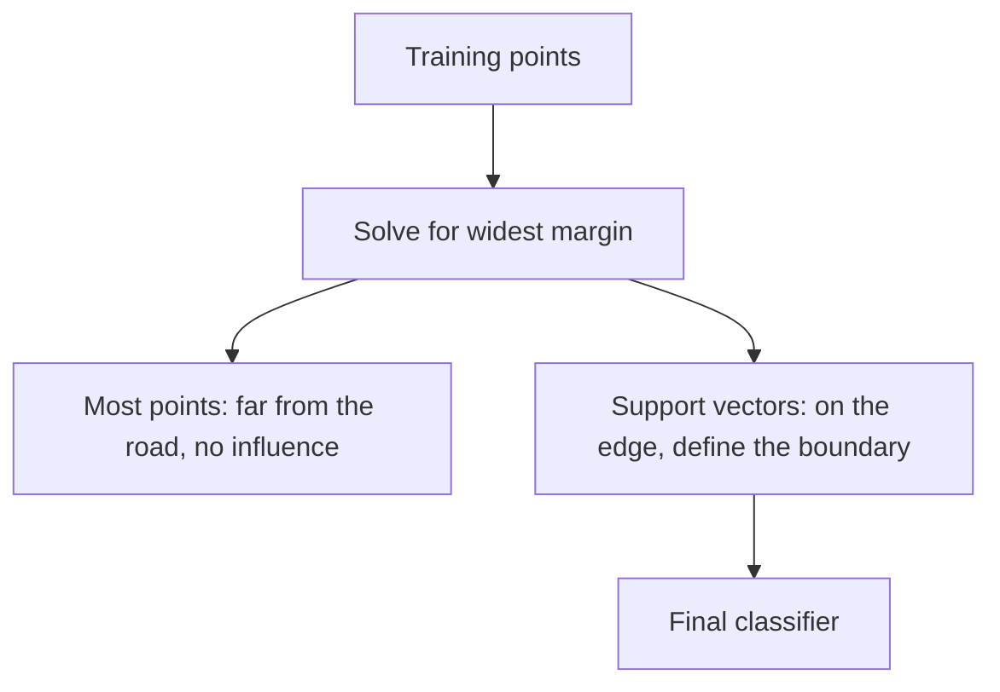

## The hook

Imagine two crowds of fans after a cricket match, spilling out onto the same open ground. The police want to put up a barrier between them. Many barrier positions would technically separate the groups. But if you put it right next to one crowd, the first person who steps sideways ends up on the wrong side.

The sensible choice is obvious once you say it out loud: put the barrier where it leaves the **widest possible road** between the two crowds. That one piece of common sense, turned into precise mathematics, became the most respected machine learning method of the late 1990s and 2000s.

## Before you start

You should be comfortable with decision boundaries from [Yes or No? How Machines Make Decisions](article:primer-classification) and with the danger of memorizing from [Memorizing vs Learning](article:primer-overfitting). Support vector machines are, at heart, a principled answer to "which boundary will generalize best?"

## The world before this paper

:::history
Vladimir Vapnik had spent decades in the Soviet Union developing statistical learning theory with Alexey Chervonenkis, including the VC dimension, a way to measure how complex a family of models is. In 1990 he moved to AT&T Bell Labs in New Jersey, which at the time was one of the best places in the world for machine learning, with Yann LeCun working on neural networks for handwriting just down the hall.
:::

In 1992, Vapnik and colleagues Bernhard Boser and Isabelle Guyon had shown how to find the maximum-margin boundary and combine it with kernels to get curved boundaries. But that method assumed the training data could be separated perfectly, which real data almost never can. Noisy labels, overlapping classes and odd outliers break the assumption.

Meanwhile, neural networks trained with [backpropagation](article:paper-backpropagation) worked, but they needed lots of tinkering: how many hidden units, which learning rate, when to stop. Results could change from run to run. Practitioners wanted something with cleaner guarantees.

## The big idea

Corinna Cortes and Vladimir Vapnik combined three ideas into one practical tool, which they called the support-vector network:

1. Choose the boundary with the widest [[margin]].
2. Allow some mistakes with a [[soft margin]], so messy data still works.
3. Use the [[kernel trick]] to get curved boundaries cheaply.

:::analogy
Keep the image of the barrier and the two crowds. The margin is the empty road on either side of the barrier. The few fans standing right at the edge of the road are the ones who decide where the barrier can go; everyone further back is irrelevant. And when a few rowdy fans are standing in the wrong crowd, you do not give up on the barrier: you accept a small, penalised number of misplaced people in exchange for a much better road for everyone else.
:::

:::insight
The best boundary is not just one that separates the training data. It is the one that stays as far as possible from both classes, because that leaves the most room for new, unseen examples to land on the correct side.
:::

## How it works

### The margin, in symbols

A straight boundary can be written as $w \cdot x + b = 0$, where $w$ is a vector of weights and $b$ is a bias, just like logistic regression. The SVM fixes the scale so that the closest points on each side satisfy $w \cdot x + b = \pm 1$. Then the width of the road turns out to be

$$\text{margin} = \frac{2}{\|w\|}$$

- $\|w\|$ is the length of the weight vector.
- A shorter $w$ means a wider margin.

So "widest road" becomes a clean optimization problem: make $\|w\|$ as small as possible while keeping every point on its correct side of the road.

### Support vectors

When you solve that problem, something elegant happens. The final boundary depends only on the points sitting right at the edge of the road, or inside it. These are the [[support vector|support vectors]]. You could delete every other training point and get exactly the same boundary.

That is where the name comes from: the boundary is held up, or supported, by a handful of critical examples.

### The soft margin

Cortes and Vapnik's key addition was letting the road be imperfect. Each training point gets a [[slack variable]] $\xi_i$, which is zero if the point is safely on its side and grows if the point intrudes into the road or crosses the boundary. The goal becomes

$$\text{minimise} \quad \frac{1}{2}\|w\|^2 + C\sum_i \xi_i$$

- The first term asks for a wide margin.
- The second term charges a price for every violation.
- $C$ sets the exchange rate. A large $C$ means "avoid mistakes at almost any cost," which risks overfitting to noise. A small $C$ means "a wide road matters more than a few mistakes."

### The kernel trick

Some data cannot be split by any straight line. Imagine one class of points in the middle of a number line, at $-0.5$ and $0.5$, and the other class on both ends, at $-2$ and $2$. No single cut works.

Now map each number $x$ to two numbers, $(x, x^2)$. The middle points become $(-0.5, 0.25)$ and $(0.5, 0.25)$; the outer points become $(-2, 4)$ and $(2, 4)$. In this new [[feature space]], a flat line at height 1 separates them perfectly. Back on the original number line, that line corresponds to a boundary at $x = \pm 1$: a curved decision made with a straight-line method.

The trick is that SVM training only ever needs **dot products** between pairs of points. A kernel function computes the dot product the points *would* have in the richer space directly from the original points, without building the new coordinates. That makes it possible to use enormous, even infinite-dimensional feature spaces at manageable cost.

:::try-this
Using the map $x \rightarrow (x, x^2)$, where would the point $x = 1.5$ land? Which side of the line at height 1 is it on, and which class would it be assigned? (It lands at $(1.5, 2.25)$, above the line, so it joins the outer class. That matches intuition: 1.5 is closer to the outer points.)
:::

## What they found

The paper tested support-vector networks on handwritten digit recognition, a central benchmark at Bell Labs, using the US Postal Service digit data and the larger NIST collection. Using polynomial kernels, the SVMs performed competitively with the best existing methods, including carefully engineered neural networks, while needing far less hand-design of the architecture.

They also observed that the number of support vectors was a small fraction of the training set, and that this was related to how well the classifier generalized: fewer support vectors relative to the data tended to mean better results on new examples.

:::warning
Common misconception: "SVMs are a kind of neural network." The paper's title says "networks," and the decision function can be drawn as a network with one hidden layer. But the training is completely different: SVMs solve a convex optimization problem with a single best answer, while neural networks are trained by gradient descent that can land in different places on different runs.
:::

## What it got wrong (or left open)

SVM training time grows quickly with the number of training examples, roughly with the square of the dataset size or worse. That was fine for tens of thousands of examples but became a wall at millions.

Kernels also have to be chosen by hand. Picking a good kernel for images or text is a form of feature engineering, and that is exactly the human effort that deep learning later automated by learning features directly from raw data.

Finally, SVMs are built for yes-or-no decisions. Handling many classes, or outputting calibrated probabilities, needs extra machinery bolted on.

## What happened next

- Through the late 1990s and 2000s, SVMs became a default choice for text classification, bioinformatics and many vision tasks. Libraries like LIBSVM put them in every researcher's toolkit.
- The margin idea influenced theory widely and connected to boosting and other methods covered in [A Few Useful Things to Know About Machine Learning](article:paper-few-useful-things).
- In 2012, [AlexNet](article:paper-alexnet) showed that deep networks trained on huge datasets with GPUs could beat feature-engineered pipelines on image recognition, and the field swung back to neural networks.
- Kernels never vanished. The idea of measuring similarity with dot products in a rich space echoes through [embeddings](article:primer-embeddings) and the dot-product scores at the heart of [attention](article:paper-attention-is-all-you-need).

## Key takeaways

- Support vector machines choose the separating boundary with the widest margin, which tends to generalize better to new data.
- The boundary is determined only by the support vectors, the few training points closest to it.
- Cortes and Vapnik's soft margin allows penalised mistakes, controlled by a parameter C, so the method works on noisy, overlapping real data.
- The kernel trick lets a straight-line method learn curved boundaries by implicitly working in a richer feature space.
- SVMs dominated many tasks until deep learning showed that learning features from raw data at scale worked better.
