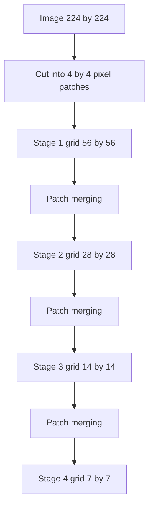

## The hook

In 2020, the Vision Transformer showed that you could cut a photo into patches, treat them like words, and classify images very well. Then people tried to use it for the jobs vision systems actually do all day: finding every car in a street scene, or labelling every pixel of a road.

Those jobs need big, detailed images, and attention compares every patch with every other patch. Double the width and height of the image and the work grows sixteen times. The idea that conquered language was choking on pixels.

## Before you start

You should know how self-attention compares tokens, from [The Paper That Taught Machines Where to Look](article:paper-attention-is-all-you-need), and how an image becomes a sequence of patches, from [the Vision Transformer article](article:paper-vit). Knowing that CNNs like [ResNet](article:paper-resnet) shrink their feature maps stage by stage will help.

## The world before this paper

For a decade, convolutional networks were the default [[backbone]] for vision. They had two habits that suited images. Each filter only looked at a small neighbourhood, so cost grew in step with image size. And they shrank the feature map stage by stage, building a pyramid: fine detail early, big shapes late. Detection and segmentation systems were built around that pyramid.

The Vision Transformer (ViT) broke both habits. Every patch attended to every other patch, and the grid stayed the same size in every layer. That was fine for 224 by 224 pixel classification with 16 by 16 pixel patches, which gives only 196 tokens. It was hopeless for dense prediction, which needs small patches on large images.

:::history
Ze Liu, Yutong Lin, Yue Cao, Han Hu, Yixuan Wei, Zheng Zhang, Stephen Lin and Baining Guo at Microsoft Research Asia posted Swin Transformer in March 2021. It appeared at ICCV 2021 and won the conference's Marr Prize for best paper. Their stated goal was a Transformer that could serve as a general-purpose backbone for all of computer vision, not just classification.
:::

People had tried local attention before, sliding a window around each pixel like a convolution. The catch was speed: every position had a different set of neighbours, so the work could not be packed into the large, regular matrix multiplications that GPUs are good at.

## The big idea

:::analogy
Picture a huge open-plan office. If everyone held one giant meeting with everyone else, nothing would get done. So the office is split into pods of desks, and people only talk within their pod. That is fast, but news never leaves a pod. The fix: every other day, the pod boundaries move by half a pod, so each new pod mixes people from four old ones. And every few weeks, neighbouring pods merge into larger teams with broader jobs.
:::

Swin does exactly this with image patches. [[Window attention]] is the pod: attention only inside a small square window. [[Shifted windows]] are the moved boundaries in the next layer, so information leaks across the old borders. [[Patch merging]] is the team merge: between stages, groups of 2 by 2 patches become one, so the network sees larger regions with fewer, richer tokens.

The result is a Transformer that behaves like a CNN where it matters: local work, cost that grows with image area, and a pyramid of feature maps.

## How it works

Inside every stage, blocks come in pairs: one block uses regular windows, the next uses shifted windows. In the office, that is a day in the usual pods followed by a day in the moved pods.

### Step 1: small patches, small windows

Swin cuts the image into 4 by 4 pixel patches. A 224 by 224 image becomes a 56 by 56 grid, 3,136 tokens. The grid is then split into windows of 7 by 7 patches, so 64 windows of 49 patches each. Every patch attends only to the 48 others in its window.

### Step 2: count the work

Here is the number of patch-to-patch comparisons in one attention layer for that 56 by 56 grid:

| Attention type | How to count | Comparisons |
|---|---|---|
| Global, as in ViT | 3,136 × 3,136 | 9,834,496 |
| Window, 7 by 7 | 64 windows × 49 × 49 | 153,664 |

Window attention does 64 times fewer comparisons here. The paper writes the full cost for an $h \times w$ grid with $C$ channels and window size $M$:

$$\Omega(\text{MSA}) = 4hwC^2 + 2(hw)^2C, \qquad \Omega(\text{W-MSA}) = 4hwC^2 + 2M^2hwC$$

The first term, shared by both, is the cost of the projections that make queries, keys, values and outputs. The second term is the comparisons. In global attention it contains $(hw)^2$, the number of patches squared. In window attention it contains $M^2 hw$, and $M^2$ is a fixed 49. With $h = w = 56$ and $C = 96$, the comparison term drops from 1,888,223,232 to 29,503,488, and the whole layer from about 2.0 billion to about 145 million operations.

:::try-this
Double the image to 448 by 448 pixels. The grid becomes 112 by 112, or 12,544 patches. How do global and window comparisons change? (Global: 12,544 squared is 157,351,936, sixteen times more. Window: 12,544 × 49 is 614,656, only four times more, exactly in step with the area.)
:::

### Step 3: shift the windows

Pods that never talk are a problem. A car straddling two windows is seen as two unrelated halves. So the next block moves the window grid by half a window, $\lfloor 7/2 \rfloor = 3$ patches, down and to the right. Patches that sat on either side of an old border now share a window.

In the office, the moved pods are where a person from the left pod first meets a person from the right pod. Stack a few pairs of blocks and news can travel across the whole grid.

### Step 4: the cyclic shift trick

Shifting creates a mess at the edges. On the 56 by 56 grid, a shifted cut gives 9 windows along each side instead of 8, so 81 windows instead of 64, and many are slivers. In the paper's small picture, a 2 by 2 arrangement of windows becomes 3 by 3, nine windows of uneven sizes.

Padding the slivers to full size would waste work. Instead, Swin uses a [[cyclic shift]]: it rolls the whole grid up and left by 3 patches, so the slivers that fell off one edge wrap around to the opposite edge. Now the grid can be cut into the same 64 full windows as before.

Some of those windows now contain pieces that were never neighbours, such as a strip from the top edge next to a strip from the bottom. A mask blocks attention between pieces that came from different places. After attention, the grid is rolled back.

:::warning
Common misconception: "Shifted windows give every patch global attention." They do not. Each block still only looks inside a 7 by 7 window. Information spreads across the image gradually, through alternating shifts and the shrinking grid in later stages, much like a CNN's growing receptive field.
:::

### Step 5: merge patches to build the pyramid

Between stages, [[patch merging]] takes each 2 by 2 group of neighbouring patches, stacks their features into one vector of $4C$ numbers, and a linear layer squeezes that to $2C$. With $C = 96$ in the smallest model, that is 384 numbers squeezed to 192. For a 224 pixel image the grids go:

| Stage | Grid | Tokens | Channels in Swin-T | 7 by 7 windows |
|---|---|---|---|---|
| 1 | 56 by 56 | 3,136 | 96 | 64 |
| 2 | 28 by 28 | 784 | 192 | 16 |
| 3 | 14 by 14 | 196 | 384 | 4 |
| 4 | 7 by 7 | 49 | 768 | 1 |

By stage 4 a single window covers the whole image, so global attention arrives for free once the grid is small. In office terms, pods become teams, teams become departments, and the last stage is one all-hands meeting of 49 people.

### Step 6: position as distance

Instead of stamping each patch with an absolute position, Swin adds a [[relative position bias]] to each attention score: a learned number that depends only on the offset between two patches inside the window. "One patch to the left" means the same thing anywhere in the image, which suits vision.

:::insight
Swin's lesson is that the bottleneck was not attention itself but attention over everything at once. Keep attention local, move the borders every other layer, and shrink the grid between stages, and a Transformer gains the habits that made CNNs good at images.
:::

## What they found

The paper reports results across classification, detection and segmentation:

- **Image classification:** 87.3% top-1 accuracy on ImageNet-1K for its largest model, which was pre-trained on the bigger ImageNet-22K dataset.
- **Object detection and instance segmentation:** 58.7 box AP and 51.1 mask AP on COCO test-dev, beating the previous best by 2.7 box AP and 2.6 mask AP.
- **Semantic segmentation:** 53.5 mIoU on ADE20K val, 3.2 points above the previous best.
- **Beyond Transformers:** the hierarchical design and shifted windows also helped all-MLP architectures, which suggests the layout itself, not just attention, does much of the work.

These margins on dense prediction were large for mature benchmarks, and they made the case that a Transformer could be the default backbone for vision, not only a classifier.

## What it got wrong (or left open)

- **More engineering, less simplicity.** Cyclic shifts, masks and relative position tables are fiddly compared with a plain convolution or plain global attention, and they need care to run fast on every kind of hardware.
- **Global context arrives late.** Early layers only see their window. Long-range relationships have to wait for shifts and merging, the same limit that CNNs have.
- **Fixed window size.** The relative position table is tied to the window size, so moving a trained model to larger windows or resolutions needs resizing tricks, which the authors' follow-up work addressed.
- **Was it the attention or the design?** Because the MLP results also improved, the paper left open how much of the gain came from attention and how much from the CNN-like layout.

## What happened next

The same group released Swin Transformer V2 in 2022, scaling the model up and making the position bias work across window sizes and higher resolutions. Video Swin extended the windows to 3D, over space and time.

The open question about design versus attention was taken up by ConvNeXt in 2022, which modernised a ResNet step by step using choices borrowed from Swin, and found a pure CNN could compete. That echoes earlier work such as [ResNeXt](article:paper-aggregated-residual-transformations-for-deep-neural-networks), which also gained accuracy by rethinking the block layout. Meanwhile, Swin-style backbones became a common choice in detection and segmentation systems, alongside the data-efficient ViT training from [DeiT](article:paper-training-data-efficient-image-transformers-distillation-thro).

## Key takeaways

- Global attention over small image patches costs the number of patches squared, which makes high-resolution detection and segmentation impractical for a plain Vision Transformer.
- Swin computes attention only inside fixed 7 by 7 windows, so the cost grows in step with image area, 64 times fewer comparisons than global attention on a 56 by 56 grid.
- Alternating regular and shifted windows lets information cross window borders, and a cyclic shift with a mask keeps the shifted layer as cheap as the regular one.
- Patch merging halves the grid between stages, giving the multi-scale feature pyramid that detection and segmentation heads were built for.
- Swin set new best results on COCO and ADE20K by clear margins and showed a Transformer could be a general-purpose vision backbone.
