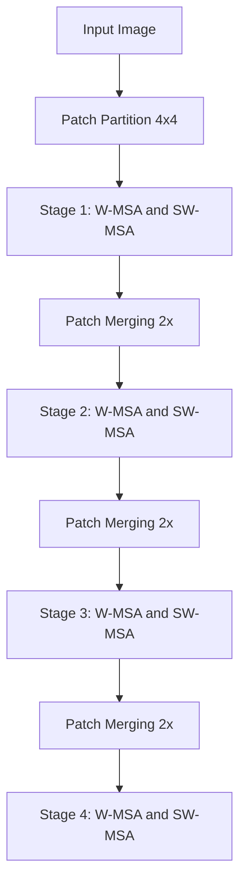
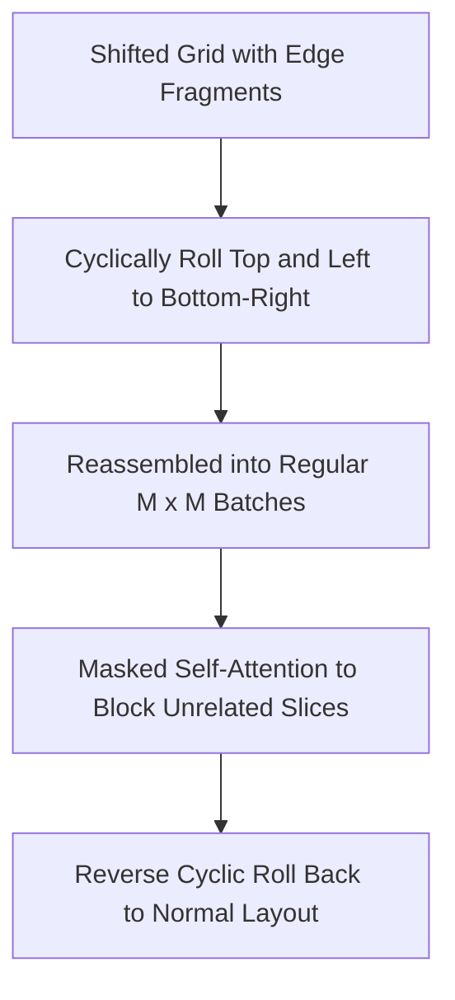

## The hook

When researchers first adapted the Transformer to images, it felt like magic. Instead of stacking dozens of convolutional layers, you chopped an image into square patches, treated those patches like words, and let self-attention do the rest. But try feeding that model a high-resolution photograph to pinpoint every pedestrian and car, and your GPU crashes instantly. The very mechanism that gave Transformers their power was strangling them with math.

```
Standard Vision Transformer:
Every patch attends to every patch -> O(N^2) explosion!

[ P1 ] <---> [ P2 ] <---> [ P3 ] <---> [ P4 ]
  ^            ^            ^            ^
  |------------+------------+------------|  (quadratically expensive)
```

## Before you start

Before jumping in, make sure you are comfortable with:
- The self-attention mechanism from [Attention Is All You Need](article:paper-attention-is-all-you-need).
- Residual connections and hierarchical feature maps from [ResNet](article:paper-resnet).
- Patch tokenization in images from [Vision Transformer (ViT)](article:paper-vit).

## The world before this paper

For nearly a decade, Convolutional Neural Networks (CNNs) ruled computer vision. Architectures like [ResNet](article:paper-resnet) had two superpowers built into their design. First, they processed images locally: a small filter slid over nearby pixels, so computational cost grew linearly with image size. Second, they formed a feature pyramid: early layers captured fine pixel details at high resolutions, while deeper layers pooled pixels together to understand big-picture concepts.

Then came the [Vision Transformer (ViT)](article:paper-vit). ViT bypassed convolutions entirely. It sliced an image into $16 \times 16$ pixel patches, flattened them into vectors, and ran standard Transformer blocks over the whole set.

ViT worked well for basic image classification on modest $224 \times 224$ inputs, which produce only 196 patches. But computer vision involves far more than classification. Autonomous cars, medical imaging, and photo editing require dense prediction tasks:
- **Object Detection:** Finding bounding boxes around objects of vastly different sizes.
- **Semantic Segmentation:** Labeling every single pixel in an image (for example, identifying exactly which pixels belong to a tumor or a road).

Dense prediction requires high-resolution inputs, often $1024 \times 1024$ pixels or larger. If you chop a $1024 \times 1024$ image into $4 \times 4$ patches, you get $256 \times 256 = 65{,}536$ tokens. 

Because standard attention calculates the relationship between every pair of tokens, the cost scales with the square of the token count: $65{,}536^2 \approx 4.3 \times 10^9$ interactions per layer. A single forward pass demands billions of floating-point operations.

Worse, ViT stayed at a single, unchanging resolution throughout all its layers. It never built the multi-scale pyramids that detection and segmentation algorithms relied on to recognize small traffic cones alongside huge skyscrapers.

:::history
Earlier researchers attempted local self-attention using sliding windows, moving a small attention window pixel-by-pixel like a convolutional filter. But on real GPU hardware, sliding-window attention was brutally slow. Because every single pixel had a different neighborhood of keys, memory access could not be grouped into neat tensor multiplications.
:::

## The big idea

The researchers at Microsoft Research Asia realized they did not need global attention everywhere to capture visual scenes. Most visual details depend heavily on their immediate neighbors.

They designed **Swin Transformer** around two principles:
1. **Local Windows:** Divide the image into small, non-overlapping windows (such as $7 \times 7$ patches) and run self-attention only within each window. This keeps computational cost strictly linear with respect to image size.
2. **Shifted Windows:** In the very next layer, shift the window boundaries by half a window. Patches that sat in separate windows in layer 1 now sit together in layer 2, letting information flow across boundaries without any extra computation.

:::analogy
Imagine a conference hall with 400 attendees. If everyone tries to talk to everyone else simultaneously, the room descends into chaos with $400^2 = 160{,}000$ conversational pairings. 

Instead, organizers split everyone into private tables of four. Conversations are quiet, fast, and focused. But how do ideas spread across tables? In the next round, the organizers shift the table seating so every new table mixes people from neighboring tables in the previous round. Ideas spread across the entire hall, yet nobody ever had to shout across a 400-person room.
:::

Combine this shifted windowing scheme with [[Patch Merging]] to halve the spatial resolution every few stages, and you get a hierarchical vision Transformer that runs at lightning speed.

## How it works

Let's trace how an image flows through the Swin architecture.



### Step 1: Patch partition and linear embedding
An RGB image of size $H \times W \times 3$ is split into non-overlapping patches of $4 \times 4$ pixels. Each patch contains $4 \times 4 \times 3 = 48$ raw color values. A linear layer projects those 48 numbers into an embedding dimension $C$ (for instance, $C = 96$ in Swin-Tiny).

### Step 2: Local Window Attention ([[W-MSA]])
Instead of letting all patches attend to one another, the feature map is partitioned into regular, non-overlapping windows of $M \times M$ patches (by default, $M = 7$).

Let's look at the computational complexity formulas:

For standard global multi-head self-attention on an image of $h \times w$ patches:
$$\Omega(\text{MSA}) = 4hwC^2 + 2(hw)^2C$$

For window-based self-attention ([[W-MSA]]):
$$\Omega(\text{W-MSA}) = 4hwC^2 + 2M^2hwC$$

Here:
- $h$ and $w$ are the height and width of the feature map in patches.
- $C$ is the hidden channel dimension.
- $M$ is the fixed window size (e.g., $7$).

Notice the critical difference: in global MSA, the second term contains $(hw)^2$, which explodes quadratically as image size increases. In [[W-MSA]], $M$ is fixed at 7, so $M^2 = 49$ is just a constant multiplier. The cost scales strictly linearly with the image area $hw$!

```
Worked Example:
Suppose an image has h = 56, w = 56 (3,136 total patches), with C = 96 and M = 7.

Global attention term:
2 * (hw)^2 * C = 2 * (3136)^2 * 96 ≈ 1,888,272,384 operations

Window attention term:
2 * M^2 * hw * C = 2 * 49 * 3136 * 96 ≈ 29,504,256 operations

Window attention uses roughly 64x fewer calculations on this layer alone!
```

### Step 3: Shifted Window Attention ([[SW-MSA]])
Window attention is cheap, but isolated windows cannot share information. To fix this, consecutive Swin Transformer blocks always arrive in pairs:
1. Block $l$ uses standard regular window partitioning ([[W-MSA]]).
2. Block $l+1$ uses shifted window partitioning ([[SW-MSA]]), displacing the window grid by $(\lfloor M/2 \rfloor, \lfloor M/2 \rfloor)$ patches down and to the right.

```
Layer l (Regular Windows):         Layer l+1 (Shifted Windows):
+-------+-------+                  +---+-------+---+
| Win 1 | Win 2 |                  |   |       |   |
+-------+-------+     Shift by     +---+-------+---+
| Win 3 | Win 4 |     (M/2, M/2)   |   | New   |   |
+-------+-------+   ============>  |   | Center|   |
                                   +---+-------+---+
                                   |   |       |   |
                                   +---+-------+---+
```

The new center window spans the corners of the four previous windows, letting their representations blend together naturally.

### Step 4: Efficient batching with cyclic shifts
Shifting creates a practical headache: along the edges, it produces smaller, irregular window fragments. A naive approach would pad these fragments with zeros, but that expands the total number of windows from $2 \times 2 = 4$ up to $3 \times 3 = 9$, wasting over half your compute.

The authors invented an elegant solution: the [[Cyclic Shift]].



By rolling the sliced top and left borders around to the bottom and right, the fragments snap together into standard $M \times M$ windows. 

:::warning
Because these wrapped-around pieces come from opposite sides of the image, they must not attend to each other. The authors use an attention mask that zeroes out attention weights between non-adjacent sub-regions, keeping the math valid while processing every window in a single GPU batch.
:::

:::try-this
Take a square piece of paper. Cut a 1-inch strip off the top edge, and a 1-inch strip off the left edge. Tape the top strip to the bottom edge, and the left strip to the right edge. You have rebuilt the exact same square dimensions, but with new internal seams. That is precisely how [[Cyclic Shift]] allows GPUs to process shifted windows without padding.
:::

### Step 5: Hierarchical feature pyramids via [[Patch Merging]]
To detect objects of all shapes and sizes, the network must zoom out as it gets deeper.

Between stages, a [[Patch Merging]] layer groups every $2 \times 2$ cluster of neighboring patches:
1. Concatenates their channel features: $4$ patches of dimension $C$ become a single token of dimension $4C$.
2. Applies a linear layer to project the channel dimension down to $2C$.

This cuts the spatial dimensions in half ($\frac{H}{2} \times \frac{W}{2}$) while doubling the channels, mirroring the hierarchical feature pyramids of [ResNet](article:paper-resnet).

### Step 6: [[Relative Position Bias]]
Standard Transformers add absolute positional coordinates to each token at the input. Swin instead adds a learnable [[Relative Position Bias]] matrix $B$ directly to each attention score:

$$\text{Attention}(Q, K, V) = \text{Softmax}\left(\frac{QK^T}{\sqrt{d}} + B\right)V$$

Where:
- $Q, K, V$ are the Query, Key, and Value matrices within the window.
- $d$ is the query/key dimension.
- $B$ is a learned matrix encoding the relative 2D offset $(\Delta x, \Delta y)$ between patches inside the window.

Because visual recognition depends on how close two pixels are to each other—not their absolute location on the screen—relative position bias gave the model a vital inductive bias for vision.

:::insight
Vision is not language: pixels have 2D spatial relationships and clear local neighborhood correlations. By enforcing local window attention and relative position biases, Swin restored the spatial wisdom of convolutions without sacrificing the flexibility of Transformers.
:::

## What they found

The authors tested Swin Transformer across classification, object detection, and semantic segmentation, comparing against top convolutional networks and flat Transformers like DeiT (a data-efficient version of [ViT](article:paper-vit)).

```
ImageNet-1K Top-1 Accuracy:
DeiT-S  : [=======            ] 79.8%
Swin-T  : [========           ] 81.3% (+1.5%)
Swin-L* : [=============      ] 87.3% (*ImageNet-22K pre-training)

COCO Object Detection (Bounding Box AP):
ResNet-50 : [======           ] 46.3 AP
Swin-T    : [========         ] 50.5 AP (+4.2 AP)
Swin-L    : [============     ] 58.7 AP (New State-of-the-Art)
```

Here are the key empirical findings:

- **Image Classification:** On ImageNet-1K, Swin-Tiny achieved 81.3% top-1 accuracy at $224 \times 224$ resolution, beating DeiT-S (79.8%) by +1.5% at identical computational complexity. The large model, Swin-L (pre-trained on ImageNet-22K), reached 87.3%.
- **Object Detection & Instance Segmentation:** On the COCO benchmark, replacing ResNet-50 with Swin-T on Cascade Mask R-CNN boosted detection from 46.3 to 50.5 box AP (+4.2 AP). Their best system, Swin-L with HTC++, achieved 58.7 box AP and 51.1 mask AP on COCO test-dev, setting a new world record by +2.7 box AP and +2.6 mask AP over prior methods.
- **Semantic Segmentation:** On ADE20K, Swin-L with UperNet hit 53.5 mIoU, beating the previous best model (SETR) by +3.2 mIoU while running faster.
- **The Shifted Window Ablation:** When the authors disabled shifted window partitioning (running only regular [[W-MSA]]), ImageNet accuracy dropped from 81.3% to 80.2%, COCO detection dropped from 50.5 to 47.7 box AP, and ADE20K segmentation fell from 46.1 to 43.3 mIoU. The shift was essential.
- **Hardware Speed:** The clever [[Cyclic Shift]] delivered an immediate 13% to 18% runtime speedup compared to naive padding on NVIDIA V100 GPUs.

## What it got wrong (or left open)

Swin Transformer was a milestone, but it left several challenges on the table:

1. **Engineering overhead:** While regular convolutions are natively optimized inside deep learning libraries like cuDNN, Swin requires custom cyclic shifts and complex dynamic attention masks. Writing and optimizing these operations across different mobile chips and edge hardware remains tricky.
2. **Delayed global context:** Because attention is strictly local in early layers, patches on opposite ends of an image cannot directly communicate. Global understanding relies on stacking multiple stages and downsampling via [[Patch Merging]], behaving more like a CNN than a purely global Transformer.
3. **Changing window sizes:** The learned [[Relative Position Bias]] matrix is tied to the window dimension $M$. When fine-tuning a pre-trained model on larger resolutions with different window sizes, researchers had to use bi-cubic interpolation to resize the bias table, which degraded accuracy slightly.

## What happened next

Swin Transformer was awarded the prestigious **Marr Prize** (Best Paper) at ICCV 2021, proving that Transformers could cleanly replace CNNs as the default backbone across all of computer vision.

The success of Swin ignited a burst of architectural innovations:
- **Swin Transformer V2 (2022):** Addressed scaling bottlenecks with log-spaced continuous relative position biases, scaling Swin up to 3 billion parameters and handling ultra-high-resolution images up to $1536 \times 1536$.
- **ConvNeXt (2022):** Convolutional network designers struck back! Researchers modernized standard ResNets using the architectural principles discovered in Swin, proving that pure convolutions could still compete when designed with similar macro-structures.
- **Multimodal Foundation Models:** Swin became the vision backbone of choice for large vision-language models, feeding visual tokens into text models like [CLIP](article:paper-clip).

By showing how to tame the quadratic beast of self-attention, Swin bridged the gap between natural language processing and computer vision.

## Key takeaways

- Standard Vision Transformers suffer from quadratic computational cost $O((hw)^2)$ and a single fixed resolution, making them impractical for dense tasks like object detection and segmentation.
- Swin Transformer confines self-attention to local $M \times M$ windows ([[W-MSA]]), reducing computational complexity to scale linearly with image size.
- Alternating with shifted windows ([[SW-MSA]]) connects adjacent windows across consecutive layers without increasing computational cost.
- The [[Cyclic Shift]] and attention masking technique allows shifted windows to be batched efficiently on GPU hardware without wasted padding.
- Hierarchical [[Patch Merging]] creates multi-scale feature pyramids, allowing Transformer backbones to slot directly into existing computer vision pipelines.
