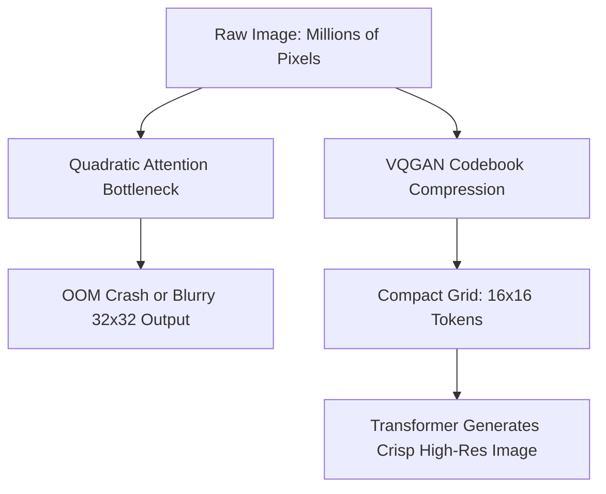
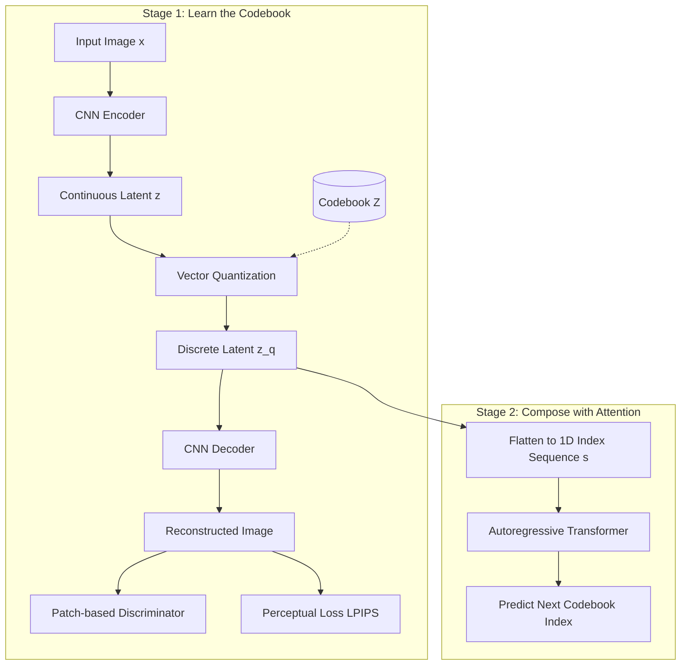

## The hook

If you ask a transformer to write a story, it juggles a few thousand words without breaking a sweat. But ask that same model to draw a standard smartphone photo, and its attention mechanism collapses under the weight of several million pixels. 

For years, researchers assumed transformers were simply the wrong tool for high-resolution graphics. This paper proved that transformers could paint breathtaking, megapixel-scale worlds—as long as you stopped asking them to place every single speck of dust.

## Before you start

Before jumping in, make sure you are comfortable with:
- How attention computes pairwise relationships across a sequence in [Attention Is All You Need](article:paper-attention-is-all-you-need).
- How latent spaces capture data distributions in [Variational Autoencoders](article:paper-vae).
- How generators and discriminators train against one another in [Generative Adversarial Networks](article:paper-gan).

## The world before this paper

In late 2020, generative vision was split into two rival camps, each with an annoying flaw.

In one camp stood Generative Adversarial Networks. Models like StyleGAN created jaw-dropping faces with silky hair and realistic skin pores in a single feedforward pass. But GANs were notoriously stubborn. They struggled with complex, multi-object scenes containing arbitrary compositions. You could not easily ask them to build an entire city park containing a dog, three benches, a red kite, and a lake in specific locations without specialized, fragile tricks.

In the other camp stood autoregressive models and transformers. Ever since GPT showed that predicting the next token could master natural language, vision researchers dreamed of doing the same with pictures: order the pixels from top-left to bottom-right, predict them one by one, and sample any visual world you want.

:::history
At OpenAI, researchers pushed this dream to its limit with Image-GPT in mid-2020. They treated each pixel as a letter in a giant visual sentence. The catch? The self-attention matrix scales with the square of sequence length, $O(N^2)$. A modest $256 \times 256$ color picture has $65{,}536$ pixels, yielding over four billion pairwise attention calculations per layer. As a result, Image-GPT was stuck generating tiny $32 \times 32$ or heavily clustered $64 \times 64$ squares, chewing through monstrous compute budgets just to produce fuzzy thumbnails.
:::

Earlier discrete models like VQ-VAE tried to fix this by compressing images into a spatial grid of discrete codes before running a sequence predictor. But their autoencoders were trained with mean-squared pixel errors ($L_2$ loss). When you force an autoencoder to compress an image by a factor of 16 using pixel error, it gives up on fine details like grass blades, pebbles, and hair. To minimize mean error, it outputs an average: a blurry smudge. 

If the dictionary entries themselves are blurry, no downstream model—no matter how clever—can ever assemble a crisp, photorealistic picture.

## The big idea

Patrick Esser, Robin Rombach, and Björn Ommer realized that image generation should be split into two distinct responsibilities: **local texture** versus **global composition**.

Convolutions are naturally great at local texture because neighboring pixels share strong geometric relationships. Transformers are terrible at local pixel math due to quadratic costs, but they excel at high-level composition: deciding where the sky ends, where a mountain sits, and where a boat docks.

The authors proposed [[VQGAN]]: a hybrid architecture that pairs a convolutional, vector-quantized autoencoder with an autoregressive transformer.

:::analogy
Imagine building a sprawling mosaic across a palace floor. 

If you hire a single artist to place every microscopic grain of colored sand one by one while keeping the whole cathedral layout in mind, they will burn out before completing one square foot. 

Instead, split the job. First, a craftsman builds a physical catalog of pre-fabricated, detailed ceramic tiles: a tile for curly hair, a tile for water ripples, a tile for brick mortar. Second, an architect steps back, looks at the whole floor plan, and writes down a simple grid of tile numbers: "Put tile 42 at row 1 column 1, tile 89 at row 1 column 2." 

The craftsman handles the microscopic texture; the architect handles the grand design.
:::

:::insight
Convolutions provide the inductive bias needed to learn reusable, compact visual textures. Transformers provide the unconstrained attention needed to assemble those textures into coherent global compositions.
:::

## How it works

The architecture splits cleanly into two separate stages: training the visual vocabulary, and then training the sequence architect.

### Stage 1: Crafting the visual codebook (VQGAN)

First, we need to convert an image $x \in \mathbb{R}^{H \times W \times 3}$ into a small spatial grid of discrete tokens without losing crisp textures.

1. **The Encoder:** A convolutional neural network $E$ downsamples the image by a factor $f = 2^m$ (where $m$ is the number of downsampling blocks). A $256 \times 256$ image with $f=16$ becomes a compact feature map $\hat{z} = E(x) \in \mathbb{R}^{16 \times 16 \times n_z}$, where $n_z$ is the channel depth.
2. **[[Vector Quantization]]:** We maintain a learned codebook (a discrete dictionary) of $K$ embedding vectors:
   $$
   \mathcal{Z} = \{z_k\}_{k=1}^K \subset \mathbb{R}^{n_z}
   $$
   For each spatial position $(i, j)$ in the feature map, we find the closest codebook vector by Euclidean distance:
   $$
   z_q = \arg\min_{z_k \in \mathcal{Z}} \|\hat{z}_{ij} - z_k\|_2
   $$
3. **The Decoder:** A convolutional generator $G$ takes the grid of chosen vectors $z_q$ and reconstructs the full-resolution image $\hat{x} = G(z_q)$.

Because the $\arg\min$ operation has zero derivative almost everywhere, gradients cannot pass backward through quantization during training. The authors use a classic straight-through estimator: during backpropagation, the gradients from the decoder are copied directly to the encoder inputs, bypassing the quantization step.

### Beating the blur: Perceptual and adversarial supervision

Standard VQ-VAEs stop there, using $L_2$ pixel loss. VQGAN changes the game by adding two perceptual judges:

1. **[[Perceptual Loss]] ($\mathcal{L}_{\text{rec}}$):** Instead of checking if pixel $(14, 28)$ has the exact same RGB value, the model passes both real and reconstructed images through a pretrained feature network (like VGG) and compares intermediate feature activations. This penalizes missing textures or blurry lines while ignoring tiny, invisible pixel shifts.
2. **[[Patch-based Discriminator]] ($\mathcal{L}_{\text{GAN}}$):** An adversarial discriminator inspects small overlapping patches of the decoded image and determines whether they look like authentic, crisp photograph patches or synthetic fakes.

To stop the adversarial loss from overpowering the reconstruction early in training, the authors calculate an adaptive weight $\lambda$:

$$
\lambda = \frac{\nabla_{G_L}[\mathcal{L}_{\text{rec}}]}{\nabla_{G_L}[\mathcal{L}_{\text{GAN}}] + \delta}
$$

Here, $\nabla_{G_L}[\cdot]$ denotes the gradient magnitude with respect to the very last layer of the decoder, and $\delta = 10^{-6}$ prevents dividing by zero. If the adversarial gradient spikes, $\lambda$ automatically shrinks to balance the update.

:::try-this
Work through the gradient balancing by hand. Suppose at a certain training step, the gradient of the perceptual reconstruction loss at the decoder's final layer has a norm of $12.0$, while the discriminator gradient has a norm of $24.0$. 

Using the formula with $\delta \approx 0$:
$$
\lambda = \frac{12.0}{24.0} = 0.5
$$
The generator scales down the adversarial pressure so the model preserves content fidelity without getting thrown off balance by an aggressive discriminator.
:::

### Stage 2: Teaching the transformer to build images

Once the VQGAN is trained, we freeze it. The encoder and codebook turn any image into a $16 \times 16$ grid of discrete integers.

We unroll this 2D grid into a 1D sequence of length $N = 256$ in standard row-major order:
$$
s = (s_1, s_2, \dots, s_N), \quad s_i \in \{0, \dots, K-1\}
$$

Now, we feed this sequence into a standard decoder-only transformer (identical to GPT-2). The training objective is simple categorical cross-entropy: predict the index of the next tile given all preceding tiles:

$$
\mathcal{L}_{\text{Transformer}} = \mathbb{E}_{x} \left[ -\sum_{i=1}^N \log p(s_i \mid s_{<i}) \right]
$$

During generation, the transformer predicts probability distributions token by token. Once all 256 tokens are sampled, we look up their continuous vectors from codebook $\mathcal{Z}$, arrange them into a $16 \times 16$ spatial grid, and feed them through the convolutional decoder $G$. Instantly, out pops a sharp $256 \times 256$ image.

:::warning
The transformer never predicts continuous RGB pixel values or latent vectors directly. It only outputs discrete classification logits over codebook indices $0$ through $K-1$, exactly like predicting the next word in an English sentence.
:::

### Extending to conditional and megapixel synthesis

Because the transformer only sees sequences of tokens, adding guidance is straightforward:
- **Class Conditioning:** Prepend a single token representing the target category (e.g., class `933` for cheeseburger) before the image tokens.
- **Semantic Layouts or Depth Maps:** Train a separate VQGAN to turn segmentation masks or depth maps into another sequence of discrete indices $r$, then prepend $r$ to $s$. The transformer attends to the layout sequence while generating the picture.

What if you want an image larger than $256 \times 256$? 

If an image is $1024 \times 1024$, its token grid is $64 \times 64 = 4{,}096$ tokens—pushing standard attention back into memory trouble. The paper solves this with a [[Sliding Attention Window]]. 

During sampling, the transformer moves across the canvas in a sliding crop, attending only to adjacent tokens inside its local context horizon. Because the convolutional decoder handles local seamlessness, sliding the attention window across the token grid produces consistent, boundary-free megapixel vistas.

## What they found

The paper demonstrated that taming transformers with perceptual codebooks fundamentally changed the quality and efficiency of generative modeling.

### 1. Latent attention beats pixel modeling
On CIFAR-10, running the transformer on a modest VQGAN latent space ($f=2$) yielded an 18.63% improvement in Frechet Inception Distance (FID) while sampling images **14.08 times faster** than Image-GPT operating directly on raw pixels.

On unconditional ImageNet, the 310-million-parameter transformer reached a negative log-likelihood of 4.78, beating the prior state-of-the-art convolutional sequence model, PixelSNAIL (which scored 4.96).

### 2. Adversarial losses make aggressive compression possible
Why did earlier discrete autoencoders fail to give transformers such clean inputs? 

The authors compared their VQGAN against the discrete autoencoders used in DALL-E and VQ-VAE-2 on ImageNet reconstruction:

| Model | Latent Grid | Codebook Size | Reconstruction FID (Validation) |
| :--- | :--- | :--- | :--- |
| DALL-E VAE | $32 \times 32$ | 8,192 | 32.01 |
| VQ-VAE-2 | $64 \times 64 \ \& \ 32 \times 32$ | 512 | $\sim 10$ |
| **VQGAN** | **$16 \times 16$** | **1,024** | **7.94** |
| **VQGAN** | **$16 \times 16$** | **16,384** | **4.98** |

VQGAN achieved a reconstruction FID of 4.98 with a tiny $16 \times 16$ grid (sequence length 256). DALL-E's autoencoder scored a far blurrier 32.01 on a sequence four times longer ($32 \times 32 = 1{,}024$ tokens). Patch adversarial losses allowed the network to compress an image 16 times along each axis while preserving fine details.

### 3. High-resolution benchmark results
On class-conditional ImageNet generation ($256 \times 256$), VQGAN reached an FID of 15.78 without classifier filtering, beating VQ-VAE-2 ($\sim 31$) and DCTransformer (36.5). Adding classifier rejection sampling pushed its FID down to 5.20.

On unconditional human face generation at $256 \times 256$, VQGAN achieved an FID of 10.2 on CelebA-HQ and 9.6 on FFHQ, rivaling established GAN baselines while maintaining an explicit likelihood-based latent space.

### 4. Which token order works best?
Language has a natural left-to-right order, but how should a 2D image grid be unrolled? The authors tested row-major raster scan, spiral-out from the center, spiral-in, serpentine alternating lines, and space-filling Morton Z-curves. 

The humble row-major raster scan performed best, securing the lowest negative log-likelihood (4.767). Hierarchical or spiral paths disrupted the directional context transformers rely on to predict upcoming structure.

## What it got wrong (or left open)

Despite its breakthrough results, the paper had clear bottlenecks:

- **Strict reconstruction ceilings:** If your compression factor $f$ is set too high (such as $f=32$ on human faces), individual eyes or teeth can be distorted beyond recognition in the latent representation. If the VQGAN codebook cannot reconstruct an eye properly, the transformer can never fix it, no matter how many parameters it has.
- **Slow autoregressive inference:** Generating an image requires predicting tokens one by one. For a 256-token grid, the transformer must run 256 sequential forward passes. This is much faster than generating 65,536 pixels, but it is still noticeably slower than the single forward pass of a standard GAN.
- **Heavy training costs:** Training the largest ImageNet model took 45.8 days on a high-end NVIDIA A100 GPU. Autoregressive cross-entropy on large codebooks ($|\mathcal{Z}| = 16{,}384$) requires massive matrix multiplications at the classification head for every single step.

## What happened next

The two-stage philosophy introduced here reshaped the entire trajectory of generative AI.

In late 2021 and 2022, two of the paper's authors (Patrick Esser and Robin Rombach) recognized that while the autoregressive transformer was a capable sequence model, step-by-step token generation had inherent speed and scaling limits. 

They kept the exact perceptual autoencoder from VQGAN, but swapped out the autoregressive transformer in favor of a continuous score-based denoising process. That breakthrough became [Latent Diffusion Models](article:paper-latent-diffusion), the core engine powering **Stable Diffusion**. 

Almost every modern text-to-image pipeline today—from SDXL to Flux—owes its efficiency to the insight pioneered in this paper: compress the perceptual chaos of pixels into a compact latent world first, and let your generative model dream there instead.

## Key takeaways

- Transformers struggle with high-resolution images because self-attention scales quadratically with pixel count.
- Convolutions and transformers have complementary strengths: CNNs handle local, translation-invariant textures efficiently, while transformers excel at global semantic composition.
- VQGAN compresses raw images into a discrete spatial grid of learned codebook indices using perceptual and patch-based adversarial losses, avoiding the blurriness of traditional $L_2$ autoencoders.
- An autoregressive transformer can synthesize high-resolution and megapixel images by modeling sequences of visual codebook indices using raster-order next-token prediction.
- Decoupling visual representation into a perceptual compression stage and a composition stage paved the foundation for modern latent generative vision.
