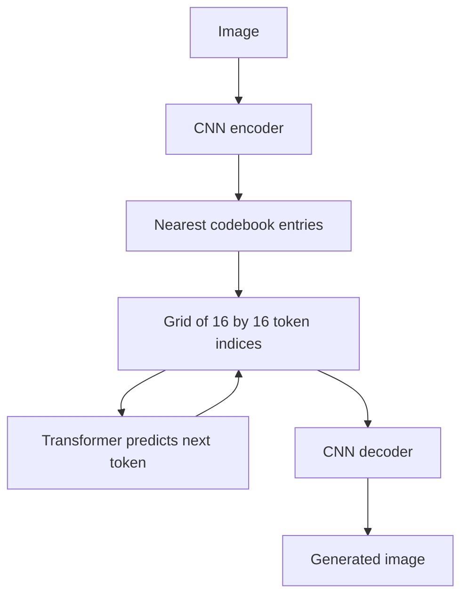

## The hook

By 2020, transformers could write paragraphs that read like a person wrote them. So why not pictures? Treat an image as a sequence of pixels and predict the next pixel, the way GPT predicts the next word.

The problem is size. A modest 256 by 256 colour image is nearly two hundred thousand numbers, and a transformer compares every position with every other. A team in Heidelberg found a way around it: first teach a network to describe any image with a few hundred "visual words", then let the transformer write in that vocabulary.

## Before you start

You should know how autoencoders and VAEs compress data into a smaller code, from [the VAE article](article:paper-vae), how a discriminator pushes a generator toward realism, from [the GAN article](article:paper-gan), and how transformers predict the next token, from [The Paper That Taught Machines Where to Look](article:paper-attention-is-all-you-need).

## The world before this paper

There were two strong families of image generators, each with a gap:

- **Convolutional networks and GANs** were efficient and great at local texture, because convolutions look at neighbourhoods. But they struggled with long-range structure: keeping a face symmetric, or a scene coherent from one side to the other.
- **Transformers** handled long-range relationships brilliantly, since attention connects any two positions. But on raw pixels the sequences were so long that only tiny images were practical.

An earlier idea, VQ-VAE, compressed images into a grid of discrete codes from a learned [[codebook]], and other models were trained on those codes. But to keep reconstructions sharp, the grids had to stay fairly large, which kept sequences long.

:::history
Patrick Esser, Robin Rombach and Björn Ommer, at Heidelberg University, wanted the best of both: convolutions for local detail, a transformer for global composition. Their paper appeared on arXiv in December 2020 and at CVPR 2021. The same group later developed latent diffusion, the basis of Stable Diffusion.
:::

## The big idea

:::analogy
Think of a mosaic artist who works with a box of a thousand pre-made tiles, each showing a small pattern: a bit of sky, a strand of hair, the edge of a leaf. To describe a picture, they only need to say which tile goes in each slot of a 16 by 16 grid. A second person who has never seen the original can then write new grids of tile numbers, slot by slot, and the tile box turns those numbers into a full, detailed picture.
:::

The paper's big idea is to split image generation into two jobs. A convolutional model, VQGAN, learns the tile box: a codebook of rich visual patterns, and how to encode any image into a short grid of tile indices and decode it back sharply. A transformer then learns to write grids of tile indices, one [[token]] at a time, just like writing text.

The trick that makes the grid short is to make each tile do a lot of work. That needs a decoder that turns very few tokens into a convincing image, which is where the GAN part comes in.

## How it works

### Stage 1: VQGAN, the tile box

1. A convolutional encoder turns a 256 by 256 image into a small grid, for example 16 by 16, of feature vectors.
2. [[Vector quantisation]] replaces each feature vector with the index of its nearest codebook entry.
3. A convolutional decoder turns the grid of codebook vectors back into an image.

Trained only to match pixels, such a model gives blurry results at this level of compression. VQGAN adds two losses:

- A [[perceptual loss]], which compares images by the features of a pre-trained vision network.
- A [[patch discriminator]], an adversarial loss that judges small regions of the output as real or fake.

Together they push the decoder to produce crisp textures from few tokens.

### Stage 2: the transformer, the writer

The image is now a sequence of 256 indices, read row by row. A GPT-style transformer is trained [[autoregressive]]ly to predict each index from all the previous ones. To generate, it samples indices one by one, and the VQGAN decoder paints the image.

### Conditioning and big images

To condition on a class or a layout, the paper puts conditioning tokens before the image tokens: a class label, or a segmentation map, depth map or edge map, itself encoded with its own VQGAN. The transformer then continues the sequence.

For images larger than training size, the transformer uses a sliding window: each new token attends only to a nearby block of earlier tokens. Generation can then continue across a very large grid, producing megapixel images.

### How much information is in a code?

Suppose the codebook has 1,024 entries, a common choice in this line of work. Each token is then one of 1,024 possibilities, about 10 bits. A 16 by 16 grid of tokens holds about 2,560 bits in total, a few hundred bytes for an entire 256 by 256 picture. That is a strikingly small description, which is why the decoder must be trained to invent convincing fine detail rather than store it. In the mosaic picture, the grid only says which tile goes where; all the craft lives inside the tiles.

### Why compression matters so much

| Representation of a 256 by 256 image | Sequence length |
|---|---|
| Raw pixels, one colour channel | 65,536 |
| VQGAN with 16 times downsampling | 16 × 16 = 256 |

Attention cost grows roughly with the square of the length. Going from 65,536 to 256 shrinks that cost by a factor of about 65,000.

:::try-this
If an image of 512 by 512 pixels is downsampled by 16 in each direction, how many tokens does it become? How does the attention cost compare with a 256 by 256 image? (32 × 32 = 1,024 tokens, four times as many, so roughly sixteen times the full-attention cost. That is why the sliding window helps for big images.)
:::

:::insight
The transformer never sees a pixel. It writes in a vocabulary of learned visual patterns, and the convolutional decoder handles the fine detail. Splitting "what goes where" from "what it looks like up close" let each architecture do what it does best.
:::

## What they found

- **Sharp reconstructions from short codes.** VQGAN's adversarial and perceptual training kept reconstructions realistic at compression levels where a plain VQ-VAE became blurry, which is what made short sequences possible.
- **Strong results across conditional tasks.** The same approach worked for class-conditional ImageNet generation, image generation from semantic layouts, depth maps and edges, and super-resolution, often matching or beating specialised models.
- **Best-in-class among autoregressive image models** at the time on several benchmarks, according to the paper.
- **Megapixel images.** With sliding-window attention, the model synthesised high-resolution landscapes and scenes far larger than its training crops.

:::warning
Common misconception: "the transformer generates the image's pixels." It generates codebook indices. If the codebook or decoder is weak, no transformer can produce a good image, which is why most of the paper's effort goes into training the VQGAN well.
:::

## What it got wrong (or left open)

- **Slow sampling.** Generating 256 tokens one at a time, each with a full transformer pass, is slow compared with a single GAN pass.
- **Codebook problems.** Many codebook entries can go unused, wasting capacity, a problem later work addressed with improved quantisation.
- **Fixed raster order** of reading tokens left to right, top to bottom, is arbitrary for images and makes early tokens decide a lot without seeing the rest.

## What happened next

VQGAN became a widely used image tokenizer. In 2021, artists combined it with CLIP, using CLIP to score how well an image matched a text prompt and steering VQGAN's codes toward it; "VQGAN plus CLIP" notebooks spread widely as an early form of text-to-image art. You can read about CLIP in [Learning Transferable Visual Models From Natural Language Supervision](article:paper-clip).

The same group's next step was to keep the compressed space but replace the autoregressive transformer with a diffusion model, giving [latent diffusion](article:paper-latent-diffusion) and eventually Stable Diffusion. Later systems, such as Google's MaskGIT and Parti, also generated images as sequences of discrete visual tokens from VQGAN-style tokenizers.

## Key takeaways

- Transformers model long-range structure well but cannot run directly on the huge pixel sequences of high-resolution images.
- VQGAN compresses an image into a short grid of indices into a learned codebook of visual patterns, and decodes it back sharply.
- Perceptual and patch-based adversarial losses let very short codes decode into crisp images, which is what keeps sequences short.
- A GPT-style transformer then generates images by predicting codebook indices one at a time, with optional conditioning tokens.
- This two-stage idea led directly to VQGAN plus CLIP art, latent diffusion and token-based image generators.
