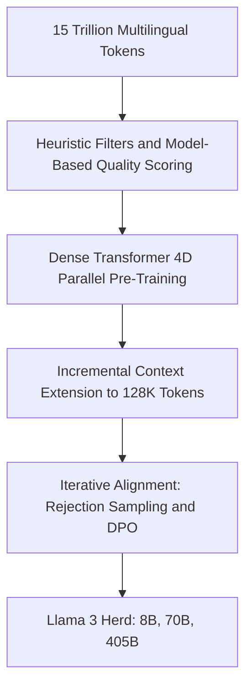
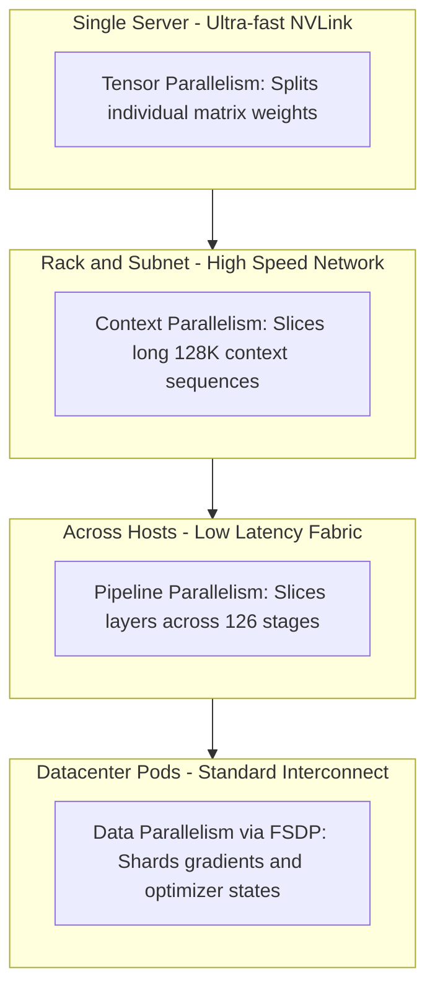
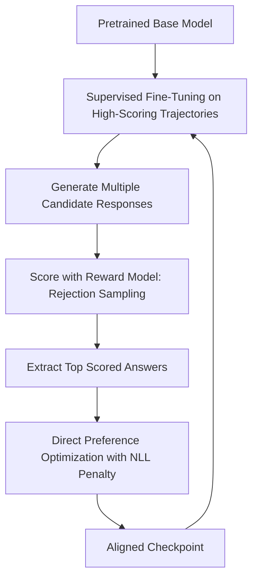

## The hook

What happens when you hook 16,000 cutting-edge graphics processors together in a single room and feed them electricity equivalent to a small city? Every single day, something breaks. Silicon processors fail, optical transceivers burn out, and power fluctuations can cause tens of megawatts of instantaneous swings across the local power grid. Yet, out of that storm came a 405-billion parameter brain capable of going toe-to-toe with the world's best proprietary systems.

```
+-------------------------------------------------------------+
|               The 16,000 GPU Reality Check                  |
|                                                             |
|   54 Days  -->  466 Interruptions (~9 per day)              |
|   Hardware causes ~78% of surprises                         |
|   Power swings: tens of megawatts                           |
|   Result: >90% effective training time anyway               |
+-------------------------------------------------------------+
```

## Before you start

Before reading this, you should understand how foundation models are born and trained. We recommend checking out [Llama 1 and 2](article:paper-llama) for the foundational open-weight architecture, [Scaling Laws](article:paper-scaling-laws) to see how compute predicts model loss, and [Direct Preference Optimization](article:paper-dpo) for the mechanics of aligning raw language models without reinforcement learning headaches.

## The world before this paper

In early 2024, if you wanted top-tier model intelligence, you had to call a proprietary API. Closed research labs guarded their recipes closely. The exact training mixes, hardware layouts, data filters, and alignment tricks that powered systems like GPT-4 remained corporate secrets. 

Open-weight models existed, but they lagged behind. Meta's earlier Llama 2 had proved that releasing weights could spark massive community innovation. Yet Llama 2 capped out at 70 billion parameters, ingested only 1.8 trillion tokens, struggled beyond an 4,000-token context window, and lagged behind in complex coding and reasoning. 

Many researchers believed matching frontier proprietary performance required radical architectural departures—such as sparse Mixture-of-Experts (MoE) routing, exotic layers, or heavily guarded reinforcement learning pipelines. The team behind Llama 3 took the opposite bet: frontier-level reasoning could be unlocked with a standard, dense Transformer, provided you perfected the data curation, scaled hardware cleanly to 16,000 GPUs, and engineered an iterative, multi-round post-training loop.

:::history
When Meta began training the 405B flagship model, no one had published a comprehensive, end-to-end recipe detailing how to stabilize and align a dense model of this scale. The authors chose radical transparency: writing an exhaustive 92-page engineering manual detailing their failures, cluster designs, and data mixtures.
:::

## The big idea

Instead of inventing exotic architectures, the authors focused on three core levers: data quality, massive scale, and simplicity. 

:::analogy
Constructing Llama 3 is like building a 126-floor skyscraper using a 16,000-worker crew split into four nested teams. One team cuts heavy steel beams locally inside the room. Another runs the floor-by-floor assembly line. A third carries blueprints across long corridors. The fourth coordinates supply deliveries from the warehouse. Instead of trying out unproven building materials, the crew relies on standard structural steel, uncompromising material quality inspections, and rock-solid radios to finish the tower on schedule despite daily crane breakdowns.
:::

The paper introduced three dense language models: an 8-billion parameter featherweight, a 70-billion parameter workhorse, and a 405-billion parameter flagship. Rather than stopping at compute optimality, Meta heavily overtrained the smaller models on roughly 15 trillion tokens so that everyday users could run astonishingly capable checkpoints on modest local hardware.



## How it works

Let's pull back the curtain on how Meta built the flagship 405B model across pre-training, scaling, systems architecture, and post-training.

### 1. Data Quality and Curation

A model is what it eats. Llama 3 was pre-trained on a corpus of 15.6 trillion text tokens, roughly eight times larger than Llama 2. To build this dataset, the team built a ruthless filtering pipeline:
- **Deduplication:** MinHash at the document level and aggressive line-level deduplication to discard web boilerplate and repetitive error messages.
- **Model-Based Classifiers:** Using distilled models to score educational value and text quality, guided by prompts tuned on earlier Llama generations.
- **Domain Pipelines:** Custom scrapers built for code syntax and mathematical proofs, ensuring that formatting was preserved rather than destroyed by web parsers.

### 2. The 4D Parallelism Architecture

Fitting a 405-billion parameter dense model into memory is impossible on a single machine. The parameters alone take over 800 gigabytes in 16-bit precision, without even counting optimizer states or intermediate activations. 

To solve this, Meta combined four distinct distributed techniques into a unified [[4D Parallelism]] system:



1. **Tensor Parallelism (TP = 8):** Within a single eight-GPU server, weight matrices are split across GPUs using fast NVLink interconnects.
2. **Context Parallelism (CP = 16):** When reading huge contexts up to 128,000 tokens, the sequence is divided into chunks across 16 GPUs.
3. **Pipeline Parallelism (PP = 16):** The 126 layers of the flagship model are divided across 16 pipeline stages.
4. **Data Parallelism (DP via FSDP):** Whole replicas of the model process distinct batches of text, with optimizer states and gradients sharded across devices.

:::insight
Place the operations requiring the highest bandwidth and lowest latency on the fastest physical connections. Put TP inside the single node over NVLink, and push DP/FSDP to the outer network where latency can be hidden behind asynchronous computation.
:::

Because the model used [[Grouped-Query Attention (GQA)]]—sharing key-value heads across multiple query heads—the key and value tensors were small. This enabled the team to implement [[Context Parallelism (CP)]] using an all-gather communication step rather than a complex ring pattern. The communication overhead took barely any time compared to the quadratic cost of self-attention computation.

### 3. Hardware Reliability and Scaling Math

To measure hardware efficiency, researchers use [[Model FLOPs Utilization (MFU)]]. MFU measures the percentage of theoretical peak hardware math actually spent doing forward and backward passes:

$$\text{MFU} = \frac{\text{Actual Floating-Point Operations per Second}}{\text{Theoretical Peak Hardware FLOPs}}$$

Meta achieved an MFU between 38% and 43% across configurations of up to 16,384 GPUs. Maintaining that throughput across 54 consecutive days was an operational feat:

```
Total Interruptions in 54 Days: 466
├── Planned Maintenance: 47
└── Unexpected Failures: 419
    ├── Faulty GPUs: 148 (30.1%)
    ├── GPU Memory (HBM3): 72 (17.2%)
    ├── Software Bugs: 54 (12.9%)
    ├── Network Switches/Cables: 35 (8.4%)
    └── Other Hardware/Host Issues: 110 (26.4%)
```

Thanks to fast checkpoint writing to a distributed storage system (bursting up to 7 terabytes per second) and automated diagnostic tools, the team maintained higher than 90% effective training time.

:::try-this
Imagine your cluster has 16,384 GPUs, and a single GPU has a Mean Time Between Failures of 3 years (about 1,100 days). How often will *some* GPU fail in your cluster? 
$$\frac{1,100 \text{ days}}{16,384 \text{ devices}} \approx 0.067 \text{ days} \approx 1.6 \text{ hours}$$
At scale, individual hardware components fail continuously. Your software must be designed to recover automatically without human engineers waking up every two hours.
:::

### 4. Six Rounds of Iterative Post-Training

Raw pre-training creates a brilliant word predictor, not a helpful assistant. To align Llama 3, the team ran six sequential rounds of alignment. Each round executed two key phases:

1. **Rejection Sampling (RS):** The model generated 10 to 30 candidate responses for each user prompt. A separately trained reward model scored each answer, and the highest-scoring candidate was kept to form supervised fine-tuning (SFT) data.
2. **Direct Preference Optimization (DPO):** The team aligned the SFT checkpoint directly on paired human comparisons using [[Direct Preference Optimization (DPO)]].



Standard DPO can sometimes destabilize models, causing them to generate repetitive phrases or abrupt termination tokens. The authors introduced two crucial stabilization tricks:
- **Token Masking:** They masked out special chat formatting tokens from the DPO loss function, preventing the loss from oscillating on syntax boundaries.
- **Negative Log-Likelihood Regularization:** They added an auxiliary penalty ($\alpha = 0.2$) on chosen answers to stop the model from drifting away from high-probability correct phrases.

:::warning
Never assume your synthetic data is correct simply because a large model generated it. For code generation, Meta verified every single synthetic script with linters and automated unit test executions in sandboxed containers. Only programs that executed successfully and passed their tests made it into the training set.
:::

## What they found

The results proved that open foundation models could match the best closed systems across major AI benchmarks. 

```
Benchmark Performance Comparison
========================================================================
Task            Benchmark           Llama 3 8B    Llama 3 70B   Llama 3 405B   GPT-4 (0125)
------------------------------------------------------------------------
General         MMLU (5-shot)          69.4          83.6          87.3           85.1
Reasoning       MMLU (0-shot, CoT)     73.0          86.0          88.6           85.4
Coding          HumanEval (0-shot)     72.6          80.5          89.0           86.6
Math            GSM8K (8-shot, CoT)    84.5          95.1          96.8           94.2
========================================================================
```

Beyond benchmarks, the paper revealed key insights:
- **Small models benefit from extreme overtraining:** While compute-optimal scaling laws suggested stopping earlier, training the 8B model on trillions of extra tokens produced an exceptionally strong lightweight model that runs cheaply on laptops.
- **Synthetic data with execution feedback works wonders:** About 20% of synthetic coding problems initially produced faulty code, but the model corrected them after seeing error traces, turning failed attempts into high-value training lessons.
- **Scaling laws hold across four orders of magnitude:** By predicting negative log-likelihood on downstream benchmarks first, and then mapping log-likelihood to actual multiple-choice accuracy, Meta predicted Llama 3's final performance before pre-training began.

## What it got wrong (or left open)

While Llama 3 was a milestone, the team acknowledged several stubborn hurdles:

1. **Hardware load swings:** The synchronization barriers of distributed training caused instantaneous power swings of tens of megawatts across the data center. Balancing electrical grid loads remains an open infrastructure dilemma for future clusters.
2. **Diminishing returns on specialized pre-training data:** While annealing small models on extra math data boosted their scores significantly, doing so on the 405B flagship showed almost negligible impact. The massive model had already learned the necessary concepts from raw scale.
3. **Multimodal integration was deferred:** Although the paper previewed experimental speech and vision adapters, these components were not mature enough to ship with the initial text weights.
4. **Hardware sensitivity:** GPU failures caused 58.7% of all unexpected downtime, showing that cluster reliability remains bound by physical chip yields and interconnect stability.

## What happened next

The release of Llama 3 transformed the landscape of open artificial intelligence. Within days of release, the 8B and 70B models became the default engines powering local open-source agents, enterprise fine-tuning, and research experiments worldwide. 

The 405B release demonstrated that independent organizations could inspect and deploy a true GPT-4-class model behind their own firewalls. Furthermore, the 92-page paper became a definitive handbook for building modern AI clusters. Engineering teams around the world adopted Meta's playbook: building [[4D Parallelism]] layouts, applying [[Grouped-Query Attention (GQA)]] to minimize key-value cache bloat, using [FlashAttention](article:paper-flashattention) mechanics, and replacing brittle reinforcement learning loops with stabilized [[Direct Preference Optimization (DPO)]].

## Key takeaways

- Frontier AI performance does not require exotic architectures; an expertly tuned dense Transformer scaled to 405 billion parameters rivals the best proprietary models.
- Training across 16,000 GPUs demands a 4D parallelism hierarchy that maps communications onto the physical speeds of NVLink, intra-rack switches, and datacenter networks.
- At modern scales, hardware failures are daily routine, requiring automated diagnosis, rapid checkpointing, and robust network routing to maintain over 90% cluster utilization.
- Post-training thrives on iterative loops of rejection sampling and stabilized DPO, especially when synthetic training data is verified by compilers and execution sandboxes.
- Extreme overtraining of smaller models yields exceptional real-world efficiency by pushing high capability into lightweight checkpoints that are practical to serve.
