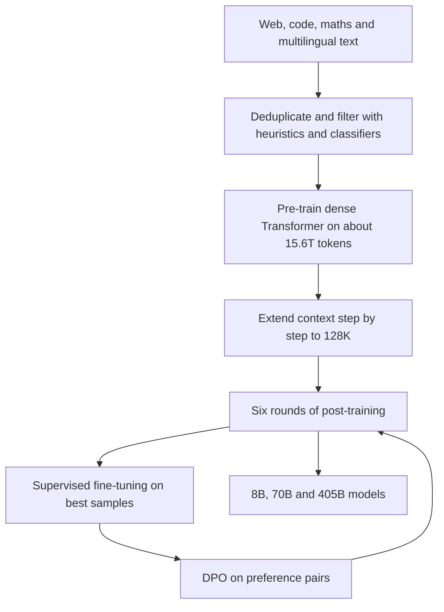

## The hook

Imagine a kitchen cooking one enormous banquet over almost two months, with 16,000 cooks working in lockstep, ovens failing every few hours, and power draw swinging so sharply that the building's electrical supply notices. The menu is deliberately ordinary, but the ingredients, the stations and the tasting rounds are planned obsessively.

That is roughly what Meta described in "The Llama 3 Herd of Models" in July 2024. The result was a family of openly released models, the largest with 405 billion parameters, which the paper reports as comparable in quality to leading closed models such as GPT-4 on many tasks. The surprise was not a new architecture. It was how far a plain recipe goes when every other part of the kitchen is engineered carefully.

## Before you start

You should know what an open language model is from [Small Enough to Share, Strong Enough to Matter](article:paper-llama), how loss falls predictably with compute from [Scaling Laws](article:paper-scaling-laws), and how preference pairs can train a model directly from [DPO](article:paper-dpo). Knowing that attention stores keys and values for every past token also helps.

## The world before this paper

By early 2024, the strongest language models were mostly closed, available through APIs with little public detail about data, infrastructure or alignment. Open models existed and were popular, including Meta's own Llama 2, which topped out at 70 billion parameters and a 4,000-token context window. But they trailed the best closed systems on reasoning, coding and long documents.

A common belief was that catching up would need something exotic, such as mixture-of-experts routing or secret training tricks. Llama 3 bet the other way: keep the model simple, and win on three levers the authors name in the paper, which are data, scale and managing complexity.

:::history
The paper lists hundreds of contributors in its author list, and is unusually long and detailed for a model release, covering data pipelines, cluster failures, post-training and safety. The models were released together with it, including the 405B flagship, and that release is often called Llama 3.1.
:::

## The big idea

:::analogy
Back in the banquet kitchen, the head chef chooses a classic recipe everyone knows how to cook, because an experimental dish that fails on day 40 ruins everything. The effort goes elsewhere: inspecting every ingredient (the data), organising 16,000 cooks into stations that rarely need to shout across the room (the parallelism), and holding repeated tasting rounds where the best plates teach the next round (post-training).
:::

The recipe is a [[dense Transformer]] with small, well-understood changes, such as [[grouped-query attention (GQA)]] and a longer context window of up to 128K tokens. The paper releases a "herd" of three sizes, 8B, 70B and 405B. The flagship is trained close to compute-optimal; the smaller two are [[overtraining|overtrained]] on far more tokens than their size would suggest, so they punch above their weight and stay cheap to run.

## How it works

### Ingredients: the data

The kitchen is only as good as its ingredients. The pre-training set grew to about 15.6 trillion tokens. The paper describes several layers of cleaning: removing duplicates at the URL, document and line level, heuristic filters for low-quality pages, and model-based classifiers that score text quality. Code and maths pages get dedicated extraction so their formatting survives. The data mix is tuned with small experiments before the big run, and the final stage of training anneals on especially high-quality data.

### The budget, checked by hand

A common rule of thumb says training compute is about 6 × parameters × tokens.

| Quantity | Value |
|---|---|
| Parameters N | 4.05 × 10¹¹ |
| Tokens D | 1.56 × 10¹³ |
| 6 × N × D | ≈ **3.8 × 10²⁵ FLOPs** |

That matches the compute figure the paper reports for the flagship. The authors also used scaling-law experiments to choose the flagship's size for that budget and to forecast its benchmark scores before the run, by first predicting the model's loss on benchmark answers and then mapping that loss to accuracy.

### Stations: 4D parallelism

The weights alone do not fit on one GPU: 405 billion parameters at 2 bytes each is about 810 GB, against 80 GB of memory on each H100. So the work is split in four ways, a scheme the paper calls [[4D parallelism]]:

- **Tensor parallelism** splits individual weight matrices across the GPUs inside one server, which share the fastest links.
- **Context parallelism** splits very long sequences into chunks on different GPUs, needed for 128K-token training.
- **Pipeline parallelism** gives different groups of layers to different groups of GPUs.
- **Data parallelism** runs copies of the whole arrangement on different batches, with optimiser state sharded across them.

Listed from the most to the least communication-heavy, the order matters: the chattiest split sits on the fastest links, like putting cooks who constantly pass pans to each other at the same station.

:::insight
Every design choice in Llama 3's infrastructure follows one rule: put the communication that happens most often on the fastest connection, and push the rarest communication to the slowest one. The model is ordinary; the arrangement of the kitchen is not.
:::

### Why grouped-query attention helps

In the 405B model, 128 query heads share just 8 key-value heads. The [[KV cache]] per token is 2 (keys and values) × 126 layers × 8 heads × 128 dimensions × 2 bytes ≈ 516 KB. At 128K tokens that is about 68 GB. With a separate key-value head for every query head, it would be 16 times larger, over 1 TB. Smaller keys and values also made context parallelism simpler: the paper gathers all keys and values across GPUs in one step, because they are small enough that this is cheap.

### Keeping the kitchen running

Over a 54-day snapshot of pre-training, the paper reports hundreds of job interruptions, most of them unexpected, and most of those traced to hardware such as faulty GPUs and GPU memory. Even so, automation for detecting failures, fast checkpointing and quick restarts kept effective training time above 90%. The synchronised behaviour of so many GPUs also made the cluster's power draw swing by tens of megawatts, which the paper flags as a challenge for the electrical grid.

### Tasting rounds: post-training

A pre-trained model predicts text; it is not yet an assistant. Llama 3 ran six rounds of post-training. In each round:

- **First, [[rejection sampling]]**: the current model writes several answers per prompt, a reward model scores them, and the best become supervised fine-tuning data.
- **Then supervised fine-tuning** on that data plus human-written and synthetic examples.
- **Finally, [[direct preference optimization (DPO)]]** on pairs of preferred and rejected answers. The authors stabilised it by masking special formatting tokens out of the loss and adding a small extra loss that keeps the probability of chosen answers from falling.

Each round's model generates better samples for the next, like a kitchen where each tasting round's best plates become the training examples for the next batch of cooks. For code, synthetic solutions were checked by actually running them: static analysis and unit tests in a sandbox, with failing code fed back for the model to fix.

:::warning
Common misconception: "synthetic data from a big model is automatically good data." The paper treats model-generated data as untrusted until checked: code is executed and tested, and data is filtered and scored before it is used. Unchecked synthetic data can teach a model its own mistakes.
:::

:::try-this
The 8B model also has 8 key-value heads, but 32 layers and the same head size of 128. How large is its KV cache per token in 16-bit precision? (2 × 32 × 8 × 128 × 2 bytes = 131,072 bytes, about 128 KB per token, so about 17 GB at 128K tokens.)
:::

## What they found

- **Open and competitive.** The paper reports that the 405B model is comparable to leading language models such as GPT-4 across a wide range of benchmarks, and that the smaller models are best in class for their sizes at release.
- **Overtraining pays for small models.** Training the 8B and 70B models well past compute-optimal made them much stronger than their size alone would predict.
- **Scaling laws predict downstream accuracy.** The two-step forecast, from compute to loss on benchmark answers to accuracy, predicted the flagship's performance reasonably well.
- **Annealing helps small models more.** Finishing training on high-quality maths and code data clearly improved the 8B model, but had little effect on the 405B model.
- **Reliability is an engineering result.** Above 90% effective training time on a cluster of about 16,000 GPUs, despite frequent hardware failures.

## What it got wrong (or left open)

- **Costly to reproduce.** The recipe is public, but the compute and engineering staff it needs are out of reach for almost everyone.
- **Benchmarks are not the whole story.** Comparisons depend on prompt formats and evaluation settings, and contamination of benchmark data is hard to rule out completely, which the paper discusses.
- **Multimodality was still experimental.** The paper reports image, video and speech experiments using adapters, but these were not released as finished models with the text models.
- **Power and hardware.** The authors note the power swings of large synchronised training as an open infrastructure problem.

## What happened next

The open weights became a default base for fine-tuning, research and on-premise deployment, and the paper itself became a widely read reference on how to run training at this scale. Later Llama releases added vision models and smaller models for devices. Other labs' open models adopted similar ingredients: grouped-query attention, long context, heavy data filtering, and iterated rejection sampling with preference optimisation.

## Key takeaways

- Llama 3 matched strong closed models with a standard dense Transformer by investing in data quality, scale and simplicity instead of a new architecture.
- The 405B flagship used about 3.8 × 10^25 FLOPs, consistent with the rule of thumb compute ≈ 6 × parameters × tokens.
- Four kinds of parallelism split the model so the most frequent communication runs over the fastest links.
- Grouped-query attention cuts the key-value cache 16 times, which is what makes 128K-token contexts practical.
- Six rounds of rejection sampling, fine-tuning and stabilised DPO, with code checked by execution, turned the base model into an assistant.
