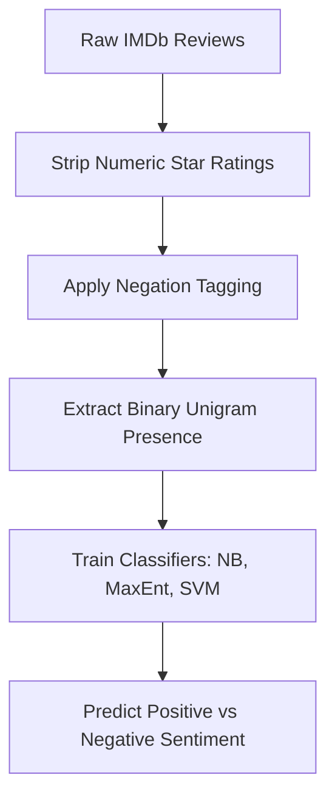
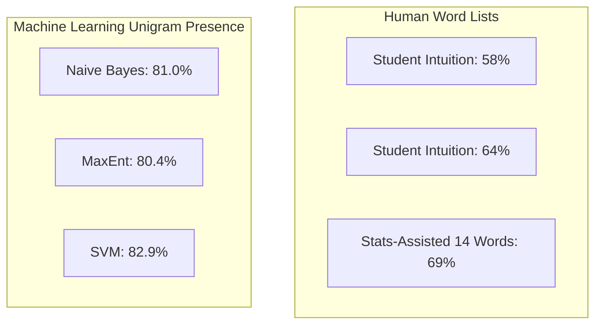

## The hook

If you want a computer to know whether an article is about sports or politics, you just look for words like "touchdown" or "senator". Topic classification is easy because the subject dictates the vocabulary. But what happens when you ask an algorithm whether a movie review is a glowing recommendation or a savage pan? 

A reviewer can spend three paragraphs praising the lead actor's sparkling eyes, the gorgeous Italian scenery, and the brilliant soundtrack, only to finish with: "Yet the script ruins it completely." To a naive word-counter, that review looks overwhelmingly positive. In 2002, three computer scientists set out to discover whether computers could read between the lines, launching modern computational sentiment analysis.

## Before you start

Before jumping in, make sure you are comfortable with basic categorization in [Yes or No? How Machines Make Decisions](article:primer-classification) and the role of inputs and outputs in [What Machines Actually Learn From](article:primer-data-features-labels). It also helps to know how max-margin boundaries operate from [Draw the Widest Road Between Two Crowds](article:paper-support-vector-networks).

## The world before this paper

In the early 2000s, natural language processing had scored real victories in topic classification. Algorithms sorted wire stories into "Finance" or "Sports" with over 90% accuracy. Because topics have distinct signatures, basic keyword matching did most of the heavy lifting.

Categorizing opinions was another beast entirely. 

Linguists and computer scientists mostly tackled opinion mining using hand-crafted dictionaries. If you wanted to know if a text was cheerful or critical, you hired experts to curate lists of "good" and "bad" words. A computer would tally up the score. If positive tallies beat negative tallies, you gave it a green light.

:::history
Bo Pang and Lillian Lee at Cornell University, teaming up with Shivakumar Vaithyanathan at IBM Almaden, grew skeptical of this manual approach. Why spend hundreds of hours hand-crafting lexicons that miss everyday slang, sarcasm, and subtle rhetorical turns? They decided to pit statistical machine learning algorithms against human intuition.
:::

Other researchers had tried unsupervised methods using search engines to check if words co-occurred near anchors like "excellent" or "poor". But on messy domains like movie critiques, those systems struggled, barely crawling past random guessing. Pang, Lee, and Vaithyanathan wanted to see if standard supervised classifiers could figure out human sentiment on their own.

:::analogy
Imagine judging whether someone enjoyed a dinner party purely by scanning their diary for adjectives. A guest writes about "delicious" appetizers, "magnificent" chandeliers, and "gorgeous" music, before wrapping up: "Yet the steak arrived burned and stone cold." 

A static keyword checklist gets dazzled by the lavish praise in the backstory. A supervised learning algorithm looks at every clue in the room and figures out which patterns actually predict a happy guest.
:::

## The big idea

The researchers made a bold bet: **you do not need a hand-crafted dictionary of emotional adjectives to classify sentiment.**

Instead, you can treat [[Sentiment Classification]] as a data-driven [[Bag-of-Features]] task. Collect thousands of real reviews, let the reviewer's own star ratings serve as labels, and let statistical classifiers figure out which tokens matter. 

Even better, they discovered that tracking whether a word appears at all matters far more than counting how many times someone repeats it.

## How it works

The team designed a systematic pipeline to test algorithms against human baselines.

### 1. Building the benchmark dataset
Supervised learning needs labeled data. Rather than reading thousands of reviews by hand, the authors scraped reviews from the IMDb archive on the `rec.arts.movies.reviews` Usenet group. 

Reviewers often left clear signposts like "4 out of 5 stars" or "grade: F". The authors parsed these explicit scores to assign ground-truth labels: positive or negative. To ensure no single critic biased the test, they capped each author at no more than 20 reviews per sentiment category. This left a balanced pool of 700 positive and 700 negative reviews. Finally, they scrubbed out the star ratings from the raw text so the algorithms could not cheat.

### 2. Handling negation
Human language twists meaning with tiny words. "Good" is positive; "not good" is negative. 

To give their models a fighting chance without building a full syntactic parser, the authors implemented [[Negation Tagging]]. Whenever they encountered a negative word ("not", "isn't", "never"), they appended a `NOT_` prefix to every subsequent word until reaching the next punctuation mark:

- Raw text: `"I did not like this boring film."`
- Transformed: `"I did not NOT_like NOT_this NOT_boring film."`

Now, `NOT_like` and `NOT_boring` acted as distinct tokens in the vocabulary.

### 3. Representing text as features
The authors converted each review into a vector of features $\vec{d}$. They compared two styles of representation:

- **Term Frequency:** Count how many times each token appears in the review.
- **Binary Presence:** Mark $1$ if the word appears at least once, and $0$ if it is absent.

### 4. The three contenders
They trained three foundational machine learning algorithms using balanced 3-fold cross-validation:

1. **Naive Bayes:** Calculates the probability that a review belongs to class $c$ (positive or negative) assuming each word appears independently:

$$P(c \mid d) \propto P(c) \prod_{i=1}^{m} P(f_i \mid c)^{n_i(d)}$$

Here, $P(c)$ is the base probability of a class (50% in a balanced set), $f_i$ is a feature (a word), and $n_i(d)$ is whether that feature is present.

2. **[[Maximum Entropy (MaxEnt)|Maximum Entropy]]:** Also known as multinomial logistic regression. Unlike Naive Bayes, MaxEnt does not assume features are independent. It fits weights $\lambda_{i,c}$ by choosing the smoothest, most uniform probability distribution that matches the training data:

$$P(c \mid d) = \frac{1}{Z(d)} \exp\left( \sum_{i} \lambda_{i,c} F_{i,c}(d, c) \right)$$

Here, $Z(d)$ is a normalizer that ensures probabilities sum to 1, and $F_{i,c}(d, c)$ is an indicator that turns on when feature $f_i$ occurs in a review evaluated for class $c$.

3. **[[Support Vector Machine (SVM)|Support Vector Machines]]:** Instead of calculating probabilities, an SVM views each review as a point in a high-dimensional space and slices a clean geometric boundary between the two classes:

$$\vec{w} = \sum_{j} \alpha_j c_j \vec{d}_j$$

Here, $\vec{w}$ defines the dividing line, $\vec{d}_j$ is the vector of a training review, $c_j \in \{-1, +1\}$ is its label, and $\alpha_j$ is a weight learned during optimization. The reviews sitting right on the boundary are the support vectors.

:::try-this
Suppose you have a vocabulary of two words: `["brilliant", "disaster"]`. 
A review has vector $[1, 0]$ (contains "brilliant", no "disaster").
If an SVM learns weights $w = [1.8, -2.1]$ with a threshold of $0$, what is the score?
$1 \times 1.8 + 0 \times (-2.1) = +1.8$. Since $+1.8 > 0$, the model classifies it as positive!
:::

## What they found

Before training their models, the authors set up human baselines. They asked two graduate students to draft lists of obvious sentiment words. 

- Student 1 picked words like *dazzling*, *brilliant*, *terrible*, and *suck*. 
- Student 2 chose words like *gripping*, *mesmerizing*, *boring*, and *slow*.

When tested on the 1,400 reviews, the human lists floundered. Student 1 reached only 58% accuracy; Student 2 managed 64%. The biggest problem? **Ties.** In 75% of reviews, Student 1's chosen words appeared zero times for both positive and negative, forcing a coin flip!

Then, the algorithms took the field.

### 1. Algorithms crushed human intuition
Every machine learning model outperformed the human word lists by a huge margin. Naive Bayes reached **81.0%**, Maximum Entropy achieved **80.4%**, and Support Vector Machines won top honors at **82.9%**.

### 2. Presence beat frequency
This was the paper's most famous surprise. In standard topic classification, counting how many times a word repeats usually helps. If an article mentions "cricket" eight times, it is definitely about sports. 

In sentiment classification, counting hurt. For SVMs, switching from raw word frequencies to simple binary presence jumped accuracy from **72.8% to 82.9%**! 

:::insight
In sentiment analysis, mentioning a positive word once tells you the author likes something. Repeating that same word four times often just reflects stylistic emphasis or plot summary, not four times the positive emotion. Binary presence stops verbose descriptions from hijacking the prediction.
:::

### 3. More complex features did not help
The researchers tried adding bigrams (pairs of words), part-of-speech tags, and tracking where words appeared in the review (beginning, middle, or end). 

None of it beat plain single words (unigrams). In fact, isolating only adjectives dropped accuracy down to **75.1% - 77.7%**. Verbs ("hated", "loved") and nouns ("masterpiece", "trash") carried just as much emotional weight as adjectives.

## What it got wrong (or left open)

While 82.9% was a breakthrough for 2002, the authors noticed something humbling: in topic categorization, the exact same algorithms routinely scored 90% or higher. Why was sentiment so much harder?

The authors looked closely at the errors and identified rhetorical traps that bag-of-words models simply cannot handle.

:::warning
Counting words ignores narrative flow. When authors deploy rhetorical tricks, word-counters fall right into the trap.
:::

The primary culprit was **[[Thwarted Expectations]]**. Reviewers love setting up contrasts:

> *"This film should be brilliant. The plot sounds fantastic, the actors are first-rate, and the supporting cast is talented. However, it can't hold up."*

A human immediately understands that "However" negates the premise. But to an SVM or a Naive Bayes model, that review contains four positive words (*brilliant*, *fantastic*, *first-rate*, *talented*) and only one mild criticism. The algorithm votes positive, completely missing the punchline.

Similarly, reviewers frequently praise individual parts of bad projects: a great actress stuck in an unwatchable movie. Bag-of-features classifiers cannot distinguish between the subject of praise and the reviewer's verdict on the overall work.

## What happened next

This paper opened the floodgates for computational sentiment analysis. By publicly releasing their curated IMDb dataset, Pang and Lee gave the natural language processing community its first standard benchmark. For the next decade, nearly every new NLP text categorization paper compared its scores against Pang and Lee's movie reviews.

Researchers quickly built on their findings:
- Later work introduced sentence-level subjectivity filters to strip out neutral plot summaries before feeding reviews to classifiers.
- As neural approaches emerged, dense vector representations described in [King Minus Man Plus Woman Equals Queen](article:paper-word2vec) helped models associate words with similar emotional polarity.
- Modern architectures like [Fill in the Blanks, Understand Everything](article:paper-bert) finally conquered the "thwarted expectations" problem by looking at entire sentence structures with self-attention.

Yet the core takeaway from this 2002 milestone remains true: human intuition about language is notoriously incomplete. Let the data do the talking.

## Key takeaways

- Hand-crafted sentiment dictionaries fail because human intuition misses common indicators and suffers from crippling tie rates.
- Treating sentiment classification as a supervised bag-of-features task decisively beats human word lists.
- Binary feature presence outperforms term frequency for sentiment categorization, because repeating an opinion word does not scale its emotional polarity linearly.
- Rhetorical structures like thwarted expectations place an upper ceiling on bag-of-words models, demanding full syntactic and contextual understanding.
