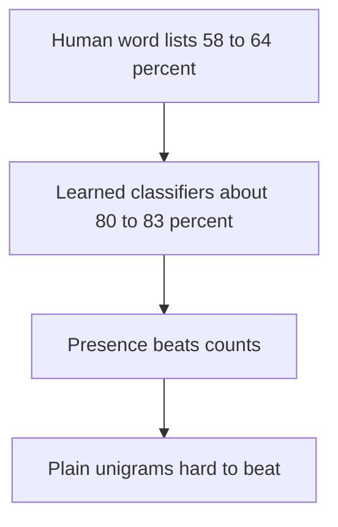

## The hook

By 2002, computers could already sort news into sport or politics: a story full of "wicket" and "innings" is about cricket. But a film review can say "brilliant", "stunning" and "talented" and still end with "it is a mess". The words give away the topic, not the verdict.

So should you tell the computer which words are positive, or let it learn from examples? And when it learns, what should it look at?

## Before you start

You should know what a classifier does from [Yes or No? How Machines Make Decisions](article:primer-classification), what features and labels are from [What Machines Actually Learn From](article:primer-data-features-labels), and the idea of a maximum-margin boundary from [Draw the Widest Road Between Two Crowds](article:paper-support-vector-networks).

## The world before this paper

Text classification was well studied for topics. Opinions were newer ground. Much earlier work on opinions relied on lists of positive and negative words, either chosen by hand or grown from a few seed words like "excellent" and "poor". Count the good words, count the bad words, and see which side wins.

That seems reasonable. The question nobody had settled was whether standard machine learning, trained on labelled reviews, would do better on [[sentiment classification]] than people's intuitions about which words matter.

:::history
Bo Pang and Lillian Lee at Cornell and Shivakumar Vaithyanathan at IBM Almaden published the paper at EMNLP 2002. They built a corpus of film reviews from the rec.arts.movies.reviews newsgroup archive on IMDb and used each reviewer's own rating to label reviews positive or negative, so no one had to label them by hand.
:::

## The big idea

:::analogy
Imagine cutting a review into single-word slips and dropping them into a jar. You can shake the jar, pull out slips and see which words are there, but the order is gone. "Not" and "good" are both in the jar, with nothing saying they were next to each other. Now you must decide, from the jar alone, whether the reviewer liked the film.
:::

That jar is a [[bag of words]]. The paper's bet was that you should not decide in advance which slips matter. Give a classifier hundreds of labelled jars, and let it learn which slips lean positive and which lean negative.

The paper then asked a second, quieter question: when you look in the jar, should you count how many slips say "great", or only note that "great" is in there? The answer surprised people.

## How it works

### The data

The authors kept reviews with a clear rating, converted the rating into a positive or negative label, and removed the rating from the text so a classifier could not just read it. To stop a few prolific reviewers from dominating, they limited how many reviews each author could contribute. The final set had 700 positive and 700 negative reviews.

### First, the human baseline

Two graduate students were asked to list words that suggest positive and negative reviews. A review was labelled by which list matched more words, and a tie meant guessing. These lists scored 58% and 64% accuracy, where 50% is a coin flip. The main problem was ties: many reviews contained none of the listed words, or equal numbers from each side.

### Then, three learned classifiers

Each review became a vector of [[unigram]] features: one entry per word in the vocabulary. The authors trained three standard classifiers on these vectors:

- **Naive Bayes** treats each word as independent evidence and multiplies the evidence for each class.
- **Maximum entropy**, the same model as logistic regression here, learns a weight for each word and class and turns the weighted sum into a probability.
- **Support vector machines** find the boundary between positive and negative reviews with the widest margin.

They evaluated with three-fold cross-validation and tried several feature sets: single words, word pairs, words with part-of-speech tags, adjectives only, and words tagged with their position in the review.

### Two small but important tricks

[[Negation tagging]] gives the jar back a little of the lost order. Every word after a negation word, up to the next punctuation mark, gets a `NOT_` prefix:

| Original | After tagging |
|---|---|
| I did not like this boring film. | I did not NOT_like NOT_this NOT_boring NOT_film . |
| The songs are good, not great. | The songs are good , not NOT_great . |

Now "NOT_like" is a separate slip from "like", and the classifier can learn opposite weights for them.

[[Feature presence]] means each word's feature is 1 if it appears at all and 0 otherwise, instead of a count.

### A worked example: why counting can mislead

Here is an illustrative linear scorer, the kind of model an SVM or maximum-entropy classifier learns, with made-up weights: great +1.0, funny +0.8, boring −1.2, waste −1.5. A positive total means positive.

The review summarises the plot first: "the hero is a great swordsman, a great leader and a great friend". Then the verdict: "the film is boring and a waste of time".

| Word | Weight | Count | Count × weight | Present | Present × weight |
|---|---|---|---|---|---|
| great | +1.0 | 3 | +3.0 | 1 | +1.0 |
| boring | −1.2 | 1 | −1.2 | 1 | −1.2 |
| waste | −1.5 | 1 | −1.5 | 1 | −1.5 |
| **Total** | | | **+0.3, positive** | | **−1.7, negative** |

Counting lets one word repeated in the plot summary outvote the verdict. Presence caps each word at one vote, and the review is correctly negative. In the jar picture: three "great" slips do not mean the reviewer was three times as pleased.

:::try-this
Apply negation tagging to "The jokes are not funny, but the music is lovely." Which words get the NOT_ prefix? (Only "funny". Tagging stops at the comma, so "but the music is lovely" is untouched.)
:::

## What they found

The learned classifiers beat the human word lists clearly. With unigram presence features, Naive Bayes reached 81.0%, maximum entropy 80.4% and the SVM 82.9%.

The other findings were just as useful:

- **Presence beat frequency.** For the SVM with unigrams, counts gave 72.8% and presence gave 82.9%. This differed from what people expected from topic classification, where counts are often useful.
- **Fancier features did not clearly help.** Adding word pairs, part-of-speech tags or position information did not beat plain unigrams by any meaningful margin, and restricting features to adjectives did worse. Nouns and verbs such as "masterpiece" or "wasted" carry opinion too.
- **Sentiment was harder than topic.** The same methods did noticeably worse here than they typically do on topic classification.

:::insight
For opinions, whether a word appears matters more than how often it appears. One "brilliant" signals a view; three of them are often just the reviewer describing the plot.
:::

:::warning
Common misconception: "Experts know which words carry sentiment, so a hand-built list should win." People missed many useful words and their short lists produced many ties. A classifier that learns weights from labelled reviews finds signals people do not think of, including plain words that are not adjectives.
:::

## What it got wrong (or left open)

The authors studied the errors and named the hardest pattern: [[thwarted expectations]]. A reviewer lists everything that should have made the film great, then delivers a negative verdict in a sentence or two. The jar holds many positive slips and only a few negative ones, and the bag-of-words model votes positive. Order, and words like "but" and "however", matter, and the jar throws order away.

Related problems:

- **Praise for parts, verdict on the whole.** "The lead actor is wonderful in a dreadful film" mixes opinions about different things.
- **Negation is only patched.** Tagging up to the next punctuation mark is a rough rule. It misses negation that spans clauses and over-tags in some sentences.
- **One domain.** All the data were film reviews. Words that signal sentiment in films may not transfer to, say, product reviews.
- **Binary labels only.** The study handled positive versus negative, not ratings or mixed opinions.

## What happened next

The film-review data became a standard benchmark for sentiment classification. The authors released it publicly, and an expanded version became widely used in later work.

Follow-up work tried to fix the jar's blindness to structure. Pang and Lee themselves later separated subjective sentences from plot summary before classifying, which targets thwarted expectations directly. Dense word vectors like those in [King Minus Man Plus Woman Equals Queen](article:paper-word2vec) let models share what they learn across similar words. Models such as [BERT](article:paper-bert), which read whole sentences in context, finally handle order and contrast much better than any bag of words.

Simple bag-of-words classifiers with presence features remain a strong, fast baseline for text classification today, which is a sign of how well this paper's lessons have lasted.

## Key takeaways

- Treating sentiment as supervised classification over word features beat hand-picked positive and negative word lists by a wide margin.
- With unigram features, Naive Bayes, maximum entropy and SVMs all reached about 80 to 83% accuracy on balanced film reviews, with the SVM best at 82.9%.
- Recording whether a word appears worked much better than counting it, because repeated words often come from plot summary rather than opinion.
- Richer features such as word pairs or part-of-speech tags did not clearly beat plain single words, and adjectives alone did worse.
- Bag-of-words models fail on thwarted expectations, where a long positive build-up is reversed by a short verdict, because they ignore word order.
