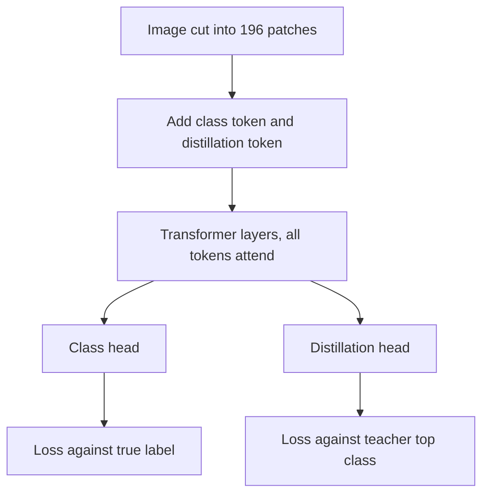

## The hook

In 2020, Google showed that a pure transformer could classify images as well as the best convolutional networks. There was a catch you could not get around: the strongest results came after pre-training on a private collection of hundreds of millions of images, on infrastructure few labs could afford.

A few months later, a team at Facebook AI trained a competitive image transformer on the public ImageNet dataset alone, on a single computer, in under three days.

## Before you start

You should know how [the Vision Transformer](article:paper-vit) cuts an image into patches and treats them like words, and how self-attention works from [the Transformer article](article:paper-attention-is-all-you-need). Knowing what a convolutional network such as [ResNet](article:paper-resnet) does helps with the teacher part.

## The world before this paper

Convolutional networks carry a strong [[inductive bias]]. A convolution looks at small neighbourhoods and reuses the same filter everywhere. That bakes in two useful assumptions: nearby pixels belong together, and a cat is a cat wherever it appears.

A vision transformer has almost none of that. It sees 196 patches and has to learn from data which ones relate to which. With enormous datasets, that freedom pays off. With only ImageNet's roughly one million training images, the original ViT fell behind similar-sized convnets, and its authors concluded that transformers need very large datasets to shine.

:::history
Hugo Touvron, Matthieu Cord, Matthijs Douze, Francisco Massa, Alexandre Sablayrolles and Hervé Jégou, at Facebook AI and Sorbonne University, posted DeiT (Data-efficient image Transformers) in December 2020, about two months after ViT appeared on arXiv. It appeared at ICML 2021. Their claim was that ViT's problem was mostly the training recipe, not the architecture.
:::

## The big idea

:::analogy
Picture a junior birdwatcher learning from a field guide. Each photo in the guide carries an official name. Next to her stands a veteran who grew up in the forest and has strong instincts about where birds perch and what shapes to look for. The junior keeps two notebooks: one for the field guide's name, one for what the veteran says when she glances at the same photo. Over time, the second notebook passes on the veteran's instincts.
:::

DeiT has two ingredients.

1. **A better training recipe.** Strong [[data augmentation]] and regularisation let a transformer train well on ImageNet alone.
2. **Distillation through attention.** A new [[distillation token]] gives the transformer a second notebook, filled in by a teacher, often a convnet.

The student is the birdwatcher. The field guide is ImageNet's labels. The veteran is the teacher network, whose convolutional instincts are exactly the inductive bias a transformer lacks.

## How it works

### Two extra tokens

ViT splits a 224 by 224 image into 16 by 16 pixel patches: 14 × 14 = 196 patch tokens. It adds one [[class token]], whose final state predicts the label.

DeiT adds a second extra vector, the distillation token, giving 198 tokens. Both extra tokens pass through every attention layer, so both can gather information from all the patches and from each other. At the end, each has its own small classifier head.

### What the second notebook records

In classic [[knowledge distillation]], the student matches the teacher's full spread of probabilities, softened by a temperature. DeiT also tried a simpler option, [[hard distillation]]: take the teacher's top class as if it were a label. The paper found hard distillation worked better in its setting.

The training loss averages two ordinary cross-entropy losses:

$$\mathcal{L} = \tfrac{1}{2}\,\mathrm{CE}(\psi(Z_{c}), y) + \tfrac{1}{2}\,\mathrm{CE}(\psi(Z_{d}), y_t)$$

Here $Z_c$ is the class head's output scores, $Z_d$ is the distillation head's, $\psi$ is the softmax that turns scores into probabilities, $y$ is the true label, and $y_t$ is the teacher's top class for this exact training image. CE is cross-entropy, which is small when the model gives high probability to the target.

Why would the teacher's label ever differ from the true one? Augmentation. A random crop of a "robin" photo might show only the branch it sat on. The field guide still says robin; the veteran, looking at the cropped image, says branch.

### A worked example

Three classes: robin, sparrow, branch. A heavily cropped robin photo shows mostly branch. The true label is robin; the teacher's top class is branch.

| Head | Scores | Softmax probabilities | Target | Loss |
|---|---|---|---|---|
| Class | 2.0, 1.0, 0.5 | 0.629, 0.231, 0.140 | robin | 0.464 |
| Distillation | 0.5, 0.2, 2.5 | 0.110, 0.081, 0.809 | branch | 0.212 |

Each loss is minus the natural log of the probability given to the target: $-\ln 0.629 \approx 0.464$ and $-\ln 0.809 \approx 0.212$. The total is their average, about 0.338. Both gradients flow back through the same shared layers, so the backbone learns from the label and from the teacher's view of what is actually in the crop.

### Two answers at test time

The teacher is not needed at test time. The student produces two predictions, and DeiT adds their softmax probabilities, a form of late fusion.

Take a clean photo where the class head gives 0.465, 0.381, 0.155 and the distillation head gives 0.345, 0.466, 0.189. Summed: 0.810, 0.846, 0.344. The class head alone would say robin, the distillation head says sparrow, and the combined vote picks sparrow. Both notebooks get a say.

:::try-this
At 384 by 384 pixels with 16 by 16 patches, how many tokens does DeiT process? (384 / 16 = 24, so 24 × 24 = 576 patches, plus 2 extra tokens, makes 578.)
:::

### Why not just two class tokens?

The authors checked. Two class tokens trained on the same true labels end up nearly identical, so the second one adds nothing. The distillation token, supervised by a different target, stays different from the class token and carries complementary information. Two notebooks only help if they record different things.

:::warning
Common misconception: "Distillation only helps when the teacher is more accurate than the student will be." In DeiT, the teacher's value is partly its different way of seeing. A convnet teacher passes on locality habits a transformer lacks, and the paper reports that convnet teachers worked especially well.
:::

:::insight
The inductive bias that a transformer leaves out does not have to come from more data. It can be borrowed from a model that has it, through a dedicated token that listens to that model.
:::

## What they found

The abstract states the headline results:

- **ImageNet alone is enough.** A convolution-free transformer trained only on ImageNet, with no external data, was competitive. The reference model, with 86 million parameters, reached 83.1% top-1 accuracy (single-crop).
- **Cheap to train.** The models trained on a single computer in less than three days.
- **Token-based distillation helps, especially with a convnet teacher.** With the distillation token, results became competitive with convnets on ImageNet, reaching up to 85.2% accuracy.
- **Good transfer.** The models also did well when transferred to other image classification tasks.
- **Open release.** Code and trained models were shared publicly.

## What it got wrong (or left open)

- **You still need a teacher.** The best results rely on a strong pre-trained convnet, which costs compute to train and to run during the student's training.
- **The recipe is delicate.** Performance leans heavily on a specific mix of augmentation and regularisation, and changing it can hurt.
- **No new architecture.** DeiT made ViT trainable on modest data but did not change its structure. It still processes every patch at one resolution, which is costly for large images and dense tasks like segmentation.
- **Why convnet teachers help is argued, not proven.** The inductive-bias explanation is plausible and supported by experiments, but not a full theory.

## What happened next

DeiT's training recipe and released models quickly became a standard starting point for vision transformer research, because they made the architecture usable without private data.

Other work then tried to put the missing inductive bias into the architecture itself. [Swin Transformer](article:paper-swin-transformer-hierarchical-vision-transformer-using-shift) used local windows and a hierarchy of resolutions, which made transformers practical for detection and segmentation. The same group continued with follow-ups such as CaiT and DeiT III, which refined the training of deeper image transformers. Vision transformers later became standard image encoders in vision-language systems such as [BLIP](article:paper-blip-bootstrapping-language-image-pre-training-for-unified-v).

## Key takeaways

- The original Vision Transformer needed huge private datasets; DeiT showed that a careful training recipe makes ImageNet alone enough to be competitive.
- DeiT adds a distillation token beside the class token; both attend through every layer, but the distillation token is trained to match a teacher's prediction.
- Hard distillation uses the teacher's top class as a label, which also corrects labels that random crops make misleading.
- At test time the two heads' probabilities are added, giving a small ensemble inside one model.
- Convolutional teachers worked especially well, suggesting that a transformer can borrow the inductive bias it lacks from another model.
