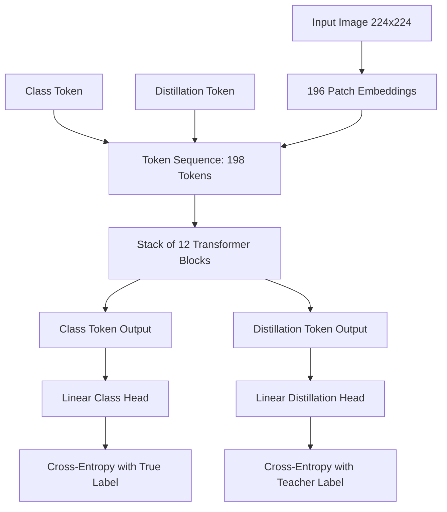
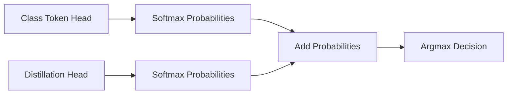

## The hook

In late 2020, Google dropped a bombshell called the Vision Transformer. It proved that pure self-attention could beat deep convolutional networks at image classification, but it came with an infuriating catch: to match a standard ResNet, you had to pre-train it on 300 million private images using massive Google compute clusters. Train it on the standard academic ImageNet dataset alone, and it failed miserably. A team at Facebook AI asked a daring question: could you tame this data-hungry beast so that ordinary researchers could train it on a single machine in just a couple of days?

## Before you start

Before jumping in, make sure you are comfortable with:
- How self-attention works from [The Paper That Taught Machines Where to Look](article:paper-attention-is-all-you-need).
- The basic architecture of residual convolutional networks from [Why Deeper Got Worse, and the Shortcut That Fixed It](article:paper-resnet).
- How images are sliced into linear patch tokens from [What If an Image Is Just a Sentence of Patches?](article:paper-vit).

## The world before this paper

For nearly ten years after AlexNet, computer vision meant one thing: convolutional neural networks (CNNs). Convolutions reigned supreme because they carried a built-in architectural assumption known as [[Inductive Bias|inductive bias]]. 

A convolution slides a tiny filter over an image. By construction, it assumes that nearby pixels are related (locality) and that a cat in the top-left corner is still a cat if it appears in the bottom-right corner (translation invariance). Because these rules were baked into the wiring of the network, CNNs could learn efficiently from modest datasets like standard ImageNet (1.2 million images).

:::history
When Google published ViT in late 2020, it abandoned convolutions entirely. ViT sliced images into a grid of 16x16 patches and treated them like words in a sentence. ViT was wonderfully flexible, but it had zero built-in assumptions about how 2D images worked. It did not know that pixel (1, 1) was right next to pixel (1, 2). When trained on standard ImageNet without external data, ViT-B managed only 77.9% accuracy, trailing behind contemporary CNNs. Only when fed Google's private JFT-300M dataset did ViT finally take the crown. For anyone without a private supercomputer, Vision Transformers looked like an academic curiosity you could admire but never use.
:::

Hugo Touvron and his colleagues at Facebook AI and Sorbonne University refused to accept that Vision Transformers were doomed to be data gluttons. They believed the architecture was sound; the training regime was simply starving for structural guidance.

## The big idea

The researchers introduced **DeiT** (Data-efficient Image Transformer). DeiT achieves two breakthroughs simultaneously. First, it introduces a clean recipe of heavy data augmentations tailored specifically for transformers. Second, and most famously, it introduces a clever distillation technique called the **[[Distillation Token|distillation token]]**.

Instead of making the transformer discover spatial geometry from scratch, why not let it peek at the notes of an experienced convolutional network?

:::analogy
Imagine a student preparing for an art history exam by staring at unorganized fragments of paintings. Without millions of practice examples, the student gets disoriented because they have no innate sense of perspective or brushwork. DeiT hands this student two notepads. Notepad A (the class token) records observations to match the official exam answer key. Notepad B (the distillation token) is reserved exclusively for coaching tips from a seasoned master painter (a CNN teacher). Even with a regular-sized textbook, the master's structural advice allows the student to ace the exam in just three days of study.
:::

## How it works

DeiT keeps the exact same architecture as ViT, with one critical addition at the input and a tailored loss function at the output.

### 1. Slicing images and adding the distillation token

Just like in standard ViT, an RGB image is divided into a grid of $14 \times 14$ non-overlapping patches, each of size $16 \times 16$ pixels. Each patch is flattened and linearly projected into a vector of dimension $D = 768$ (for the base model).

Normally, ViT prepends a single learnable vector called the class token (`[CLS]`). DeiT prepends **two** learnable vectors:
1. The **Class Token** (`[CLS]`): tasked with predicting the ground-truth label.
2. The **Distillation Token** (`[DIST]`): tasked with reproducing the prediction of a teacher model.

If an image yields $N = 196$ patch tokens, DeiT feeds a sequence of $N + 2 = 198$ tokens into the transformer encoder. Learnable positional embeddings are added to every token so the model knows where each patch belongs.



Inside the transformer blocks, all 198 tokens attend to one another through standard multi-head self-attention. The class token and distillation token can gather information from the image patches and from each other across all 12 layers.

### 2. Hard distillation vs soft distillation

Traditional knowledge distillation, popularized by Geoffrey Hinton, uses "soft" targets. The student tries to match the smooth probability distribution output by the teacher's softmax function using Kullback-Leibler (KL) divergence:

$$\mathcal{L}_{\text{soft}} = (1 - \lambda)\mathcal{L}_{\text{CE}}(\psi(Z_s), y) + \lambda \tau^2 \text{KL}(\psi(Z_s / \tau), \psi(Z_t / \tau))$$

Here, $Z_s$ are the student logits, $Z_t$ are the teacher logits, $\tau$ is a temperature parameter that softens the distributions, and $\lambda$ balances the two terms.

The DeiT authors discovered something surprising: transformers learn much better from **[[Hard Distillation|hard distillation]]**. Instead of matching softened probabilities, the student simply takes the teacher's top prediction as an absolute ground-truth label:

$$y_t = \operatorname{argmax}_c Z_t(c)$$

The global loss is then a simple, parameter-free average of two standard cross-entropy losses:

$$\mathcal{L}_{\text{hard}} = \frac{1}{2}\mathcal{L}_{\text{CE}}(\psi(Z_s), y) + \frac{1}{2}\mathcal{L}_{\text{CE}}(\psi(Z_s), y_t)$$

Here:
- $\psi$ is the softmax function converting logits into class probabilities.
- $Z_s$ is the logit vector produced by the network.
- $y$ is the true one-hot ground-truth label.
- $y_t$ is the teacher's discrete top choice.
- $\mathcal{L}_{\text{CE}}$ is standard cross-entropy loss.

:::insight
Why does hard distillation beat soft distillation here? Data augmentation! DeiT uses aggressive cropping and mixing. If an augmentation accidentally crops out a cat and leaves only grass, the true label $y$ still says "cat". But the CNN teacher looks at the cropped image and says "grass". The hard label from the teacher dynamically corrects mislabeled crops on the fly!
:::

### A tiny numerical example

Suppose an image contains a dog running in the snow. We have 3 possible classes: `[Cat, Dog, Snow]`.

- **True ground-truth label ($y$):** `[0, 1, 0]` (Dog).
- **Teacher model output ($Z_t$):** `[1.2, 5.1, 4.8]`.
- The teacher's argmax pick is index 1 (Dog), so $y_t =$ `Dog`.

Now suppose data augmentation heavily crops the image so that only the white background is visible:
- **True ground-truth label ($y$):** still says `[0, 1, 0]` (Dog).
- **Teacher model output ($Z_t$):** `[0.5, 1.1, 6.2]`. The teacher sees white powder and predicts index 2 (Snow), so $y_t =$ `Snow`.

The student's class head tries to predict `Dog` (matching $y$), while the student's distillation head tries to predict `Snow` (matching $y_t$). Both heads propagate gradients through the shared transformer backbone. The network learns what an object looks like from both the dataset ground truth and the contextual eye of the teacher.

:::warning
You might wonder: why not just add a second class token instead of inventing a distillation token? The authors tested this! When two class tokens are both trained on the true ground-truth labels, their cosine similarity reaches $0.999$. They collapse into redundant clones. In contrast, the class token and distillation token start with an average cosine similarity of only $0.06$. They learn complementary representations throughout the network.
:::

### 3. Inference via late fusion

At test time, the teacher network is discarded entirely. The image passes through DeiT, producing two output vectors: one from the class head and one from the distillation head.

How do you make the final call? DeiT uses **[[Late Fusion|late fusion]]**. You convert both logit outputs into probabilities with softmax, add them together, and pick the highest score:

$$P_{\text{final}} = \operatorname{argmax}_c \left( \psi(Z_{\text{class}})_c + \psi(Z_{\text{distill}})_c \right)$$

This ensemble-within-a-single-model consistently beats using either head on its own.



### 4. The data-efficient training recipe

The distillation token is half the story. The other half is an aggressive data augmentation recipe that prevents the transformer from overfitting. The authors systematically ablated every regularizer:

- **Rand-Augment & AutoAugment:** Randomly applies rotations, shearing, and color transforms.
- **Mixup & CutMix:** Blends pairs of images or pastes patches from one image into another.
- **[[Repeated Augmentation|Repeated Augmentation]]:** Samples 3 different augmented views of the same image within a single mini-batch, forcing the self-attention layers to find invariant features.
- **Stochastic Depth:** Randomly drops entire transformer layers during training steps to regularize deep backbones.
- **No Dropout:** Crucially, adding dropout actually *hurt* performance. DeiT removed dropout completely.

:::try-this
Imagine training a network where you apply CutMix: you cut out half of an image of a sports car and replace it with a patch of sunflowers. What would a standard transformer do if you trained it with ordinary labels? It would struggle because the label says 50% car, 50% flower, but the patches are jumbled. A convolutional teacher, however, identifies the flower textures locally and gives clear, patch-grounded targets that guide the distillation token.
:::

## What they found

The results transformed vision transformer research overnight.

```
Model                        Data         Params    ImageNet Top-1
------------------------------------------------------------------
ViT-B (Original)             ImageNet-1k   86M           77.9%
ViT-B (Original)             JFT-300M      86M           84.15% (at 384x384)
DeiT-B (No distillation)     ImageNet-1k   86M           83.1% (at 384x384)
DeiT-B⚗ (Distilled)          ImageNet-1k   87M           84.5% (at 384x384)
DeiT-B⚗ (1000 epochs)        ImageNet-1k   87M           85.2% (at 384x384)
```

1. **Beating 300 million images with 1.2 million:** DeiT-B⚗ trained strictly on academic ImageNet-1k scored **85.2% top-1 accuracy** at resolution 384x384 when trained for 1000 epochs. This surpassed the original ViT-B pre-trained on Google's private 300-million-image JFT dataset (84.15%).
2. **Trained on a single node:** A standard DeiT-B model trained for 300 epochs took only **53 hours on a single 8-GPU node**. Smaller models like DeiT-Ti (Tiny, 5M parameters) and DeiT-S (Small, 22M parameters) trained in less than 3 days on just 4 GPUs.
3. **CNN teachers crush transformer teachers:** When distilling into DeiT-B, using a convolutional teacher (RegNetY-16GF, 82.9% accuracy) yielded an **84.2%** student at resolution 384. Using an equally strong Vision Transformer as the teacher only reached **83.1%**. Convolutions inject spatial inductive priors that transformers desperately need.
4. **Hard distillation easily beats soft distillation:** On DeiT-B at 224x224, standard soft distillation scored 81.8%, while hard distillation reached 83.0%.
5. **Excellent downstream transfer:** When fine-tuned on smaller target datasets without any large-scale pre-training, DeiT achieved 99.2% on CIFAR-10, 91.4% on CIFAR-100, and 93.9% on Stanford Cars.

## What it got wrong (or left open)

While DeiT made vision transformers practical, several challenges remained:

1. **Teacher overhead during training:** While DeiT eliminated the need for millions of extra images, training still required forward passes through a hefty CNN teacher network (like RegNetY-16GF). This added memory pressure and training compute compared to pure supervised learning.
2. **Heuristic positional interpolation:** When boosting resolution from 224x224 to 384x384, the number of patches jumps from $14 \times 14$ to $24 \times 24$. To avoid vector norm shrinkage, the authors had to use bicubic interpolation on positional embeddings. Without careful fine-tuning after interpolation, accuracy quickly degraded.
3. **High hyperparameter sensitivity:** The paper showed that without the exact cocktail of Rand-Augment, Mixup, CutMix, and repeated augmentation, training collapsed. The transformer had no natural resilience against overfitting without this handcrafted augmentation pipeline.

## What happened next

DeiT blew the doors open for vision transformer adoption. Before DeiT, you needed Google-scale clusters to work on vision transformers. After DeiT, any academic lab with a single GPU box could build state-of-the-art vision models.

The open-source code and pre-trained weights published by Facebook AI became the default baseline for vision research. Just months later, researchers introduced [Swin Transformer](article:paper-swin-transformer-hierarchical-vision-transformer-using-shift), which built hierarchical shifted windows directly into the transformer architecture to bring back locality without needing a CNN teacher. 

Later, architectures like [BLIP](article:paper-blip-bootstrapping-language-image-pre-training-for-unified-v) and [BLIP-2](article:paper-blip-2-bootstrapping-language-image-pre-training-with-frozen) borrowed DeiT-style patch projection backbones to connect vision encoders seamlessly to large language models. The concept of dedicated functional tokens—vectors inserted into attention blocks to siphon specific knowledge—became a standard tool across modern deep learning.

## Key takeaways

- Vision Transformers do not need hundreds of millions of proprietary images; a disciplined training recipe of Mixup, CutMix, and repeated augmentation enables strong training on standard ImageNet alone.
- The distillation token lets a transformer student absorb the spatial inductive biases of a convolutional teacher through standard self-attention.
- Hard distillation, where the student targets the teacher's discrete top choice, outperforms classical soft KL-divergence distillation when heavy data augmentations are used.
- Late fusion between the class head and distillation head produces an internal ensemble that outperforms either head on its own.
- Training a competitive 86-million-parameter Vision Transformer was reduced from weeks on supercomputer clusters to 53 hours on a single 8-GPU workstation.
