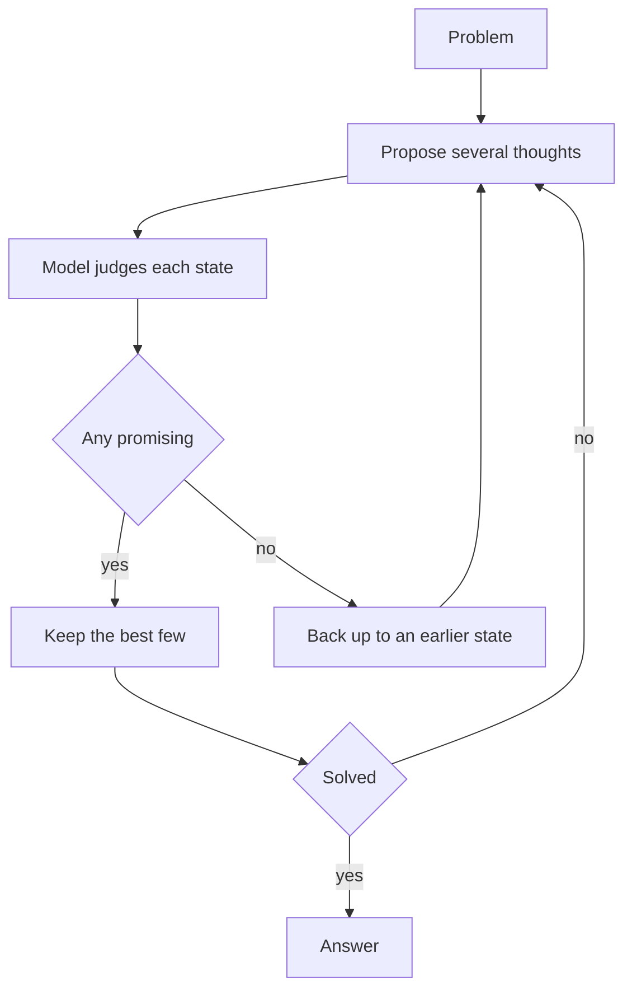

## The hook

Give a strong language model the numbers 4, 9, 10 and 13, and ask it to make 24 with plus, minus, times and divide. A child with a pencil will try something, see it go nowhere, cross it out and try again.

The model cannot cross anything out. It writes its first step, then keeps building on it, even when that step has already made 24 impossible. In the paper's experiments, GPT-4 with step-by-step prompting solved only 4% of these puzzles. Letting it back up and try again raised that to 74%.

## Before you start

You should know [chain-of-thought prompting](article:paper-chain-of-thought), where a model writes its reasoning before answering, and that models like [GPT-3](article:paper-gpt-3) generate text one token at a time from left to right. Knowing breadth-first and depth-first search from a data structures course helps, but the article explains both.

## The world before this paper

By 2023, prompting had become a powerful way to get reasoning out of language models. [[Chain of thought]] asked the model to show its working. Self-consistency sampled several chains and took a majority vote on the final answer.

Both share one limit: each chain is a single left-to-right pass. The model never compares two possible next steps, and it never goes back. If the first step is a bad one, everything after it is built on sand. That works when problems are mostly straight lines, and fails when an early choice decides everything.

:::history
Shunyu Yao, then a PhD student at Princeton, worked with Dian Yu, Jeffrey Zhao, Izhak Shafran, Thomas L. Griffiths, Yuan Cao and Karthik Narasimhan from Princeton and Google DeepMind. The paper appeared at NeurIPS 2023. It draws on an old idea from Allen Newell, Cliff Shaw and Herbert Simon: problem solving is a search through a space of possibilities, guided by judgements about which paths look promising.
:::

## The big idea

:::analogy
Picture an explorer in a cave system. At every fork, a careless explorer simply walks down the first tunnel and keeps going, however damp and narrow it gets. A careful explorer holds up a lantern, peers a little way down each tunnel, and judges which look promising. They chalk an X on the ones that dead-end, and if their chosen tunnel fails, they walk back to the last fork and try the next one.
:::

Chain of thought is the careless explorer. Tree of Thoughts makes the language model the careful one. The model proposes several possible next steps, called [[thought]]s, judges how promising each partial solution is, and a search algorithm decides which branches to keep, which to explore next and when to back up.

The key point is that no new model is trained. The same language model plays every role: it proposes tunnels, holds the lantern, and its judgements guide the search.

## How it works

Tree of Thoughts has four design questions, answered differently for each problem.

- **What is one thought?** A step big enough to judge but small enough to vary. In the Game of 24, one thought is one equation, such as $13 - 9 = 4$, which turns four numbers into three.
- **How are thoughts proposed?** Either sample several independent continuations, or ask the model to list several possible next steps in one go.
- **How are states judged?** The [[state evaluator]] asks the model to rate each partial solution on its own, for example with a label like sure, maybe or impossible, or to vote for the most promising among several.
- **How is the tree searched?** [[Breadth-first search]] keeps the best few states at each level; [[depth-first search]] follows the most promising branch and uses [[backtracking]] when it fails.

### A worked example: why the first step matters

Take the paper's example numbers 4, 9, 10 and 13 in the [[Game of 24]]. Combining any two of the four numbers with the four operations, in either order for minus and divide, gives 36 possible first steps. A short program that follows every path to the end finds:

| Quantity | Count |
|---|---|
| Possible first steps | 36 |
| First steps from which 24 is still reachable | 7 |
| Complete paths in the whole tree | 3,880 |
| Complete paths that end at 24 | 9 |

Only 7 of the 36 first steps keep the puzzle alive. A model that commits to a first step without judging it walks into a dead tunnel about 4 times out of 5. That is the trap chain of thought falls into.

Now watch Tree of Thoughts. It proposes candidates such as these and asks the model to judge what is left:

- $13 \times 10 = 130$ leaves 4, 9, 130. Far too big to bring back to 24: impossible.
- $13 - 9 = 4$ leaves 4, 4, 10. Promising, since $(10 - 4) \times 4 = 24$: sure.

Keeping the promising state, the next steps are $10 - 4 = 6$, leaving 4 and 6, and then $4 \times 6 = 24$. The answer is $(13 - 9) \times (10 - 4) = 24$. The lantern saved the explorer from a long walk down the 130 tunnel.

:::try-this
From the numbers 2, 3 and 4, can you still reach 24? What about 1, 2 and 3? Judge each the way the state evaluator would. (2, 3, 4 is promising: $2 \times 3 \times 4 = 24$. 1, 2, 3 is impossible: the largest you can make is $(1 + 2) \times 3 = 9$, so that branch gets an X.)
:::

### Breadth versus depth

For the Game of 24, which always takes exactly three steps, the paper used breadth-first search, keeping the best 5 states at each level. For mini crosswords, where a wrong word can surface many steps later, it used depth-first search: place the most promising word, keep going, and back up as soon as the evaluator says some clue can no longer be filled. Same explorer, two strategies for the same cave.

:::insight
The model already knows a lot about which partial answers look hopeless. Chain of thought never asks it. Tree of Thoughts turns that judgement into a search signal, so the model can spend its effort where it pays off.
:::

:::warning
Common misconception: "Tree of Thoughts makes the model smarter." The model and its weights are unchanged. What changes is how its outputs are used: more proposals, explicit self-evaluation and a search procedure. It buys better answers with many more model calls, and it is only as good as the model's own judgements.
:::

## What they found

The paper tested three new tasks that need planning or search: the Game of 24, creative writing and mini crosswords. According to the abstract:

- **Large gains across all three tasks.** Tree of Thoughts significantly improved the problem-solving ability of language models on every task.
- **Game of 24: from 4% to 74%.** GPT-4 with chain-of-thought prompting solved 4% of the puzzles; with Tree of Thoughts it solved 74%.
- **A general framework.** The same four design questions covered tasks as different as arithmetic, story planning and word puzzles.

For creative writing, the model proposed several plans for a passage and voted on the best, and the resulting passages were judged more coherent than chain-of-thought ones. In crosswords, depth-first search with backtracking clearly beat single-pass prompting.

## What it got wrong (or left open)

- **Cost.** Proposing and judging many thoughts takes many more model calls than one chain. For easy problems this is wasted money and time.
- **Hand-designed for each task.** What counts as a thought, how to judge it and which search to use were all chosen by hand, with task-specific prompts.
- **The judge can be wrong.** The evaluator is the same model, so it can confidently mark a good branch impossible or a bad one sure. Search amplifies good judgement but cannot fix poor judgement.
- **Small, puzzle-like tasks.** The tasks were chosen to need search. How much the method helps on messy real-world problems was left open.

## What happened next

Tree of Thoughts helped popularise the idea of spending more computation at answer time: letting a model try, judge and revise rather than answer in one pass. Follow-up work extended trees to graphs of thoughts that can merge branches, and combined language models with Monte Carlo tree search, the planning method behind [AlphaGo](article:paper-alphago).

Later reasoning-focused models moved the search inside the model, training it to propose, check and revise within its own long output instead of relying on an external search script. The explorer's habits, peek, judge, chalk an X, back up, became something models learn rather than something prompts impose. The voting idea also connects to [self-consistency](article:paper-self-consistency-improves-chain-of-thought-reasoning-in-lang).

## Key takeaways

- Chain-of-thought prompting follows a single left-to-right path, so one bad early step can doom the whole answer.
- Tree of Thoughts treats reasoning as search: the model proposes several thoughts, judges partial solutions itself, and a search algorithm keeps, explores or abandons them.
- No training is needed; the same language model proposes thoughts and evaluates them through different prompts.
- On the Game of 24, GPT-4's success rate rose from 4% with chain of thought to 74% with Tree of Thoughts.
- The gains cost many more model calls and task-specific design, and they depend on the model judging its own partial work well.
