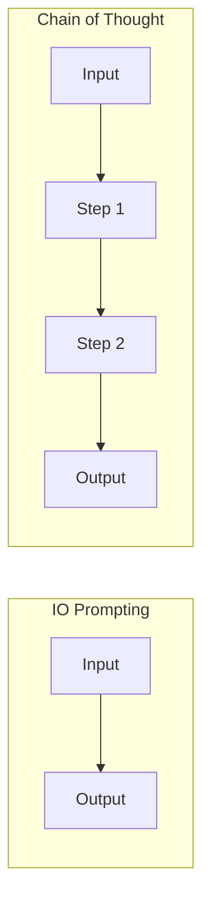
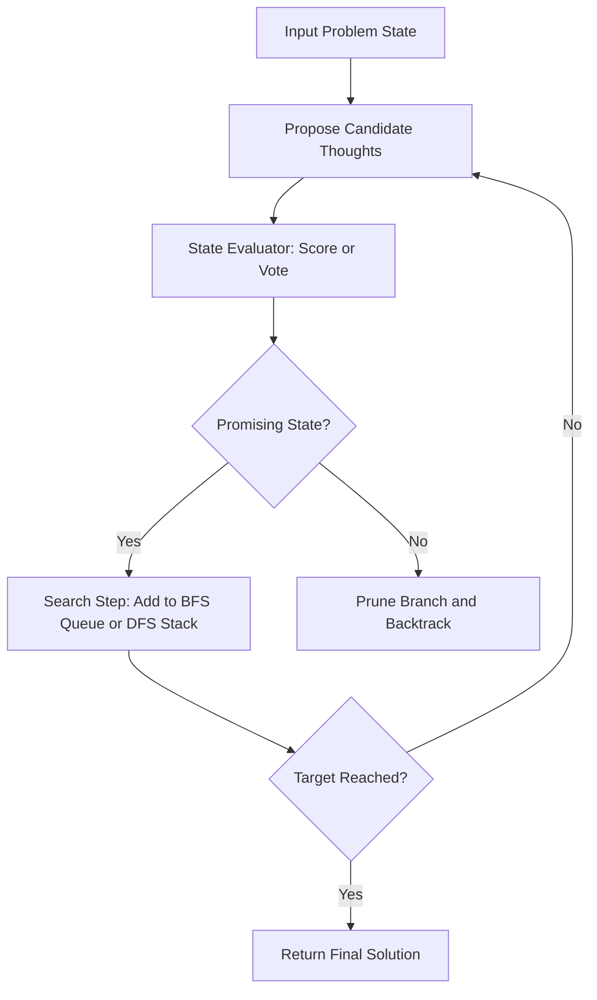
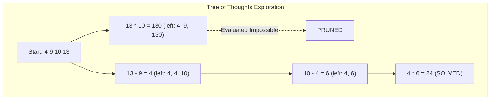

## The hook

Give GPT-4 four numbers: 4, 9, 10, and 13. Ask it to use basic arithmetic to make 24. 

Even with the famous "let's think step by step" prompt, one of the most capable models in the world succeeds only 4% of the time. Why does a model that passed the bar exam fail at a math puzzle designed for eight-year-olds?

The answer lies in how language models generate text: one token at a time, strictly left to right, with no way to reconsider. In 2023, a team from Princeton and Google DeepMind showed that if you give the model the ability to explore alternative paths, score its own partial ideas, and backtrack from dead ends, its success rate jumps from 4% to 74%.

:::analogy
Standard autoregressive language generation is like driving down an unfamiliar highway without a map, committing blindly to every fork you meet and praying it leads to your destination. 

**Tree of Thoughts** is like stopping at intersections, sending out scouts down several roads, evaluating their reports, and turning the car around whenever a scout discovers a dead end.
:::

## Before you start

To get the most out of this article, you should understand how [few-shot prompting works](article:paper-gpt-3) and how [Chain of Thought prompting](article:paper-chain-of-thought) encourages models to write intermediate reasoning steps before arriving at a final answer.

## The world before this paper

Modern large language models are autoregressive: they sample the next token based on all preceding tokens. When you ask a hard question, standard Input-Output (IO) prompting asks the model to jump directly to the answer.

[Chain of Thought (CoT)](article:paper-chain-of-thought) made a breakthrough by asking the model to write out intermediate steps ($z_1, z_2, \dots, z_k$) before providing the final answer $y$. By giving the model extra "thinking tokens", CoT improved accuracy across reasoning tasks. Researchers then developed Self-Consistency (CoT-SC), where the model generates multiple complete reasoning chains and takes a majority vote on the final answer.

Yet even CoT-SC had two fatal limitations:

1. **No local exploration:** Every chain was generated sequentially in a single pass. If the model chose a poor first step, the entire chain was doomed.
2. **No lookahead or backtracking:** The model had no way to pause at step two, realize that step one made the problem impossible, and retreat to try an alternative path.

Voting across independent chains only helped when the output space was tiny, such as multiple-choice questions. For open-ended puzzles where every wrong turn produced a unique wrong answer, majority voting broke down completely.

:::history
In the 1950s, AI pioneers Allen Newell, Cliff Shaw, and Herbert Simon observed that human problem solving is not a smooth stream of words. Humans treat difficult problems as an active search through a combinatorial maze. We try a move mentally, check if we like where it leads, and back up if it looks like a trap. The authors of Tree of Thoughts realized that language models were trapped in "System 1" thinking (fast, automatic association) and needed a mechanism for "System 2" thinking (slow, deliberate search).
:::

## The big idea

Instead of generating a continuous stream of tokens, the authors split problem solving into four distinct ingredients under a framework called **Tree of Thoughts (ToT)**:

1. **Thought Decomposition:** Carve the task into discrete semantic steps called [[Thought|thoughts]] (an equation, a paragraph plan, or a word clue).
2. **Thought Generation:** Use the language model as a [[Thought Generator|thought generator]] to propose multiple candidate next steps from the current state.
3. **State Evaluation:** Use the language model itself as a [[State Evaluator|state evaluator]] to judge how promising a partial solution is.
4. **Tree Search:** Wrap these generation and evaluation prompts inside classic graph search algorithms, such as [[Breadth-First Search (BFS)|Breadth-First Search]] or [[Depth-First Search (DFS)|Depth-First Search]], allowing the model to explore multiple lines of reasoning and backtrack when it hits a dead end.

:::insight
The key conceptual leap was realizing that you do not need a separately trained neural network (like the value network in [AlphaGo](article:paper-alphago)) to evaluate intermediate states. A frozen language model can act as its own heuristic guide when prompted to evaluate its own thoughts.
:::

## How it works

Let us walk through the four components using real examples from the paper.

### 1. Thought decomposition
A [[Thought|thought]] must be large enough for the model to judge its utility, but small enough that generating candidates remains diverse and manageable. 
- In **Game of 24**, a thought is a single arithmetic equation reducing four numbers to three (e.g., $13 - 9 = 4$).
- In **Creative Writing**, a thought is a high-level outline for a story paragraph.
- In **Mini Crosswords**, a thought is an candidate word proposal for a specific clue.

### 2. Thought generation
From an existing state $s = [x, z_1, \dots, z_i]$, the system generates $k$ possible next steps. The authors proposed two strategies:
- **Independent sampling (i.i.d.):** Sample $k$ independent answers from standard CoT prompts. This works well when the thought space is rich, such as generating diverse writing outlines.
- **Propose prompt:** Ask the model in a single prompt to list multiple distinct next moves. This works well for structured tasks like math or crosswords, because it prevents the model from generating duplicate ideas.

### 3. State evaluation
How does the algorithm know which branches are worth following? Classical heuristic search systems like $A^*$ depend on hand-crafted mathematical formulas. ToT instead uses two prompt-based evaluation modes:

- **Value each state independently:** Prompt the model to inspect a partial state and classify its feasibility. For Game of 24, the model outputs `sure`, `maybe`, or `impossible`. If the remaining numbers are 1, 2, 3, basic commonsense says you cannot reach 24 with standard operations, so the branch is stamped `impossible`.
- **Vote across candidate states:** When absolute valuation is hard (such as judging how good a creative writing outline is), the model inspects all $k$ proposed outlines together in one prompt and casts votes for which plan feels most coherent.

:::try-this
Imagine you are playing the Game of 24 with input numbers **4, 9, 10, 13**. 
- Candidate Step A: $13 \times 10 = 130$ (remaining numbers: 4, 9, 130).
- Candidate Step B: $13 - 9 = 4$ (remaining numbers: 4, 4, 10).

Even without calculating the whole equation, you immediately recognize that Candidate A has blown up into numbers too large to bring back to 24 with simple subtraction or division. Candidate B leaves you with 4, 4, and 10, which easily allows $(10 - 4) \times 4 = 24$. ToT prompts the model to make this exact judgment before wasting time on Candidate A.
:::

### 4. Search algorithms
Once thoughts can be generated and evaluated, standard algorithms navigate the tree:

- **[[Breadth-First Search (BFS)|Breadth-First Search (BFS)]]:** At depth step $t$, the system generates candidates for all active states, evaluates them, and keeps only the top $b$ candidates (the breadth limit). The rest are discarded. This is ideal when the tree has a fixed, shallow depth (e.g., Game of 24 always takes exactly 3 steps).
- **[[Depth-First Search (DFS)|Depth-First Search (DFS)]]:** The system explores the single most promising thought until it either finds a solution or triggers an `impossible` evaluation. If deemed impossible, DFS prunes the entire branch, returns to the parent node, and tries the next candidate. This is ideal for deeper, constraint-heavy tasks like crosswords.

## What they found

The authors tested ToT against standard prompting baselines across three challenging problem-solving domains.

### Game of 24
On 100 challenging games, standard input-output prompting succeeded only 7.3% of the time. Chain of Thought achieved 4.0%, and Self-Consistency over 100 samples reached 9.0%. 

When Tree of Thoughts ran with a breadth of $b = 5$, GPT-4 achieved a **74% success rate**.

The paper's error analysis uncovered a striking finding: around **60% of CoT samples had already failed the task after generating their very first step** (the first three words of the response). Because standard models have no backtracking mechanism, that single early misstep guaranteed total failure.

| Method | Success Rate |
| :--- | :--- |
| IO prompt | 7.3% |
| CoT prompt | 4.0% |
| CoT-SC ($k=100$) | 9.0% |
| CoT (best of 100) | 49.0% |
| **ToT (ours, $b=1$)** | **45.0%** |
| **ToT (ours, $b=5$)** | **74.0%** |

### Creative Writing
The task required generating a four-paragraph story where four specified, unrelated sentences served as the final sentence of each paragraph.

ToT maintained a depth of 2: generating 5 story outlines, voting on the most coherent outline, generating 5 passage drafts based on that outline, and voting on the best draft.
- Average coherency score from GPT-4 (1–10 scale): IO scored 6.19, CoT scored 6.93, and **ToT scored 7.56**.
- In a blind human study comparing CoT and ToT passages across 100 prompts, humans preferred ToT in 41 pairs, preferred CoT in only 21 pairs, and rated 38 pairs as ties.

### 5x5 Mini Crosswords
A 5x5 crossword requires simultaneous horizontal and vertical letter constraints. Standard IO and CoT models achieved a word-level success rate below 16% and solved at most 1 out of 20 games (5%). 

Using DFS with pruning and backtracking, ToT achieved a **60% word success rate** and fully solved 4 out of 20 games (20%). When an oracle picked the best state explored during search, ToT had visited states solving 7 out of 20 games (35%).

:::warning
Do not assume search fixes inaccurate world knowledge. The authors noted that GPT-4 sometimes pruned winning crossword branches because it incorrectly believed a valid English word was impossible (such as archaic words like "agend"). If the model's underlying knowledge base is unaware of a concept, search heuristics can inadvertently discard correct answers.
:::

## What it got wrong (or left open)

While Tree of Thoughts introduced deliberate planning to language models, it carried real trade-offs:

- **Compute and cost explosion:** Instead of running a single inference pass, ToT issues dozens or hundreds of LLM calls per problem. Searching a game of 24 or a crossword puzzle costs orders of magnitude more time and API budget than a single linear prompt.
- **Unnecessary for simple problems:** For tasks where base models like GPT-4 already perform proficiently, adding tree search yields minimal benefit while adding major latency.
- **Fragile evaluation heuristics:** Because the evaluator is another prompt, the model can hallucinate evaluations, eliminate correct branches too early, or get caught cycling through equally mediocre candidates.

## What happened next

Tree of Thoughts ignited a wave of research into **test-time compute scaling**—the principle that you can trade extra computation at inference time to solve problems that a model cannot solve in one shot.

Following this work, researchers introduced:
- **Graph of Thoughts (GoT):** Extending trees to directed acyclic graphs, allowing models to combine and merge multiple distinct reasoning branches rather than only splitting them.
- **Monte Carlo Tree Search (MCTS) with LLMs:** Integrating principled reward value estimates and exploration-exploitation algorithms, similar to the techniques pioneered in [AlphaGo](article:paper-alphago).
- **Reasoning-optimized models:** Later frontier systems shifted from prompting external search scripts to training the language model itself to generate internal planning, verification, and backtracking steps natively within its output stream.

## Key takeaways

- Autoregressive generation fails at complex planning because it generates text left to right with no mechanism to look ahead or backtrack.
- Tree of Thoughts reframes generation as a search over a tree of intermediate semantic steps called thoughts.
- Pre-trained language models can serve as their own heuristic evaluators by scoring partial thoughts or voting among alternatives.
- On combinatorial problems like the Game of 24, deliberate search improved GPT-4's success rate from 4% under Chain of Thought to 74%.
- Deliberate search shifts the paradigm from making models bigger to giving existing models more test-time compute to plan before answering.
