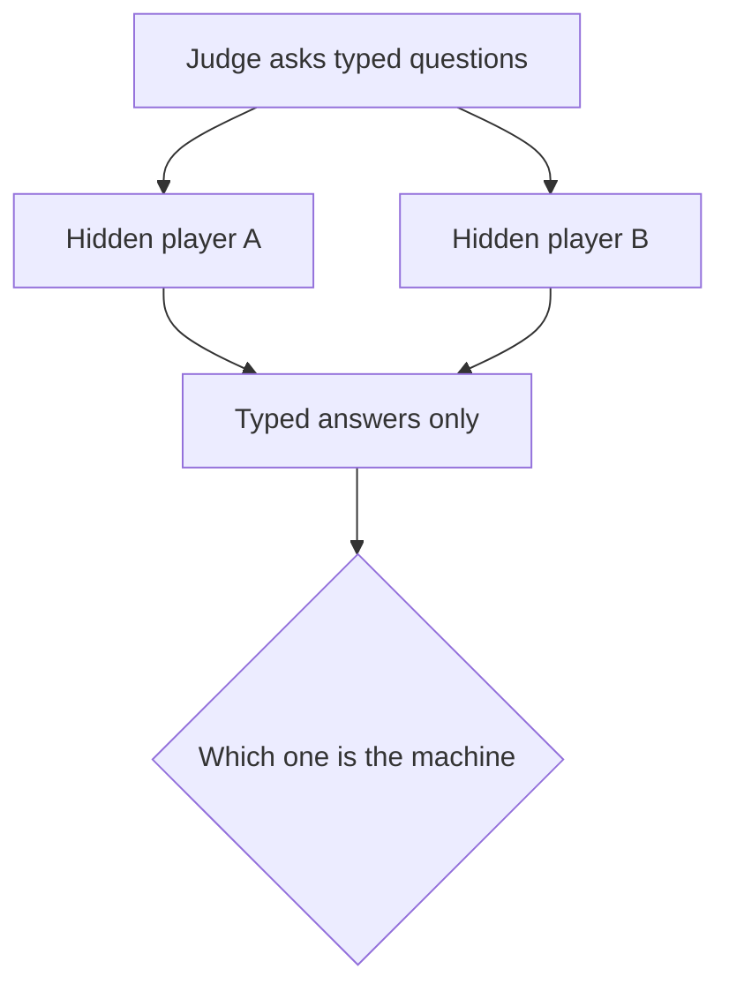

## The hook

In 1950, there were only a handful of electronic computers on the planet. They filled rooms, broke down constantly, and were used mostly to crunch numbers for physicists. Their memories could hold a few thousand numbers.

That year, a 38-year-old mathematician in Manchester published a paper in a philosophy journal that opened with a single, outrageous line: *"I propose to consider the question, 'Can machines think?'"*

Then, a paragraph later, he refused to answer it. What he did instead shaped the next 75 years of artificial intelligence.

## Before you start

You only need the big picture from [AI, ML, and Deep Learning: The Map You Wish You Had](article:primer-ai-ml-dl-map). This paper comes from before anyone had built a learning machine, so it needs no maths at all. If you want to practise reading originals, it is also a perfect first paper to skim, using [How to Read a Research Paper](article:primer-how-to-read-papers).

## The world before this paper

:::history
Alan Turing was already famous among mathematicians. In 1936 he had described an imaginary machine, now called a Turing machine, that could carry out any step-by-step calculation. During the Second World War he had worked at Bletchley Park on breaking German codes. By 1950 he was at the University of Manchester, working with one of the world's first stored-program computers.
:::

People were already arguing about "electronic brains." Newspapers loved the phrase. Philosophers and scientists pushed back: a machine just follows instructions, they said. It has no mind, no feelings, no originality.

The trouble was that nobody could agree what "think" meant. Is it having feelings? Using language? Being conscious? Solving problems? Every definition led to an argument that could not be settled, because you cannot open up someone else's head, human or machine, and look for the thinking.

## The big idea

Turing's move was a brilliant dodge. He said the question "Can machines think?" was too vague to be worth debating. Instead, he replaced it with a game whose result anyone could check.

:::analogy
Think of it like a blind taste test. Arguing about whether a cheaper cola is "really as good" as a famous brand goes nowhere. So you pour both into identical cups, hand them to people, and ask which is which. If tasters cannot tell them apart, the argument is over for practical purposes. Turing proposed a blind taste test for minds.
:::

He called it the [[imitation game]]. A human judge sits in one room and types questions to two hidden players. One is a person. The other is a machine. The judge's job is to work out which is which, using only the typed conversation. If the machine fools the judge about as often as a person would, Turing argued, we should stop fussing over whether it "really" thinks.

:::insight
Turing turned a philosophical question into an experiment. Instead of asking what thinking is, he asked whether a machine's behaviour could be told apart from a thinking being's behaviour.
:::

## How it works

### The setup

Typing matters. Turing wanted to remove everything irrelevant to intelligence, like a voice, a face or handwriting. Only the conversation counts. The judge may ask anything: poetry, arithmetic, chess, feelings.

Turing even wrote out a sample exchange. The judge asks for a sonnet about a bridge, and the machine replies, "Count me out on this one. I never could write poetry." Asked to add two large numbers, it pauses for about 30 seconds and then gives an answer that is slightly wrong. Turing's point was sly: a machine trying to pass would have to imitate human slowness and human mistakes, not just human cleverness.

### Why a digital computer is enough

Turing then explained what a [[digital computer]] is: a store of memory, an executive unit that does operations, and a control that follows a table of instructions. He pointed out that such a machine is a [[universal machine]]. With the right program, one computer can imitate any other step-by-step machine. So the question becomes simpler: is there *some* program that would do well in the game? That is a question about software, not about building special hardware.

He also made a bold prediction. He believed that in about fifty years, computers with a storage capacity of about $10^9$ (a billion binary digits) could be programmed to play the game so well that an average judge would have no more than a 70% chance of picking the machine correctly after five minutes of questioning.

### Answering the critics

Most of the paper is Turing patiently knocking down objections. A few of the best:

| Objection | Turing's reply, in short |
|---|---|
| Machines have no consciousness | We cannot check consciousness in other people either; we accept their behaviour as evidence |
| Machines cannot do X (be kind, fall in love, enjoy strawberries) | These are guesses based on the limited machines people had seen, not proofs |
| Mathematical limits, from Gödel's theorem | Humans have limits too; this proves no superiority |
| [[Lady Lovelace's objection]]: machines only do what we tell them | Machines surprise their programmers all the time, and learning machines could originate behaviour |

:::warning
Common misconception: "Turing claimed his test defines intelligence." He was more careful than that. He offered the game as a practical replacement for a question he considered too vague, and he admitted he had no knock-down proof that machines could think. He mostly argued that the common reasons for saying they could not were weak.
:::

### The idea that came true: learning machines

The final section is the most prophetic. Programming an adult mind by hand, Turing guessed, would be an enormous job. So why not build a [[child machine]] and teach it?

He wrote: *"Instead of trying to produce a programme to simulate the adult mind, why not rather try to produce one which simulates the child's? If this were then subjected to an appropriate course of education one would obtain the adult brain."*

He even sketched rewards and punishments to guide the learning, and suggested including some randomness. That is a recognisable outline of machine learning and even of reinforcement learning, written decades before either became practical.

## What they found

This is a thought experiment, not an experiment with data, so there are no result tables. Its "findings" are arguments:

- The question "Can machines think?" can be replaced by a concrete, testable game.
- A single universal digital computer could, in principle, play that game; the challenge is the program.
- None of the popular objections proved that machines could never succeed.
- Learning, rather than hand-programming, is the most promising path to a machine that could pass.

:::try-this
Imagine you are the judge and you have five minutes. Write down three questions you would ask to unmask a machine. Then, for each, ask yourself: would a modern chatbot answer it convincingly? Turing's own suggestion was to probe for things that need common sense and lived experience, not facts.
:::

## What it got wrong (or left open)

The test measures **imitation**, not understanding. In 1980 the philosopher John Searle argued, with his "Chinese Room" thought experiment, that a system could shuffle symbols well enough to fool people without understanding a word. That debate is still alive.

The test also rewards deception and ignores intelligence that is not chat-shaped. A program that designs new medicines but cannot make small talk would fail.

And the timeline was off in an interesting way. The storage Turing predicted, about 125 megabytes, arrived on cheap computers by around 2000, but convincing conversation did not. It needed vastly more data and computation than he imagined, and the learning approach he championed.

## What happened next

- In 1966, Joseph Weizenbaum's ELIZA chatbot used simple pattern-matching rules to imitate a therapist. Some users became emotionally attached to it, a warning that fooling people is easier than being intelligent.
- For decades, the "learning machine" idea moved forward in small steps, starting with [The Perceptron](article:paper-perceptron) in 1958 and [backpropagation](article:paper-backpropagation) in 1986.
- In the 2020s, large language models like [GPT-3](article:paper-gpt-3), and chat assistants trained with [human feedback](article:paper-instructgpt), became good enough that controlled studies found many people could not reliably tell them from humans in short text conversations.

Turing's child machine, educated rather than programmed, turned out to be roughly how it happened, just with the whole internet as the classroom.

## Key takeaways

- Turing replaced the vague question "Can machines think?" with the imitation game, a testable contest of typed conversation.
- He argued that a universal digital computer could in principle play the game, so the real challenge was writing the right program.
- He systematically answered objections, showing that none proved machines could never think.
- His most prophetic idea was the child machine: build something simple that learns from teaching and experience, the core idea of machine learning.
- The test is still debated because it measures convincing imitation, which is not necessarily the same as understanding.
