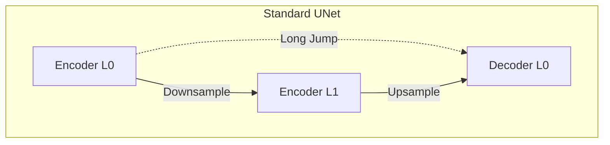
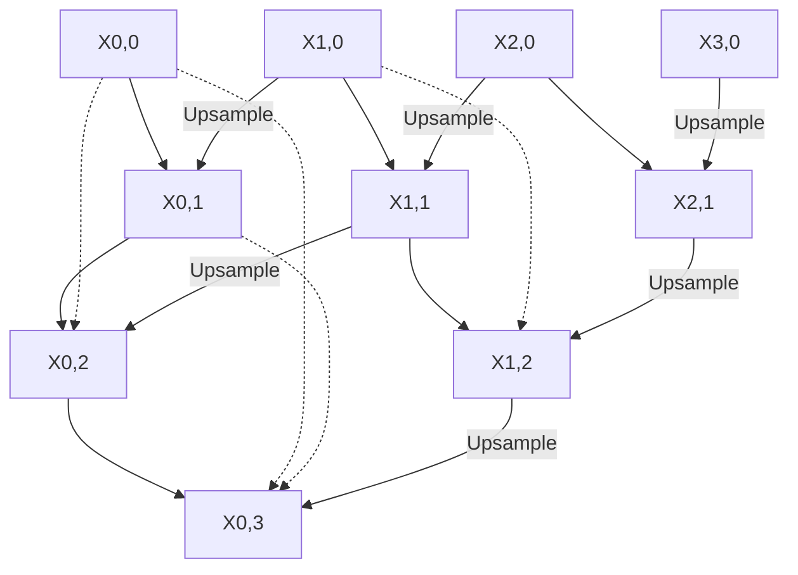
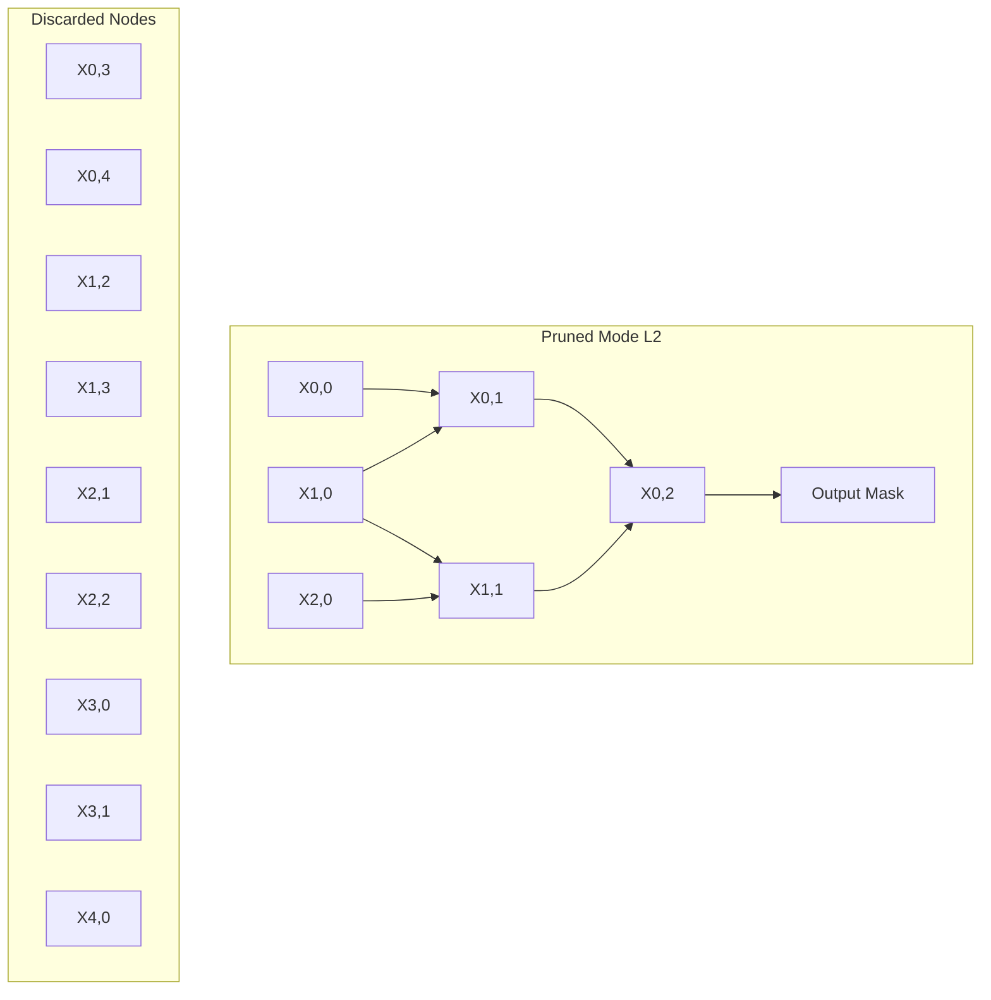

## The hook

Imagine handing a raw blueprint sketch drawn by an apprentice directly to a master builder who is putting the final gold leaf on a cathedral dome. The builder knows where the altar goes, but your sketch shows where individual bricks sit on the ground floor. If you force the builder to stitch those two things together with zero context in between, confusion follows.

For years, the gold standard in medical imaging—[U-Net](article:paper-unet)—did exactly that. It captured fine edges on the left, squished the image down to understand high-level anatomy at the bottom, and then hurled raw, early features across a giant blank chasm to the decoder on the right.

UNet++ asked a simple question: what happens if you fill that empty canyon with stepping-stone workshops?

:::analogy
Think of U-Net like an education system with only primary school and university. A primary school student learns basic phonics and shapes; a university graduate handles complex literary analysis. Standard U-Net tries to pair them up directly on a joint project. 

UNet++ introduces middle school and high school classrooms in between, complete with hallways linking them together. Concepts mature step by step, and if a specific medical task only requires high-school level knowledge, the student can graduate early and save everyone time.
:::

## Before you start

Before jumping in, make sure you feel comfortable with:
- How an encoder-decoder architecture extracts and reconstructs features in [U-Net](article:paper-unet).
- Why shortcut connections keep gradients alive in deep models like [ResNet](article:paper-resnet).

## The world before this paper

In 2015, the original U-Net revolutionized biomedical image segmentation. By adding a [[Skip Connection]] from each downsampling stage of the encoder to the matching upsampling stage of the decoder, the network preserved crisp spatial boundaries that pooling layers usually destroy.

Yet practitioners kept running into two maddening frustrations.

First, there was the [[Semantic Gap]]. The features living on the left side of the "U" are raw and shallow. They respond to simple pixel contrast, tiny edges, and noisy textures. Meanwhile, the features on the right side have traveled all the way through the network bottleneck. They represent high-level medical concepts like "liver boundary" or "lung nodule." Slamming those two representations together via simple concatenation forced the decoder to reconcile two completely different dialects of visual information without any translator.

Second, nobody knew how deep a U-Net needed to be for a given problem. Should your encoder have three downsampling stages, four, or five? 

If your target is a massive liver, a shallow model might suffice. If your target is a tangled cluster of tiny cell nuclei, you might need a much deeper network. Finding the sweet spot meant training five different models from scratch and comparing them on a validation set—a massive waste of time and compute.

:::history
In 2018, a team led by Zongwei Zhou at Arizona State University noticed that medical teams often built huge, wasteful ensembles of separate U-Nets to hedge their bets. They realized that rather than throwing away intermediate representations or guessing network depths, one could nest smaller U-Nets inside a larger U-Net, letting them share weights and learn together.
:::

## The big idea

Instead of leaving the middle of the "U" completely hollow, UNet++ packs it with a dense web of intermediate convolutional blocks. 

By connecting these intermediate nodes both horizontally and vertically, UNet++ builds an ensemble of U-Nets of varying depths nestled inside one single frame. 

Every skip pathway becomes an active, multiscale highway. Features from the encoder travel through a chain of intermediate convolution blocks, gradually becoming more abstract before they ever touch the decoder. 

Even better: by supervising the output at each intermediate depth with [[Deep Supervision]], you can choose how deep your network runs after training is done. If you need lightning-fast results on a mobile hospital scanner, you simply prune away the deepest layers and take predictions from a shallower head.

:::insight
UNet++ transforms skip connections from passive data cables into active feature processors, turning a single network into a nested Russian doll of segmenters.
:::

## How it works

Let us break down the geometry of UNet++. 

Imagine an indexed grid of nodes $X_{i,j}$, where:
- $i \in \{0, 1, 2, 3, 4\}$ denotes the downsampling level down the encoder (depth).
- $j \in \{0, 1, 2, 3, 4\}$ denotes the convolution stage along the skip pathway (horizontal distance).

When $j = 0$, you are looking at the standard encoder backbone ($X_{0,0}, X_{1,0}, X_{2,0}, \dots$). 

Whenever $j > 0$, you are looking at an intermediate node or a decoder node.

### The math behind the nodes

Let $x_{i,j}$ represent the stack of feature maps produced by node $X_{i,j}$. The operation at each node follows one of two rules:

$$x_{i,j} = \begin{cases} 
\mathcal{H}(\mathcal{D}(x_{i-1,j})) & j = 0 \\ 
\mathcal{H}\left( \left[ [x_{i,k}]_{k=0}^{j-1}, \mathcal{U}(x_{i+1,j-1}) \right] \right) & j > 0 
\end{cases}$$

Here is what those symbols mean in plain English:
- $\mathcal{H}(\cdot)$ is a convolution layer followed by a non-linear activation function (like ReLU).
- $\mathcal{D}(\cdot)$ is a downsampling layer (such as max pooling) that cuts spatial dimensions in half.
- $\mathcal{U}(\cdot)$ is an upsampling layer (such as bilinear interpolation or transposed convolution) that doubles spatial dimensions.
- $[\cdot]$ denotes concatenation along the channel dimension.
- $[x_{i,k}]_{k=0}^{j-1}$ represents all previous feature maps generated at the exact same depth level $i$.

Look closely at the case where $j > 0$. Each node receives two streams of information:
1. **Horizontally:** The concatenated outputs of all preceding nodes at the same resolution level. This forms a [[Dense Convolutional Block]].
2. **Vertically:** The upsampled output of the node located diagonally below it ($\mathcal{U}(x_{i+1, j-1})$).

### A tiny worked example

Let us trace node $X_{0,2}$ (depth 0, stage 2).

Suppose our image channels have height and width $64 \times 64$:
1. It looks left along row $0$: it collects feature maps from $X_{0,0}$ (say, 32 channels) and $X_{0,1}$ (32 channels).
2. It looks down diagonally: it takes the output of $X_{1,1}$ (which has resolution $32 \times 32$ and 64 channels) and runs it through upsampling $\mathcal{U}$, yielding a $64 \times 64$ tensor with 64 channels.
3. It stacks them all together along the channel axis:
   $$\text{Total channels} = 32 + 32 + 64 = 128$$
4. Finally, it passes this combined $64 \times 64 \times 128$ block through its convolution layers $\mathcal{H}$ to output the refined representation $x_{0,2}$.

Because $x_{0,2}$ contains both raw spatial data from $X_{0,0}$ and partly digested semantic clues from $X_{1,1}$, the gap between levels vanishes.

:::try-this
Draw a small $3 \times 3$ grid on a napkin. Label rows $i = 0, 1, 2$ and columns $j = 0, 1, 2$. 

Pick node $(0, 2)$. Using your finger, point to all nodes whose arrows feed directly into it. You should find three sources: $(0,0)$, $(0,1)$, and the upsampled output of $(1,1)$. Notice how $(0,2)$ sits at the intersection of a shallow horizontal highway and a deeper vertical ladder.
:::

### Deep supervision and hybrid loss

In standard U-Net, only the very last layer produces a segmentation map. UNet++ attaches a small $1 \times 1$ convolutional classifier head to every top-level node: $X_{0,1}$, $X_{0,2}$, $X_{0,3}$, and $X_{0,4}$.

Each head outputs a full-resolution segmentation prediction. During training, the model calculates the error at each of these heads against the true ground-truth mask using a hybrid loss:

$$\mathcal{L}_{\text{hybrid}} = \mathcal{L}_{\text{BCE}} + \mathcal{L}_{\text{Dice}}$$

Binary cross-entropy ($\mathcal{L}_{\text{BCE}}$) gives smooth gradients across all pixels, while the soft Dice loss ($\mathcal{L}_{\text{Dice}}$) prevents the network from ignoring tiny tumors that occupy only a fraction of the total scan area. The overall network loss is simply the sum of the hybrid losses across all active heads.

### Dynamic model pruning

Because heads $X_{0,1}, X_{0,2}, X_{0,3},$ and $X_{0,4}$ all output valid masks, you can discard parts of the network during inference. This is [[Model Pruning]] made trivial.

If you evaluate the network on validation data and find that head $X_{0,2}$ matches your required clinical accuracy, you can drop depths 3 and 4 entirely. All the grayed-out nodes in the diagram above are never computed, saving precious milliseconds and device battery.

:::warning
Model pruning in UNet++ is an inference-time decision, not an automated training compression technique. You still have to train the complete, heavy UNet++ architecture first. Only when deploying do you choose which branch to prune.
:::

## What they found

The authors put UNet++ through a grueling evaluation across six diverse biomedical tasks: cell segmentation, electron microscopy (EM), nuclei instance segmentation, brain tumor detection (BraTS 2013), liver CT scans, and 3D lung nodules.

### 1. Consistent performance leap across applications
Without even enabling deep supervision, UNet++ beat standard U-Net on every single benchmark in Intersection-over-Union (IoU):
- **Lung nodules:** $+5.06$ points
- **Liver:** $+2.62$ points
- **Brain tumors:** $+2.00$ points
- **Cell segmentation:** $+2.30$ points
- **Nuclei:** $+1.87$ points
- **Neuronal structures:** $+0.62$ points

Adding deep supervision and averaging the predictions across all heads pushed IoU scores up by an additional $0.8$ points.

### 2. Parameter efficiency vs. wider baselines
You might ask: does UNet++ perform better simply because adding extra intermediate nodes gave it more parameters?

To test this, the authors built a "wide U-Net" that scaled up channel counts across plain U-Net until it matched the $9.0\text{M}$ parameter size of UNet++. UNet++ still comfortably outperformed wide U-Net across all tasks, proving that the dense, nested topology was responsible for the gains, not raw parameter volume.

### 3. Big speedups from pruning
When pruned to depth 3 ($\text{UNet++ L3}$), the model achieved an average **$32.2\%$ reduction in inference time** and a **$75.6\%$ reduction in memory footprint**, while losing only $0.6$ points of IoU.

### 4. The embedded training bonus
Here is one of the most intriguing findings in the paper. What if you took the pruned architecture $\text{UNet++ L1}$ and trained it by itself from scratch in isolation? 

The authors tried this and compared it against training the full UNet++ and then pruning it to $\text{L1}$ at test time (embedded training).

Embedded training crushed isolated training. For liver segmentation, the embedded $\text{L1}$ model scored **5 points higher in IoU** than the exact same architecture trained in isolation. 

Why? Because during full training, backpropagation from the deeper nodes $X_{2,0}, X_{3,0}, X_{4,0}$ acted like a team of senior tutors, injecting rich semantic knowledge into the shallow layers that they could never have learned on their own.

## What it got wrong (or left open)

While UNet++ delivered clear gains, it introduced its own headaches:

1. **Training memory explosion:** While pruning shrinks memory at test time, training UNet++ demands significant GPU RAM. All those concatenated intermediate feature maps must be retained in memory for backpropagation. A standard 2D UNet uses around $7.8\text{M}$ parameters with simple paths; UNet++ hovers around $9.0\text{M}$, but its intermediate activations are much bulkier.
2. **Deep supervision does not always matter:** On datasets where targets varied dramatically in scale (like lung nodules and branching neurons), deep supervision provided massive boosts. But on uniform targets like simple cell stains, the extra heads offered almost negligible benefit over plain UNet++.
3. **Manual pruning selection:** UNet++ does not automatically know when to halt computation. You still have to manually run an empirical grid search across your validation dataset to decide whether $\text{L2}$, $\text{L3}$, or $\text{L4}$ offers the best latency-accuracy compromise.

## What happened next

The ideas in UNet++ triggered a wave of multiscale architectural upgrades across computer vision.

Researchers quickly built upon its foundation to introduce **UNet 3+**, which redesigned connections even further to aggregate full-scale features from both smaller and larger scales directly. Others introduced spatial and channel attention mechanisms into the nested blocks.

Moreover, the realization that skip connections should not be empty tunnels influenced vision transformer designs such as [Swin Transformer](article:paper-swin-transformer-hierarchical-vision-transformer-using-shift), which similarly rethink how multiscale spatial hierarchies communicate.

Later, the biomedical field experienced a reality check with [nnU-Net](article:paper-nnu-net-a-self-configuring-method-for-deep-learning-based-bi). nnU-Net showed that while clever architectural modifications like UNet++ are powerful, standard U-Net could often rival them if preprocessing, data augmentation, and loss configurations were systematically tuned. Today, UNet++ remains one of the most popular and dependable backbones whenever practitioners need high-precision boundary delineation and flexible deployment speed.

## Key takeaways

- Standard U-Net links shallow encoder features directly to deep decoder features, creating a severe semantic mismatch.
- UNet++ fills the empty center of the network with a nested grid of dense convolution blocks that gradually refine representations across scales.
- Multi-depth outputs allow deep supervision, turning skip pathways into collaborative learning conduits.
- You can prune trained UNet++ models at inference time, slashing memory by over $75\%$ and latency by roughly a third with minimal drop in accuracy.
- Shallow networks trained within the full UNet++ framework perform far better than identical shallow networks trained in isolation.
