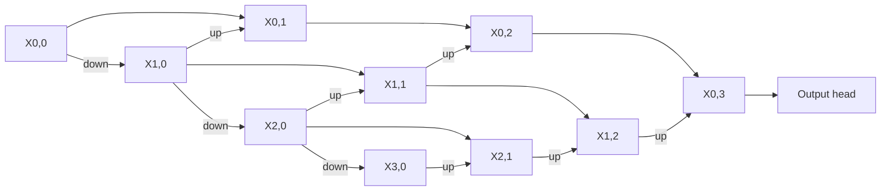

## The hook

A radiologist needs to outline a liver tumour on a CT scan, slice by slice. A neural network can do this in seconds, and for years the default choice was [U-Net](article:paper-unet). But anyone building one faced two awkward questions. How deep should it be: three downsampling steps, four, five? And why did its skip connections hand raw, low-level features straight to a decoder that was thinking in terms of whole organs?

The usual answer to the first question was to train several U-Nets of different depths and keep the best. UNet++, from a team at Arizona State University, answered both questions with one design: nest all those U-Nets inside one network and fill the empty middle of the "U" with intermediate steps.

## Before you start

You should know how [U-Net](article:paper-unet) works: an encoder shrinks the image while learning more abstract features, a decoder grows it back, and [[skip connection]]s pass detail across. Shortcut paths in [ResNet](article:paper-resnet) also help. The task is [[segmentation]]: labelling every pixel.

## The world before this paper

U-Net, published in 2015, became the standard for medical image segmentation. Its skip connections copy each encoder level's feature maps across to the decoder at the same resolution, where they are concatenated. That keeps sharp boundaries that pooling would otherwise blur.

Two problems remained.

- **The [[semantic gap]].** At the top level, the encoder's features have passed through only a couple of convolutions and describe edges and textures. The decoder's features at the same level have travelled down to the bottleneck and back, and describe structures like "edge of the liver". Concatenating them asks the decoder to reconcile two very different kinds of information in one step.
- **Unknown depth.** The best depth depends on the dataset: large organs may need less depth, small scattered structures more. Finding it meant training several separate networks.

:::history
Zongwei Zhou, Md Mahfuzur Rahman Siddiquee, Nima Tajbakhsh and Jianming Liang first presented UNet++ at a MICCAI 2018 workshop. This article covers the extended 2019 journal version in IEEE Transactions on Medical Imaging, which adds the redesigned skip connections' analysis, more datasets, and a study of how training the whole network helps its shallower parts.
:::

## The big idea

:::analogy
Imagine a school with only primary school and university. A primary pupil who knows letters and shapes is paired directly with a university graduate on a project, and the graduate has to translate everything. UNet++ builds the missing middle school and high school in between, with corridors linking every classroom. Ideas mature step by step before they meet the graduate. And if a task only needs high-school knowledge, a student can graduate early, saving time.
:::

UNet++ fills the space between encoder and decoder with a grid of convolution nodes. Every skip path becomes a chain of these nodes, so encoder features become gradually more abstract before reaching the decoder: the middle and high schools. Every depth gets its own output head, trained with [[deep supervision]], which is what lets a student graduate early: after training, you can use a shallower part of the network alone, a form of [[model pruning]].

:::insight
A UNet++ of depth 4 contains U-Nets of depths 1, 2, 3 and 4 that share one encoder. Training them together means one network does the job of a whole family of models, and the shallow ones learn from the deep ones' gradients.
:::

## How it works

### The grid of nodes

Name each node X i,j: i is the depth (how many times the image has been downsampled), j is the step along the skip path. The column j = 0 is the ordinary encoder. A node with j > 0 combines:

- **horizontally**, the outputs of all earlier nodes at the same depth, X i,0 to X i,j−1, concatenated together, like a dense block;
- **vertically**, the upsampled output of the node one level deeper and one step back, X i+1,j−1.

$$x_{i,j} = \mathcal{H}\left(\left[x_{i,0}, \dots, x_{i,j-1}, \mathcal{U}(x_{i+1,j-1})\right]\right)$$

Here H is a convolution block, U is upsampling and the brackets mean concatenation along channels. In the school picture, each classroom hears from every earlier classroom on its floor and from one more advanced classroom above it.

The diagram shows a depth-3 grid for readability; dense links within each row are not drawn.

### A worked node

Trace X0,2 on a 64 × 64 image, with illustrative channel counts:

| Input | Resolution | Channels |
|---|---|---|
| X0,0 (same row) | 64 × 64 | 32 |
| X0,1 (same row) | 64 × 64 | 32 |
| X1,1 upsampled | 32 × 32 → 64 × 64 | 64 |
| **Concatenated** | 64 × 64 | **128** |

Its convolution block then turns this 128-channel stack into its own output. It sees raw detail from X0,0, a partly refined version from X0,1, and more abstract context from the level below. No single step has to bridge the whole semantic gap.

### Deep supervision and the loss

Each top-row node, X0,1 to X0,4, gets a small 1 × 1 convolution head that outputs a full-resolution mask. During training, every head is compared with the true mask, using a combination of pixel-wise binary cross-entropy and [[Dice loss]]. Cross-entropy gives smooth gradients for every pixel; Dice keeps a small lesion from being ignored when most of the image is background.

At test time there are two modes: average all the heads for the best accuracy, or use a single head for speed.

### Pruning after training

Because the head at X0,k only depends on nodes with i + j ≤ k, you can keep that sub-network and drop everything else. Counting nodes for a depth-4 UNet++:

| Pruned to | Nodes kept | Share of the full 15 |
|---|---|---|
| L1 | 3 | 20% |
| L2 | 6 | 40% |
| L3 | 10 | 67% |
| L4 (full) | 15 | 100% |

Choose the smallest level whose accuracy on validation data is good enough: the student graduates early.

:::try-this
Draw a 3 × 3 grid with rows i = 0, 1, 2 and columns j = 0, 1, 2. Which nodes feed X0,2 directly? (X0,0 and X0,1 from its own row, and X1,1 upsampled from below. That is exactly the worked node above.)
:::

:::warning
Common misconception: "pruning means you only ever train the small network." You still train the full UNet++ first. Pruning is a choice made at deployment, and the paper found that a shallow sub-network cut out of the jointly trained model performs better than the same shallow network trained on its own, because it benefited from the deeper parts' gradients during training.
:::

## What they found

The journal paper evaluates UNet++ on six medical segmentation datasets spanning several modalities, including electron microscopy, CT and MRI, with tasks such as cells, nuclei, brain tumours, liver and lung nodules.

- **Consistent gains over U-Net.** UNet++ improved segmentation over U-Net across the datasets.
- **Not just more parameters.** It also beat a "wide U-Net" given extra channels to match UNet++'s parameter count, so the gains come from the nested design, not size alone.
- **A general upgrade.** The redesigned skip connections also improved other architectures, including Mask R-CNN-style instance segmentation, where the authors report similar gains.
- **Pruning works.** Shallower pruned models ran substantially faster and used much less memory, with only a small drop in accuracy for moderate pruning.
- **Joint training helps shallow models.** A pruned sub-network from the full model clearly outperformed the identical architecture trained in isolation.

## What it got wrong (or left open)

- **Heavier training.** The dense, nested connections keep many more intermediate feature maps in memory during training than U-Net does.
- **Pruning level picked by hand.** The network does not decide its own depth per image; you choose a level using validation data.
- **Deep supervision's benefit varies.** Its value depended on the dataset, with more benefit where object sizes vary a lot.
- **Architecture is not everything.** Later work showed that careful configuration of a plain U-Net can match many architectural changes.

## What happened next

UNet++ became a widely used segmentation architecture and a common option in segmentation libraries. UNet 3+ pushed the idea further with full-scale connections across every level. On the other side, [nnU-Net](article:paper-nnu-net-a-self-configuring-method-for-deep-learning-based-bi) showed that automatically configuring preprocessing, training and a standard U-Net often matters as much as the architecture itself. Hierarchical vision transformers such as [Swin Transformer](article:paper-swin-transformer-hierarchical-vision-transformer-using-shift) brought multi-scale feature hierarchies into transformer-based segmentation.

## Key takeaways

- U-Net's skip connections join shallow encoder features directly to deep decoder features, leaving a semantic gap the decoder must bridge in one step.
- UNet++ places a grid of convolution nodes along the skip paths, so each node combines all earlier features at its level with upsampled features from one level deeper.
- One UNet++ contains U-Nets of every depth that share an encoder, and deep supervision gives each depth its own output head.
- After training, the network can be pruned to a shallower sub-network for faster inference, and that sub-network beats the same architecture trained alone.
- The gains held across six medical datasets and against a wider U-Net with the same number of parameters.
