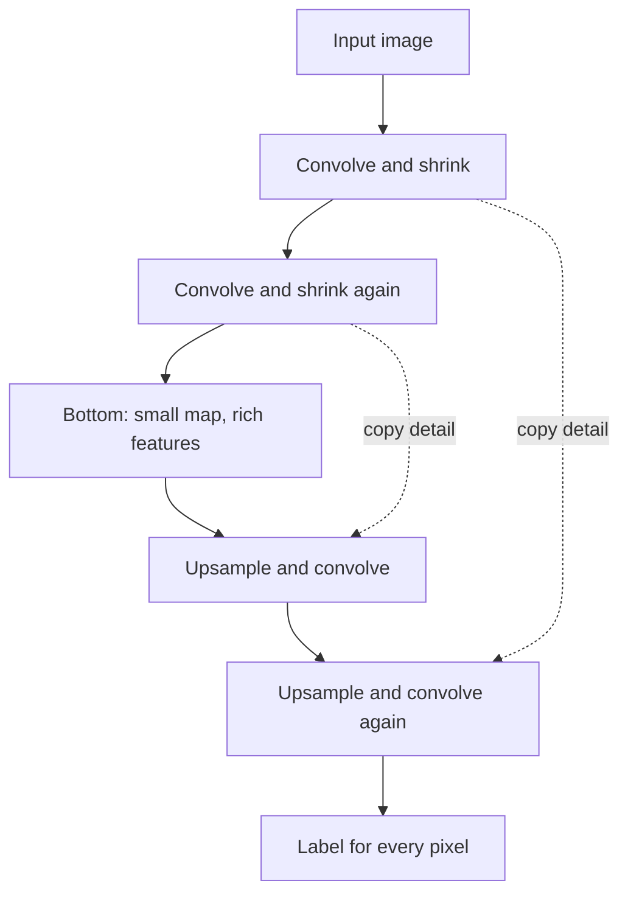

## The hook

A biologist stares at a microscope image packed with hundreds of cells, all touching, all slightly different shapes. Her task: trace the exact boundary of every single cell. It takes hours per image, and she has thousands of images.

In 2015, a small team at the University of Freiburg in Germany built a neural network that did this better than any other method in a major competition, trained from only a few dozen hand-traced images. Its shape on paper looked like the letter U, so they called it U-Net. Seven years later, the same U-shaped design was quietly sitting at the heart of the AI image generators that took the internet by storm.

## Before you start

You should be comfortable with convolutions and pooling from [The Network That Read Your Cheques](article:paper-lenet). U-Net uses the same building blocks but arranges them for a different job: instead of one answer per image, it produces one answer per pixel.

## The world before this paper

Most famous convolutional networks, like [AlexNet](article:paper-alexnet), do classification: they look at a whole image and output one label. Medicine and biology often need something harder, [[segmentation]]: which pixels are tumour, which are cell boundary, which are background?

There was a basic tension. To recognise **what** is in an image, a network needs context, so it pools and shrinks the image layer by layer until each feature sees a large region. But shrinking throws away **where** things are. A segmentation map needs both: the big-picture understanding and pixel-precise location.

:::history
Earlier approaches classified each pixel by running a network on a small patch around it, sliding across the whole image. This was slow, since overlapping patches were processed again and again, and each patch saw only a little context. In 2014, researchers at Berkeley introduced "fully convolutional networks" that produced whole segmentation maps in one pass by upsampling the final features. U-Net built on that idea and pushed it much further.
:::

Biomedical data added another problem: very few labels. Tracing cells is slow, expert work, so a dataset might have only 30 annotated images, while classification networks of the time trained on a million.

## The big idea

Build the network in two halves that mirror each other. The first half shrinks the image to understand it. The second half grows it back to full size to localize precisely. And add bridges between them, so that the second half can borrow the fine detail the first half had to throw away.

:::analogy
Think of an architect designing a renovation. First they zoom out: they study the whole building, its structure and purpose, until they understand what each room is for. Then they zoom back in to draw exact plans, room by room. While drawing the detailed plans, they keep the original close-up photos of each wall pinned beside them, so the new lines land exactly where the old walls were. The zooming out is the [[contracting path]], the zooming in is the [[expanding path]], and the pinned photos are the [[skip connection|skip connections]].
:::

:::insight
Understanding needs a zoomed-out view, but precise outlines need zoomed-in detail. U-Net gets both by sending the detail straight across from the early layers to the late ones.
:::

## How it works

### The U shape

**Contracting path.** Repeated steps of two 3 by 3 convolutions followed by a 2 by 2 max pooling. Each step halves the width and height and doubles the number of feature channels. At the bottom of the U, the feature maps are small but very rich in meaning.

**Expanding path.** Repeated steps of [[upsampling]], which doubles the width and height and halves the number of channels, followed by convolutions. Each step brings the maps closer to the original resolution.

**Skip connections.** At each level, the feature maps from the contracting path are copied across and concatenated with the upsampled maps. The expanding path now has both the deep "what" information from below and the sharp "where" information from the left.

A final 1 by 1 convolution turns each pixel's features into class scores, such as cell or background.

### Learning from very few images

U-Net's second key ingredient was aggressive data augmentation, especially [[elastic deformation]]: smoothly warping each training image and its label map in random ways, like stretching a printed picture on a rubber sheet. Real tissue really does deform like this, so the warped images are realistic. A few dozen annotated images became an effectively endless supply of training variations.

It also helps that segmentation gives a lot of signal per image. Every pixel has its own label, so one image provides many thousands of small training targets rather than one.

:::try-this
Imagine you have a single labeled microscope image. List three transformations you could apply to create new, realistic training examples, and one transformation that would create unrealistic ones. (Realistic: small rotations, gentle elastic warps, slight brightness changes. Unrealistic for cells: flipping colours to neon, or stretching the image to ten times its width. Augmentation only helps if it mimics variation the network will genuinely meet.)
:::

### Why concatenate instead of add?

At each level of the expanding path, U-Net stacks the copied feature maps alongside the upsampled ones, doubling the number of channels, and lets the following convolutions decide how to combine them. Adding them together would force the two kinds of information into the same numbers. Keeping them side by side lets the network learn, separately for every feature, how much to trust the coarse "what" signal from below and how much to trust the sharp edge information from the left.

### Separating cells that touch

When cells press against each other, the thin gap between them is only a few pixels wide, and a network can easily merge two cells into one blob. U-Net's loss function gives extra weight to the pixels in these narrow borders between touching cells, forcing the network to pay close attention to them.

### Big images, tile by tile

To handle large microscope images with limited GPU memory, U-Net processes them in tiles. Because convolutions at the edge of a tile lack context, it uses an "overlap-tile" strategy, giving each tile a border of surrounding image (mirrored at the image edges) so predictions near tile boundaries are still accurate.

## What they found

- On the ISBI challenge for segmenting neuronal structures in electron microscope images, U-Net outperformed the previous best method, a sliding-window network, despite training on only 30 annotated images.
- In the ISBI 2015 cell tracking challenge, U-Net won two categories of light microscopy images by a large margin. On one dataset it reached an average overlap score (intersection over union) of about 92%, compared with about 83% for the second-best method; on a harder dataset, about 77.5% versus about 46%.
- It was fast: segmenting a 512 by 512 image took less than a second on a GPU of the time.

:::warning
Common misconception: "skip connections in U-Net are the same as in ResNet." Both are called skip connections, but they do different things. ResNet adds a block's input to its output to ease optimization. U-Net copies whole feature maps across the network and concatenates them, to recover spatial detail lost by downsampling.
:::

## What it got wrong (or left open)

U-Net needs every training image to be labeled pixel by pixel, which, even if only 30 images are required, is still expert work. Its success also depends on augmentations that match the domain; elastic warps suit soft tissue but not, say, X-rays of rigid bones.

The original network was 2D, while much medical imaging, like CT and MRI scans, is 3D. Extending U-Net to volumes and tuning it for each new dataset took further work. In 2021, a self-configuring version called nnU-Net showed that a well-tuned plain U-Net was still extremely hard to beat across many medical segmentation tasks.

## What happened next

- U-Net became the standard architecture for medical image segmentation, used for tumours, organs, retinal scans and more.
- Its encoder-decoder-with-skips shape spread to satellite imagery, self-driving perception and photo editing.
- Most surprisingly, U-Net became the backbone of image generation. [Denoising diffusion models](article:paper-ddpm) use a U-Net to predict the noise in an image, because the job, an image in and a same-sized image out, fits its shape perfectly.
- [Latent diffusion](article:paper-latent-diffusion), the method behind Stable Diffusion, runs a U-Net in a compressed space, adding attention layers inside it so text prompts can guide the picture.

## Key takeaways

- Segmentation labels every pixel, which requires both an understanding of what is in the image and exact knowledge of where.
- U-Net's contracting path captures context by shrinking the image, and its expanding path restores full resolution.
- Skip connections copy detailed feature maps across the U, so the output can draw precise boundaries.
- Heavy data augmentation, especially elastic deformations, let U-Net learn from only a few dozen annotated images.
- The U-shaped design became standard in medical imaging and later became the backbone of diffusion image generators.
