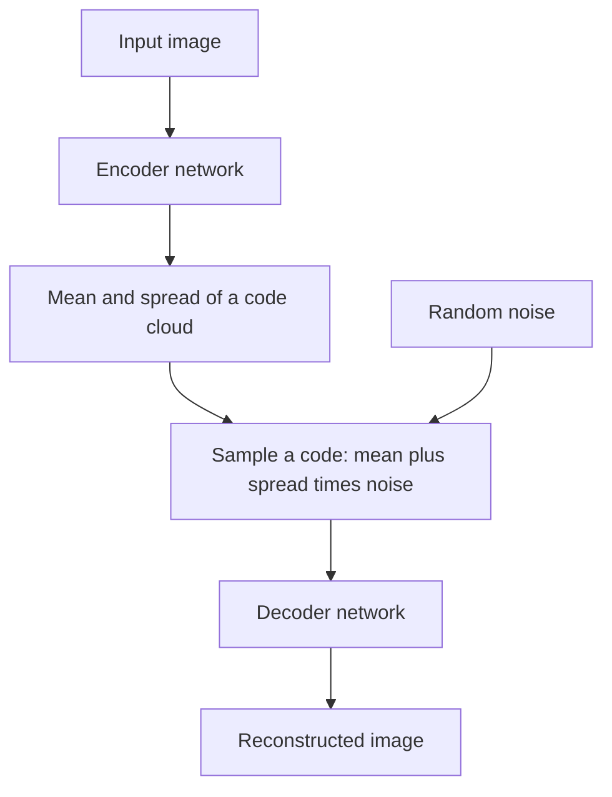

## The hook

A plain autoencoder is a brilliant compressor and a terrible artist. Train one on faces, pick a random point in its code space, decode it, and you usually get a smeared mess, not a new face. The codes it learned are scattered islands in a vast ocean of nonsense.

In December 2013, Diederik Kingma and Max Welling at the University of Amsterdam posted a paper that fixed this with a probabilistic twist. Their model, the variational autoencoder, learned a smooth, continuous map of possibilities. You could walk across it and watch one digit gradually morph into another, or a face slowly turn its head. It was one of the first deep networks that could genuinely dream up new data.

## Before you start

You should understand autoencoders, with their encoder, code and decoder, from [How to Squeeze a Picture Into Thirty Numbers](article:paper-deep-autoencoders). This article uses a little probability: the idea of a bell curve described by a mean and a spread is enough.

## The world before this paper

A [[generative model]] learns the patterns of a dataset well enough to create new examples. The dream is a model with two abilities: compress any real image into a meaningful code, and generate a new realistic image from any code you choose.

Probabilistic modellers had a beautiful framework for this. Assume each image was generated from some hidden code, in a [[latent space]], through a process with learnable parameters. Then learn both the generation process and how to infer the code behind each image. The trouble was that with flexible neural networks inside, the maths of inference became intractable, and the existing approximate methods were slow or did not scale to large datasets.

:::history
Max Welling was a leading figure in probabilistic machine learning; Kingma was his PhD student, who would later also write the [Adam optimizer](article:paper-adam) paper. Remarkably, a team at DeepMind (Danilo Rezende, Shakir Mohamed and Daan Wierstra) independently developed essentially the same idea at almost the same time, published in early 2014. Good ideas, it seems, were in the air.
:::

## The big idea

Make the encoder fuzzy. Instead of mapping an image to one exact point, map it to a small **cloud** of possible codes, described by a mean and a spread. During training, sample a code from that cloud and ask the decoder to rebuild the image from it. And gently pull every cloud toward one shared, simple shape centred at zero.

:::analogy
Think of a city where every house is described by a postcode. In a plain autoencoder, each house gets one exact pin on the map, and the map is full of empty fields where no house exists. In a VAE, each house is described as "somewhere around here," a small fuzzy patch, and the city council insists every patch stays fairly close to the centre. The patches overlap and fill the map. Now any spot you pick is near some houses, and the decoder has learned to build something sensible there.
:::

:::insight
Training with fuzzy codes forces nearby points in the latent space to decode to similar outputs, and pulling all codes toward one simple shape removes the empty gaps. The result is a smooth space where every point means something.
:::

## How it works

### The architecture

The encoder outputs two vectors: a mean $\mu$ and a spread $\sigma$ for each latent dimension. A code $z$ is sampled from the bell curve they describe. The decoder turns $z$ back into an image.

### The objective: two forces in tension

The VAE maximizes the [[evidence lower bound]] (ELBO). In plain terms it balances two terms:

$$\text{ELBO} = \underbrace{\mathbb{E}\big[\log p(x \mid z)\big]}_{\text{reconstruct well}} - \underbrace{\text{KL}\big(q(z \mid x)\,\|\,p(z)\big)}_{\text{stay close to the prior}}$$

- $x$ is the input image and $z$ is the sampled code.
- $p(x \mid z)$ is the decoder's probability of producing $x$ from $z$. Making this high means "rebuild the input accurately."
- $q(z \mid x)$ is the encoder's cloud for this input, and $p(z)$ is the [[prior]], a standard bell curve with mean 0 and spread 1.
- [[KL divergence]] measures how different the cloud is from the prior. Keeping it small means "do not let codes drift into their own private corners."

Reconstruction pushes clouds to be small and distinct, so each image is recognisable. The KL term pushes them to overlap near the centre. The balance between the two is what creates a smooth, usable latent space.

### The trick that made it trainable

There is a problem. Backpropagation needs to know how the loss changes when the encoder's outputs change. But in the middle sits a **random** sampling step, and you cannot take the derivative of "pick a random number."

Kingma and Welling's [[reparameterization trick]] rewrites the sample as a deterministic formula plus independent noise:

$$z = \mu + \sigma \odot \epsilon, \qquad \epsilon \sim \mathcal{N}(0, 1)$$

Now the randomness lives entirely in $\epsilon$, which does not depend on any weights. The path from $\mu$ and $\sigma$ to $z$ is ordinary multiplication and addition, so gradients flow straight through it to the encoder.

### A worked example

Take one latent dimension. The encoder outputs $\mu = 1.0$ and $\sigma = 0.5$, and the noise draw is $\epsilon = 0.4$.

- Sample: $z = 1.0 + 0.5 \times 0.4 = 1.2$.
- If the loss would drop by moving $z$ lower, the gradient tells the encoder to lower $\mu$ (each unit of $\mu$ moves $z$ one-for-one) and to adjust $\sigma$ (each unit of $\sigma$ moves $z$ by $\epsilon = 0.4$).

For a single bell curve, the KL term has a neat closed form: $\frac{1}{2}(\mu^2 + \sigma^2 - 1 - \ln \sigma^2)$. With $\mu = 1.0$ and $\sigma = 0.5$: $\frac{1}{2}(1 + 0.25 - 1 + 1.386) \approx 0.82$. If $\mu$ were 0 and $\sigma$ were 1, it would be exactly 0: the cloud would match the prior perfectly.

:::try-this
Compute the KL term for $\mu = 0$ and $\sigma = 0.1$, a very tight cloud right at the centre. ($\frac{1}{2}(0 + 0.01 - 1 - \ln 0.01) = \frac{1}{2}(0.01 - 1 + 4.61) \approx 1.81$. Even centred, a cloud that is too narrow is penalised, because the prior is wide. That is how the KL term stops codes from becoming exact points.)
:::

### Generating new data

After training, throw the encoder away. Sample a random $z$ from the standard bell curve, feed it to the decoder, and out comes a brand-new image. Because training made the whole region around the centre meaningful, these samples look like plausible data.

## What they found

- On handwritten digits (MNIST) and a dataset of face images (Frey Face), the method optimized its objective faster and reached better values than the wake-sleep algorithm, a standard alternative of the time.
- With a two-dimensional latent space, the authors could draw the entire learned map as a grid of decoded images. Digits flowed smoothly from one class into another across the grid, and faces varied smoothly in expression and pose.
- The approach, which they named stochastic gradient variational Bayes, applied far beyond images: any model with continuous hidden variables could use it, and it scaled to large datasets with ordinary mini-batch training.

:::warning
Common misconception: "a VAE is just an autoencoder with noise added." The noise is only half the story. The KL term, pulling every code toward a shared prior, is what makes random sampling produce sensible outputs. Remove it, and you are back to islands in an empty ocean.
:::

## What it got wrong (or left open)

VAE samples, especially of natural images, tend to be **blurry**. A common explanation is that the reconstruction loss rewards averaging over plausible details rather than committing to sharp ones. For years, [GANs](article:paper-gan) produced much crisper pictures.

The balance between the two terms can also go wrong. With very powerful decoders, a VAE sometimes learns to ignore the code entirely, a failure called posterior collapse. And the ELBO is only a lower bound on how well the model explains the data, not the real thing.

## What happened next

- VAEs became a standard tool for learning structured latent spaces in science, from molecules to music.
- Later variants, such as the VQ-VAE (2017), replaced continuous codes with a learned dictionary of discrete codes and produced much sharper results.
- The reparameterization trick spread far beyond VAEs and is now a basic technique wherever a model needs gradients through random sampling.
- The biggest legacy is in image generation: [latent diffusion](article:paper-latent-diffusion), the method behind Stable Diffusion, uses a VAE-style autoencoder to compress images into a small latent space, and runs [diffusion](article:paper-ddpm) there.
- In 2024, the paper received the first ICLR Test of Time award.

## Key takeaways

- A variational autoencoder maps each input to a cloud of possible codes, described by a mean and a spread, rather than a single point.
- Its objective balances reconstruction quality against a KL penalty that keeps every code cloud close to a simple prior.
- The reparameterization trick writes a sample as mean plus spread times noise, making the random step differentiable so the whole model trains with backpropagation.
- The result is a smooth latent space where random points decode to plausible new data, letting the model generate as well as compress.
- VAE images tend to be blurry, but VAE-style compression became a key part of modern image generators like Stable Diffusion.
