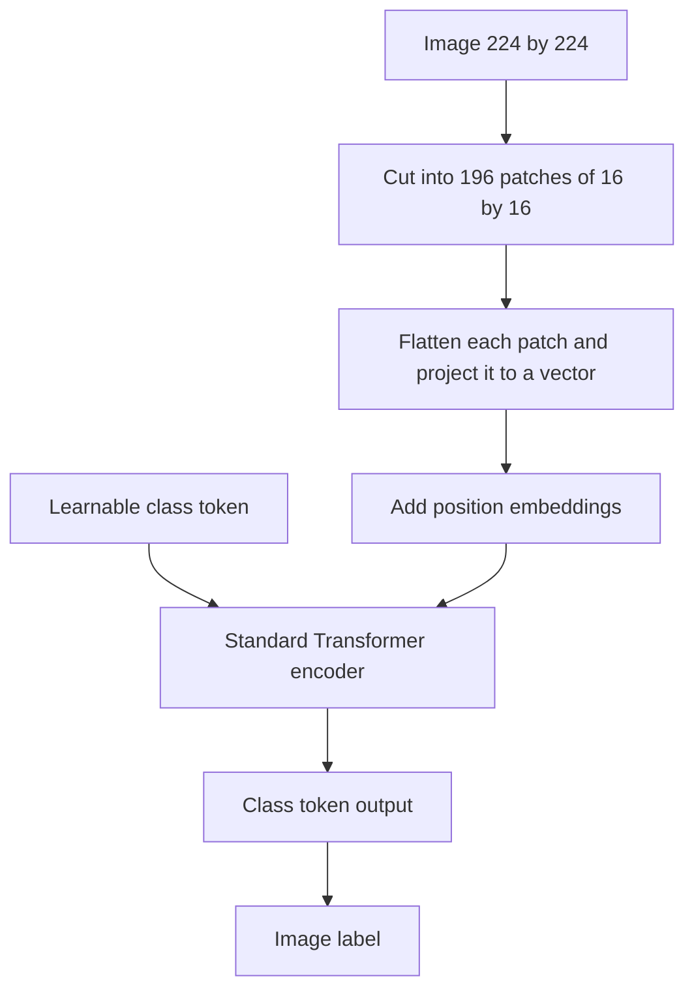

## The hook

For thirty years, computer vision and convolutional networks were nearly inseparable. From LeNet reading cheques to ResNet winning ImageNet, the idea that images need sliding filters seemed as natural as gravity.

In October 2020, a team at Google Research in Zurich posted a paper with a playful title: "An Image is Worth 16x16 Words." Its proposal sounded almost naive. Cut the image into a grid of small squares, treat each square like a word, and feed the "sentence" into the exact Transformer used for language. No convolutions at all.

It worked. Given enough data, this plain Transformer matched or beat the best convolutional networks. Within a few years, Transformers were everywhere in vision, and the same architecture could read text, look at images and, soon, do both at once.

## Before you start

You need self-attention and the Transformer encoder from [The Paper That Taught Machines Where to Look](article:paper-attention-is-all-you-need), and the convolutional baseline it was compared against, from [Why Deeper Got Worse, and the Shortcut That Fixed It](article:paper-resnet).

## The world before this paper

Transformers had taken over natural language processing by 2019. Naturally, people tried them on images. But self-attention compares every token with every other token, and an image has a lot of pixels. A modest 224 by 224 image has over 50,000 pixels; attention between every pair would mean billions of comparisons per layer.

So earlier attempts used attention cleverly but partially: only within local neighbourhoods, or combined with convolutional networks, or with specialised attention patterns that were hard to run efficiently on standard hardware.

:::history
The Google Brain team in Zurich, including Alexey Dosovitskiy, Lucas Beyer, Alexander Kolesnikov, Xiaohua Zhai and Neil Houlsby, had been working on large-scale image pre-training with convolutional networks called Big Transfer (BiT). They had access to Google's internal JFT-300M dataset of around 300 million labeled images. That combination, an interest in scale and the data to test it, set up the experiment.
:::

## The big idea

Do not attend between pixels. Attend between **patches**. Split the image into a grid of non-overlapping squares, say 16 by 16 pixels each, turn each patch into a vector, and treat that sequence of vectors exactly as a Transformer treats a sentence of word embeddings. Change as little as possible about the Transformer itself.

:::analogy
Think of a jigsaw puzzle where each piece has been given a short written description: "blue sky with a cloud edge," "brown fur, part of an ear." A Transformer reading those descriptions can relate any piece to any other, the ear to the eye, the sky to the horizon, no matter how far apart they sit. A convolutional network, by contrast, is like someone studying the puzzle through a small window that slowly widens. ViT reads all the pieces at once and decides which ones belong together.
:::

:::insight
Convolutions are a helpful assumption, not a requirement. With enough data, a general-purpose Transformer can learn what it needs about images on its own, and then keeps improving with scale.
:::

## How it works

### From image to tokens

1. **Split.** A 224 by 224 image with 16 by 16 [[patch|patches]] gives a 14 by 14 grid: 196 patches.
2. **Flatten and project.** Each patch has $16 \times 16 \times 3 = 768$ numbers (three colour channels). A learned linear layer maps them to a vector, the [[patch embedding]].
3. **Mark positions.** Add a learned [[position embedding]] to each patch so the model knows where it came from.
4. **Add a class token.** Borrowing from [BERT](article:paper-bert), prepend an extra learnable [[class token]]. After the Transformer, its final vector is used to classify the image.
5. **Run a standard Transformer encoder.** Layers of multi-head self-attention and feed-forward networks, with layer normalization and [residual connections](article:paper-resnet).

### A worked example: why patches make it affordable

Attention cost grows with the square of the sequence length.

- Pixels as tokens: $224 \times 224 = 50{,}176$ tokens, and about $50{,}176^2 \approx 2.5$ billion pairs per attention layer.
- 16 by 16 patches: 196 tokens, and $196^2 = 38{,}416$ pairs.

That is about 65,000 times fewer pairs. The title's "16x16 words" is exactly this trick.

:::try-this
What if you used larger 32 by 32 patches on the same 224 by 224 image? How many patches, and how many attention pairs? ($224 / 32 = 7$, so $7 \times 7 = 49$ patches and $49^2 = 2{,}401$ pairs. Much cheaper, but each token now covers a bigger area and fine detail is harder to capture. The paper found smaller patches gave better accuracy at higher cost.)
:::

### What the Transformer gives up

A convolutional network has strong [[inductive bias|inductive biases]] built into its design: it assumes nearby pixels are related (locality) and that a pattern means the same thing wherever it appears (translation equivariance). These assumptions are usually true for images, which helps convolutional networks learn from less data.

ViT has almost none of this. Apart from cutting patches, every patch can attend to every other from the very first layer, and nothing tells it that neighbouring patches matter more. It must learn such patterns from data.

### Pre-train big, fine-tune small

ViT followed the same two-stage recipe as [BERT](article:paper-bert) and [GPT](article:paper-gpt-1). First, it was pre-trained on a large [[pre-training dataset]] to classify images into thousands of categories. Then the final classification layer was replaced and the model was fine-tuned on the target task, such as ImageNet or CIFAR-100. Fine-tuning often used higher-resolution images than pre-training; since the patch size stays fixed, a larger image simply produces a longer sequence of patches, and the learned position embeddings were stretched to fit the new grid.

## What they found

- **Data size decides the winner.** Trained only on ImageNet (about 1.3 million images), ViT did somewhat worse than comparable ResNets. Pre-trained on ImageNet-21k (about 14 million images), it caught up. Pre-trained on JFT-300M (about 300 million images), it matched or exceeded the state of the art.
- **Strong benchmark results.** The largest model, ViT-H/14, reached about 88.55% top-1 accuracy on ImageNet after pre-training on JFT-300M, and strong results on CIFAR-100 and a broad suite of transfer tasks.
- **Cheaper to pre-train.** ViT reached these results with substantially less pre-training compute than the leading convolutional models of the time.
- **It learned image structure anyway.** The learned position embeddings showed a 2D grid pattern: patches in the same row or column had similar embeddings. Some attention heads attended across the whole image even in the lowest layers, while others stayed local, like early convolutions.

:::warning
Common misconception: "Transformers are simply better than convolutional networks for vision." The paper's own results show it depends on data. With limited data, the built-in assumptions of convolutions are an advantage. ViT's edge appears at large scale, and later convolutional designs, updated with modern training tricks, closed much of the gap.
:::

## What it got wrong (or left open)

ViT's appetite for data was a real obstacle: few organisations had 300 million labeled images. Within months, DeiT (2021) from Facebook AI showed how to train ViTs well on ImageNet alone, using strong data augmentation and distillation from a convolutional teacher.

Its reliance on a private dataset also made the headline results hard for outsiders to reproduce exactly, a growing concern as more AI progress depended on data that only a few companies owned.

The fixed patch grid also made ViT less natural for tasks that need fine spatial detail at many scales, such as detection and segmentation. Hierarchical variants like the Swin Transformer (2021) reintroduced some locality to address this.

## What happened next

- Vision Transformers became a standard backbone for image classification, detection, segmentation and video.
- [CLIP](article:paper-clip) used a ViT as its image encoder, connecting images and language in one embedding space.
- Self-supervised methods and large segmentation models were built on ViTs, and multimodal language models that "see" images typically feed ViT patch embeddings into a language model.
- Diffusion image generators later began replacing their [U-Nets](article:paper-unet) with Transformers operating on patches of the latent image.

## Key takeaways

- The Vision Transformer splits an image into fixed-size patches, embeds each one like a word, and processes the sequence with a standard Transformer encoder.
- Using patches instead of pixels shrinks the sequence enough to make full self-attention affordable.
- ViT lacks the built-in assumptions of convolutions, so it underperforms them on small datasets but matches or beats them when pre-trained on very large ones.
- At scale it reached state-of-the-art accuracy with less pre-training compute than leading convolutional networks.
- ViT unified the architecture for language and vision, paving the way for multimodal models like CLIP.
