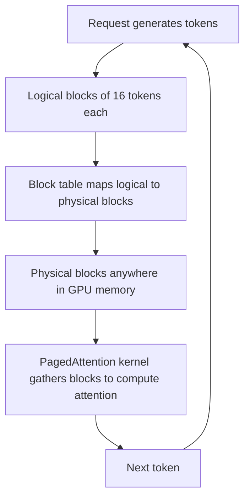

## The hook

Running a chatbot for millions of people is ruinously expensive. Each GPU costs a fortune, and the number of conversations it can handle at once decides how many GPUs you need. In 2023, researchers at UC Berkeley looked at how existing systems used GPU memory while generating text, and found something startling: most of the memory set aside for each conversation was sitting empty, reserved "just in case."

Their fix came from a decades-old idea in operating systems: virtual memory with pages. Applied to language models, it let the same hardware serve several times more requests. The open-source engine they built, vLLM, became one of the most widely used ways to serve open models.

## Before you start

You need attention's queries, keys and values from [Attention Is All You Need](article:paper-attention-is-all-you-need), and the idea that GPU memory is the bottleneck, from [Faster Attention by Doing More Maths](article:paper-flashattention). This article is about what happens **after** training, when a model is answering users.

## The world before this paper

A language model generates text one token at a time. Each new token attends to every previous token's keys and values. Recomputing those for the whole conversation at every step would be wasteful, so serving systems keep them in a [[KV cache]].

The KV cache is big. The paper gives an example: for a 13-billion-parameter model, it takes about 800 kilobytes per token. A single request of 2,000 tokens can need well over a gigabyte. And the cache grows and shrinks unpredictably: nobody knows in advance how long an answer will be.

:::history
To use a GPU efficiently, serving systems process many requests together through [[batching]]. Earlier systems like NVIDIA's FasterTransformer and the research system Orca improved how requests were scheduled. But they stored each request's KV cache in one contiguous chunk of memory, reserved up front for the maximum possible length. Woosuk Kwon, Zhuohan Li and colleagues in Ion Stoica's group at Berkeley measured how much of that reserved memory actually held useful data.
:::

The answer was bleak. In the systems they examined, only around 20% to 40% of the KV cache memory was used for actual token states. The rest was lost to three kinds of [[fragmentation]]:

- **Reserved but not yet used:** space held for tokens the model has not generated yet.
- **Over-reservation:** space for a maximum length the answer never reaches.
- **Gaps:** leftover holes between allocations too small to fit another request.

## The big idea

Stop requiring each request's KV cache to be one contiguous block. Instead, store it in small fixed-size **blocks** that can live anywhere in GPU memory, and keep a table mapping each sequence's logical blocks to physical ones. This is exactly how an operating system's [[virtual memory]] maps a program's addresses onto scattered physical pages. The authors called the attention algorithm that works this way PagedAttention.

:::analogy
Think of a restaurant that seats groups. The wasteful way: when any group arrives, reserve a long table for twenty, because they might invite friends later. Most chairs sit empty all evening, and new groups are turned away. The paged way: seat groups at small tables of four, anywhere in the room, and keep a note of which tables belong to which group. When a group grows, give them another small table wherever one is free. Almost no chair goes unused.
:::

:::insight
Memory waste, not raw computing power, was limiting how many requests a GPU could serve. Allocating the KV cache in small pages on demand nearly eliminates the waste, so far more requests fit in the same GPU.
:::

## How it works

### Blocks and block tables

Each block holds the keys and values for a fixed number of tokens, for example 16. A sequence's cache is a list of blocks, and its [[block table]] records where each one physically lives. A new block is allocated only when the previous one fills up, so the only waste per sequence is the unused part of its last block.

### PagedAttention

Standard attention kernels assume each sequence's keys and values sit in one contiguous array. The PagedAttention kernel instead looks up the block table, fetches the scattered blocks, and computes attention over them. The result is exactly the same as normal attention; only the memory layout changes.

### Sharing memory between sequences

Paging also makes sharing easy. When a user asks for several alternative answers to the same prompt, or when beam search explores several candidate continuations, all of them begin with the same prompt. Their block tables can point to the **same** physical blocks for the shared part. Only when a sequence writes something different into a shared block does vLLM make a private copy, a technique called [[copy-on-write]] that operating systems have used for decades.

### A worked example: how much memory is wasted?

A system reserves space for 2,048 tokens per request, but a typical answer, including its prompt, ends up 300 tokens long.

- **Contiguous reservation:** $300 / 2048 \approx 15\%$ of the reserved memory holds real data; about 85% is wasted.
- **Paged with blocks of 16:** the request needs $\lceil 300 / 16 \rceil = 19$ blocks, which is 304 token slots. Only 4 slots are empty, about 1% waste.

With the same GPU memory, the paged system can fit many more requests at once, and more requests per batch means higher [[throughput]].

:::try-this
With blocks of 16 tokens, how many blocks does a 1,000-token sequence need, and how many token slots are wasted? What if blocks held 128 tokens? (With 16: $\lceil 1000/16 \rceil = 63$ blocks, 1,008 slots, 8 wasted. With 128: 8 blocks, 1,024 slots, 24 wasted. Bigger blocks waste a little more but need fewer table lookups, a trade-off the paper explored.)
:::

### The scheduler

When memory runs out, vLLM can pause some requests by moving their blocks to CPU memory, or dropping them and recomputing later, using an all-or-nothing policy per sequence. Because blocks are small and uniform, these decisions are simple to make, again much like an operating system swapping pages.

## What they found

- **Little waste.** With PagedAttention, the memory wasted in the KV cache fell to under 4%.
- **Higher throughput.** On popular models, vLLM improved serving throughput by 2 to 4 times compared with state-of-the-art systems such as FasterTransformer and Orca, at the same level of latency.
- **Bigger gains for harder cases.** The improvement was larger with longer sequences, larger models and more complex decoding, such as parallel sampling and beam search, where memory sharing saved a great deal.
- **Real-world deployment.** The system was already serving models behind the popular Chatbot Arena and Vicuna demos.

:::warning
Common misconception: "vLLM makes the model itself run faster." Each forward pass takes about as long as before. The gain is in **throughput**: by wasting far less memory, vLLM fits many more requests into each batch, so the GPU produces many more tokens per second in total.
:::

## What it got wrong (or left open)

The PagedAttention kernel has some overhead from looking up block tables and reading scattered memory, which makes the attention computation itself a little slower than a perfectly contiguous version. The authors showed this cost was small compared with the overall gains, but it is real.

The approach also leaves other problems open: how to handle extremely long contexts that do not fit even with paging, how to schedule fairly between users with very different request lengths, and how to share cached prompts across different users' requests efficiently.

## What happened next

- vLLM grew into one of the most popular open-source serving engines, used by many companies to serve open models such as [LLaMA](article:paper-llama), including models customised with [LoRA](article:paper-lora).
- Paged KV caches became standard across serving systems, including NVIDIA's TensorRT-LLM and Hugging Face's text generation server.
- Prefix caching, reusing KV blocks for prompts shared across many requests, built directly on the paging idea.
- Serving engines combine PagedAttention with other techniques covered in this track: tensor parallelism from [Megatron-LM](article:paper-megatron-lm) for large models, and fast kernels in the spirit of [FlashAttention](article:paper-flashattention).

## Key takeaways

- Serving language models requires a KV cache of keys and values for every generated token, which is large and grows unpredictably.
- Existing systems reserved contiguous memory for the maximum length, so most KV cache memory was wasted through fragmentation.
- PagedAttention stores the cache in small fixed-size blocks anywhere in memory, tracked by block tables, just like virtual memory pages in an operating system.
- Paging cut KV cache waste to under 4% and enabled sharing between sequences with copy-on-write.
- The vLLM engine built on it achieved 2 to 4 times higher throughput than earlier systems and became a widely used way to serve open models.
