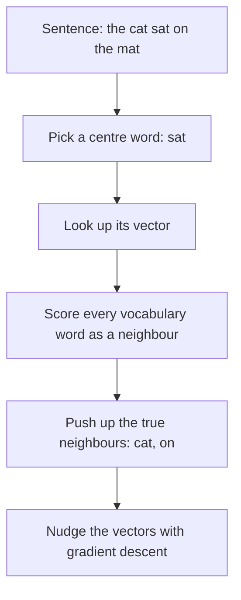

## The hook

In 2013, a small team at Google released a free piece of software and a short paper. Feed it a large pile of text, wait a few hours, and it would give you back a list of numbers for every word. Nothing about that sounds exciting.

Then people started doing arithmetic with the numbers. Paris minus France plus Italy landed near Rome. Walking minus walk plus swim landed near swimming. Nobody had told the model about capitals or verb tenses. It had read the news and found the structure of language sitting in the geometry of its vectors. Word2vec turned "word embeddings" from a research curiosity into a tool every language engineer used.

## Before you start

You should be comfortable with the idea of an embedding as a map of meaning, from [How Words Become Numbers With Meaning](article:primer-embeddings). This paper is the reason that primer exists.

## The world before this paper

To a computer, words were usually just IDs. The common representation was one-hot: a vocabulary of a million words meant a million-long vector with a single 1. Every word was equally unrelated to every other.

:::history
The idea of learning dense word vectors was not new. In 2003, Yoshua Bengio and colleagues trained a neural language model that learned a vector for each word while predicting the next word. Later work by Ronan Collobert, Jason Weston and others showed such vectors helped many tasks. Tomas Mikolov had built recurrent neural network language models for his PhD. The catch was cost: these models were slow, so they were trained on relatively small amounts of text, and the vectors were only as good as the data behind them.
:::

Mikolov, then at Google with Kai Chen, Greg Corrado and Jeff Dean, bet on a lesson you may remember from [A Few Useful Things to Know About Machine Learning](article:paper-few-useful-things): more data often beats a cleverer algorithm.

## The big idea

Strip the neural language model down to the bare minimum, so it is cheap enough to train on **billions** of words. Give up the expensive non-linear hidden layer entirely. Train each word's vector on one simple job: predicting its neighbours, or being predicted by them.

:::analogy
Imagine learning about people at a huge wedding purely by noticing who stands next to whom. You never hear a conversation. But after watching for hours, you notice that the bride's college friends cluster together, the aunties cluster together, and the cricket fans drift toward the screen showing the match. Without being told anything, you could place every guest on a map where people with similar circles stand close. Word2vec does exactly that with words and their neighbours in text.
:::

:::insight
You do not need a complicated model to learn meaning. A very simple model, trained on an enormous amount of text, captures more of language's structure than a sophisticated model trained on a little.
:::

## How it works

### Two mirror-image models

The paper proposed two architectures.

**[[CBOW]] (continuous bag-of-words).** Take a [[context window]] of words around a gap, for example two on each side. Average their vectors and use the result to predict the missing middle word. "The cat ___ on the mat" should predict "sat."

**[[Skip-gram]].** Do the reverse. Take the middle word and use its vector to predict each of the surrounding words. "sat" should predict "cat," "on" and so on.

Neither task is useful in itself. The point is the side effect: to predict neighbours well, words that appear in similar contexts must end up with similar [[word vector|word vectors]]. "Chai" and "coffee" both predict "cup," "hot" and "morning," so their vectors drift together.

### Why it was so fast

Earlier neural language models had a large non-linear hidden layer between the input and output. Word2vec's models are essentially log-linear: a lookup of vectors, a dot product, and a softmax over the vocabulary, with a hierarchical trick to avoid scoring every word one by one. This made training orders of magnitude cheaper. The paper reported learning high-quality vectors from a 1.6 billion word dataset in less than a day.

### What gets learned

Each word actually gets two vectors during training: one used when it is the centre word and one used when it is a neighbour. The prediction score is simply a dot product between them. After training, the "centre" vectors are kept and become the word vectors everyone downloads. Typical sizes were a few hundred dimensions, and the paper showed that quality improved as vector size grew, as long as the amount of training text grew too.

### Measuring meaning: the analogy test

How do you know if word vectors are good? The authors built a large [[analogy test]] with two kinds of questions:

- **Semantic:** Athens is to Greece as Oslo is to ___ (Norway). Man is to woman as brother is to ___ (sister).
- **Syntactic:** big is to bigger as small is to ___ (smaller). Walking is to walked as swimming is to ___ (swam).

To answer "big is to bigger as small is to ___," compute $\text{vec}(\text{bigger}) - \text{vec}(\text{big}) + \text{vec}(\text{small})$, then find the nearest word vector. If it is "smaller," the answer counts as correct. Only exact matches counted, so it is a strict test.

### A worked example in two dimensions

Pretend vectors have just two numbers: a "size" direction and a "comparative" direction.

| Word | Size | Comparative |
|---|---|---|
| big | 0.9 | 0.0 |
| bigger | 0.9 | 0.7 |
| small | 0.1 | 0.0 |
| smaller | 0.1 | 0.7 |

Compute bigger − big + small: size $0.9 - 0.9 + 0.1 = 0.1$, comparative $0.7 - 0.0 + 0.0 = 0.7$. The result $[0.1, 0.7]$ is exactly "smaller." The relationship "make it comparative" is one consistent direction, wherever you start.

:::try-this
Add "tall" at $[0.6, 0.0]$ to the toy table. Predict the vector for "taller" using the same arithmetic, starting from bigger − big. (You get $[0.6, 0.7]$. If the real "taller" sits near there, the model has learned that comparatives share one direction.)
:::

## What they found

- Vectors from both new models beat earlier neural network language models on the analogy test, at a small fraction of the training cost.
- Skip-gram was especially strong on the semantic questions; CBOW was slightly better on syntactic ones and faster to train.
- Quality kept improving with both more training data and larger vectors, so long as both grew together. Training on about 6 billion words of Google News produced the best results.
- Relationships like country to capital, male to female, and singular to plural appeared as consistent offsets between vectors.

:::warning
Common misconception: "the analogy results prove the model understands meaning." Analogy arithmetic works often but not always, and the evaluation excludes the input words from the answers, which flatters the results somewhat. Word vectors capture patterns of usage, which overlap with meaning but are not the same thing.
:::

## What it got wrong (or left open)

Each word gets exactly **one** vector, no matter how it is used. "Bank" in "river bank" and "bank loan" gets a single blended vector, which muddles both meanings.

Rare words and words never seen in training get poor or no vectors. And because the vectors are learned from human writing, they absorb its biases. A 2016 paper by Tolga Bolukbasi and colleagues, titled "Man is to Computer Programmer as Woman is to Homemaker?", showed gender stereotypes encoded in word2vec vectors trained on news.

## What happened next

- A follow-up paper later in 2013 introduced [[negative sampling]] and other tricks that made training even faster and better. It received the NeurIPS Test of Time award in 2023.
- The open-source word2vec tool spread everywhere, and alternatives like GloVe (2014) and fastText (2016) followed.
- Word vectors became the standard first layer of language models, including [Sequence to Sequence Learning](article:paper-seq2seq).
- The one-vector-per-word problem was solved by contextual representations, where a word's vector depends on its sentence, in models like [BERT](article:paper-bert) and [GPT](article:paper-gpt-1).
- The same idea, embed things so that geometry reflects meaning, extended to images and text together in [CLIP](article:paper-clip).

## Key takeaways

- Word2vec learns a vector for every word from a simple task: predicting a word from its neighbours (CBOW) or neighbours from a word (skip-gram).
- By removing the expensive hidden layer, the models trained fast enough to use billions of words, and more data produced better vectors.
- Words used in similar contexts end up with similar vectors, so meaning becomes distance and direction in space.
- Relationships such as country to capital or singular to plural appear as consistent vector offsets, enabling analogy arithmetic.
- Single vectors per word cannot handle multiple meanings and inherit social biases, problems that later contextual models partly addressed.
