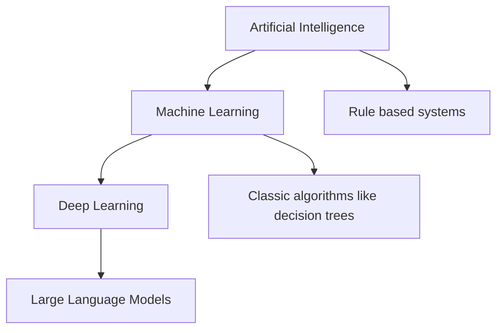

## The hook

Before lunch today, you probably used [[Artificial intelligence|AI]] a dozen times without noticing. Your phone unlocked when it saw your face. Your inbox quietly hid three scam emails. Your keyboard guessed the next word before you typed it.

Here is the strange part. If you ask three people what "AI" means, you will get three different answers, and someone will throw in "machine learning" and "deep learning" as if they were the same thing. They are not. By the end of this primer, you will have a mental map that makes every later article in PaperStack click into place.

## The intuition

:::analogy
Picture a set of Russian nesting dolls. The biggest doll is **artificial intelligence**. Open it, and inside you find **machine learning**. Open that, and inside is **deep learning**. Each doll is a smaller, more specific idea that fits completely inside the one around it.
:::

That is really the whole map. Every deep learning system is a machine learning system. Every machine learning system is an attempt at AI. But not every AI system learns, and not every learning system is "deep."

The interesting question is *why* the dolls exist at all. Each one was born because the bigger doll ran into a wall.

## Let's build it up

### The biggest doll: AI

[[Artificial intelligence]] is a goal, not a technique. The goal is to make computers do things that would look intelligent if a human did them: play chess, translate a sentence, spot a tumor in a scan.

:::history
The term "artificial intelligence" first appeared in a 1955 proposal for a summer workshop at Dartmouth College, held in 1956. The organizers, including John McCarthy, were wildly optimistic. They wrote that a carefully chosen group of scientists could make a significant advance on problems like language and reasoning in a single summer. It took about sixty years longer than they hoped.
:::

For decades, the main way to build AI was to **write the rules by hand**. Want a computer to diagnose diseases? Interview doctors, turn their knowledge into thousands of "if this, then that" rules, and type them in. These were called expert systems, and in narrow domains they worked surprisingly well.

But rules break. Try writing rules that recognize a cat in a photo. "Has pointy ears"? So does a fox. "Has whiskers"? What if the cat is facing away? You end up with endless exceptions. The real world is too messy to describe by hand.

### The middle doll: machine learning

[[Machine learning]] flips the problem around. Instead of writing the rules, you show the computer **examples with the right answers**, and it works out the rules itself.

:::insight
Traditional programming: you give the computer **rules + data**, and it gives you **answers**. Machine learning: you give the computer **data + answers**, and it gives you **rules**.
:::

The thing that comes out of this process is called a [[model]]. You can think of a model as a function with lots of adjustable knobs inside. [[Training]] is the process of turning those knobs, a tiny bit at a time, until the model's answers match the examples.

Machine learning comes in three main flavours:

| Flavour | What you give it | Everyday example |
|---|---|---|
| Supervised learning | Examples with correct answers | Emails labeled "spam" or "not spam" |
| Unsupervised learning | Examples with no answers | Grouping shoppers with similar habits |
| Reinforcement learning | A goal and a score, no examples | A program learning a video game by playing it |

Most of what you will read in PaperStack starts with supervised learning, so that is where the next primers focus.

### The smallest doll: deep learning

Classic machine learning still needed humans for one hard job: deciding *what to look at*. To detect spam, a person had to choose the inputs, like "number of exclamation marks" or "contains the word winner." Choosing these inputs (called features) was an art, and it often decided whether a project succeeded.

[[Deep learning]] removes most of that job. It uses [[Neural network|neural networks]] with many layers stacked on top of each other. The first layers learn simple patterns, like edges in an image. Later layers combine those into bigger patterns, like eyes and ears, and eventually into whole concepts, like "cat."

:::warning
Common misconception: "neural networks work like the human brain." They were loosely inspired by neurons, but they are really just layers of simple math: multiply, add, repeat. The brain is far stranger and far less understood.
:::

Deep learning needs two things in huge amounts: data and computing power. Around 2012, both finally arrived, thanks to giant labeled image collections and graphics chips (GPUs) that could do millions of multiplications in parallel. That is when deep learning started winning almost everything.

## A tiny example

Let's teach a computer to sort email into "spam" and "not spam," three different ways.

**The rule-based way (AI without learning).** You write: "If the subject contains FREE MONEY, mark it as spam." It works until spammers write FR3E M0NEY. Then you write another rule. And another. You are now in an arms race you will lose.

**The machine learning way.** You collect 10,000 emails that people have already marked. You pick some features: count of words like "winner," number of links, whether the sender is in your contacts. The model learns how much each feature matters. Maybe it discovers that "sender is in contacts" makes spam very unlikely, which you never told it.

**The deep learning way.** You feed in the raw text of each email, word by word. The network figures out for itself which words, phrases and patterns matter. Nobody had to invent the feature "number of exclamation marks." If it helps, the network finds it.

:::try-this
Grab a pen. For each item below, decide which doll it belongs in: AI only (rules, no learning), machine learning, or deep learning.

1. A calculator app that follows fixed formulas.
2. A thermostat that turns the heat on below 19°C.
3. A photo app that learned to recognize your friends from millions of tagged photos using a many-layered network.
4. A bank model that learned which loans go bad from 50 years of records and a few hand-picked features.

Answers: 1 is not really AI at all. 2 is a simple rule-based system. 3 is deep learning. 4 is classic machine learning.
:::

## Where you'll see this again

This map is the backbone of the whole learning path.

- Next, [Data, Features, and Labels](article:primer-data-features-labels) looks closely at the "examples with answers" that machine learning learns from.
- In [Computing Machinery and Intelligence](article:paper-turing-test), you will meet Alan Turing asking whether machines can think, before anyone had built a learning machine.
- In the [AlexNet](article:paper-alexnet) article, you will watch the 2012 moment when deep learning crushed the competition and the smallest doll suddenly became the most important one.
- And in [Attention Is All You Need](article:paper-attention-is-all-you-need), you will see the deep learning design that powers today's chatbots, the doll inside the doll inside the doll.

## Key takeaways

- Artificial intelligence is the broad goal of making machines act intelligently, and it includes systems that never learn anything.
- Machine learning is a way of building AI where the computer learns rules from examples with known answers, instead of a human writing the rules.
- Deep learning is machine learning with many-layered neural networks that discover their own features from raw data.
- Each doll exists because the bigger one hit a wall: hand-written rules could not handle messy reality, and hand-picked features could not keep up with complex data.
