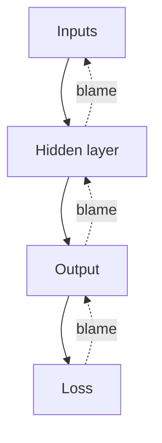

## The hook

A restaurant gets a one-star review: "The biryani was cold and bland." The owner has to fix it. But whose fault was it? The cook who under-salted it? The supplier whose spices were stale? The waiter who left it on the counter for ten minutes?

To improve, the owner has to divide the blame fairly, and then tell each person how to adjust. A neural network faces this exact problem after every wrong prediction, except it has millions of "staff." The clever method it uses to share out the blame is called backpropagation, and it is the reason deep learning works at all.

## The intuition

From [Gradient Descent](article:primer-gradient-descent), you know the training recipe: for every weight, find the slope of the loss, then step downhill. The hard part is the first step. How do you find the slope for a weight buried three layers deep, when its effect on the loss passes through many other neurons?

:::analogy
Think of [[backpropagation]] as passing blame backward through a kitchen. The customer's complaint reaches the head chef first. The head chef works out how much of the problem came from each dish, and passes the right share of blame to each station cook. Each station cook passes a share back to the suppliers who gave them ingredients. Everyone receives exactly their portion of the blame, in a single sweep from the front of the restaurant to the back.
:::

That is the whole idea. Blame flows backward, and at every step it is split according to how much each part contributed.

## Let's build it up

### Two passes

Training a network on one example takes two sweeps:

1. The [[forward pass]]: feed the inputs through every layer to get a prediction, then compute the loss.
2. The [[backward pass]]: start from the loss and move backward, computing how much each weight is responsible for it. These responsibilities are the [[gradient|gradients]].

Then every weight takes a small step downhill, and you move on to the next example.

### The one rule that makes it work

Effects multiply along a chain. If turning a dial makes a gear spin 2 times faster, and that gear makes a wheel spin 3 times faster, then the dial makes the wheel spin $2 \times 3 = 6$ times faster.

That is the [[chain rule]] from calculus, and it is all backpropagation needs. To find how a deep weight affects the loss, multiply the local effects along the path from that weight to the loss.

:::insight
Backpropagation is not a mysterious new kind of math. It is the chain rule, applied carefully and in the right order so that no work is ever repeated.
:::

### Why "in the right order" matters

You could find each slope the slow way: nudge one weight, rerun the whole network, see how much the loss moved, and repeat for every weight. For a network with a million weights, that is a million runs for a single training step.

Backpropagation is smarter. Going backward, each layer computes "how much does the loss care about my output?" exactly once, and every weight feeding into that layer reuses the answer. One backward pass, costing roughly as much as one forward pass, delivers all one million slopes at once. That efficiency is what made training big networks practical.

:::history
The chain-rule trick behind backpropagation was discovered more than once, in different fields, from the 1960s onward. It became famous in machine learning in 1986, when David Rumelhart, Geoffrey Hinton and Ronald Williams showed that it could train networks with hidden layers to learn useful internal features. You will read that story in [the backpropagation paper](article:paper-backpropagation).
:::

## A tiny example

Here is the smallest possible "deep" network: an input $x$, multiplied by weight $w_1$ to make a hidden value $h$, then multiplied by weight $w_2$ to make the output $y$. The loss is the squared error against a target $t$.

Take $x = 1$, $w_1 = 2$, $w_2 = 3$ and target $t = 10$.

**Forward pass:**

- $h = w_1 \times x = 2$
- $y = w_2 \times h = 6$
- Loss $= (y - t)^2 = (6 - 10)^2 = 16$

**Backward pass**, one link at a time:

- How does the loss change with $y$? The slope of $(y-t)^2$ is $2(y - t) = -8$. Negative means "raising $y$ would lower the loss."
- How does the loss change with $w_2$? Since $y = w_2 \times h$, nudging $w_2$ changes $y$ by $h = 2$ per unit. Chain them: $-8 \times 2 = -16$.
- How does the loss change with $h$? Nudging $h$ changes $y$ by $w_2 = 3$ per unit, so $-8 \times 3 = -24$.
- How does the loss change with $w_1$? Nudging $w_1$ changes $h$ by $x = 1$ per unit, so $-24 \times 1 = -24$.

Notice how the $-24$ for $h$ was computed once and reused for $w_1$. In a big network, that reuse saves enormous amounts of work.

**Update** with a learning rate of $0.01$: $w_2$ becomes $3 + 0.16 = 3.16$, and $w_1$ becomes $2 + 0.24 = 2.24$. The new output is $1 \times 2.24 \times 3.16 \approx 7.08$, and the loss drops from 16 to about 8.5. One step, and the network is noticeably less wrong.

:::try-this
Do one more forward and backward pass with the new weights ($w_1 = 2.24$, $w_2 = 3.16$). First compute $h$, $y$ and the loss. Then compute the slope for $w_2$, which is $2(y - t) \times h$. Is it still negative? (It is: $y \approx 7.08$ is still below 10, so both weights keep growing.)
:::

### When blame fades away

Notice that the blame for early weights is a **product** of many local effects. If those effects are often smaller than 1, the product shrinks layer after layer, like a whisper fading down a long corridor. Early layers then get almost no signal and barely learn.

:::warning
Common misconception: "backpropagation works equally well on networks of any depth." For decades, very deep networks were hard to train because of this [[vanishing gradient]] problem. Fixes like ReLU activations, careful initialization, [Batch Normalization](article:paper-batch-normalization) and the shortcut connections of [ResNet](article:paper-resnet) are what finally made depth practical.
:::

Today, you almost never compute gradients by hand. Libraries like PyTorch record the forward pass and run backpropagation automatically. But every one of them is doing exactly what you just did with pencil and paper.

## Where you'll see this again

- [Learning Representations by Back-propagating Errors](article:paper-backpropagation) is the 1986 paper that put this algorithm at the centre of neural network research.
- [Long Short-Term Memory](article:paper-lstm) was designed specifically to stop gradients from vanishing in sequence models.
- [ResNet](article:paper-resnet) added shortcuts so blame could flow back through more than a hundred layers.

## Key takeaways

- Backpropagation computes the gradient of the loss for every weight by passing blame backward from the output to the inputs.
- It is the chain rule from calculus, applied in an order that reuses intermediate results so no work is repeated.
- One backward pass gives all the gradients for roughly the cost of a forward pass, which makes training huge networks possible.
- In very deep networks, blame can shrink as it travels backward, the vanishing gradient problem that many later papers set out to fix.
