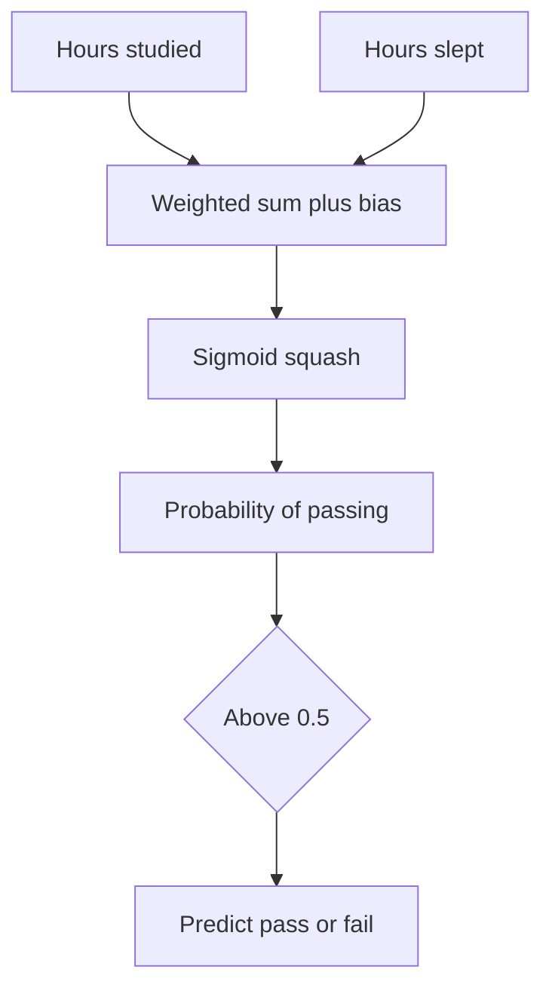

## The hook

Every day, software makes millions of tiny yes-or-no decisions about you. Is this card payment fraud? Is this email spam? Should this loan be approved? Will this user click this ad?

Many of these decisions are made by an idea so simple you can compute it on the back of a bus ticket. It has a confusing name, [[logistic regression]], and despite being decades old, it is still one of the most used tools in industry. It is also the first building block of every neural network you will meet later.

## The intuition

Imagine a teacher trying to guess which students will pass an exam, using two facts: hours studied and hours slept the night before.

:::analogy
Think of logistic regression as a panel of judges who each hold up a scorecard. Each feature is a judge. Some judges matter more than others (their scores are multiplied by a bigger number), and some judges are pessimists (their scores count against you). Add up all the scorecards, then translate the total into a confidence: "I'm 73% sure this student passes."
:::

There are only two steps:

1. **Weighted vote:** multiply each feature by its [[weight]], add them up, and add a [[bias]].
2. **Squash:** push that total through a function that turns it into a probability between 0 and 1.

## Let's build it up

### Step 1: the score

With two features $x_1$ (hours studied) and $x_2$ (hours slept), the score is

$$z = w_1 x_1 + w_2 x_2 + b$$

- $w_1$ and $w_2$ are the weights: how much each feature matters.
- $b$ is the bias: a starting offset, like a judge who is grumpy before anyone performs.
- $z$ can be any number at all, from very negative to very positive.

### Step 2: the squash

A score of 7.3 is not a probability. To get one, logistic regression uses the [[sigmoid]] function:

$$\sigma(z) = \frac{1}{1 + e^{-z}}$$

You do not need to love the formula. Just remember its shape, an S-curve:

| Score $z$ | $\sigma(z)$ | Reading |
|---|---|---|
| -4 | 0.02 | Almost certainly no |
| -2 | 0.12 | Probably no |
| 0 | 0.50 | Coin flip |
| 2 | 0.88 | Probably yes |
| 4 | 0.98 | Almost certainly yes |

Big positive scores get close to 1, big negative scores get close to 0, and nothing ever goes outside that range.

### Step 3: the decision

To turn the probability into a yes or no, compare it with a [[threshold]], usually 0.5. A fraud system might lower the threshold to 0.2, flagging more payments to be safe. A system that annoys users with false alarms might raise it.

:::insight
Every classifier is secretly drawing a line through the space of features. On one side, the model says yes; on the other, no. For logistic regression, that [[decision boundary]] is always a straight line.
:::

### Where the weights come from

Nobody types the weights in. They are learned. Start with random weights, predict probabilities for every training example, measure the cross-entropy loss from [the loss primer](article:primer-loss-functions), and then use [gradient descent](article:primer-gradient-descent) to nudge each weight downhill. Repeat until the loss stops improving.

So logistic regression is really three ideas you already know, snapped together: a weighted sum, a loss, and a walk downhill.

:::warning
Common misconception: "regression" in the name suggests it predicts numbers. It does not. Logistic regression is a classification method. The name is a historical leftover: it regresses the log-odds, a score that is later squashed into a probability.
:::

### More than two choices

Real problems often have more than two answers: is this photo a cat, a dog or a horse? The fix is a natural extension. Give each class its own set of weights and its own score. Then, instead of the sigmoid, use the **softmax** function, which turns a whole list of scores into probabilities that add up to 1. If the scores are 2, 1 and 0.1, softmax turns them into roughly 0.66, 0.24 and 0.10. The model picks the class with the biggest share. You will meet softmax again in almost every deep learning paper, including the Transformer.

### The limit: straight lines only

Suppose students pass if they studied a lot **or** slept a lot, but fail if they did both a little **or**, oddly, both a lot. No single straight line can separate those groups. Logistic regression would fail.

That limitation is exactly what pushed researchers toward stacking many of these units together into [neural networks](article:primer-neural-networks), which can bend the boundary into any shape.

## A tiny example

Suppose training produced these values: $w_1 = 0.8$ for hours studied, $w_2 = 0.5$ for hours slept, and $b = -6$.

A student studied 5 hours and slept 6 hours:

$$z = 0.8 \times 5 + 0.5 \times 6 - 6 = 4 + 3 - 6 = 1$$

From the S-curve, $\sigma(1) \approx 0.73$. The model says there is a 73% chance this student passes, so with a 0.5 threshold it predicts **pass**.

Look at what the weights tell you, too. Studying (0.8 per hour) matters more than sleeping (0.5 per hour), and the bias of -6 means a student who does neither is almost certain to fail. Logistic regression is easy to read, which is a big reason it is still popular in banks and hospitals.

:::try-this
Using the same weights, take a student who studied 2 hours and slept 4. Compute $z$, then estimate the probability using the table above. (You should get $z = 1.6 + 2 - 6 = -2.4$, a probability of roughly 0.08: a predicted fail.)
:::

## Where you'll see this again

This little unit is everywhere.

- [The Perceptron](article:paper-perceptron) is its 1958 ancestor: a weighted vote with a hard yes-or-no step instead of a smooth squash.
- In [Neural Networks from One Neuron Up](article:primer-neural-networks), each neuron is essentially a logistic regression, and stacking them breaks the straight-line limit.
- [Support-Vector Networks](article:paper-support-vector-networks) also draw a boundary, but choose the one with the widest safety margin.
- And at the very end of every language model, a softmax, the many-class cousin of the sigmoid, picks the next word.

## Key takeaways

- Logistic regression makes a decision by adding up weighted features into a score and squashing that score into a probability with the sigmoid.
- The weights say how strongly each feature pushes toward yes or no, and they are learned with cross-entropy loss and gradient descent.
- A threshold turns the probability into a decision and can be moved to make the model more cautious or more eager.
- Its decision boundary is always a straight line, a limit that motivated neural networks.
