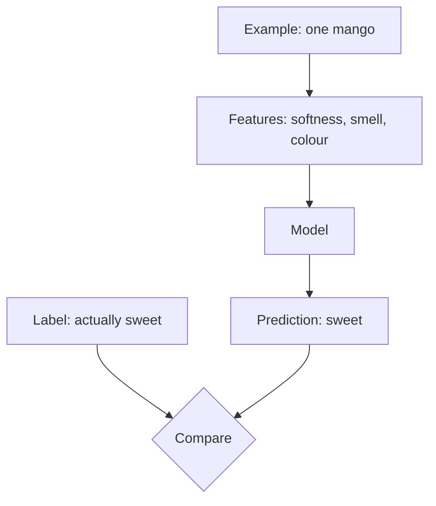

## The hook

Watch a seasoned fruit seller pick a mango. She presses it gently, sniffs near the stem, glances at the colour, and says "this one, eat it tomorrow." She never studied botany. She has simply seen tens of thousands of mangoes and remembers how each one turned out.

That is exactly what machine learning does. The only difference is that the computer needs everything written down, in numbers, in neat rows. This primer is about those rows: what goes in them, and why they matter more than almost anything else.

## The intuition

Every supervised machine learning problem starts with a [[dataset]], and nearly every dataset can be pictured as a spreadsheet.

:::analogy
Think of a dataset as the fruit seller's memory, written down as a spreadsheet. Each **row** is one mango she has handled. Each **column** is something she noticed about it: softness, smell, colour. The **last column** is what actually happened: was it sweet or sour? Learning means finding the pattern that connects the first columns to the last one.
:::

Those three pieces have names you will see in every paper from here on:

- Each row is an [[example]].
- Each descriptive column is a [[feature]].
- The answer column is the [[label]].

The model looks at the features, makes a prediction, and then the prediction is compared with the label. That comparison is how it learns. The next primer is entirely about that comparison.

## Let's build it up

### Features: everything becomes a number

A model is a mathematical function. It can multiply, add and compare numbers, and that is all. So every feature has to become a number before learning can begin.

Some features are numbers already: a house's floor area, a patient's age. Others need translating:

| Raw information | How it becomes numbers |
|---|---|
| Colour of a mango | Three numbers for red, green and blue levels |
| A photo | Millions of numbers, one per pixel and colour |
| A city name | A list of zeros with a single 1 in the position for that city |
| A word | A list of a few hundred numbers that capture its meaning |

That last row is a big idea in its own right, and it gets its own primer later: [Embeddings](article:primer-embeddings).

:::insight
A model never sees a mango, a photo or a sentence. It only ever sees lists of numbers. Choosing what those numbers capture is one of the most important decisions in any project.
:::

### Labels: two kinds of questions

Labels come in two main flavours, and the flavour decides what kind of problem you are solving.

If the label is a **category**, like sweet or sour, spam or not spam, cat or dog or horse, the task is called [[classification]].

If the label is a **number on a scale**, like a price, a temperature or a delivery time, the task is called [[regression]].

The same dataset can support both. With house data you could predict the exact price (regression) or simply whether it will sell within a month (classification).

### Where labels come from

Labels are often the expensive part. Somebody had to look at each photo and type "cat." Somebody had to mark each email as spam. Doctors had to review each scan. Some of the most famous datasets in AI history, like the ImageNet collection you will meet in the [AlexNet](article:paper-alexnet) article, took enormous human effort to label.

:::history
The idea that labeled examples could replace hand-written rules is old. In the 1950s, Arthur Samuel wrote a checkers program that improved by playing against itself and learning from the outcomes, and he helped popularise the phrase "machine learning." But large labeled datasets only became common once the internet made collecting examples cheap.
:::

### Garbage in, garbage out

A model can only learn patterns that are actually in the data. If the data is wrong, incomplete or one-sided, the model will be too.

:::warning
Common misconception: "the algorithm is the clever part." In practice, the quality and quantity of data often matter more than the choice of algorithm. A simple model trained on great data usually beats a fancy model trained on poor data.
:::

A classic failure: if every photo of a wolf in your dataset happens to have snow in the background, your "wolf detector" may really be a snow detector. It found a pattern, just not the one you wanted.

## A tiny example

Here is a tiny housing dataset. Each row is an example, the first three columns are features, and the last column is the label.

| Area (sq m) | Bedrooms | Km to metro | Price (lakh ₹) |
|---|---|---|---|
| 60 | 1 | 0.5 | 55 |
| 90 | 2 | 1.0 | 78 |
| 120 | 3 | 2.0 | 95 |
| 150 | 3 | 6.0 | 92 |

Look at it like a model would. Bigger homes cost more, which makes sense. But the 150 square metre home costs a little less than the 120 one. Why? The only other difference is that it is far from the metro. Distance seems to pull prices down.

You just did what a regression model does: you weighed each feature and noticed how it pushes the label up or down.

:::try-this
Using the table above, guess the price of a home with 100 square metres, 2 bedrooms, 1.5 km from the metro. Write your number down. There is no single right answer, but if you said something between 80 and 88 lakh, you are reasoning like a model: somewhere between the 90 and 120 square metre homes, close to the metro.
:::

With four examples you can only guess. With forty thousand, a model can measure exactly how much each extra square metre and each extra kilometre is worth.

## Where you'll see this again

These three words appear in every article that follows.

- The next primer, [How Wrong Is the Model?](article:primer-loss-functions), shows how the prediction and the label are compared to produce a single "wrongness" score.
- In [A Few Useful Things to Know About Machine Learning](article:paper-few-useful-things), Pedro Domingos argues that more data often beats a cleverer algorithm.
- In [word2vec](article:paper-word2vec), you will see how words themselves were turned into useful features.
- And in [AlexNet](article:paper-alexnet), a huge labeled dataset of over a million images is what finally let deep learning shine.

## Key takeaways

- A dataset is a table of examples, where each example is described by features and paired with a label.
- Features are the measurable inputs and must all be turned into numbers before a model can use them.
- Labels are the correct answers; categories make a classification problem and numbers on a scale make a regression problem.
- The quality, quantity and fairness of the data often matter more than the cleverness of the algorithm.
