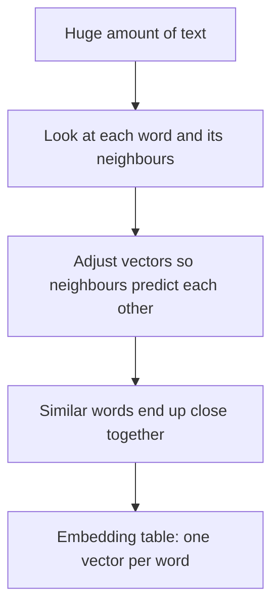

## The hook

In 2013, a group of researchers led by Tomas Mikolov trained a model on a large pile of text and then tried a strange piece of arithmetic. They took the numbers representing "king," subtracted the numbers for "man," added the numbers for "woman," and looked for the closest word to the result.

It was "queen."

Nobody had told the model anything about royalty or gender. It discovered those ideas on its own, as directions in a space of numbers. That space is called an embedding, and it is quietly running inside your search engine, your music recommendations and every chatbot you have ever used.

## The intuition

Computers need numbers, as you saw in [What Machines Actually Learn From](article:primer-data-features-labels). The question is which numbers. For words, the naive answer is terrible, and the clever answer is beautiful.

:::analogy
Think of an embedding as a map of meaning. Every word gets a location, a set of coordinates. Words with similar meanings are placed near each other, like neighbouring shops in a market: "tea," "coffee" and "chai" sit in the same lane, "rocket" and "satellite" sit together on a distant street. And the directions on this map mean something too. Walking from "man" to "woman" is roughly the same journey as walking from "king" to "queen."
:::

The coordinates are called an [[embedding]]. Real embeddings do not have two coordinates like a paper map. They have hundreds, but the idea is the same.

## Let's build it up

### The naive way: one-hot

Suppose your vocabulary has 50,000 words. The simplest encoding gives each word its own slot: "cat" is a list of 50,000 numbers, all zero except a 1 in position 7,412. This is [[one-hot encoding]].

It has two big problems. Each word costs 50,000 numbers. Worse, every word is equally different from every other word. "Cat" and "kitten" share nothing, exactly like "cat" and "volcano." A model reading one-hot words has to learn everything about every word separately.

### The clever way: dense vectors

An embedding gives each word a short [[vector]] of, say, 300 numbers. Each position is one [[dimension]]. These numbers are not chosen by hand. They start random and are learned, so that words used in similar ways end up with similar vectors.

How does a model know which words are similar? From [[context]].

:::history
In 1957 the linguist J. R. Firth wrote a line that became a motto for this whole field: "You shall know a word by the company it keeps." If "chai" and "coffee" both keep appearing next to "cup," "hot," "morning" and "sugar," they probably mean similar things. Decades later, neural networks turned this idea into a practical training recipe.
:::

### Measuring closeness

Two vectors are "similar" if they point in nearly the same direction. The usual measure is [[cosine similarity]], which is 1 when two vectors point the same way, 0 when they are unrelated, and -1 when they point in opposite directions. It is computed from the dot product: multiply matching positions and add up.

:::insight
An embedding turns meaning into geometry. Similar things become nearby points, and relationships become directions. Once meaning is geometry, a model can do math with it.
:::

### Not just words

The same trick works for almost anything. Streaming services embed songs and users, so "users near this song" become recommendations. Shops embed products. Image models embed photos. And every modern language model starts by looking up an embedding for each piece of text it reads. The first layer of GPT is essentially a giant embedding table.

:::warning
Common misconception: "embeddings are neutral because they are just math." They learn from human text, so they also learn human biases. Researchers have shown that word embeddings trained on news and web text can associate some professions more with one gender than another. The geometry faithfully reflects whatever is in the data, including the parts we would rather it did not learn.
:::

## A tiny example

Let's build a toy embedding by hand with just two dimensions: a "royalty" score and a "gender" score (positive for male, negative for female).

| Word | Royalty | Gender |
|---|---|---|
| king | 0.9 | 0.8 |
| queen | 0.9 | -0.8 |
| man | 0.1 | 0.8 |
| woman | 0.1 | -0.8 |

Now do the famous arithmetic, one dimension at a time:

- Royalty: $0.9 - 0.1 + 0.1 = 0.9$
- Gender: $0.8 - 0.8 + (-0.8) = -0.8$

The result is $[0.9, -0.8]$, which is exactly "queen."

Real embeddings learn hundreds of dimensions, and they are not this tidy. No single dimension cleanly means "royalty." But the relationships show up as directions in the same way, which is why the 2013 result surprised so many people.

:::try-this
Using the toy table, compute the dot product of "king" with "queen" ($0.9 \times 0.9 + 0.8 \times -0.8$) and of "king" with "man" ($0.9 \times 0.1 + 0.8 \times 0.8$). Which pair scores higher? (King and man: 0.73 versus 0.17. In this toy space, gender dominates. Real embeddings balance many more aspects of meaning.)
:::

## Where you'll see this again

Embeddings are one of the threads that ties the whole path together.

- [word2vec](article:paper-word2vec) is the 2013 paper behind the king and queen result, and it made embeddings mainstream.
- [Sequence to Sequence Learning](article:paper-seq2seq) and [Bahdanau attention](article:paper-bahdanau-attention) feed embeddings into networks that translate whole sentences.
- [Attention Is All You Need](article:paper-attention-is-all-you-need) starts every sentence by looking up an embedding for each token.
- [CLIP](article:paper-clip) puts images and text into the same embedding space, so a photo and its caption land near each other.

## Key takeaways

- An embedding represents something, such as a word, as a short list of learned numbers, so that similar things get similar vectors.
- One-hot encoding treats every word as equally different, while embeddings capture meaning as distance and direction.
- Word embeddings are learned from context: words that appear in similar company end up close together.
- Embeddings power search, recommendations and every modern language model, and they also absorb the biases present in their training data.
