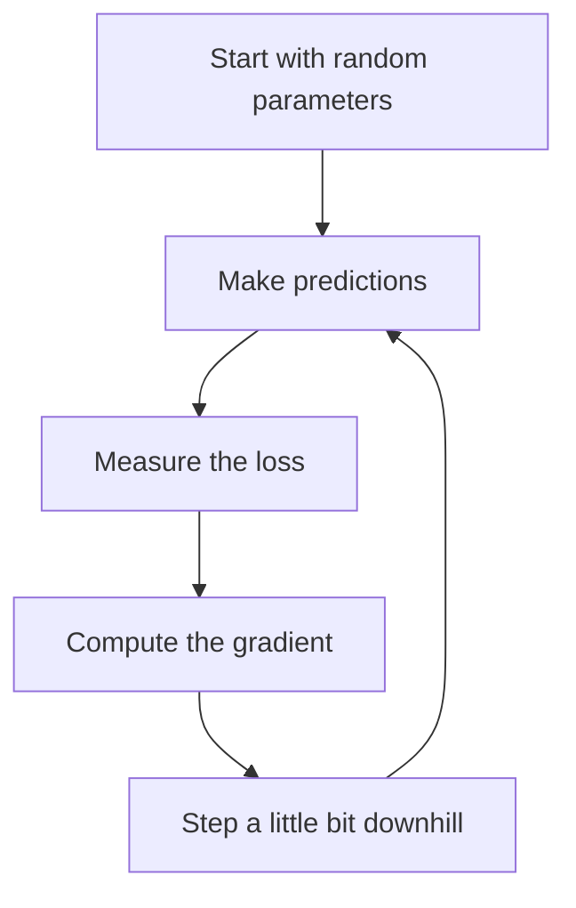

## The hook

You are standing somewhere on a hillside in thick fog. You cannot see more than a metre. Somewhere below is the valley floor, where there is a warm village and a cup of chai. You have no map.

What do you do? You feel the ground under your feet, figure out which way slopes down most steeply, and take a careful step that way. Then you do it again. And again.

That is gradient descent. It sounds almost too simple to matter, yet it trains essentially every neural network in this app, from handwriting readers to ChatGPT.

## The intuition

The previous primer, [How Wrong Is the Model?](article:primer-loss-functions), ended with an important fact: the loss depends on the model's parameters. Change the parameters and the loss goes up or down.

:::analogy
Picture every possible setting of the parameters as a location on a landscape, and the loss as the height at that location. High ground means a bad model. The valley floor means a good one. Training is the foggy walk downhill. You never see the whole landscape; you only feel the slope right where you stand.
:::

The slope has a name: the [[gradient]]. It tells you, for each parameter, which way is uphill and how steep it is. You step the **opposite** way, downhill. That repeated step is [[gradient descent]].

## Let's build it up

### One knob first

Imagine a model with a single parameter $w$, and a loss that happens to be

$$L(w) = (w - 3)^2$$

You can see the best answer is $w = 3$, where the loss is zero. But pretend you cannot see that, like the hiker in the fog.

The slope of this loss is its [[derivative]]: $\frac{dL}{dw} = 2(w - 3)$. If $w$ is below 3, the slope is negative (the ground falls away to the right). If $w$ is above 3, it is positive.

The gradient descent rule is:

$$w_{\text{new}} = w - \eta \cdot \frac{dL}{dw}$$

- $w$ is the current value of the parameter.
- $\frac{dL}{dw}$ is the slope at that point.
- $\eta$ (the Greek letter eta) is the [[learning rate]], the step size.
- The minus sign means "go against the slope," which is downhill.

### Walking it with real numbers

Start at $w = 0$ with a learning rate of $0.1$.

| Step | $w$ | Slope $2(w-3)$ | Update | Loss |
|---|---|---|---|---|
| 0 | 0.00 | -6.00 | 0 - 0.1 × (-6) | 9.00 |
| 1 | 0.60 | -4.80 | 0.6 + 0.48 | 5.76 |
| 2 | 1.08 | -3.84 | 1.08 + 0.384 | 3.69 |
| 3 | 1.46 | -3.07 | 1.46 + 0.307 | 2.36 |

Each step moves closer to 3, and the steps get smaller on their own because the slope flattens as you approach the bottom. After a few dozen steps, $w$ is almost exactly 3.

:::insight
You never need to see the whole landscape. Knowing only the local slope, and repeating small downhill steps, is enough to find a good spot. That is why gradient descent scales to models with billions of parameters.
:::

### The step size matters a lot

Now try a learning rate of $1.1$ from $w = 0$. The first step is $0 - 1.1 \times (-6) = 6.6$. That leaps right over the valley to the other side, where the loss is 12.96, worse than where you started. The next step jumps back even further. The loss explodes.

Too small a learning rate is a problem too: with $0.0001$, you would take tens of thousands of steps to get anywhere. Picking the learning rate is one of the most common practical headaches in deep learning.

:::try-this
Using $L(w) = (w-3)^2$, start at $w = 5$ with a learning rate of $0.25$. Compute one step by hand. The slope is $2(5-3) = 4$, so $w_{\text{new}} = 5 - 0.25 \times 4 = 4$. Now do one more step yourself. (You should land on 3.5.)
:::

### Many knobs at once

Real models have thousands to billions of parameters. The gradient is then a long list of slopes, one per parameter, and every parameter takes its own small step downhill at the same time. The rule is identical; it just runs on lists of numbers.

How do you find all those slopes efficiently? That is the job of backpropagation, explained in [Backpropagation Without the Scary Math](article:primer-backprop-intuition).

### Mini-batches: good enough is fast enough

Computing the exact slope means checking the loss on every training example. With a million examples, that is slow for a single step. So in practice we grab a small random [[mini-batch]], maybe 32 or 256 examples, estimate the slope from those, and step.

This is called stochastic gradient descent (SGD). Each step is a bit noisy, like a hiker who sometimes misjudges the slope, but you can take thousands of cheap steps in the time one perfect step would take.

:::warning
Common misconception: "the model will get stuck in the first little dip it finds." A [[local minimum]] is a real possibility in principle. In practice, for large neural networks, the noise from mini-batches helps the walk escape small dips, and getting trapped in a truly bad spot turns out to be less of a problem than early researchers feared.
:::

## A tiny example

You run a tea stall and want to find the best price for a cup. Think of a disappointing day's earnings as a high loss. You do not know the formula linking price to earnings, but each day you can try a price and see how the day went.

Day 1 at ₹10 goes badly. Day 2 at ₹12 goes a bit better. The "slope" says raising the price helped, so on Day 3 you try ₹14. Worse. You overshot, so you step back to ₹13 and it is your best day yet.

You just performed gradient descent with a human learning rate, using two nearby measurements to estimate a slope.

## Where you'll see this again

Gradient descent is the engine under nearly every paper in the learning path.

- [Backpropagation](article:paper-backpropagation) made it possible to compute gradients for networks with many layers.
- [Adam](article:paper-adam) is a smarter way to choose step sizes for each parameter, and it became the default optimizer in deep learning.
- [Batch Normalization](article:paper-batch-normalization) made the landscape smoother so larger steps became safe.
- And the giant language models in [GPT-3](article:paper-gpt-3) were trained by exactly this foggy downhill walk, just on an enormous scale.

## Key takeaways

- Gradient descent improves a model by repeatedly stepping each parameter a little in the direction that lowers the loss.
- The gradient is the local slope of the loss, and the update moves against it, downhill.
- The learning rate controls the step size: too small is slow, too large overshoots and can make training blow up.
- Real training estimates the gradient from small random mini-batches, trading a little noise for a huge gain in speed.
