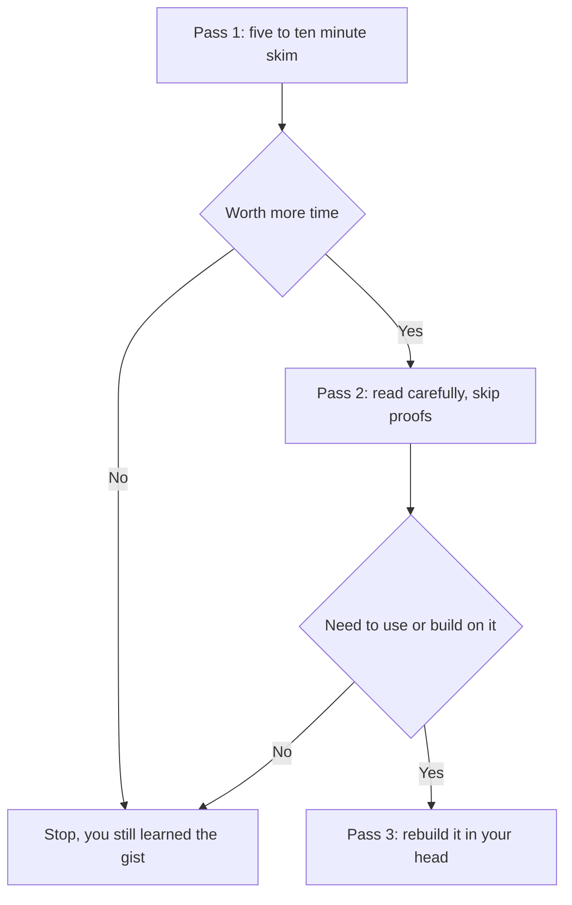

## The hook

The first time you open a real machine learning paper, it can feel like walking into the middle of a conversation in a language you half know. Dense paragraphs. Greek letters. Tables of numbers in bold. References to twenty other papers you have never heard of.

Here is a secret that might make you feel better: most researchers do not read papers from the first word to the last, either. They skim, jump around, look at the pictures, and only dig deep when a paper earns it. This primer teaches you their method, so that when you finish PaperStack you can open any paper on arXiv and actually get something out of it.

## The intuition

:::analogy
Reading a paper is like exploring a new city. On day one, you look at the map and visit the famous landmarks to get your bearings. On day two, you walk the main streets properly. Only if you decide to live there do you learn every alley and back lane. Nobody memorises a city's street plan before deciding whether they like it.
:::

The computer scientist Srinivasan Keshav described this as the **three-pass method** in a short, much-shared 2007 note called "How to Read a Paper." Each pass goes deeper, and you can stop after any of them.

## Let's build it up

### Know the anatomy

Almost every machine learning paper has the same skeleton:

| Section | What it is for |
|---|---|
| Title and [[abstract]] | The whole paper in a paragraph |
| Introduction | The problem, why it matters, and the claimed contributions |
| Related work | How it fits among earlier papers |
| Method | What they actually built |
| Experiments and results | Tables and charts that test the claims |
| Conclusion | The summary, plus admitted limitations |
| Appendix | Extra details, proofs and settings |

Once you know the skeleton, you know where to look for each answer.

### Pass 1: the skim (5 to 10 minutes)

Read the title, the abstract and the introduction. Read the section headings. Look at every figure and its caption, because authors put their best explanation into the main diagram. Then read the conclusion. Skip the maths entirely.

At the end, you should be able to answer Keshav's five questions, which he calls the five Cs:

1. **Category:** What kind of paper is it? A new method, a new dataset, an analysis, a system?
2. **Context:** Which earlier work does it build on?
3. **Correctness:** Do the assumptions seem reasonable?
4. **Contributions:** What exactly is new?
5. **Clarity:** Is it well written?

:::insight
You do not need to understand everything in a paper to learn from it. Getting the problem, the core idea and the main result right is already most of the value.
:::

### Pass 2: the careful read (about an hour)

Now read properly, but still skip proofs and fiddly derivations. Pay close attention to the figures and results tables, and ask hard questions:

- **What is the [[baseline]]?** A new method beating a weak, old baseline is far less impressive than beating a strong, recent one.
- **Which [[benchmark]]?** Standard benchmarks make comparisons fair, but a great benchmark score does not guarantee real-world usefulness.
- **Is there an [[ablation study]]?** Good papers remove each part of their method one at a time to show what really matters.

In results tables, the best number in each column is usually in bold, and the new method is usually the last row. Look at the size of the gap, not just its direction.

:::warning
Common misconception: "if it beats the [[state of the art]], it must be a breakthrough." Small improvements on a benchmark can come from extra tuning, more compute or luck with random seeds. The papers in this app became famous because their ideas kept working when other people tried them, not just because they topped a table once.
:::

### Pass 3: rebuild it (several hours)

Only for papers you need to use or extend. Try to re-derive the key steps yourself, or sketch how you would implement it. You will find the hidden assumptions and the parts the authors glossed over.

### Where papers live

Most machine learning papers appear first on arXiv as a [[preprint]], free for anyone to read. Many are later accepted at conferences such as NeurIPS, ICML, ICLR or CVPR after [[peer review]]. Peer review is a useful filter, but it is not a guarantee of truth, and some of the most influential AI papers were only ever preprints.

## A tiny example

Let's do a first pass on [Attention Is All You Need](article:paper-attention-is-all-you-need), using only what its abstract and figures tell you.

- **Category:** a new model architecture.
- **Context:** builds on recurrent and convolutional sequence models with attention.
- **Correctness:** the claim is simple and testable: attention alone is enough.
- **Contributions:** the Transformer, which removes recurrence, trains faster and translates better.
- **Clarity:** short, with one famous diagram that explains the whole architecture.

Five minutes, and you already know why the paper mattered. Everything else is detail you can go back for.

:::try-this
Pick any paper in this learning path and open the original using the link at the top of its article. Give yourself a timer of seven minutes for a first pass. Write down one sentence for each of the five Cs. Then read the PaperStack article and see how close you were. You will be surprised how much you got right.
:::

## Where you'll see this again

Every paper article in PaperStack follows a structure that mirrors these questions: "The world before this paper" is the context, "The big idea" is the contribution, "What they found" is the results, and "What it got wrong" is the critical reading that a careful second pass should give you.

- Start applying it right away with [Computing Machinery and Intelligence](article:paper-turing-test), a paper so readable that you can skim the original in one sitting.
- [A Few Useful Things to Know About Machine Learning](article:paper-few-useful-things) is itself a great example of a paper written to be read.

## Key takeaways

- Researchers rarely read papers start to finish; they use several passes, going deeper only when a paper earns it.
- A first pass of title, abstract, introduction, headings, figures and conclusion is enough to answer the five Cs: category, context, correctness, contributions and clarity.
- When judging results, look closely at the baselines, the benchmark and any ablation study, not just the bold numbers.
- Preprints and peer-reviewed papers both matter, but lasting importance comes from ideas that keep working when others test them.
