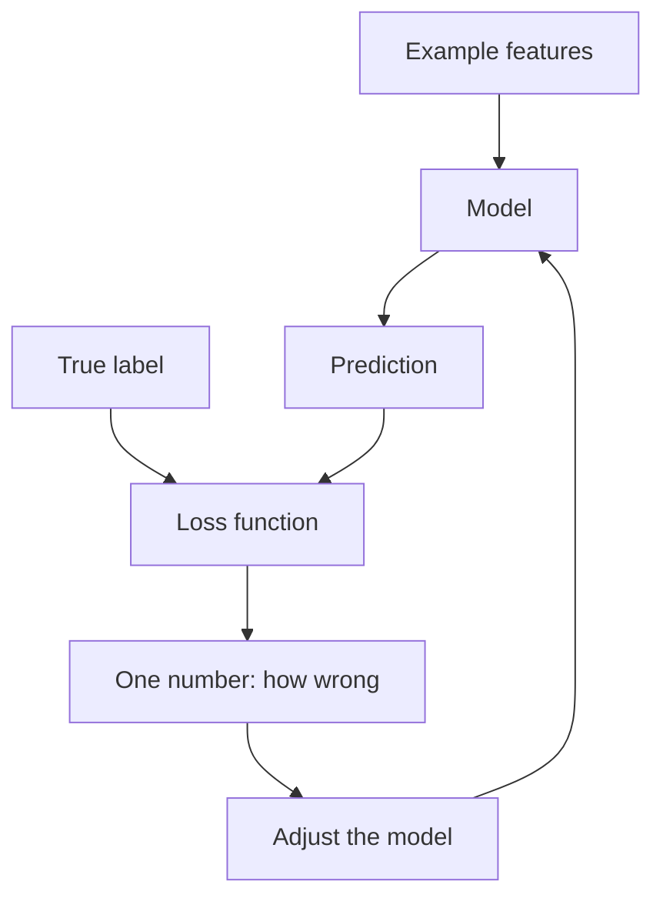

## The hook

A weather app says "90% chance of rain," and the day turns out bright and sunny. Another app said "60% chance of rain." Both were wrong. But was one of them *more* wrong?

Most people feel that the 90% app deserves more blame. It was confident and mistaken. That gut feeling, turned into a precise formula, is the most important idea in all of machine learning training. It is called a loss function, and every model you will ever read about is built around one.

## The intuition

A model makes a [[prediction]] for each example. We know the right answer, the label. The [[loss function]] boils all the differences between predictions and labels down to **one number**.

:::analogy
Think of the loss as a golf score. Every mistake adds strokes. A perfect round has a very low score, a messy round has a high one, and the whole point of practice is to bring the number down. Training a model is practice: the loss is the scorecard, and lower is always better.
:::

Why squeeze everything into a single number? Because a single number can be **minimised**. Once you have one score, you can ask: "if I nudge this knob inside the model, does the score go up or down?" That question drives everything in the next primer.

## Let's build it up

### Step 1: the error for one example

Say a model predicts a house will sell for 80 lakh, and it actually sells for 95. The error is $95 - 80 = 15$. Simple.

But errors can be negative too. If another prediction is 110 for a house that sold for 95, the error is $-15$. Add those two errors up and you get zero, which would suggest a perfect model. That is clearly nonsense.

### Step 2: squaring fixes two problems at once

The most common fix is to square each error. Now both errors become 225, and nothing cancels. Then take the average over all examples. This is [[mean squared error]] (MSE):

$$\text{MSE} = \frac{1}{n}\sum_{i=1}^{n}(y_i - \hat{y}_i)^2$$

In plain words:

- $n$ is the number of examples.
- $y_i$ is the true label of example $i$, and $\hat{y}_i$ (read "y-hat") is the model's prediction for it.
- $(y_i - \hat{y}_i)^2$ is the squared error for that one example.
- The $\frac{1}{n}\sum$ part just means "add them all up, then divide by how many there are."

Squaring has a second effect: **big mistakes count much more than small ones.** An error of 2 becomes 4, but an error of 20 becomes 400. The model learns that being badly wrong, even occasionally, is very costly.

:::insight
A loss function is a statement of what you care about. Squaring the error says "I really hate big mistakes." Choosing a different loss changes what the model tries to get right.
:::

### Step 3: losses for yes-or-no questions

For classification, models usually output a probability, such as "80% spam." Here the favourite loss is [[cross-entropy]], also called log loss. It looks only at the probability the model gave to the **correct** answer and takes the negative logarithm:

$$\text{loss} = -\log(p_{\text{correct}})$$

The negative log behaves exactly like our gut feeling about the weather apps:

| Probability given to the right answer | Loss |
|---|---|
| 0.99 (confident and right) | 0.01 |
| 0.90 | 0.11 |
| 0.50 (unsure) | 0.69 |
| 0.10 (fairly confident and wrong) | 2.30 |
| 0.01 (very confident and wrong) | 4.61 |

Being confident and right costs almost nothing. Being unsure costs a bit. Being confident and wrong is punished hard.

:::warning
Common misconception: "a lower loss always means a better model." A model can drive its loss on the training data close to zero by memorising it, and still fail on new data. Watching the loss on examples the model has never seen is what tells you the truth. The primer on [overfitting](article:primer-overfitting) is all about this.
:::

### Choosing a loss is choosing your priorities

Squared error is not the only option. Mean absolute error skips the squaring and simply averages the size of each mistake, so a single wild outlier does not dominate. A delivery app that is late by an hour once a month might prefer that. A self-driving car, where one large error could be a disaster, might prefer squared error. Neither is "correct." The loss is where you tell the model, in math, what kind of mistakes you can live with.

### What the loss depends on

A model has adjustable numbers inside it called [[parameter|parameters]]. Change a parameter and the predictions change, so the loss changes too. That means the loss is really a function of the parameters. Training is the hunt for the parameter values that make it as small as possible.

## A tiny example

A model predicts the prices of three homes (in lakh ₹):

| Home | True price | Predicted | Error | Squared error |
|---|---|---|---|---|
| A | 55 | 50 | 5 | 25 |
| B | 78 | 80 | -2 | 4 |
| C | 95 | 85 | 10 | 100 |

The MSE is $(25 + 4 + 100) / 3 = 43$.

Notice that home C contributes 100 out of 129 total. The squared loss is shouting: "fix home C first."

:::try-this
Suppose a tweak to the model changes its prediction for home C from 85 to 93, and nothing else moves. Recalculate the MSE. You should get $(25 + 4 + 4) / 3 = 11$. A single improvement on the worst example cut the loss by almost three quarters. That is why squared loss pushes models to fix big mistakes first.
:::

## Where you'll see this again

Every paper in PaperStack has a loss function hiding inside it, even when it is not the star of the show.

- Next, [Gradient Descent](article:primer-gradient-descent) shows how a model walks downhill on the loss to improve itself.
- [Logistic regression](article:primer-classification) is trained with exactly the cross-entropy loss above.
- In [Generative Adversarial Nets](article:paper-gan), two networks play a game where one network's loss is the other's gain.
- And in [InstructGPT](article:paper-instructgpt), the "loss" comes partly from human preferences, which is how chatbots learned to be helpful.

## Key takeaways

- A loss function turns all of a model's mistakes into a single number, where lower means better.
- Mean squared error squares each error so mistakes cannot cancel out and large errors are punished most.
- Cross-entropy scores probabilities: it barely penalises confident correct answers and heavily penalises confident wrong ones.
- The loss depends on the model's parameters, so training is the search for parameter values that make the loss as small as possible.
