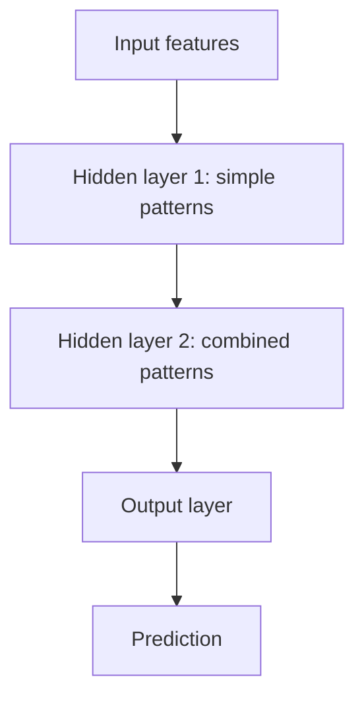

## The hook

Each artificial neuron in a neural network does something a ten-year-old could do with a pencil: multiply a few numbers, add them up, and decide whether the result is worth passing on.

That is all. There is no magic inside. And yet, wire up a few million of these little calculators in the right way, show them enough examples, and they learn to recognise faces, translate languages and write poetry. This primer shows you how the pieces fit, starting from a single neuron.

## The intuition

You already met the building block in [Yes or No?](article:primer-classification). Logistic regression takes features, weighs them, adds them up and squashes the result. A [[neuron]] is essentially the same thing.

The leap comes from **teamwork**.

:::analogy
Think of a neural network as a company. Junior analysts (the first layer) each look at the raw data and report one simple observation. Managers (the next layer) read several analysts' reports and combine them into bigger conclusions. The CEO (the output) reads the managers' summaries and makes the final call. Nobody tells the analysts what to look for. Over time, the company reorganises itself until the reports that reach the CEO are genuinely useful.
:::

## Let's build it up

### One neuron

A neuron with inputs $x_1, x_2, x_3$ computes

$$z = w_1 x_1 + w_2 x_2 + w_3 x_3 + b, \qquad \text{output} = f(z)$$

- Each $w$ is a [[weight]]: how much that input matters.
- $b$ is the bias, a starting offset.
- $f$ is the [[activation function]], a small bend applied to the sum.

The most popular activation today is [[ReLU]], which is almost comically simple: $f(z) = \max(0, z)$. If the sum is positive, pass it on. If it is negative, output zero.

### Why the bend matters

Here is a surprising fact. If you remove the activation function, stacking layers gives you **nothing**. A weighted sum of weighted sums is just another weighted sum. A hundred layers of pure multiplication and addition collapse into one straight-line model.

:::insight
The tiny bend in each neuron is the source of a network's power. Bends let the network carve curved, complicated boundaries that no single straight line could ever draw.
:::

### Layers

A [[layer]] is a row of neurons that all read the same inputs. Each neuron has its own weights, so each one notices something different. The outputs of one layer become the inputs of the next.

Layers between the input and the output are called [[hidden layer|hidden layers]], because nobody labels what they should compute. Training discovers it. In image networks, researchers have found that early layers often learn to detect edges and colour blobs, middle layers detect textures and parts like eyes or wheels, and late layers respond to whole objects.

### How many knobs?

Parameters add up fast. Suppose the input is a small 28 by 28 pixel image, which is 784 numbers, feeding a hidden layer of 128 neurons. Every input connects to every neuron, so that is $784 \times 128 = 100{,}352$ weights, plus 128 biases. One modest layer, over a hundred thousand knobs. Modern language models have billions.

All of those knobs are set with the same recipe you already know: a [loss function](article:primer-loss-functions) and [gradient descent](article:primer-gradient-descent). The only new question is how to find the slope for every knob efficiently, and that is the subject of the next primer.

:::warning
Common misconception: "a neural network is a model of the brain." The original inspiration came from neurons, but the resemblance is shallow. Real neurons are electrochemical cells with complex timing; artificial ones are a multiply, an add and a max. Think "inspired by," not "copy of."
:::

### Deep means many layers

"Deep learning" just means networks with many hidden layers. Depth lets the network build up concepts step by step: from pixels to edges, edges to shapes, shapes to objects. It turns out to be a very efficient way to represent complicated things.

:::history
In 1989 and 1991, mathematicians proved a striking result now called the universal approximation theorem: a network with even a single hidden layer, given enough neurons, can approximate essentially any reasonable function. The catch is that "enough" can be enormous. Deep networks often get the same power with far fewer neurons, which is one reason depth won.
:::

## A tiny example

Remember the pattern logistic regression could not learn: output 1 when exactly one of two inputs is on, and 0 when both are off or both are on. This is called XOR. No straight line separates it.

Two hidden ReLU neurons can do it. Use these hand-picked weights:

- Hidden neuron $h_1 = \text{ReLU}(x_1 + x_2)$
- Hidden neuron $h_2 = \text{ReLU}(x_1 + x_2 - 1)$
- Output $= h_1 - 2h_2$

Check all four cases:

| $x_1$ | $x_2$ | $h_1$ | $h_2$ | Output |
|---|---|---|---|---|
| 0 | 0 | 0 | 0 | 0 |
| 1 | 0 | 1 | 0 | 1 |
| 0 | 1 | 1 | 0 | 1 |
| 1 | 1 | 2 | 1 | 0 |

It works. $h_1$ counts how many inputs are on. $h_2$ only wakes up when both are on, and the output uses it to cancel the double count. Two bent neurons solved what no single straight line could.

:::try-this
Change the output rule to $h_1 - h_2$ and recompute the four outputs. What pattern do you get now? (You should get 0, 1, 1, 1: that is OR, "at least one input is on." Same neurons, different final weights, a different function.)
:::

In a real network, nobody picks these weights by hand. Gradient descent finds them, starting from random values.

## Where you'll see this again

Everything in the rest of the path is built from this unit.

- [The Perceptron](article:paper-perceptron) was the first trainable artificial neuron, built in 1958.
- [Backpropagation Without the Scary Math](article:primer-backprop-intuition) explains how all those weights get their gradients.
- [LeNet](article:paper-lenet) arranged neurons cleverly for images, an idea called convolution.
- [ResNet](article:paper-resnet) showed how to train networks over a hundred layers deep.

## Key takeaways

- A neuron multiplies its inputs by weights, adds a bias, and applies a simple non-linear activation function such as ReLU.
- Activation functions are essential: without their bends, any number of layers would collapse into a single straight-line model.
- Layers of neurons stacked together let a network build complex features out of simple ones, with hidden layers discovering their own intermediate features.
- All the weights are learned with a loss function and gradient descent, starting from random values.
