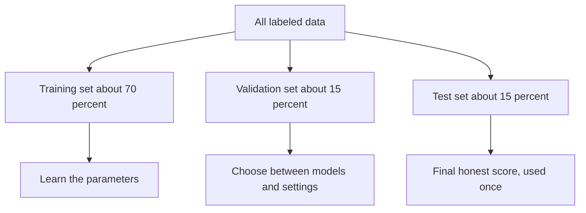

## The hook

Two students prepare for the same exam. Riya gets hold of last year's paper and memorizes every answer, word for word. Arjun works through the same paper too, but keeps asking *why* each answer is right.

On exam day, the questions are new. Riya, who scored perfectly on every practice run, freezes. Arjun does fine.

Riya's problem has a name in machine learning, and it is the single most common way a model fools its own creators. It is called overfitting.

## The intuition

:::analogy
Think of training a model as exam preparation. The training data is the practice paper. A model that **memorizes** the practice paper looks brilliant until the real exam asks something slightly different. A model that **learns the underlying ideas** can handle new questions. The only way to know which kind of student you have is to give them questions they have never seen.
:::

The goal of machine learning is not to do well on the examples you already have. You already know their answers. The goal is [[generalization]]: doing well on new examples.

There are two ways to fail:

- [[Underfitting]]: the model is too simple to catch the real pattern. Like a student who only learned that "the answer is usually C." It does badly on practice and on the exam.
- [[Overfitting]]: the model is so flexible that it learns the noise and quirks of the training data. It aces practice and flops on the exam.

The sweet spot sits in between.

## Let's build it up

### Split your data before you start

The standard defence is to divide your data before training begins.

- The [[training set]] is what the model learns from.
- The [[validation set]] is for you, the developer. You use it to compare models, pick a learning rate, or decide when to stop.
- The [[test set]] stays locked in a drawer until the very end, and you use it once to report how good the final model really is.

:::warning
Common misconception: "I only looked at the test set to tweak a few settings, so it is still a fair test." Every time you adjust a model based on test results, a little information about the test leaks into your choices. Do it enough and your test score becomes as untrustworthy as a training score.
:::

### The tell-tale gap

Track the loss on both the training set and the validation set as training goes on.

| Situation | Training error | Validation error | Diagnosis |
|---|---|---|---|
| Both high | High | High | Underfitting: model too simple |
| Both low and close | Low | Low | Good generalization |
| Training low, validation high | Low | High | Overfitting: memorizing |

:::insight
The gap between training performance and performance on unseen data is the clearest signal you have. A small gap means the model learned something real. A big gap means it memorized.
:::

### Why flexible models overfit

Imagine fitting a curve through ten noisy dots. A straight line misses some of them: it underfits slightly, but it captures the trend. A wildly wiggly curve can pass through all ten dots exactly, with zero training error. But between the dots it swings up and down absurdly. Its predictions for any new point are nonsense.

More parameters means more flexibility, and more flexibility means more ability to memorize. Modern neural networks have millions or billions of parameters, so fighting overfitting is a constant job.

### How to fight it

The toolbox is called [[regularization]], plus a few related habits:

- **Get more data.** Memorizing a million examples is much harder than memorizing a hundred, so the model is pushed toward general patterns.
- **Prefer simpler models,** or add a penalty to the loss for very large weights, so the model only gets complicated when the data really demands it.
- **Stop early.** Watch the validation loss and stop training when it starts rising, even if training loss is still falling.
- **Add noise on purpose.** Techniques like [Dropout](article:paper-dropout) randomly switch off parts of a network during training so it cannot rely on any single memorized shortcut.

### A sneaky cousin: leakage

Sometimes a model looks great on the test set for a bad reason. If information about the answer slips into the features, the model can cheat. A famous kind of mistake: a hospital model that predicts which patients are seriously ill, but one of its features is "was a specialist called." Of course that predicts serious illness, because doctors already decided it! The test score looks wonderful, and the model is useless in practice. Always ask: would this feature really be available at the moment the prediction is needed?

## A tiny example

You want to predict a person's weight from their height, using 6 people. You try three models and measure average error, in kilograms:

| Model | Training error | Test error |
|---|---|---|
| Always predict 65 kg | 9.0 | 9.4 |
| Straight line through the data | 3.1 | 3.6 |
| Curve with 6 parameters through every point | 0.0 | 14.2 |

The first model underfits. The third model has a perfect training score and the worst test score by far. The humble straight line wins, because it learned the real trend (taller people tend to weigh more) instead of six people's personal quirks.

:::try-this
Think of your phone's keyboard suggestions. If a keyboard model overfit to you, what would that look like? (One answer: after you type a friend's unusual nickname twice, it starts suggesting the nickname everywhere, even in work emails. It memorized a quirk instead of learning your general writing style.)
:::

## Where you'll see this again

The fight between memorizing and learning runs through the entire path.

- [Support-Vector Networks](article:paper-support-vector-networks) choose the boundary with the widest margin, a built-in defence against overfitting.
- [Random Forests](article:paper-random-forests) average many deliberately different trees so their individual quirks cancel out.
- [Dropout](article:paper-dropout) is one of the most famous regularization tricks in deep learning.
- [A Few Useful Things to Know About Machine Learning](article:paper-few-useful-things) explains why generalization, not training accuracy, is the whole game.

## Key takeaways

- The goal of machine learning is generalization: performing well on new data, not on the examples the model has already seen.
- Underfitting means the model is too simple, while overfitting means it memorized the training data's noise and quirks.
- Splitting data into training, validation and test sets, and keeping the test set untouched until the end, is how you measure real performance honestly.
- More data, simpler models, early stopping and regularization techniques like dropout all push a model toward learning instead of memorizing.
