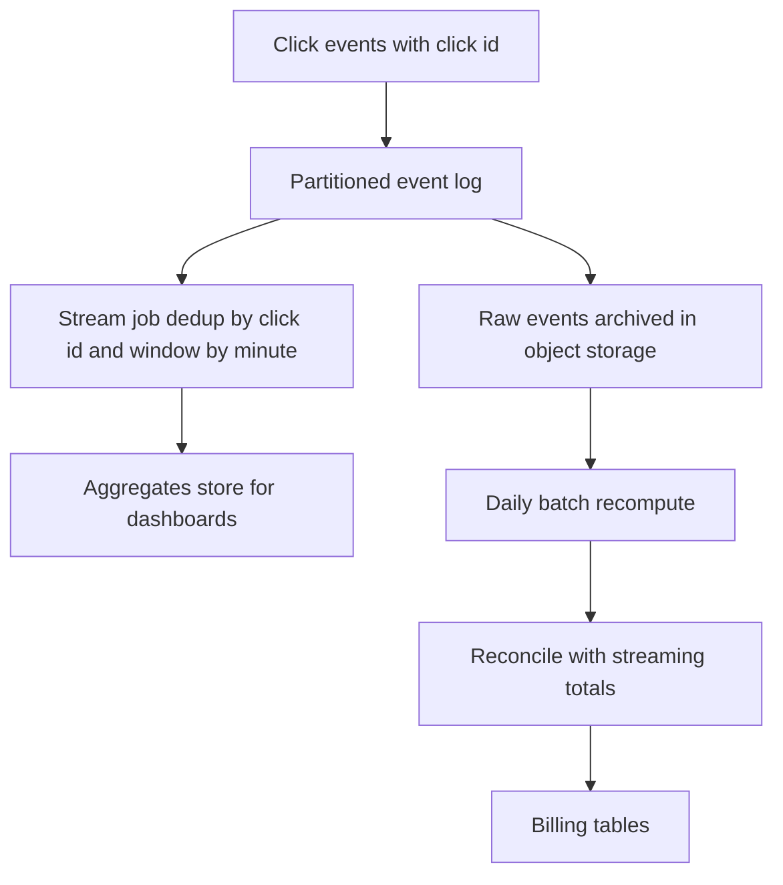

## The hook

Advertisers pay per click. A dashboard shows each campaign's clicks per minute, and at the end of the month the totals become invoices.

One day a network blip makes producers retry, and some clicks arrive twice. Another day a data centre's events arrive two hours late. If the aggregator counts duplicates, advertisers are overcharged; if it drops late events, publishers are underpaid. Both are real money and real disputes.

Predict the two techniques that make the numbers trustworthy enough to bill. (One works on every event in real time; the other runs on the whole day afterwards.)

## Requirements

**Functional**
- Ingest click events; aggregate clicks per ad (and per campaign, country, device) per minute.
- Query recent aggregates for dashboards within about a minute; produce exact daily totals for billing.

**Non-functional**
- About 1 billion clicks a day, peaks around 5 times average (**estimates**).
- No double counting and no lost clicks in billed totals.
- Fraud filtering (bots, repeated clicks).

:::analogy
A stadium **counts turnstile clicks per minute across many gates**. Each gate sends its tallies to a control room, which shows live totals on a screen. Sometimes a gate's radio repeats a message or delivers it late. The live screen is "about right"; the official attendance, used for payments, is recounted the next morning from every gate's sealed log.
:::

## Back-of-envelope numbers

All **estimates**.

- 1,000,000,000 clicks a day ≈ **11,600 per second**; peaks around **58,000 per second**.
- 2 million ads, 20% active in any minute: about **400,000 aggregate rows per minute**, about 576 million per day at one-minute resolution.
- Deduplication: remembering click ids for 10 minutes at peak means about **35 million ids** in the window.

## High-level design

## Deep dives

### 1. Unique ids and deduplication

Take a guess first: where should the click id be created, at the aggregator or at the moment of the click? (Hold that thought; the answer decides whether retries can be recognised at all.)

Every **[[click event]]** gets a unique click id at the source. Producers retry with the same id. That is the answer to the question above: only an id created at the click itself is the same on every retry. The stream job keeps a **[[deduplication window]]** of recently seen ids (in its state store, or a Bloom filter backed by an exact store) and ignores repeats. This is the idempotent-consumer idea in [A Cheque the Bank Cashes Only Once](article:system-design-exactly-once).

### 2. Windows and late data

Clicks are counted by event time in one-minute tumbling windows with a watermark a few minutes behind, as in [Counting Cars Per Minute When Some Report Late](article:system-design-stream-processing). Events behind the watermark go to a side output; they still reach the raw archive and the batch recount.

### 3. Exactly-once effect in the pipeline

The stream job checkpoints its state (counts and dedup ids) together with its input offsets, and writes aggregates idempotently (upserting rows keyed by ad and minute, or committing them transactionally). After a crash it resumes from the checkpoint without double counting.

### 4. Reconciliation

The answer to the hook: streaming dedup in real time, and **[[reconciliation]]** afterwards. A nightly batch job recomputes exact totals from the archived raw log, as in [Counting Votes in Every Booth, Then Adding the Totals](article:system-design-batch-processing), including events that arrived very late, then compares them with the streaming totals. Differences are investigated and the batch numbers feed billing.

Wait, if batch is the source for billing, why keep streaming at all? Because advertisers watch campaigns live and pause bad ones within minutes. Fresh-but-approximate and late-but-exact serve different decisions.

### Lambda or kappa

| | [[Lambda architecture]] | [[Kappa architecture]] |
|---|---|---|
| Paths | Streaming plus batch | Streaming only |
| Reprocessing | Batch job over the archive | Replay the log through the same stream job |
| Pros | Independent check for billing | One codebase |
| Cons | Two codebases to keep consistent | Needs long log retention and a trustworthy stream engine |

:::insight
Trustworthy click counts come from two layers: in real time, unique click ids with a deduplication window plus event-time windows and checkpoints make streaming counts nearly exact; afterwards, a batch recomputation from the raw log reconciles them, and only reconciled numbers are billed.
:::

## Trade-offs

| Decision | Choice | Trade-off |
|---|---|---|
| Dedup window | 10 minutes to hours | Longer catches more duplicates; more state |
| Watermark delay | A few minutes | Fresher dashboards versus more late events |
| Aggregation grain | Per minute | Detail versus row volume |
| Billing source | Reconciled batch totals | Accurate; available the next day |
| Fraud filtering | Rules plus models before counting | Fairer billing; risk of filtering real clicks |

:::warning
Common misconception: "the stream processor guarantees exactly-once, so the counts are billable as they are." Exactly-once inside the processor does not cover duplicate events produced upstream, events later than the watermark, or bugs in the job. Deduplicate by click id and reconcile against a batch recount before money changes hands.
:::

:::try-this
A bug in the stream job undercounted clicks for one campaign by 3% for two days. With a lambda architecture, how do you fix the numbers? (Fix the job going forward; the batch recompute for those two days, built from the raw archive with independent code, already has the right totals, so reconciliation flags the difference and billing uses the batch numbers. Dashboards can be backfilled from the batch output.)
:::

## What can go wrong

- **Double counting** from retries without click ids.
- **Lost late events** if the raw log is not archived.
- **Hot partitions** for huge campaigns; key by ad id plus a small bucket.
- **Unbounded dedup state**; bound the window and use compact structures.
- **Click fraud** inflating counts; filter before aggregation and audit later.
- **Mismatch between streaming and batch logic**, creating unexplained differences.

### Interview follow-ups

**"How do you show 'clicks in the last 5 minutes' quickly?"** Query the per-minute aggregate table for the last 5 rows per ad (or keep a sliding-window aggregate), rather than counting raw events.

**"Where do click ids come from?"** The ad server or click redirect service generates them when the click happens, so every retry downstream carries the same id.

**"How would you scale aggregation?"** Partition the log by ad id; each stream task owns a set of ads, so counts and dedup state for an ad live in one place.

## Further reading

- Akidau et al., "The Dataflow Model" (VLDB 2015).
- Nathan Marz's writing on the lambda architecture, and Jay Kreps, "Questioning the Lambda Architecture" (2014).

## Key takeaways

- Every click needs a unique id at the source, so retries carry the same id and duplicates can be removed.
- The streaming path deduplicates within a window, counts by event time in per-minute windows with watermarks, and checkpoints state with input offsets.
- Raw events are archived so a batch job can recompute exact totals, including very late events.
- Reconciliation compares streaming and batch totals, and only reconciled numbers are used for billing.
- Lambda keeps separate streaming and batch paths for an independent check; kappa uses one streaming pipeline and replays the log to reprocess.
