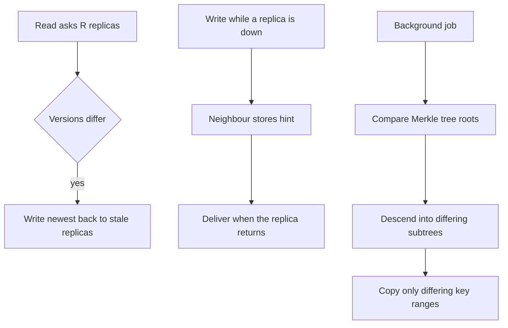

## The hook

A key-value store keeps every key on three replicas. Over a week, things happen: one replica reboots for a kernel patch, another misses a few writes during a network blip, a third was slow and timed out of some quorums.

Nobody lost data, exactly. But the three replicas no longer agree. A key updated on Tuesday is new on two replicas and old on the third. A user reading at the wrong moment sees the old value.

How do a billion keys on three machines get back in sync without copying a billion keys around every night? Predict how many hashes two replicas must exchange to find 10 differing keys among a billion. (Spoiler: a few hundred, and the article shows exactly why.)

## The intuition

:::analogy
Gossip spreads through a neighbourhood and some versions get garbled. Neighbours fix it in three ways. When two of them happen to talk about a story, the one with the fresher version corrects the other. When someone is away on holiday, a neighbour keeps a note of the news to tell them when they return. And once a week, **neighbours compare notes** systematically, chapter by chapter, and fix any mismatches they find.
:::

Those three habits are the three repair mechanisms of leaderless stores:

- **[[Read repair]]**: fix what you notice while reading.
- **[[Hinted handoff]]**: hold writes for an absent replica and deliver them later.
- **[[Anti-entropy]]**: compare everything in the background and fix the rest.

All three exist because of **[[replica divergence]]**, which [Ask Enough People and Someone Heard the News](article:system-design-quorums) tolerates but does not cure.

## How it works

### 1. Read repair

The coordinator of a read collects versions from R replicas, returns the newest to the client, and writes it back to any replica that returned an older version. Cheap and immediate, but it only fixes keys that are read. A key nobody reads can stay stale on one replica forever.

### 2. Hinted handoff

If a target replica is down during a write, another node accepts the write with a hint ("this belongs to node C"). When C returns, the hints are replayed to it. This repairs writes made during short outages without any comparison.

Predict the risk. A node is down for 2 hours, and 5,000 writes per second belong to its ranges. Its neighbours must hold 5,000 × 7,200 = 36 million hints. That is why systems cap hint storage or duration: beyond the cap, they stop hinting and rely on full anti-entropy repair when the node returns.

### 3. Merkle-tree anti-entropy

For everything else, replicas periodically compare their data. Comparing a billion keys one by one would be like sending the whole dataset. Instead, each replica builds a **[[Merkle tree]]** over its key range, as in [One Fingerprint for a Billion Files](article:famous-algos-merkle-trees):

- Leaves are hashes of small key ranges; parents hash their children; the root summarises everything.
- Equal roots mean equal data: done.
- Different roots: compare children and descend only into subtrees whose hashes differ.

With 10⁹ keys and 2²⁰ leaves (about 954 keys per leaf), 10 differing keys touch at most 10 leaves. Descending 20 levels for each, two replicas exchange on the order of 10 × 20 × 2 = 400 hashes, then sync about 10 leaves, roughly 9,500 keys. Not a billion.

Wait, if Merkle trees are so efficient, why not skip read repair and hints entirely? Because building and comparing trees costs CPU and disk I/O, so it runs periodically, perhaps daily per range. Read repair and hints fix the common cases within seconds, between those runs.

:::insight
Leaderless replicas drift apart, so they need repair. Read repair fixes hot keys immediately, hinted handoff replays writes missed during short outages, and periodic Merkle-tree comparison finds everything else while exchanging only a handful of hashes per difference.
:::

## Trade-offs

| Mechanism | Fixes | When | Cost | Gaps |
|---|---|---|---|---|
| Read repair | Keys that are read | Immediately, on read | Extra writes on some reads | Never touches unread keys |
| Hinted handoff | Writes during short outages | When the node returns | Disk on stand-in nodes | Lost if the hint holder dies; capped for long outages |
| Merkle anti-entropy | Everything | Periodically | CPU and I/O to build and compare trees | Stale between runs |

Deletes need care: a deleted key is recorded as a tombstone, and tombstones must be kept until repair has run everywhere; otherwise a replica that missed the delete looks like it has "extra" data and repair copies the deleted value back.

:::warning
Common misconception: "with quorum reads and writes, replicas stay identical." Quorums ensure reads overlap completed writes, but replicas that missed writes stay stale until something repairs them. Without anti-entropy, rarely read data can diverge for months, and a later node failure can turn the only good copy into the lost one.
:::

:::try-this
A replica was offline for 3 days, longer than the hint window, and tombstones are purged after 10 days. What must happen before it serves traffic, and what goes wrong if the tombstone window were 1 day instead? (Run a full anti-entropy repair of its ranges before serving. With a 1-day tombstone window, tombstones for keys deleted during its 3-day absence would already be purged elsewhere, so repair would see the returning replica's old values as "missing" on the others and copy deleted data back: zombie records.)
:::

## What can go wrong

- **Unbounded hints** filling disks during long outages.
- **Repair never scheduled**, so cold data diverges silently.
- **Repair storms**: many ranges repaired at once saturate disks and network; throttle and stagger.
- **Tombstones purged too early**, resurrecting deleted data.
- **Read repair amplification** on hot keys during widespread divergence.

### Interview follow-ups

**"In the key-value store design, how do replicas converge?"** Name all three mechanisms and their gaps, as in [Design a Distributed Key-Value Store](article:system-design-key-value-store).

**"Why build a Merkle tree per key range rather than one for the whole node?"** Each range is replicated to a different set of nodes; trees per range let each pair of replicas compare exactly what they share, and rebuild trees independently.

**"How often should anti-entropy run?"** At least as often as the tombstone purge window, so every replica sees every delete before its tombstone is removed.

## In the real world

- Amazon's Dynamo paper described hinted handoff, read repair and Merkle-tree anti-entropy; Cassandra and Riak implement similar mechanisms, including scheduled repair.
- Gossip protocols spread membership and repair state between nodes, as in [How Rumours Keep a Thousand Servers in Sync](article:famous-algos-gossip-protocols).

## Further reading

- DeCandia et al., "Dynamo: Amazon's Highly Available Key-value Store" (SOSP 2007), sections on handling failures.
- The Apache Cassandra documentation on repair, hints and tombstones.

## Key takeaways

- Replicas in leaderless systems drift apart during failures and delays, and quorums alone do not bring them back together.
- Read repair fixes stale replicas for keys as they are read, but never touches data that nobody reads.
- Hinted handoff stores writes for a down replica and replays them when it returns, and must be capped for long outages.
- Merkle-tree anti-entropy compares replicas by descending only into differing subtrees, so finding a few differences among billions of keys costs only hundreds of hashes.
- Tombstones must outlive the repair interval, or repair resurrects deleted data.
