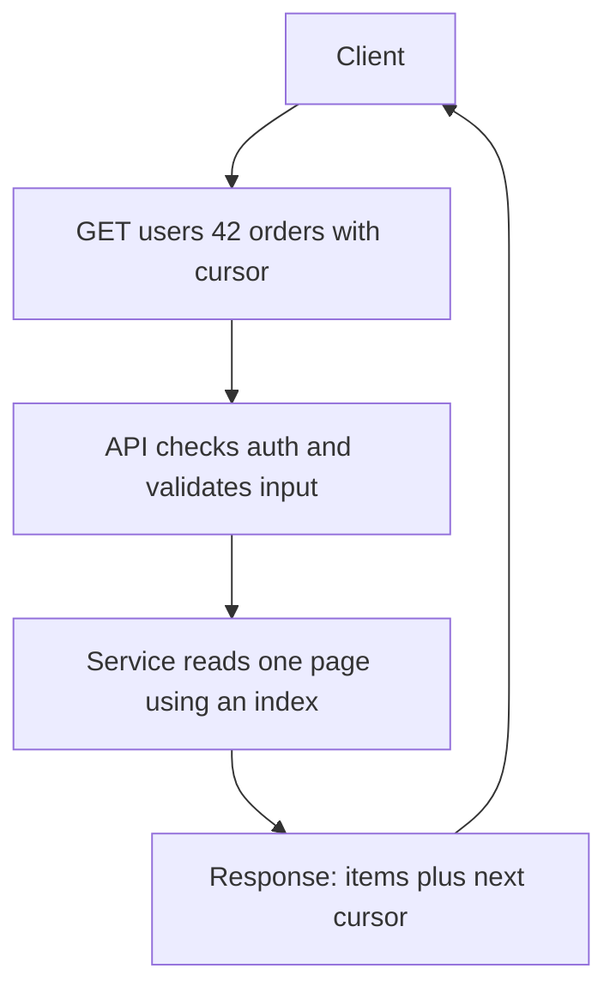

## The hook

A mobile app ships with a call to `GET /feed?page=2`. A year later the backend team changes how pages work. The app in millions of pockets cannot be updated overnight, and suddenly half your users see duplicated posts or blank screens.

APIs are the part of a system that is hardest to take back. Once a client depends on one, every change is a negotiation with code you do not control. That is why design interviews ask you to sketch the API early, and why good engineers treat it as a promise.

## The intuition

:::analogy
A restaurant menu is a contract between diners and the kitchen. Diners order by name, not by telling the chef how to cook. The kitchen can change ovens, suppliers and staff without anyone noticing, as long as "masala dosa" still arrives as a masala dosa. But if the menu suddenly renames dishes or drops one, every regular is confused.
:::

An [[API]] is that menu. Clients name what they want; the service decides how. Good API design keeps the menu clear, hard to misuse, and stable over time, even while the kitchen behind it changes completely.

## How it works

### Three styles

| Style | Shape | Best for |
|---|---|---|
| REST over HTTP | [[Resource]]s at URLs, standard methods, usually JSON | public APIs, browsers, broad compatibility |
| gRPC | typed functions defined in a Protocol Buffers [[schema]], binary messages over HTTP/2 | internal service-to-service calls, streaming |
| GraphQL | one endpoint, the client describes exactly the fields it wants | apps with varied screens that would otherwise make many calls |

### REST in one page

Model nouns, not verbs: `/users/42/orders`, not `/getOrdersForUser`. Use methods for the action:

- `GET /orders/9` reads, `POST /orders` creates, `PUT /orders/9` replaces, `PATCH` partially updates, `DELETE` removes.
- GET, PUT and DELETE are [[idempotent]]: repeating them does no extra harm. POST is not, so a retried "create payment" could charge twice; APIs that matter accept an `Idempotency-Key` header and return the first result on a repeat.
- Status codes carry meaning: `200` OK, `201` created, `400` bad input, `401` not signed in, `403` not allowed, `404` missing, `409` conflict, `429` too many requests, `500` and `503` server trouble.

### Pagination

Offset pagination (`?offset=40&limit=20`) is simple, but the database still walks past the first 40 rows, and new items inserted at the top shift everything, so users see duplicates. [[Cursor pagination]] returns an opaque `next_cursor` encoding where the page ended, such as the last item's timestamp and id. The next request says "after this cursor", which the database answers with an index seek.

:::insight
Design APIs around what clients need to do and around how data can be read efficiently. A cursor is not just nicer for clients; it lets the database jump straight to the next page instead of counting from the start.
:::

### Versioning and evolution

Additive changes are safe: new optional fields, new endpoints. A [[breaking change]] is not: removing a field, renaming it, changing its type or meaning. Common strategies are a version in the path (`/v2/orders`) or a header, plus a deprecation period with monitoring of who still calls the old version. Clients should ignore fields they do not understand, which keeps additive changes safe.

### Rate limits and errors are part of the contract

Clients need to know what happens when they misbehave or when you are overloaded. Document limits, return `429 Too Many Requests` with a `Retry-After` header, and use one consistent error shape everywhere, such as a machine-readable code, a human message and a request id for support. Clients can then retry sensibly, and on-call engineers can trace a complaint to a single request in the logs.

## Trade-offs

- **REST vs gRPC:** REST is universal and easy to debug with any HTTP tool; gRPC gives typed contracts, generated clients and compact messages, but needs tooling and is awkward directly from browsers.
- **GraphQL flexibility vs server cost:** clients fetch exactly what they need in one round trip, but a single query can become expensive, so servers need query cost limits and careful caching.
- **Chatty vs chunky:** many small calls are simple but pay a round trip each; one big call is fast but couples screens to backend shape. Mobile clients on slow networks favour fewer, larger calls.

## What can go wrong

- **Silent breaking changes** after a "harmless" rename break old app versions still in the wild.
- **Retries without idempotency** create duplicate orders or payments when a timeout hides a success.
- **Unbounded responses**: an endpoint that returns "all items" works in testing and times out in production. Always paginate lists and cap page sizes.
- **Leaky errors**: returning stack traces or internal ids helps attackers. Return a stable error code and a readable message instead.

:::warning
Common misconception: "REST means JSON over HTTP with any URLs." The core ideas are resources, uniform methods with clear semantics, and statelessness between requests. An endpoint like `POST /doEverything` with an action field in the body is a remote procedure call wearing a REST costume, and it loses caching and idempotency benefits.
:::

:::try-this
Sketch the API for a URL shortener in four lines: create a short link, redirect, get click stats, delete a link. Pick methods and status codes. (One reasonable answer: `POST /links` returns 201 with the code; `GET /{code}` returns 301 or 302 to the target; `GET /links/{code}/stats` returns 200; `DELETE /links/{code}` returns 204. The redirect uses 302 if you need every click to reach your servers for analytics.)
:::

## In the real world

Large companies often expose REST or GraphQL at the edge for apps and partners, and use gRPC between internal services, translating at an API gateway. Payment providers popularised idempotency keys for exactly the retry problem above. In interviews, writing three or four endpoints with methods, inputs, outputs and pagination in the first ten minutes, as step 3 of the [interview framework](article:system-design-interview-framework), makes the rest of the design concrete.

## Further reading

- Microsoft REST API Guidelines: https://github.com/microsoft/api-guidelines
- Google Cloud API Design Guide: https://cloud.google.com/apis/design
- gRPC documentation, "Introduction to gRPC": https://grpc.io/docs/what-is-grpc/introduction/
- GraphQL documentation, "Introduction to GraphQL": https://graphql.org/learn/

## Key takeaways

- An API is a long-lived contract, so design it around client needs and keep it stable while the implementation changes.
- REST models resources with standard methods, gRPC offers typed binary calls for internal services, and GraphQL lets clients pick exactly the fields they need.
- GET, PUT and DELETE are idempotent; risky POSTs such as payments need idempotency keys so retries do not duplicate effects.
- Cursor pagination is stable under inserts and lets the database seek directly, unlike large offsets.
- Additive changes are safe, while removing or renaming fields breaks clients and needs versioning and a deprecation period.
