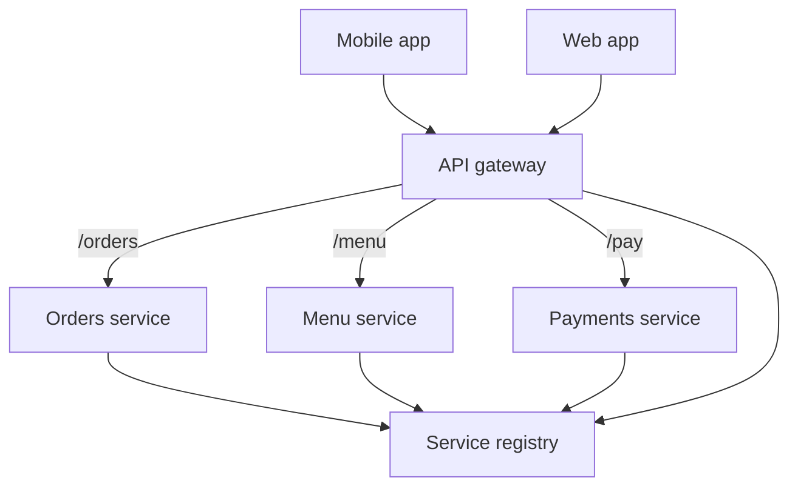

## The hook

Your food-delivery app has grown from one backend into 30 services: users, restaurants, menus, carts, orders, payments, delivery tracking, ratings, offers. The mobile app needs to talk to most of them.

Option one: the app calls all 30 directly. Every service must check login tokens, enforce rate limits, handle CORS, log requests and expose a public address. Every time a service moves or splits, every installed app must be updated.

Guess how many places the "check the login token" code ends up in. Thirty, each written slightly differently, each a chance to get security wrong. There is a better shape, and you walk through one every time you enter a mall.

## The intuition

:::analogy
A big mall has **one entrance with a security desk and a directory**. Security checks everyone once at the door. The directory tells you which floor each shop is on today, even if a shop moved last week. Shops do not each hire their own guards or print their own maps. But the security desk does not sell you shoes either: it checks, directs, and steps aside.
:::

That is an **[[API gateway]]** plus service discovery:

- The **security desk**: authentication, rate limiting, request validation, done once at the edge.
- The **directory**: routing each request to the right service, wherever its instances currently run.
- **Not selling shoes**: the gateway holds no business logic.

## How it works

### What the gateway does

| Concern | What happens at the gateway |
|---|---|
| Routing | `/orders/*` → orders service, `/menu/*` → menu service, by path, host or header |
| Authentication | Verify the token once, then pass the user identity to services in a trusted header |
| Rate limiting | Per user, per API key, per IP, before load reaches services |
| TLS termination | Decrypt at the edge; services talk inside the private network |
| Request shaping | Size limits, timeouts, maybe combining a few backend calls for one screen |
| Observability | Request ids, access logs, latency metrics for every call |

Authentication is covered in [The Front Desk and the Key Card](article:system-design-auth-basics); the gateway is where that front desk usually sits.

### Service discovery: the live directory

Services autoscale, crash and redeploy, so their addresses change constantly. Each instance registers itself in a **[[service registry]]** when it starts and sends heartbeats or passes health checks. Dead instances drop out.

Two ways to use the registry:

| | [[Client-side discovery]] | [[Server-side discovery]] |
|---|---|---|
| How | Caller queries the registry, picks an instance, calls it | Caller calls a stable address; a load balancer or proxy looks up instances |
| Load balancing | In the caller's library | In the load balancer, as in [The Host Who Seats Every Guest](article:system-design-load-balancers) |
| Pros | One fewer network hop, smart client-side choices | Callers stay simple and language-agnostic |
| Cons | Every language needs the library | An extra hop and component to run |

Many platforms make discovery feel like DNS: call `payments.internal`, and the platform resolves it to healthy instances.

Wait, why does the gateway need the registry too? Because it is just another caller: it must forward `/pay` to an instance of payments that is alive right now.

:::insight
Put the concerns every request shares (identity, limits, routing, logging) at one front door, and keep a live registry so callers find services by name rather than by address. The gateway directs traffic; the services own the business.
:::

## Trade-offs

| You gain | You give up |
|---|---|
| One place for auth, limits and TLS | An extra network hop on every request |
| Clients see one stable API while services split and move | The gateway must be highly available, or everything is down |
| Easier versioning and gradual rollouts by route | A shared component that every team depends on |
| Central metrics and request ids | Risk of the gateway becoming a bottleneck if overloaded with logic |

### Backend for frontend

Mobile screens want small, combined responses; web dashboards want richer data. A **[[backend for frontend]]** (BFF) is a thin gateway layer per client type that aggregates and shapes responses for that client. It keeps client-specific logic out of the core services, at the cost of more components to own.

:::warning
Common misconception: "the gateway is a good place for business rules, since every request passes through it." That turns the gateway into a shared monolith: every feature change needs a gateway change, one team becomes a bottleneck, and a bug there breaks everything. Keep it to routing and edge policies; put rules like pricing and discounts in the services that own the data.
:::

:::try-this
An instance of the menu service crashes without deregistering. For how long might the gateway still send it traffic, and how do you shorten that window? (Until the registry notices: one missed health-check or heartbeat cycle plus its timeout. Shorten it with frequent health checks, short registration leases, and retries on another instance when a call fails fast. Also have instances deregister on graceful shutdown.)
:::

## What can go wrong

- **Gateway as a single point of failure**: run several instances behind a load balancer, across zones.
- **Gateway overload**: heavy transformations or aggregation in the gateway add latency to every call; push them into services or BFFs.
- **Stale registry entries** send traffic to dead instances; use health checks, short leases and fast failover retries.
- **Trusting headers from outside**: if services trust a "user id" header, the gateway must strip any such header arriving from clients and set it itself.
- **Timeouts not propagated**: the gateway waits longer than the client does, wasting work; set end-to-end deadlines.

### Interview follow-ups

**"Gateway or load balancer: what is the difference?"** A load balancer spreads traffic across instances of one service. A gateway routes across many services and adds edge policies such as auth and rate limits. Gateways often use load balancing internally.

**"Where do you rate limit?"** At the gateway for per-user and per-key limits, plus protective limits inside critical services so internal callers cannot overload them.

**"How do services call each other: through the gateway?"** Usually not. The public gateway is for external traffic; internal calls use service discovery directly, sometimes through a service mesh that adds retries, mTLS and metrics.

**"How would you roll out a new version of the orders service safely?"** Route a small percentage of `/orders` traffic to the new version at the gateway (a canary), watch errors and latency, then shift more.

## In the real world

- Cloud providers offer managed API gateways, and open-source proxies such as NGINX, Envoy and Kong are widely used as gateways.
- Service registries include Consul, etcd-based platforms and the built-in service discovery of Kubernetes, where a Service name resolves to healthy pods.
- Service meshes move discovery, retries and mTLS into sidecar proxies next to each service.

The next question is whether you should have 30 services at all. The honest answer, and how to draw the boundaries if you do, is the microservices article that follows. Request design itself is covered in [The Menu Is a Promise to the Kitchen](article:system-design-api-design).

## Further reading

- The NGINX and Envoy documentation on routing and service discovery.
- Kubernetes documentation on Services and DNS-based discovery.

## Key takeaways

- An API gateway is the single front door for external traffic, handling routing, authentication, rate limiting, TLS and logging once instead of in every service.
- A service registry tracks live, healthy instances, so callers find services by name while instances scale, crash and redeploy.
- Discovery is client-side (the caller picks an instance) or server-side (a load balancer or proxy picks), trading an extra hop against simpler callers.
- Keep the gateway thin: business logic in the gateway recreates a monolith at the edge and makes every team depend on one component.
- Run the gateway redundantly, strip untrusted identity headers from clients, and propagate timeouts end to end.
